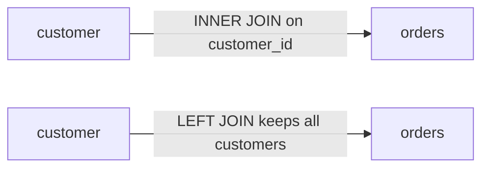
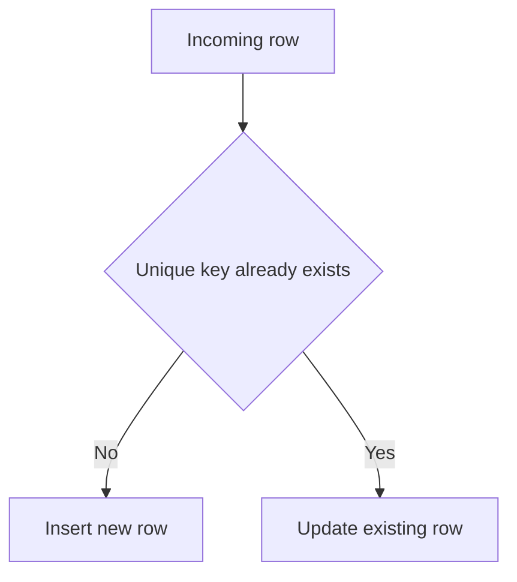
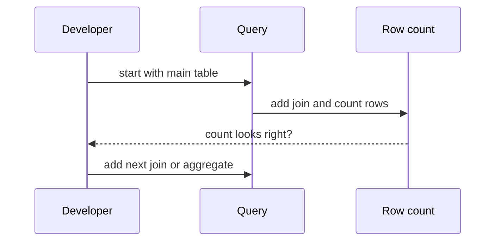

# Intermediate SQL

!!! note "In simple words"
    Most real questions need more than one table or a summary of many rows. Joins connect related tables, aggregates count or add up rows, and subqueries let one query use the result of another.

## Why it matters

The queries most applications need are not the simple ones. They filter by several conditions, combine tables, count things per customer, and find records that are missing somewhere else. Interviewers use these queries to see whether you can turn a business question into correct SQL, and whether you notice the silent problems: duplicate rows from a join, missing rows from a filter in the wrong place, or a `NOT IN` that returns nothing.

## How it works

### Filtering, sorting, and paging

```sql
SELECT DISTINCT customer_id
FROM orders
WHERE status IN ('PAID', 'SHIPPED')
  AND total_cents BETWEEN 1000 AND 50000
ORDER BY customer_id DESC
LIMIT 20 OFFSET 40;
```

`LIMIT` and `OFFSET` are not standard SQL. SQL Server uses `TOP` and `OFFSET ... FETCH`, and Oracle uses `FETCH FIRST`. A large `OFFSET` is slow because the database still reads and discards the skipped rows. For deep pagination, use keyset pagination, which asks for rows after the last one you saw:

```sql
SELECT order_id, total_cents
FROM orders
WHERE order_id > :lastSeenId
ORDER BY order_id
LIMIT 20;
```

Common row filters:

- Comparison operators (`=`, `<>`, `<`, `>=`) combined with `AND` and `OR`. Use parentheses whenever you mix `AND` and `OR`.
- `IN (...)` for a fixed list, and `BETWEEN low AND high`, which includes both ends.
- `LIKE` with `%` (any run of characters) and `_` (exactly one character). `'A%'` starts with A, and `'%li%'` contains "li".
- `IS NULL` and `IS NOT NULL`, because `= NULL` never matches.

### Joins

A join combines rows from two tables when a condition holds.

```sql
SELECT c.full_name, o.order_id, o.total_cents
FROM customer AS c
INNER JOIN orders AS o ON o.customer_id = c.customer_id;
```



| Join | Returns |
|---|---|
| `INNER JOIN` | Rows that match in both tables |
| `LEFT JOIN` | All rows from the left table, with matching right rows or NULLs |
| `RIGHT JOIN` | All rows from the right table, with matching left rows or NULLs |
| `FULL OUTER JOIN` | All rows from both sides, with NULLs where there is no match (not in MySQL) |
| `CROSS JOIN` | Every combination of rows (a Cartesian product) |
| Self-join | A table joined to itself, using two aliases |
| `NATURAL JOIN` | Joins on every column name the two tables share. Avoid it: adding a column later silently changes the join |

To find customers with no orders, join with `LEFT JOIN` and keep only the rows where the right side is missing:

```sql
SELECT c.customer_id
FROM customer AS c
LEFT JOIN orders AS o ON o.customer_id = c.customer_id
WHERE o.order_id IS NULL;
```

Put a condition on the right table inside the `ON` clause of a `LEFT JOIN`, not in `WHERE`. A `WHERE` filter on the right table removes the NULL rows, which turns the join into an inner join without any warning.

A self-join links a table to itself. Here each employee is paired with their manager:

```sql
SELECT e.full_name AS employee, m.full_name AS manager
FROM employee AS e
LEFT JOIN employee AS m ON m.employee_id = e.manager_id;
```

### Aggregates and GROUP BY

Aggregates collapse many rows into one value: `COUNT`, `SUM`, `AVG`, `MIN`, and `MAX`. `COUNT(*)` counts rows, and `COUNT(column)` skips NULLs.

```sql
SELECT customer_id,
       COUNT(*)         AS order_count,
       SUM(total_cents) AS spent_cents
FROM orders
WHERE status = 'PAID'
GROUP BY customer_id
HAVING COUNT(*) >= 3;
```

`WHERE` filters rows before grouping. `HAVING` filters groups after aggregation. Every column in `SELECT` must either appear in `GROUP BY` or sit inside an aggregate.

### Subqueries

- **Scalar subquery:** returns one value, used like a column or a constant.
- **Inline view:** a subquery in `FROM`, given an alias.
- **Correlated subquery:** refers to the outer query and runs once for each outer row.

```sql
-- Orders above the average for their own customer (correlated)
SELECT o.order_id
FROM orders AS o
WHERE o.total_cents > (
    SELECT AVG(o2.total_cents)
    FROM orders AS o2
    WHERE o2.customer_id = o.customer_id
);
```

`EXISTS` checks whether a subquery returns at least one row. It often beats `IN` on large sets because it can stop at the first match:

```sql
SELECT c.customer_id
FROM customer AS c
WHERE NOT EXISTS (
    SELECT 1 FROM orders AS o WHERE o.customer_id = c.customer_id
);
```

Prefer `NOT EXISTS` over `NOT IN` with a subquery. If the subquery returns even one NULL, `NOT IN` returns no rows at all, which is rarely what you want.

### Set operations

`UNION` combines two results and removes duplicates. `UNION ALL` keeps duplicates and is faster because it skips the duplicate check. `INTERSECT` returns rows that appear in both results. `EXCEPT` returns rows in the first result that are not in the second; Oracle calls it `MINUS`. Both sides need the same number of columns, with compatible types.

### CASE expressions

`CASE` works like an if-else inside a query:

```sql
SELECT order_id,
       CASE
           WHEN total_cents >= 10000 THEN 'large'
           WHEN total_cents >= 1000  THEN 'medium'
           ELSE 'small'
       END AS size_band
FROM orders;
```

### Updating and deleting related rows

To change rows in one table based on rows in another, use `EXISTS` or a subquery. The join form of `UPDATE` differs by vendor: MySQL allows `UPDATE orders o JOIN ...`, while PostgreSQL and SQL Server use `UPDATE ... FROM`. The `EXISTS` form works in all three.

```sql
UPDATE customer
SET tier = 'gold'
WHERE EXISTS (
    SELECT 1
    FROM orders AS o
    WHERE o.customer_id = customer.customer_id
      AND o.total_cents > 100000
);

-- Remove orders whose customer no longer exists
DELETE FROM orders
WHERE NOT EXISTS (
    SELECT 1
    FROM customer AS c
    WHERE c.customer_id = orders.customer_id
);
```

A foreign key normally prevents orphan rows, so the second statement matters mainly when a key was added late or constraints were disabled for a bulk load. Before either statement runs, run the matching `SELECT` and check the row count.

### Upsert: insert or update

An upsert inserts a row when no matching row exists, and updates it when one does. It suits syncing data from another system, where the same record can arrive more than once. Each database has its own syntax.



**MySQL** uses `ON DUPLICATE KEY UPDATE`, which fires when a unique or primary key collides. The row alias below needs MySQL 8.0.19 or later. Older examples use `VALUES(column)` inside the update clause. That still works, but it is deprecated from 8.0.20.

```sql
INSERT INTO users (id, name, email, age)
VALUES (1, 'John', 'john@example.com', 30) AS new_row
ON DUPLICATE KEY UPDATE
    name  = new_row.name,
    email = new_row.email,
    age   = new_row.age;
```

**PostgreSQL** uses `ON CONFLICT`. You name the conflict target, which must match a unique index or constraint. `EXCLUDED` refers to the row you tried to insert.

```sql
INSERT INTO users (id, name, email, age)
VALUES (1, 'John', 'john@example.com', 30)
ON CONFLICT (id) DO UPDATE SET
    name  = EXCLUDED.name,
    email = EXCLUDED.email,
    age   = EXCLUDED.age;

-- Keep the existing row and drop the new one
INSERT INTO users (id, name, email)
VALUES (1, 'John', 'john@example.com')
ON CONFLICT (id) DO NOTHING;
```

**SQL Server** uses `MERGE`, which matches source rows against target rows and can insert, update, or delete in one statement.

```sql
MERGE INTO users AS target
USING (VALUES (1, 'John', 'john@example.com', 30),
              (2, 'Jane', 'jane@example.com', 25))
      AS source (id, name, email, age)
ON target.id = source.id
WHEN MATCHED THEN
    UPDATE SET name = source.name, email = source.email, age = source.age
WHEN NOT MATCHED BY TARGET THEN
    INSERT (id, name, email, age)
    VALUES (source.id, source.name, source.email, source.age);
-- Optional: WHEN NOT MATCHED BY SOURCE THEN DELETE removes target rows
-- that are absent from the source. Add it only when that is what you want.
```

Without a native upsert, a common approach is to try the update first, and insert only when the update changed no rows. This is not atomic. Two sessions can both see that the row is missing and both insert. The unique constraint must therefore exist, and the losing insert must be caught and retried as an update.

Performance notes:

- A single native upsert is atomic: the database performs the check and the write together.
- One multi-row upsert is much faster than one statement per row.
- The conflict target needs a unique index. Without one, the database cannot detect the conflict, and you get duplicate rows.

### Step by step: writing a multi-table query

1. Identify the grain: one row per what? One per order, per customer, or per day?
2. Start with the main table and add joins one at a time, checking the row count after each join.
3. Add `WHERE` filters on the main table wherever possible.
4. Aggregate with `GROUP BY` at the grain you chose.
5. Add `HAVING`, `ORDER BY`, and paging last.



If a count looks too high after a join, a one-to-many relationship is multiplying rows. Aggregate before joining, or use `COUNT(DISTINCT ...)`, but find the cause first.

## Where it is used

- **Reports and dashboards** that summarise sales, usage, or inventory by customer, product, or day.
- **Data sync jobs** that use upserts to load records from another system.
- **Back-office screens** that show a customer with their orders and payments on one page.
- **Data quality checks** that look for rows with no matching parent, using `NOT EXISTS` or `LEFT JOIN`.

## Benefits

- **Answers real questions** in one statement instead of many round trips to the application.
- **The database does the heavy work.** Joins and aggregates run close to the data.
- **Expressive.** Subqueries, `CASE`, and set operations cover many shapes of question.
- **Atomic upserts** (where the database provides them) avoid race conditions in simple sync logic.

## Cons and limits

- **Easy to get subtly wrong.** A join that multiplies rows or a filter in the wrong clause produces a plausible but incorrect number.
- **Performance depends on indexes and plan.** A correlated subquery that runs per row can be very slow on large tables.
- **Vendor-specific syntax.** Paging, upserts, and `UPDATE ... JOIN` differ by database.
- **Deep pagination is costly.** Large `OFFSET` values read the skipped rows every time.
- **Complex queries are hard to read.** Long nested subqueries need comments or views to stay maintainable.

## Best practices

- Decide the grain of the result before writing the join.
- Check row counts after each join, and compare them with what you expect.
- Use `NOT EXISTS` rather than `NOT IN` when the subquery can return NULL.
- Put conditions on the right table of a `LEFT JOIN` in the `ON` clause.
- Avoid `NATURAL JOIN`; name the join columns explicitly.
- Use keyset pagination for long lists.
- Create a unique index for every upsert key before you rely on the upsert.
- Use `UNION ALL` unless you need the duplicate removal, and add `ORDER BY` at the end of the whole query.

!!! tip "Interview tip"
    **Q: How do you find rows in one table with no matching rows in another?**
    Use `LEFT JOIN` and filter on `IS NULL`, or use `NOT EXISTS`. Both work. `NOT EXISTS` avoids the `NOT IN` NULL trap and reads clearly. State which one you chose and why.

## Common pitfalls

- Filtering a `LEFT JOIN`'s right table in `WHERE`, which silently makes it an inner join.
- Using `NOT IN` with a subquery that can return NULL.
- Using `DISTINCT` to hide a join that multiplied rows. Fix the join instead.
- Writing `COUNT(column)` when you meant `COUNT(*)`, and missing the NULL rows.
- Assuming `UNION` preserves order. Only `ORDER BY` guarantees order.
- Using `OFFSET` for deep pagination on large tables.
- Implementing an upsert as a plain read followed by a write, with no unique constraint behind it.

## Quick recap

- Joins combine tables. `LEFT JOIN` plus `IS NULL` finds unmatched rows.
- `WHERE` filters rows before grouping; `HAVING` filters groups after.
- Use `NOT EXISTS` rather than `NOT IN` when NULLs are possible.
- Check row counts after each join. One-to-many joins multiply rows.
- Keyset pagination scales better than large `OFFSET` values.
- An upsert needs a unique constraint behind it.

## Official documentation

- [PostgreSQL documentation](https://www.postgresql.org/docs/current/) (joins, `ON CONFLICT`, and set operations)
- [MySQL 8.0 reference manual](https://dev.mysql.com/doc/) (`ON DUPLICATE KEY UPDATE`)
- [Java SE 21 API documentation](https://docs.oracle.com/en/java/javase/21/docs/api/index.html) (for JDBC callers)

**See also:** [SQL Fundamentals](sql-fundamentals.md), [Advanced SQL and Transactions](advanced-sql-transactions.md), [Query Optimisation](query-optimisation.md)
