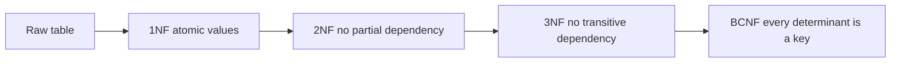

# Normalisation and Data Modelling

!!! note "In simple words"
    Normalisation means storing each fact in one place, so that when a fact changes you update it once. Data modelling is the step before you write `CREATE TABLE`, where you sketch the things you store and how they relate.

## Why it matters

Duplicated data causes bugs that are hard to find. A customer changes their city, but only some of their order rows are updated, and now two reports disagree. Normalisation prevents that class of bug by design. Interviewers ask about normal forms to check that you can spot redundancy, explain each rule in plain terms, and justify when a team should break a rule for speed.

## How it works

### Functional dependencies and keys

A functional dependency written `X -> Y` means that any two rows with the same value of `X` must also have the same value of `Y`. For example, `customer_id -> customer_city` says that a customer lives in one city. The normal forms are defined by which dependencies a table is allowed to have.

A **candidate key** is a minimal set of columns that uniquely identifies a row. The **primary key** is the candidate key you choose to use. A **superkey** is any set of columns that contains a candidate key.

### The path through the normal forms



Each form builds on the previous one. Most production schemas aim for 3NF, and check BCNF when a table has overlapping candidate keys.

### First normal form (1NF)

A table is in 1NF when every column holds an atomic (indivisible) value, and every row can be told apart from the others.

Not in 1NF:

| order_id | items |
|---|---|
| 1 | `pen, notebook, ink` |

Fix: one row per item.

| order_id | item |
|---|---|
| 1 | pen |
| 1 | notebook |
| 1 | ink |

Storing a list in one column makes it hard to filter, count, or index that data.

### Second normal form (2NF)

A table is in 2NF when it is in 1NF and every non-key column depends on the whole candidate key, not on part of it. This matters only when the key is composite, meaning it has more than one column.

Problem: a table keyed by `(order_id, product_id)` that also stores `product_name`. The name depends only on `product_id`, so it repeats for every order that contains that product. Move `product_name` into a `product` table.

### Third normal form (3NF)

A table is in 3NF when it is in 2NF and no non-key column depends on another non-key column. A dependency that runs through a second column is called a transitive dependency.

Problem: `orders(order_id, customer_id, customer_city)`. `customer_city` depends on `customer_id`, not on `order_id`. A customer moving house would require updating every order. Move the city into `customer`.

### Boyce-Codd normal form (BCNF)

A table is in BCNF when, for every non-trivial functional dependency `X -> Y`, the left side `X` is a superkey. BCNF is slightly stricter than 3NF. The difference shows up when a table has several overlapping candidate keys.

Example: a table with `student`, `course`, and `tutor`. Assume each tutor teaches only one course, so `tutor -> course`. The candidate keys are `(student, course)` and `(student, tutor)`. The dependency `tutor -> course` has `tutor` on the left, and `tutor` is not a superkey, so the table is in 3NF but not in BCNF. The fix is to split out a `tutor(tutor, course)` table.

### Denormalisation trade-offs

Normal forms protect writes. Denormalisation gives up some of that protection to make reads faster. Typical reasons:

- A reporting or read-heavy path needs a join that is too slow to run on every request.
- A derived value, such as an order total, is read often and recalculated rarely.

The cost: every copy must change together, and a missed copy becomes a silent bug. Add a constraint, a trigger, or a background job to keep the copies in sync, and document the decision so the next engineer understands it.

### Entity-relationship modelling

An entity-relationship (ER) model names the things the system stores (entities), the facts about them (attributes), and how they relate. The relationship type decides where the foreign key goes.

| Relationship | Implementation |
|---|---|
| One-to-one | A foreign key with a `UNIQUE` constraint, or the same primary key in both tables |
| One-to-many | A foreign key on the "many" side |
| Many-to-many | A junction (associative) table with two foreign keys and a composite primary key |


The matching tables:

```sql
CREATE TABLE student (
    student_id INT PRIMARY KEY,
    full_name  VARCHAR(120) NOT NULL
);

CREATE TABLE course (
    course_id  INT PRIMARY KEY,
    title      VARCHAR(160) NOT NULL
);

-- Many-to-many: a student can enrol in many courses, and a course has many students
CREATE TABLE enrolment (
    student_id  INT NOT NULL REFERENCES student (student_id),
    course_id   INT NOT NULL REFERENCES course (course_id),
    enrolled_on DATE NOT NULL,
    PRIMARY KEY (student_id, course_id)
);
```

The junction table can carry facts about the relationship itself, such as `enrolled_on` or `grade`. When it does, it is a real entity in its own right, so give it a name that reflects that, such as `enrolment`.

### Design principles

- Give every table a primary key.
- Name things consistently, either singular or plural, in snake_case, and keep to one convention.
- Use foreign keys to protect relationships in the database, not only in application code.
- Store one fact in one place, unless you have a measured reason not to.
- Model time explicitly with `created_on`, `updated_on`, and effective date ranges for history.
- Decide early between soft delete and hard delete, because the choice affects every query.

### Step by step: designing a schema for a feature

1. List the nouns (the entities) and the questions the system must answer.
2. Draw the relationships and their cardinality: one-to-one, one-to-many, or many-to-many.
3. Choose the primary keys, either natural or surrogate.
4. Normalise to 3NF, or BCNF, by checking each non-key column against each key.
5. Denormalise only where a measured read path needs it, and record the sync rule.
6. Write the constraints (foreign keys, unique, check) before you write application code.

## Where it is used

- **Any transactional schema** such as orders, payments, or accounts, where a wrong copy means a wrong bill.
- **Microservice data models**, where each service owns its tables and must keep its own facts consistent.
- **Reporting schemas** that deliberately denormalise into star or flat tables for fast reads.
- **Design reviews**, where an ER sketch is agreed before any code is written.

## Benefits

- **Fewer update anomalies.** A fact changes in one row, so readers cannot see conflicting values.
- **Smaller storage footprint.** Repeated text is not copied for every row.
- **Clear ownership.** Each table has one job, which makes the schema easier to change.
- **Constraints match the model.** Keys and foreign keys express the design directly.

## Cons and limits

- **More joins.** A fully normalised schema can make a simple screen need many joins, which costs time.
- **Over-normalising is possible.** Splitting every column into its own table makes queries hard to read and slow.
- **Denormalisation adds risk.** Copies can drift apart if the sync logic has a bug.
- **Normal forms do not cover everything.** Rules about time, history, or business policy still need explicit design.
- **Modelling takes time.** Getting the keys wrong early is expensive to change later.

## Best practices

- List the nouns and the questions the system must answer before you draw any tables.
- Draw the relationships with their cardinality (one-to-one, one-to-many, many-to-many).
- Choose primary keys that do not change. Consider a surrogate key such as an identity column when no natural key is stable.
- Normalise to 3NF, and check BCNF when a table has overlapping keys.
- Denormalise only where a measured read path needs it, and write down how the copies stay in sync.
- Write the constraints (foreign keys, unique, check, not null) before you write application code.
- Avoid nullable columns that hide missing-data rules. Make a column nullable only when "unknown" is a real business state.

!!! tip "Interview tip"
    **Q: When would you denormalise a schema?**
    When a measured read path is too slow because of joins, and the duplicated data changes rarely or can be kept in sync reliably. State the cost (write complexity and the risk of drift) and the mechanism that keeps the copies consistent, such as a constraint, a trigger, or an event-driven update.

## Common pitfalls

- Storing comma-separated lists in one column. They break 1NF and make queries hard.
- Copying a customer's name onto every order, so a name change updates some rows but not others.
- Modelling a many-to-many relationship without a junction table.
- Choosing a mutable value, such as an email address, as the primary key without a plan for changes.
- Normalising so far that every query needs ten joins, without measuring the cost.
- Making every column nullable, which hides missing-data rules.

## Quick recap

- 1NF: atomic values. 2NF: no partial dependency on a composite key. 3NF: no transitive dependency.
- BCNF: the left side of every non-trivial dependency is a superkey.
- Many-to-many needs a junction table. One-to-many puts the foreign key on the many side.
- Denormalise for measured read needs, and document how the copies stay in sync.
- Put rules in constraints, not only in application code.

## Official documentation

- [PostgreSQL documentation](https://www.postgresql.org/docs/current/) (constraints, foreign keys, and table design)
- [MySQL 8.0 reference manual](https://dev.mysql.com/doc/) (foreign keys and table design)

**See also:** [SQL Fundamentals](sql-fundamentals.md), [Query Optimisation](query-optimisation.md), [Specific Databases](specific-databases.md)
