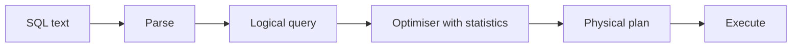
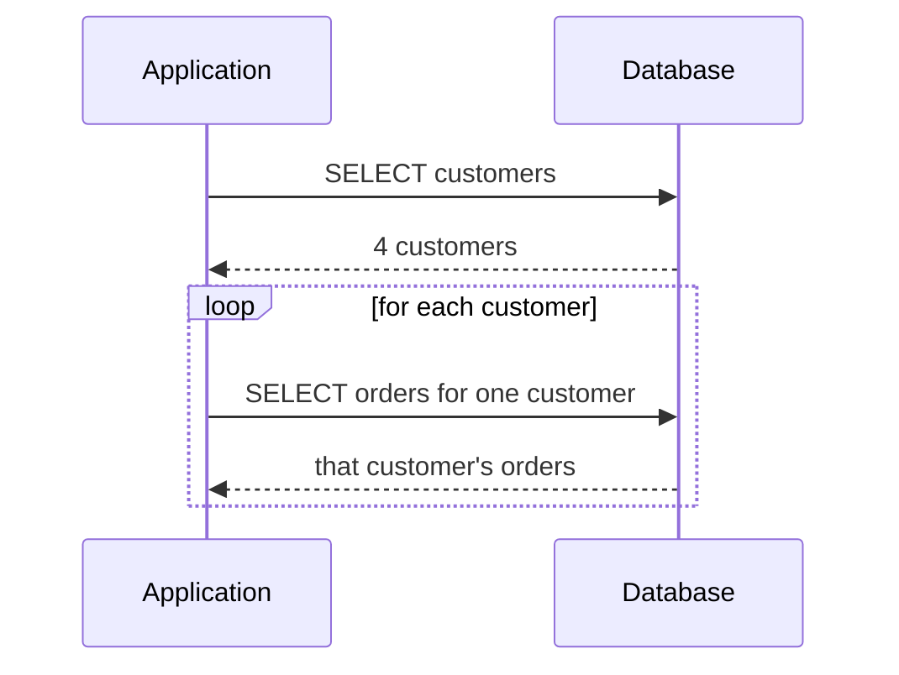
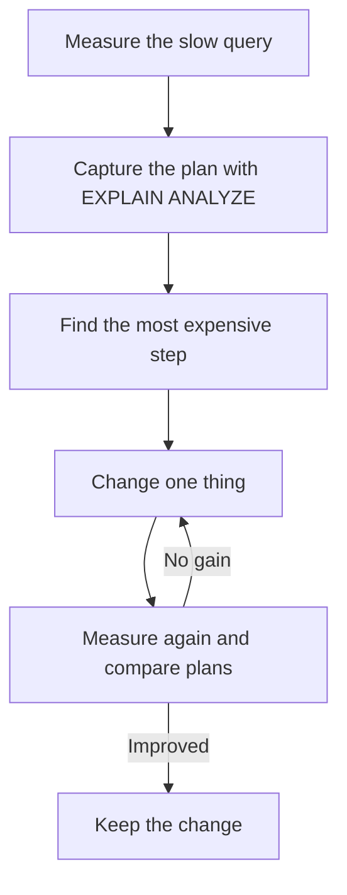

# Query Optimisation

!!! note "In simple words"
    A database can find the same answer in many ways, and some ways are far faster. Query optimisation means checking how the database runs your query, then changing the query, the indexes, or the data layout so it does less work.

## Why it matters

A query that takes 40 milliseconds on a test database can take 40 seconds in production, because the table is larger and the plan is different. Slow queries hold up request threads, exhaust connection pools, and sometimes take a whole service down. Interviewers ask about optimisation to see whether you can read an execution plan, choose an index on purpose, and recognise common problems such as N+1 queries and unnecessary full scans.

## How it works

### How the optimiser chooses a plan

Given a SQL statement, the database parses it into a logical query. The optimiser then picks a physical plan: which index to use, which join algorithm to apply, and the order in which to join the tables. It estimates the cost of each option from table statistics such as row counts and the spread of values in each column. When the statistics are stale, the estimates are wrong and the plan can be poor. Keep statistics current with `ANALYZE` in PostgreSQL or `ANALYZE TABLE` in MySQL.

Common join algorithms:

- **Nested loop:** for each outer row, look up the matches in the inner table. Fast when the inner side has an index and the outer side is small.
- **Hash join:** build a hash table on one input and probe it with the other. Good for large, unsorted inputs joined on equality.
- **Merge join:** walk two sorted inputs side by side. Good when both inputs are already sorted by the join key.



### Indexes

An index is a separate structure that maps column values to row locations. With an index, the database can find the matching rows without reading the whole table.

| Index type | Good for | Notes |
|---|---|---|
| B-tree | Equality and range queries, `ORDER BY` | The default in most relational databases |
| Hash | Exact equality lookups | Not useful for ranges; support varies by database |
| Full-text | Searching words in text | Language-aware matching; see [Specific Databases](specific-databases.md) |
| GIN, GiST (PostgreSQL) | Arrays, JSONB, full text, geometry | Specialised index methods |

Bitmap indexes are common in data-warehouse systems. Most transactional databases use bitmap scans internally, such as PostgreSQL's bitmap index scan, without exposing them as indexes you create. Describe them as a warehouse technique if you are asked.

A composite index on `(customer_id, created_on)` supports queries that filter on `customer_id` alone, and queries that filter on both columns. It does not help a filter on `created_on` alone. This is the leftmost-prefix rule.

```sql
CREATE INDEX idx_orders_customer_date ON orders (customer_id, created_on);

-- Uses the index: the leftmost column is filtered
SELECT order_id FROM orders WHERE customer_id = 42 AND created_on >= DATE '2026-01-01';

-- Usually cannot use this index efficiently
SELECT order_id FROM orders WHERE created_on >= DATE '2026-01-01';
```

Indexes are not free. Each one slows inserts and updates, takes storage, and must be maintained. Add indexes for the queries you actually run, and remove the ones nothing uses.

A unique index is also a constraint: it rejects duplicate values. Upserts need one as their conflict target (see [Intermediate SQL](intermediate-sql.md)).

Dropping an index uses vendor-specific syntax. MySQL and SQL Server use `DROP INDEX idx_orders_customer_date ON orders;`. PostgreSQL uses `DROP INDEX idx_orders_customer_date;`. PostgreSQL's `DROP INDEX CONCURRENTLY` avoids blocking writes on a busy table, and `CREATE INDEX CONCURRENTLY` does the same when creating one.

### Reading execution plans with EXPLAIN

`EXPLAIN` shows the plan the optimiser chose. `EXPLAIN ANALYZE` also runs the query and reports the actual timings and row counts. PostgreSQL supports it, and so does MySQL 8.0.18 and later.

```sql
EXPLAIN ANALYZE
SELECT customer_id, COUNT(*)
FROM orders
WHERE status = 'PAID'
GROUP BY customer_id;
```

What to look for:

- **A sequential (full table) scan** on a large table where you expected an index. Check whether the predicate is sargable (see below).
- **Estimated rows far from actual rows.** Stale statistics or correlated columns are the usual cause.
- **Sorts or hash operations spilling to disk.** Working memory may be too small, or the query returns too many rows.
- **Nested loops over large inputs.** Often a missing index on the inner side of the join.

Read the plan from the innermost node outward. In PostgreSQL, each node's cost includes the cost of its children.

### Sargable predicates

A predicate is sargable (search-argument-able) when the database can use an index to evaluate it. Wrapping the indexed column in a function, or doing arithmetic on it, usually prevents index use.

```sql
-- Not sargable: the function hides the column from the index
SELECT order_id FROM orders WHERE YEAR(created_on) = 2026;

-- Sargable: a range on the bare column
SELECT order_id FROM orders
WHERE created_on >= DATE '2026-01-01' AND created_on < DATE '2027-01-01';
```

A leading wildcard also blocks index use on a B-tree. `LIKE '%smith'` cannot use a B-tree index, but `LIKE 'smi%'` can.

### N+1 queries

The N+1 problem happens when one query fetches N parent rows, and then N more queries fetch the children of each parent. The total is N+1 queries, usually with a network round trip for each. It is the most common performance bug in ORM-based applications, because the code looks clean while the database receives hundreds of tiny queries.



Fix it with a join, a batched `IN` query, or a fetch join in JPA:

```sql
-- Instead of one query per customer:
SELECT o.*
FROM orders AS o
WHERE o.customer_id IN (1, 2, 3, 4);
```

Other tuning moves:

- Select only the columns you need.
- Push filters into subqueries or CTEs only when the optimiser cannot do it for you, and check the plan first.
- Rewrite correlated subqueries as joins or window functions when the plan shows repeated work.
- Use `UNION ALL` instead of `UNION` when duplicates are impossible or acceptable.

### Denormalisation and materialised views

Denormalisation stores redundant data to avoid joins on hot read paths. An example is a copied `customer_name` on each order. It makes writes and consistency harder, so measure before you do it (see [Normalisation and Modelling](normalisation-modelling.md)).

A materialised view stores the result of a query and refreshes it on demand or on a schedule. PostgreSQL supports `CREATE MATERIALIZED VIEW`. MySQL has no native materialised views, so teams use summary tables that a scheduled job refreshes.

### Partitioning

Partitioning splits a large table into smaller physical pieces. The database still presents them as one logical table.

| Type | Splits rows by | Example |
|---|---|---|
| Range | A range of values | Orders per month |
| List | Explicit values | Orders per country |
| Hash | A hash of a key | Spreading customers evenly |
| Composite | Two methods combined | Range by month, then hash by customer |

Partition pruning lets a query that filters on the partition key read only the relevant partitions. A query that does not filter on the key scans all of them, which can be slower than an unpartitioned table.

### Step by step: a tuning workflow



1. Measure. Find the slow query in the application logs, the slow query log, or an APM trace.
2. Capture the plan with `EXPLAIN ANALYZE` against data of realistic size.
3. Find the most expensive node, and the reason it is expensive: a scan, a sort, a spill, or a wrong row estimate.
4. Change one thing: add or fix an index, make the predicate sargable, or reduce the number of rows returned.
5. Measure again, and compare the plans. Keep the change only if it helps.

## Where it is used

- **Reporting endpoints** that aggregate large tables, where a missing index turns a second into a minute.
- **Search and listing screens** that filter and sort on several columns.
- **ORM-based services** where N+1 patterns hide inside a loop of repository calls.
- **Large event or order tables** that are partitioned by date to keep recent queries fast.

## Benefits

- **Faster responses** and less load on the database and its connection pool.
- **Lower cost** on managed databases, where work is billed by compute or I/O.
- **Predictable behaviour** when plans are checked and indexes are chosen on purpose.
- **Clear diagnosis.** A plan shows where the time goes, so you fix the cause rather than guessing.

## Cons and limits

- **Indexes cost write time and storage.** Too many indexes slow every insert and update.
- **Plans change with data.** A plan that is fast today can flip when statistics change.
- **Dev data misleads.** A small test database can pick a different plan from production.
- **Materialised views go stale** between refreshes, and refreshing them can be expensive.
- **Partitioning adds operational work.** Partitions need creating, maintaining, and dropping over time.

## Best practices

- Measure before you tune, and measure again after each change.
- Test with production-sized data, or a realistic copy of it.
- Index the columns you filter, join, and sort on, in the order the queries use them.
- Keep predicates sargable: no functions on indexed columns, and no leading wildcards.
- Keep statistics current with `ANALYZE` after large data loads.
- Fix N+1 queries with joins, batched `IN` lists, or fetch joins.
- Drop indexes that no query uses, after checking the usage statistics your database provides.
- Use `EXPLAIN ANALYZE` in code review for any new query on a large table.

!!! tip "Interview tip"
    **Q: A query is slow. What do you do first?**
    Run `EXPLAIN ANALYZE` on realistic data, and find the most expensive step. Then decide whether the fix is an index, a sargable predicate, fewer rows, or a different join. Say that you measure before and after, and that you check statistics if the estimated and actual rows differ.

## Common pitfalls

- Adding indexes without checking that the query uses them.
- Wrapping indexed columns in functions inside `WHERE` clauses.
- Assuming an index on `(a)` helps a query that filters only on `(b)`.
- Tuning on a small development dataset where the plan differs from production.
- Using `SELECT *` on wide tables, which increases I/O.
- Ignoring N+1 queries because each one is fast on its own.

## Quick recap

- The optimiser picks plans from statistics. Keep statistics current.
- B-tree indexes serve equality, ranges, and ordering. Composite indexes follow the leftmost-prefix rule.
- Read `EXPLAIN ANALYZE` for scans, sorts, and bad row estimates.
- Keep predicates sargable: no functions on indexed columns and no leading wildcards.
- Fix N+1 queries with joins, batched `IN` lists, or fetch joins.

## Official documentation

- [PostgreSQL documentation](https://www.postgresql.org/docs/current/) (EXPLAIN, indexes, and partitioning)
- [MySQL 8.0 reference manual](https://dev.mysql.com/doc/) (optimisation and `EXPLAIN ANALYZE`)

**See also:** [Intermediate SQL](intermediate-sql.md), [Normalisation and Modelling](normalisation-modelling.md), [Specific Databases](specific-databases.md)
