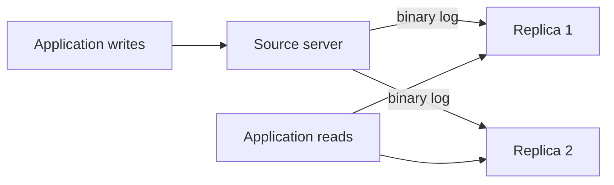
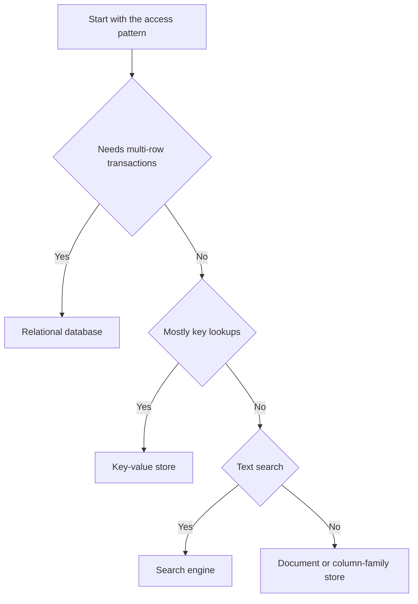

# Specific Databases

!!! note "In simple words"
    Databases are not interchangeable. MySQL, PostgreSQL, Redis, and NoSQL stores each make different trade-offs, so the right choice depends on what the feature needs to do: keep money safe, search text, serve a cache, or absorb a huge stream of writes.

## Why it matters

Interviewers often ask you to justify a database choice, not just name one. They want to hear which trade-off you accepted and why. This page covers the database features you are most likely to be asked about: MySQL storage engines, replication, and sharding; PostgreSQL's JSONB, full-text search, and extensions; Redis data structures and pub/sub; and an overview of NoSQL stores with the questions each one answers well.

## How it works

### MySQL

**InnoDB versus MyISAM.** InnoDB is the default storage engine in MySQL 5.5 and later. It supports transactions, row-level locking, and foreign keys, and it recovers cleanly after a crash. MyISAM does not support transactions and locks the whole table for writes, so it suits only read-mostly workloads that do not need transactions. For new tables, use InnoDB.

```sql
CREATE TABLE payment (
    payment_id   INT PRIMARY KEY,
    amount_cents INT NOT NULL
) ENGINE = InnoDB;
```

## Replication
Copies of data across nodes for **read scaling + high availability**.
- **Leader-follower (primary-replica)** — writes to leader, reads from replicas; async (lag) vs sync (slower).
- **Multi-leader / leaderless** (Dynamo-style) — higher availability, conflict resolution needed.
- Failover: promote a replica when the leader dies.

**Replication.** A source server (formerly called the master) records every change in its binary log. One or more replicas (formerly called slaves) read that log and apply the same changes. Replication is asynchronous by default, so a replica can lag behind the source, and a failover can lose the most recent commits. Semi-synchronous replication and group replication lower that risk, at the cost of extra latency on each write.



Read replicas scale reads, but they do not reduce the write load on the source. A read from a replica can return stale data, so send only reads that tolerate a short delay to a replica.

## Partitioning / Sharding
Split data across nodes for **write scaling** + larger datasets.
- **Horizontal (sharding)** — rows split by a **shard key** (range, hash, or directory-based).
- **Vertical** — split columns/tables by access pattern.
- **Consistent hashing** — minimizes reshuffling when nodes are added/removed.
- Challenges: cross-shard joins/transactions, hotspots (bad shard key), rebalancing.

**Sharding.** Sharding splits data across several database servers using a key, such as a customer ID. Each shard holds a subset of the rows. Sharding adds real complexity: joins and transactions across shards are hard, and changing the shard count later needs a careful migration plan. Shard only after you have tried better indexes, caching, vertical scaling, and read replicas.

## Consistency (CAP applied)
- Under a partition, choose **CP** (reject to stay consistent) or **AP** (serve, reconcile later).
- **Quorum** reads/writes (`R + W > N`) tune the consistency/availability balance.

**Performance tuning.** Read the slow query log, use `EXPLAIN` on the slow statements, and size the InnoDB buffer pool so that hot data fits in memory. Keep the primary key short. InnoDB stores the primary key value inside every secondary index entry, so a long primary key makes every index larger.

## Caching in front of the DB
Cache hot reads (Redis) to offload the database — see [Caching](../distributed-cloud/caching.md).

### PostgreSQL

**JSONB.** The `JSON` type stores the text as it was written. The `JSONB` type stores a decomposed binary form that can be indexed and searched quickly. Use `JSONB` when you need to filter on fields inside the document.

```sql
CREATE TABLE product (
    product_id INT PRIMARY KEY,
    attributes JSONB NOT NULL
);

CREATE INDEX idx_product_attributes ON product USING GIN (attributes);

SELECT product_id
FROM product
WHERE attributes @> '{"colour": "red"}';   -- containment, can use the GIN index
```

Do not turn every table into JSON. Fields that you filter on, join on, or sort by belong in ordinary columns, where constraints and statistics work properly.

**Full-text search.** PostgreSQL converts text into `tsvector` values and matches them against a `tsquery`. Language rules such as stemming let "waterproofing" match "waterproof". A GIN index on the `tsvector` expression makes searches fast. This covers many search needs without an external search engine, although dedicated engines offer richer ranking and language tooling.

```sql
SELECT product_id
FROM product
WHERE to_tsvector('english', attributes->>'description')
      @@ to_tsquery('english', 'waterproof & jacket');
```

**Window functions.** PostgreSQL supports the full window function set described in [Advanced SQL and Transactions](advanced-sql-transactions.md).

**Extensions.** PostgreSQL gains features through extensions loaded with `CREATE EXTENSION`. Common examples are `pgcrypto` for cryptographic functions, `uuid-ossp` for UUID generation (built-in UUID generation exists in recent versions too), and PostGIS for geospatial data. Check that an extension is available on your managed database service before you rely on it.

### Redis

Redis is an in-memory data store. It keeps its data in RAM and can persist it to disk. Its main value is its data structures:

| Type | Typical use |
|---|---|
| Strings | Cache entries, counters (`INCR`), feature flags |
| Lists | Simple queues, recent-items feeds |
| Sets | Unique members, tags, membership tests |
| Hashes | Objects with several fields, such as a user profile |
| Sorted sets | Leaderboards, time-ordered indexes, rate-limit windows |

```text
SET session:42 "active" EX 900      # string with a 15-minute expiry
INCR page:views                      # atomic counter
ZADD leaderboard 1520 "ana"          # sorted set: score 1520 for member "ana"
ZREVRANGE leaderboard 0 9            # top ten members
```

**Pub/sub.** Publishers send messages to channels, and subscribers receive them. Pub/sub is fire-and-forget. A subscriber that is offline when a message is sent never sees it. Use Redis Streams or a dedicated message broker when messages must not be lost.

**Transactions.** `MULTI` queues commands, and `EXEC` runs them as one unit, without other clients' commands running in between. Redis does not roll back the other commands if one fails at run time. The failing command returns an error, and the rest still run. Use `WATCH` for an optimistic check-and-set: the `EXEC` is discarded if a watched key changed.

Redis is usually a cache or a fast secondary store. It is not the system of record, unless you configure persistence and accept its trade-offs.

### NoSQL awareness

Know these stores at the level of "what kind of data model, and when would you consider it":

- **MongoDB** is a document store. It keeps JSON-like documents in collections. It suits records whose shape varies, supports secondary indexes, and supports multi-document transactions.
- **Cassandra** is a wide-column store built for write-heavy workloads spread across many nodes. You model tables around the queries you need, and it does not support joins.
- **DynamoDB** is a managed key-value and document service. You access items through a partition key and an optional sort key, so you design the access patterns first.

The common trade-off: relational databases give you joins, constraints, and transactions. NoSQL stores give you horizontal scale and flexible schemas, but you must know the access patterns in advance.

### Relational versus NoSQL at a glance

| | Relational (SQL) | NoSQL (general) |
|---|---|---|
| Schema | Fixed , structured and enforced by the database | Flexible / schemaless |
| Scaling | Usually scaled up first; sharding adds work. vertical (mostly) | Horizontal by design |
| Consistency | Strong, with ACID transactions | Tunable / eventual; often BASE (see [Advanced SQL and Transactions](advanced-sql-transactions.md)) |
| Joins | Native (yes) | Limited or absent |
| Best for | transactions, relations, Integrity-critical data and complex queries | Huge Scale, flexible data, high write throughput, varied record shapes, known access patterns |

Relational engines include MySQL, PostgreSQL, Oracle, SQL Server, and MariaDB. They share the SQL model, but they differ in syntax, extensions, and tooling. Check the vendor's syntax for upserts, paging, and identity columns before you port a query.

### NoSQL data models

| Model | Examples | Structure | Typical use | Watch for |
|---|---|---|---|---|
| Key-value | Redis, Memcached, DynamoDB | A key maps to a value the store does not interpret | Caching, sessions, counters | Lookups by key only; other queries need another index or store |
| Document | MongoDB, CouchDB, Firebase | JSON-like documents with flexible fields | Content, user profiles, catalogues | Consistency settings; work across many documents costs more |
| Column-family | Cassandra, HBase, Bigtable | Wide, sparse rows grouped into column families | High write volume, time series, scans by key | Tables are designed per query; consistency is tunable |
| Graph | Neo4j, ArangoDB | Nodes connected by typed relationships | Recommendations, social links, fraud rings | Strong for traversals; weaker for bulk aggregation |
| Search engine | Elasticsearch, Solr | Inverted index over text fields | Full-text search, log search, faceted filters | Usually a secondary index, not the system of record |

### Choosing a model from the question

| Need | Model | Example |
|---|---|---|
| Multi-row transactions and integrity | Relational | Payments, inventory |
| Records with varied fields | Document | Product catalogue |
| Very fast simple reads and writes | Key-value | Session store |
| Heavy write volume over time | Column-family | Sensor readings |
| Following relationships | Graph | Friend-of-friend queries |
| Ranked text search | Search engine | Site search |



### Step by step: choosing a database for a feature

1. List the queries, how often each runs, and the consistency the business needs.
2. Start with a relational database unless a clear requirement says otherwise.
3. Add Redis for caching, rate limits, or short-lived state.
4. Consider a document or wide-column store when the access pattern is known, the scale is high, and joins are not needed.
5. Write down the trade-off you accepted: consistency, operations effort, cost, or vendor lock-in.

## Where it is used

- **MySQL with InnoDB** for web applications and order systems that need transactions and foreign keys.
- **PostgreSQL** for complex queries, JSON documents with indexes, and built-in full-text search.
- **Redis** for caching, session storage, rate limiting, and leaderboards.
- **MongoDB** for product catalogues and content that vary in shape.
- **Cassandra or DynamoDB** for high-volume event data with known access patterns.

## Benefits

- **Right tool for the job.** Matching the store to the access pattern avoids fighting the database.
- **Mature relational options.** MySQL and PostgreSQL are well understood and well supported.
- **Speed where it counts.** Redis serves hot data from memory, and NoSQL stores scale writes across nodes.
- **Built-in features.** JSONB indexes, full-text search, and replication reduce the number of extra systems you run.

## Cons and limits

- **More systems to run.** Each extra store adds backups, monitoring, upgrades, and failure modes.
- **Replication lag.** Replicas can be behind the source, so reads from them may be stale.
- **Redis is memory-bound.** Data larger than RAM does not fit, and persistence has trade-offs.
- **Limited joins and queries in NoSQL.** Access patterns must be known in advance, and changing them later can need a new table or index.
- **Vendor differences.** Syntax and features differ, so a query that works in one relational database may need changes in another.

## Best practices

- Use InnoDB for new MySQL tables.
- Do not send reads that need the latest data to a replica.
- Shard only after the simpler options have been tried.
- Index JSONB fields that you query, and keep the fields you join on as columns.
- Treat Redis as a cache or a secondary store unless you have configured persistence and tested recovery.
- Do not rely on pub/sub for messages that must not be lost.
- Write down the access patterns before choosing a NoSQL store.

!!! tip "Interview tip"
    **Q: How would you scale reads on a relational database?**
    Add indexes and fix the slow queries first. Then add a cache such as Redis for hot, rarely changing data. Then add read replicas, and send only reads that tolerate some staleness to them. Sharding is the last step, and it changes how you write joins and transactions.

## Common pitfalls

- Using MyISAM for tables that need transactions or foreign keys.
- Treating read replicas as up to date. Replication lag makes them stale.
- Sharding too early, before indexing and caching were tried.
- Using Redis as the only copy of data without persistence and a backup plan.
- Relying on pub/sub for messages that must not be lost.
- Putting every query field inside JSON and then scanning the whole table.
- Choosing NoSQL because it is fashionable, without defining the access patterns first.

## Quick recap

- MySQL: use InnoDB. Replication is asynchronous by default. Sharding is a last resort.
- PostgreSQL: JSONB can be indexed with GIN. Full-text search uses `tsvector` and `tsquery`.
- Redis: rich data structures in memory. Pub/sub does not persist messages.
- NoSQL stores trade joins and constraints for scale and query-specific models.
- Choose a database from the access patterns, not from its popularity.

## Official documentation

- [PostgreSQL documentation](https://www.postgresql.org/docs/current/) (JSON types, full-text search, and extensions)
- [MySQL 8.0 reference manual](https://dev.mysql.com/doc/) (storage engines and replication)
- [Redis documentation](https://redis.io/docs/latest/) (data types, pub/sub, and transactions)

**Practice questions:** [Database Scaling and Architecture](../interview-questions/verbal/verbal-db-scaling-questions.md), [Databases & SQL](../interview-questions/verbal/verbal-db-questions.md)

**See also:** [Query Optimisation](query-optimisation.md), [Normalisation and Modelling](normalisation-modelling.md), [JDBC](../07-jdbc-jpa/jdbc.md)
