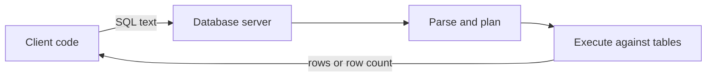
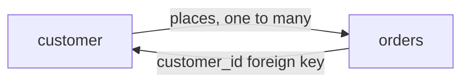
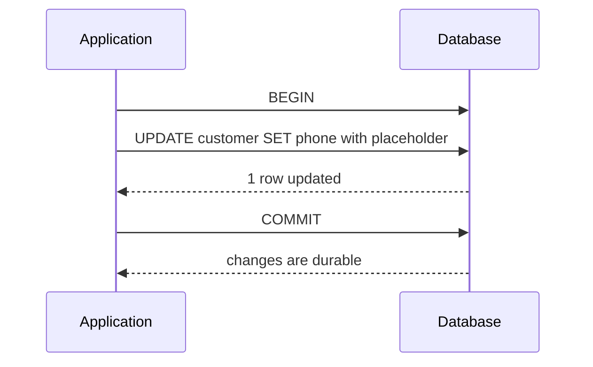

# SQL Fundamentals

!!! note "In simple words"
    A relational database stores data in tables made of rows and columns. SQL is the language you use to create those tables, put rows in them, read rows back out, and change or remove them.

## Why it matters

Almost every Java backend talks to a relational database, and almost every production incident involves data that was wrong, missing, or slow to read. SQL fundamentals are the base for everything else on this site. Interviewers start here to check that you can design a table with the right constraints, and that you can write correct reads and writes before they move on to joins, transactions, and tuning.

## How it works

### The ideas behind the tables

A **table** is a set of rows that share the same columns. A **row** is one record. A **column** has a name and a data type. A **key** identifies a row. Relational databases also enforce rules through constraints, so the database itself refuses bad data, regardless of which application sends it.



### Statement families

SQL statements fall into five groups. Interviewers sometimes ask you to name them, and the group tells you what a statement can change.

| Group | Full name | Commands | Purpose |
|---|---|---|---|
| DDL | Data Definition Language | `CREATE`, `ALTER`, `DROP`, `TRUNCATE` | Define or change schema objects |
| DML | Data Manipulation Language | `INSERT`, `UPDATE`, `DELETE` | Change rows |
| DQL | Data Query Language | `SELECT` | Read rows (many texts group this under DML) |
| DCL | Data Control Language | `GRANT`, `REVOKE` | Control which users can do what |
| TCL | Transaction Control Language | `COMMIT`, `ROLLBACK`, `SAVEPOINT` | Group changes into transactions |

### DDL: defining structure

Data Definition Language creates and changes schema objects.

```sql
-- Basic table
CREATE TABLE customer (
    customer_id  INT PRIMARY KEY AUTO_INCREMENT,
    full_name    VARCHAR(120) NOT NULL,
    email        VARCHAR(255) NOT NULL UNIQUE,
    age INT CHECK (age >= 0),
    created_at TIMESTAMP DEFAULT CURRENT_TIMESTAMP
);

-- Table with foreign key
CREATE TABLE orders (
    id INT PRIMARY KEY AUTO_INCREMENT,
    user_id INT NOT NULL,
    amount DECIMAL(10, 2),
    created_at TIMESTAMP DEFAULT CURRENT_TIMESTAMP,
    FOREIGN KEY (user_id) REFERENCES users(id) ON DELETE CASCADE
);

-- Table with composite primary key
CREATE TABLE order_items (
    order_id INT NOT NULL,
    product_id INT NOT NULL,
    quantity INT NOT NULL,
    price DECIMAL(10, 2),
    PRIMARY KEY (order_id, product_id),
    FOREIGN KEY (order_id) REFERENCES orders(id)
);

-- Create index for faster queries
CREATE INDEX idx_users_email ON users(email);
CREATE INDEX idx_orders_user_id ON orders(user_id);

ALTER TABLE customer ADD COLUMN phone VARCHAR(20);

DROP TABLE customer;          -- removes the table and its data
TRUNCATE TABLE audit_log;     -- removes all rows quickly; the table definition stays
```

Key differences:

- `DROP` removes the table definition and its data. `TRUNCATE` removes all rows and keeps the definition.
- `TRUNCATE` behaves differently by vendor. PostgreSQL and SQL Server allow it inside a transaction, so it can be rolled back. MySQL treats it as DDL that commits implicitly. Many databases also reset identity counters. Check your database before you rely on rollback.
- Identity columns generate keys automatically. The syntax varies: `AUTO_INCREMENT` in MySQL, `GENERATED BY DEFAULT AS IDENTITY` in PostgreSQL, and `IDENTITY(1,1)` in SQL Server.
- `DELETE` removes rows one at a time, accepts a `WHERE` clause, and fires triggers.

The `ADD COLUMN` form above is standard in PostgreSQL and MySQL. SQL Server writes `ALTER TABLE customer ADD phone VARCHAR(20)` without the `COLUMN` keyword.

---

### DML: reading and changing data

Data Manipulation Language reads and modifies rows.

```sql
-- Single row
INSERT INTO customer (customer_id, email, full_name)
VALUES (1, 'ana@example.com', 'Ana Silva');

-- Multiple rows
INSERT INTO users (name, email, age) 
VALUES 
    ('Bob', 'bob@example.com', 25),
    ('Charlie', 'charlie@example.com', 35),
    ('Diana', 'diana@example.com', 28);

-- Insert from another table
INSERT INTO users_backup (name, email, age)
SELECT name, email, age FROM users WHERE age > 30;

-- Insert with auto-generated ID (can retrieve with LAST_INSERT_ID())
INSERT INTO orders (user_id, amount) VALUES (1, 99.99);
SELECT LAST_INSERT_ID();  -- Returns: 1

-- Select query
SELECT customer_id, full_name
FROM customer
WHERE email = 'ana@example.com';
```

---

## UPDATE (DML)

Modify existing rows.

```sql
-- Update single row
UPDATE users 
SET age = 31, email = 'newemail@example.com'
WHERE id = 1;

-- Update multiple rows
UPDATE users 
SET active = true
WHERE created_at >= '2024-01-01';

-- Update with calculation
UPDATE orders 
SET amount = amount * 1.1  -- 10% increase
WHERE created_at < '2024-01-01';

-- UPDATE with JOIN (update based on related table)
UPDATE users u
SET subscription_level = 'premium'
WHERE EXISTS (
    SELECT 1 FROM orders o 
    WHERE o.user_id = u.id 
    AND o.amount > 1000
);

-- Be careful! Missing WHERE updates all rows
UPDATE users SET age = 25;  -- ❌ DANGEROUS: updates ALL users!
```

---

## DELETE (DML)

Remove rows.

```sql
-- Delete single row
DELETE FROM users WHERE id = 5;

-- Delete multiple rows
DELETE FROM orders 
WHERE created_at < '2020-01-01';

-- Delete with JOIN
DELETE FROM orders o
WHERE NOT EXISTS (
    SELECT 1 FROM users u WHERE u.id = o.user_id
);  -- Delete orphaned orders

-- Be careful! Missing WHERE deletes all rows
DELETE FROM users;  -- ❌ DANGEROUS: deletes ALL users!

-- Truncate: delete all rows (faster than DELETE, can't rollback)
TRUNCATE TABLE users;  -- ⚠️ Use with caution
```


Always include a `WHERE` clause in `UPDATE` and `DELETE` unless you really mean to change every row. A good habit is to run the matching `SELECT` first and check the row count.

One statement can insert many rows, or copy rows from a query. Batching like this is much faster than sending one statement per row:

```sql
INSERT INTO customer (customer_id, email, full_name)
VALUES (2, 'bo@example.com', 'Bo Lin'),
       (3, 'cy@example.com', 'Cy Park');

INSERT INTO customer_archive (customer_id, email, full_name)
SELECT customer_id, email, full_name
FROM customer
WHERE created_on < DATE '2020-01-01';
```

To get back a generated key, the syntax depends on the database. MySQL offers `LAST_INSERT_ID()` after the insert. PostgreSQL appends `RETURNING customer_id` to the statement, and SQL Server uses an `OUTPUT` clause.

---

## UPSERT (INSERT or UPDATE)

**UPSERT** — Insert if not exists, update if already exists. Use case: sync data from external sources.

### MySQL: INSERT ... ON DUPLICATE KEY UPDATE

```sql
-- If unique key/primary key exists, update; otherwise insert
INSERT INTO users (id, name, email, age)
VALUES (1, 'John', 'john@example.com', 30)
ON DUPLICATE KEY UPDATE
    name = VALUES(name),
    email = VALUES(email),
    age = VALUES(age);

-- Update only specific columns
INSERT INTO users (email, name)
VALUES ('alice@example.com', 'Alice')
ON DUPLICATE KEY UPDATE
    name = 'Alice',
    updated_at = NOW();

-- MySQL 8.0.20+: Use NEW keyword
INSERT INTO users (id, name, email)
VALUES (1, 'John', 'john@example.com')
ON DUPLICATE KEY UPDATE
    name = NEW.name,
    email = NEW.email;

-- Bulk upsert multiple rows
INSERT INTO users (id, name, email, age)
VALUES 
    (1, 'John', 'john@example.com', 30),
    (2, 'Jane', 'jane@example.com', 25),
    (3, 'Bob', 'bob@example.com', 35)
ON DUPLICATE KEY UPDATE
    name = VALUES(name),
    email = VALUES(email),
    age = VALUES(age);
```

### PostgreSQL: INSERT ... ON CONFLICT DO UPDATE

```sql
-- Insert, or update on conflict with unique/primary key
INSERT INTO users (id, name, email, age)
VALUES (1, 'John', 'john@example.com', 30)
ON CONFLICT (id) DO UPDATE SET
    name = EXCLUDED.name,
    email = EXCLUDED.email,
    age = EXCLUDED.age;

-- Conflict on composite unique key
INSERT INTO user_settings (user_id, setting_key, setting_value)
VALUES (1, 'theme', 'dark')
ON CONFLICT (user_id, setting_key) DO UPDATE SET
    setting_value = EXCLUDED.setting_value,
    updated_at = NOW();

-- Don't update, just ignore conflict
INSERT INTO users (id, name, email)
VALUES (1, 'John', 'john@example.com')
ON CONFLICT (id) DO NOTHING;
```

### SQL Server: MERGE Statement

```sql
-- Most flexible: can INSERT, UPDATE, DELETE in one statement
MERGE INTO users AS target
USING (SELECT 1 AS id, 'John' AS name, 'john@example.com' AS email, 30 AS age) AS source
ON target.id = source.id
WHEN MATCHED THEN
    UPDATE SET 
        target.name = source.name,
        target.email = source.email,
        target.age = source.age
WHEN NOT MATCHED THEN
    INSERT (id, name, email, age)
    VALUES (source.id, source.name, source.email, source.age);

-- Bulk merge
MERGE INTO users AS target
USING (VALUES 
    (1, 'John', 'john@example.com', 30),
    (2, 'Jane', 'jane@example.com', 25)
) AS source(id, name, email, age)
ON target.id = source.id
WHEN MATCHED THEN
    UPDATE SET name = source.name, email = source.email, age = source.age
WHEN NOT MATCHED THEN
    INSERT (id, name, email, age) VALUES (source.id, source.name, source.email, source.age);

-- Also allow DELETE
MERGE INTO users AS target
USING source_data AS source
ON target.id = source.id
WHEN MATCHED THEN UPDATE SET ...
WHEN NOT MATCHED THEN INSERT ...
WHEN NOT MATCHED BY SOURCE AND created_before = '2020-01-01' THEN DELETE;
```

### Alternative: Check & Do-If Pattern

For databases without native UPSERT:

```sql
-- Check if exists, then decide
SET @id = 1;
SET @name = 'John';
SET @email = 'john@example.com';

IF EXISTS(SELECT 1 FROM users WHERE id = @id)
    UPDATE users SET name = @name, email = @email WHERE id = @id;
ELSE
    INSERT INTO users (id, name, email) VALUES (@id, @name, @email);
```

### Performance Considerations

- **Single UPSERT** — Atomic, no race conditions
- **Bulk UPSERT** — Much faster than row-by-row inserts/updates
- **Indexes** — Ensure unique key is indexed for UPSERT performance

```sql
-- Create unique index for UPSERT to work efficiently
CREATE UNIQUE INDEX idx_users_email ON users(email);

-- Now upsert by email
INSERT INTO users (email, name)
VALUES ('john@example.com', 'John')
ON DUPLICATE KEY UPDATE name = VALUES(name);
```

---

## SELECT (DML)

Query and retrieve data.

```sql
-- Basic SELECT
SELECT id, name, email FROM users;

-- SELECT all columns
SELECT * FROM users;

-- WITH aliases
SELECT 
    id AS user_id,
    name AS full_name,
    email AS user_email
FROM users;

-- DISTINCT values (remove duplicates)
SELECT DISTINCT city FROM users;

-- LIMIT and OFFSET (pagination)
SELECT * FROM users LIMIT 10 OFFSET 20;  -- Skip 20, take 10
SELECT * FROM users LIMIT 20, 10;  -- MySQL shorthand (offset, limit)
```

---

### Constraints

Constraints enforce rules inside the database. Bad data is rejected whichever application writes it, including scripts, reporting tools, and future services.

| Constraint | Purpose |
|---|---|
| `PRIMARY KEY` | Unique, not-null identifier for each row; one per table |
| `FOREIGN KEY` | The value must exist in the referenced table's key |
| `UNIQUE` | No two rows share the value (how NULLs are treated depends on the database) |
| `NOT NULL` | The value must be present |
| `CHECK` | The value must satisfy a condition |
| `DEFAULT` | The value used when an insert leaves the column out |

```sql
CREATE TABLE orders (
    order_id     INT PRIMARY KEY,
    customer_id  INT NOT NULL REFERENCES customer (customer_id),
    total_cents  INT NOT NULL CHECK (total_cents >= 0),
    status       VARCHAR(20) NOT NULL DEFAULT 'NEW',
    created_on   DATE NOT NULL DEFAULT CURRENT_DATE
);
```

A foreign key with `ON DELETE CASCADE` deletes child rows automatically when the parent row is deleted. Use it on purpose, because it can remove more data than you expect.

### An ER-style view of the example

An entity-relationship view shows the tables and how they link. Here one customer places many orders.



The `orders` table holds the `customer_id` column, which points back to `customer`. That is the "many" side of the relationship, so it carries the foreign key.

### Data types

| Type | Use for | Note |
|---|---|---|
| `INT`, `BIGINT` | Whole numbers and identifiers | `INT` can overflow on long-lived IDs; `BIGINT` is safer |
| `VARCHAR(n)` | Text with a maximum length | The length limit is part of the schema |
| `DATE`, `TIMESTAMP` | Calendar dates and points in time | Decide on a time zone policy before you store timestamps |
| `DECIMAL(p, s)` | Exact money and measures | Never use `FLOAT` or `DOUBLE` for currency |
| `BOOLEAN` | True or false | Some databases map it to `TINYINT(1)` |
| `JSON` | Semi-structured data | Behaviour varies by database; see [Specific Databases](specific-databases.md) |

### NULL semantics

`NULL` means "unknown". It is not zero and it is not an empty string. Any comparison with `NULL` gives an unknown result, so `WHERE x = NULL` matches nothing. Use `IS NULL` and `IS NOT NULL`.

```sql
SELECT customer_id FROM customer WHERE phone IS NULL;
```

### Other schema objects

- **Indexes** speed up lookups and slow down writes. See [Query Optimisation](query-optimisation.md).
- **Views** are saved queries that behave like tables. A plain view stores no rows of its own; a materialised view stores its result (see Query Optimisation).
- **Triggers** run code automatically on `INSERT`, `UPDATE`, or `DELETE`. They do work the person writing the statement cannot see, so document them.
- **Stored procedures and functions** keep logic inside the database. They save round trips, but that logic then lives outside your normal code review and version control.
- **Sequences** generate numbers in PostgreSQL, Oracle, and SQL Server. An identity column is the more common choice for a single table's primary key.

### Parameterised queries and SQL injection

SQL injection happens when user input is pasted into the SQL text, so the input can change what the query does. The fix is to send the statement and the values separately, with placeholders. The database then treats the values as data, never as SQL.

```java
import java.sql.Connection;
import java.sql.PreparedStatement;
import java.sql.ResultSet;
import java.sql.SQLException;

public class CustomerLookup {
    // Unsafe alternative: "... WHERE email = '" + email + "'" lets the input rewrite the query.
    static long findCustomerId(Connection connection, String email) throws SQLException {
        String sql = "SELECT customer_id FROM customer WHERE email = ?";
        try (PreparedStatement ps = connection.prepareStatement(sql)) {
            ps.setString(1, email);
            try (ResultSet rs = ps.executeQuery()) {
                return rs.next() ? rs.getLong(1) : -1L;
            }
        }
    }
}
```

This is plain JDBC from the `java.sql` package and should compile with Java 21. It has not been run against a database.

Placeholders work for values only. Table names, column names, and sort directions cannot be bound, so check them against a fixed allow-list. ORMs and frameworks use parameters too, but a raw string built inside them is just as unsafe.

### Step by step: how a query is evaluated

A simple `SELECT` is conceptually evaluated in this order, which explains many surprises:

1. `FROM` and any joins build the set of rows to consider.
2. `WHERE` filters those rows.
3. `GROUP BY` groups the rows, and `HAVING` filters the groups.
4. `SELECT` computes the output columns.
5. `DISTINCT`, then `ORDER BY`, then `LIMIT` or `OFFSET` apply.

Because `SELECT` runs after `WHERE`, you cannot use a column alias from `SELECT` inside `WHERE` in standard SQL.

### Step by step: a write from application code



If anything fails between `BEGIN` and `COMMIT`, the application sends `ROLLBACK` and no change is kept. Transactions are covered in [Advanced SQL and Transactions](advanced-sql-transactions.md).

## Where it is used

- **Transactional systems** such as order processing, billing, and inventory, where every change must be consistent.
- **Reporting and analytics** that read from the same tables or from a copy of them.
- **Application back ends** that use JDBC, JPA, or MyBatis to talk to a database.
- **Schema migration scripts** that create and change tables as the product evolves.

## Benefits

- **Declarative.** You say what rows you want, and the database chooses how to read them.
- **Integrity in the database.** Constraints protect every writer, not just one service.
- **Mature and standard.** Most databases follow a common core, so the skills carry over.
- **Strong tooling.** Query planners, explain plans, and admin tools are built in.
- **Transactions.** Groups of changes can succeed or fail together.

## Cons and limits

- **Vendor differences.** Paging syntax, upsert, identity columns, and JSON support all vary. Code that works on one database may need changes for another.
- **Rigid schema.** Changing a table definition on a large, busy table can be slow or lock the table. Plan migrations carefully.
- **Impedance mismatch.** Rows and objects do not map one to one, which is why ORMs exist and why they can hide problems.
- **Hard to scale writes.** A single primary database has limits, and sharding adds real complexity.
- **Silent surprises.** `NULL` logic, implicit conversions, and missing `WHERE` clauses can return or change the wrong rows without an error.

## Best practices

- Give every table a primary key, and choose a key that does not change.
- Put rules in constraints (`NOT NULL`, `UNIQUE`, `CHECK`, foreign keys), not only in application code.
- Use `DECIMAL` for money. Never use `FLOAT`.
- Use `IS NULL` and `IS NOT NULL` for missing values.
- Always add `WHERE` to `UPDATE` and `DELETE`, and run the matching `SELECT` first.
- Pass user input as bound parameters. Never join it into the SQL text.
- Name the columns in application queries. Avoid `SELECT *` in production code.
- Use `ORDER BY` whenever the order of rows matters.
- Test the statements on a copy of production data before you run them against production.

!!! tip "Interview tip"
    **Q: What is the difference between `DELETE`, `TRUNCATE`, and `DROP`?**
    `DELETE` removes selected rows, can be filtered, fires triggers, and is logged row by row. `TRUNCATE` removes all rows quickly and keeps the table. `DROP` removes the table definition too. Mention that rollback support for `TRUNCATE` depends on the database.

## Common pitfalls

- Comparing to `NULL` with `=` or `<>`.
- Forgetting `WHERE` in `UPDATE` or `DELETE`.
- Storing money as `FLOAT`, which introduces rounding errors.
- Using `SELECT *` in application queries, which breaks when columns are added or reordered.
- Relying on the order of rows without `ORDER BY`. Relational tables have no inherent order.
- Treating `TRUNCATE` and `DELETE` as equivalent without checking triggers, logging, and rollback behaviour.
- Building SQL by joining user input into the query text, which opens the door to SQL injection.

## Quick recap

- DDL defines structure; DML reads and changes data; TCL groups changes into transactions.
- Constraints (PRIMARY KEY, FOREIGN KEY, UNIQUE, CHECK, NOT NULL) protect data in the database itself.
- Use `DECIMAL` for money. Never use `FLOAT`.
- `NULL` needs `IS NULL`; `= NULL` never matches.
- Logical query order: FROM, WHERE, GROUP BY, HAVING, SELECT, ORDER BY, LIMIT.
- Name the statement group (DDL, DML, DQL, DCL, TCL) when asked about a command.
- Pass user input as bound parameters, never as concatenated SQL text.

## Official documentation

- [PostgreSQL documentation](https://www.postgresql.org/docs/current/)
- [MySQL 8.0 reference manual](https://dev.mysql.com/doc/)
- [Java SE 21 API: java.sql and related packages](https://docs.oracle.com/en/java/javase/21/docs/api/index.html)

**See also:** [Intermediate SQL](intermediate-sql.md), [Normalisation and Modelling](normalisation-modelling.md)
