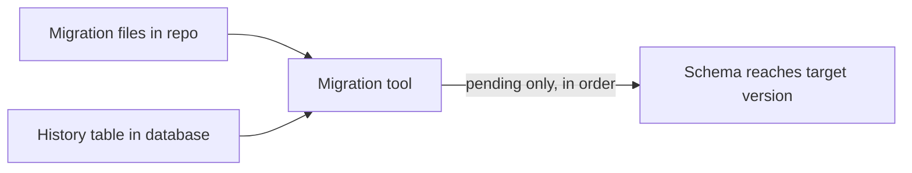
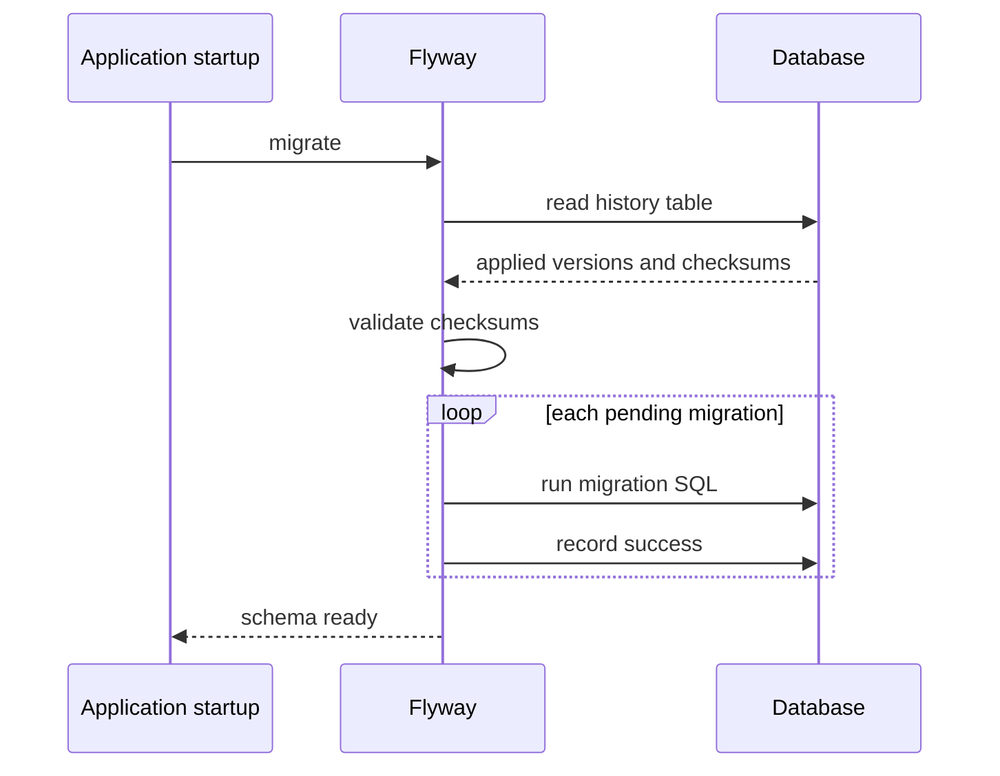
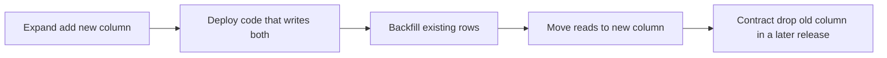

# Database Migrations

!!! note "In simple words"
    A migration is a numbered script that changes the database schema, such as adding a column. A migration tool runs the scripts in order, remembers which ones have already run, and makes sure every environment ends up with the same schema.

## Why it matters

Schemas change as a product grows. If each developer runs their own SQL by hand, one database ends up with a column that production lacks, and a deployment fails in a way nobody expected. Migration tools keep the schema history in version control and apply only the changes that are still pending. Interviewers ask about migrations to see whether you can change a live schema safely, not just create one once.

## How it works

### Why migrations exist

A migration tool keeps the schema changes in the repository, applies pending changes in order, and records each applied change in a history table. Because the history is stored in the database, running the tool again is safe: nothing that already ran runs twice.



### Flyway: versioned migrations

Flyway applies SQL migrations (or Java migrations) named by version. The default name is `V<version>__<description>.sql`, with two underscores between the version and the description.

```text
src/main/resources/db/migration/
    V1__create_customer.sql
    V2__create_orders.sql
    V3__add_phone_to_customer.sql
```

```sql
-- V1__create_customer.sql
CREATE TABLE customer (
    customer_id INT PRIMARY KEY,
    email       VARCHAR(255) NOT NULL UNIQUE
);
```

```sql
-- V3__add_phone_to_customer.sql
ALTER TABLE customer ADD COLUMN phone VARCHAR(20);
```

Flyway records each migration in a `flyway_schema_history` table, together with a checksum of the file. Its main behaviours:

- **Versioned migrations** run once, in version order.
- **Repeatable migrations** (`R__name.sql`) run again whenever their content changes. They suit views and stored procedures that are redefined as a whole.
- **Validation.** If an applied migration's file has changed, Flyway fails with a checksum mismatch. Never edit an applied migration.
- **Callbacks.** SQL or Java hooks run before or after migrations, for example to refresh statistics.
- **Undo migrations.** Some Flyway editions support them. A reverse migration written as a new forward change is the safer habit either way.

With Spring Boot, Flyway runs at startup when it is on the classpath and `spring.flyway.enabled` is not set to `false`. The settings below are a Spring Boot example, not a compiled one:

```yaml
# application.yaml (Spring Boot example)
spring:
  flyway:
    enabled: true
    locations: classpath:db/migration
    baseline-on-migrate: false   # set true only when adopting an existing database
```

### Liquibase: changelogs

Liquibase describes changes in changelogs, written as XML, YAML, JSON, or SQL. Each change is a **changeSet** with an author and an ID. Liquibase records the applied changeSets in the `DATABASECHANGELOG` table.

```yaml
# db/changelog/changelog-master.yaml
databaseChangeLog:
  - changeSet:
      id: 1-create-customer
      author: platform-team
      changes:
        - createTable:
            tableName: customer
            columns:
              - column:
                  name: customer_id
                  type: INT
                  constraints:
                    primaryKey: true
              - column:
                  name: email
                  type: VARCHAR(255)
                  constraints:
                    nullable: false
                    unique: true
```

Liquibase can express changes in a portable form, such as `createTable` and `addColumn`, or it can run raw SQL in a `sql` change. Each changeSet can declare a `rollback` block. That makes the rollback explicit, so it can be tested before it is needed.

### Flyway or Liquibase

| Concern | Flyway | Liquibase |
|---|---|---|
| Authoring | Plain SQL files, the simplest option | XML, YAML, JSON, or SQL changelogs |
| Portability | You write database-specific SQL | Abstract change types for many databases |
| Rollback | Forward-only is the norm | Rollback blocks per changeSet |
| Mental model | Ordered files | ChangeSets with IDs and authors |

Both work well with Spring Boot. Pick one per project, and do not run both against the same schema.

### Startup sequence with Flyway



When the application starts with Flyway enabled:

1. Flyway connects and creates its history table if it does not exist.
2. It reads the migration files and compares them with the history table.
3. It validates the checksums of the migrations that were already applied.
4. It runs each pending migration in version order and records each success.
5. If a migration fails, the application does not start. The failure is recorded so you can diagnose it.

### Schema changes on a live system

Rollbacks are hard once data has been written. Three strategies cover most cases:

- **Expand and contract.** Add the new column or table first (expand). Deploy code that writes to both the old and new structures, backfill the existing rows, and move reads to the new structure. Remove the old column in a later release (contract). Each step stays backward compatible, so the application can be rolled back at any point.
- **Forward fix.** When a migration is wrong, write a new migration that corrects it. Reverting an applied migration rewrites history that other environments have already run.
- **Backups before risky changes.** A tested backup and restore procedure is the real rollback for destructive changes.



Never rename or drop a column that the currently running application still reads.

### Testing migrations

- Run all migrations against an empty database in CI. That proves the full history applies from the start.
- Run large or data-changing migrations against a copy of production-like data.
- Use a disposable container of the same database engine and version as production, rather than an in-memory substitute that behaves differently. Testcontainers is a common library for this.
- Measure the runtime on realistic volumes. An `ALTER TABLE` that rewrites a large table can lock it for a long time.

## Where it is used

- **Service startup** in Spring Boot applications, where Flyway or Liquibase brings the schema up to date before the app serves requests.
- **Deployment pipelines** that run migrations as a separate step before the new version starts.
- **Shared databases** where several teams or services depend on one schema, and changes must be coordinated.
- **Reference data** such as country lists or product categories, which are seeded and changed the same way.

## Benefits

- **Repeatable.** Every environment reaches the same schema by the same steps.
- **Reviewable.** Schema changes go through code review like any other change.
- **Auditable.** The history table shows what ran, when, and with which checksum.
- **Safer releases.** Failures show up at startup or in CI, not in the middle of a request.

## Cons and limits

- **Forward-only in practice.** Automatic rollback of data changes is usually not realistic, so recovery depends on fixes and backups.
- **Long locks.** Some schema changes lock tables while they run, which can block traffic on a busy system.
- **Two tools, one schema.** Running Flyway and Liquibase against the same database causes conflicts in their history tables.
- **Database-specific SQL.** Flyway scripts are tied to one engine, unless you write portable changes in Liquibase.
- **Startup coupling.** Running migrations at app startup means every instance may try to migrate, so you need locking and a clear rule for who runs them.

## Best practices

- Keep migrations in version control, next to the code that depends on them.
- Never edit an applied migration. Write a new one.
- Make each migration small and focused on one change.
- Add new columns as nullable, or with a default, and backfill before you make them required.
- Use expand and contract for renames, type changes, and drops.
- Test every migration on an empty database and on a production-like engine with realistic data.
- Run migrations as a deployment step, or let one instance hold a lock while it migrates.
- Keep backups and a tested restore procedure for risky changes.

!!! tip "Interview tip"
    **Q: How do you change a column in a live system without downtime?**
    Use expand and contract. Add the new column, write to both, backfill existing rows, move reads to the new column, and remove the old one in a later release. Every step must be compatible with the application version that is still running, so you can roll back the code at any point.

## Common pitfalls

- Editing a migration after it has been applied in any environment.
- Running schema changes by hand in production without recording them.
- Adding a `NOT NULL` column without a default to a populated table.
- Dropping or renaming a column in the same release that stops using it.
- Relying on an in-memory database for tests when production uses a different engine.
- Running Flyway and Liquibase against the same schema.

## Quick recap

- Migrations are versioned, ordered, and recorded in a history table.
- Flyway uses `V<version>__name.sql` files. Liquibase uses changeSets in XML, YAML, JSON, or SQL.
- Never edit an applied migration. Write a forward fix instead.
- Use expand and contract for schema changes on live systems.
- Test migrations on an empty database and on a production-like engine with realistic data.

## Official documentation

- [Spring Boot reference documentation](https://docs.spring.io/spring-boot/reference/index.html) (library: how Spring Boot runs Flyway and Liquibase at startup)
- [PostgreSQL documentation](https://www.postgresql.org/docs/current/) (the engine behind the examples; `ALTER TABLE` locking behaviour)
- [MySQL 8.0 reference manual](https://dev.mysql.com/doc/) (`ALTER TABLE` and DDL behaviour)

**See also:** [JDBC](jdbc.md), [Normalisation and Modelling](../06-databases-sql/normalisation-modelling.md), [Index](index.md)
