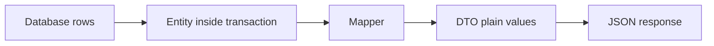

# DTOs and Mapping

!!! note "In simple words"
    A DTO (data transfer object) is a small, plain object that carries exactly the data one caller needs. A mapper copies values from the database entity into that DTO, so the entity never leaves the service layer.

## Why it matters

An entity describes how data is stored. It can contain lazy associations, internal IDs, audit fields, and methods that only work inside a transaction. If a controller returns an entity directly, the API becomes tied to the table layout, and JSON serialisation can trigger database queries at the wrong moment. Interviewers ask about DTOs to check that you keep persistence entities out of the API, and to see whether you can explain the trade-off between compile-time and reflection-based mapping.

## How it works

### The DTO pattern and its benefits

A DTO describes what a caller needs:

- **A stable contract.** The API shape stays the same when the table changes.
- **No accidental data exposure.** Fields such as password hashes or internal flags are simply not in the DTO.
- **No lazy loading surprises.** The DTO holds plain values, so serialising it cannot touch the database.
- **Shaped for the use case.** One screen may need three fields from two tables, and the DTO carries exactly those.

Java records make DTOs short and immutable:

```java
public record OrderDto(Long id, String status, int lineCount) {
}
```

Records became a standard feature in Java 16. The generated constructor, accessors, `equals`, `hashCode`, and `toString` suit DTOs well.



### Manual mapping

Writing the mapping by hand is explicit and easy to test. It is the right choice for a small project.

```java
import java.util.List;

// Minimal stand-ins so the example compiles on its own. Not the real entity.
class Order {
    long getId() { return 1L; }
    String getStatus() { return "NEW"; }
    List<String> getLines() { return List.of(); }
}

record OrderDto(long id, String status, int lineCount) { }

public class OrderMapping {

    static OrderDto toDto(Order order) {
        return new OrderDto(order.getId(), order.getStatus(), order.getLines().size());
    }

    static List<OrderDto> toDtos(List<Order> orders) {
        return orders.stream().map(OrderMapping::toDto).toList();
    }
}
```

`getLines().size()` touches a lazy collection. Call this inside the transaction, or load the data with a fetch join. The mapper is the place where that decision should be visible.

### MapStruct: compile-time mapping

MapStruct generates mapper implementations at compile time, through an annotation processor. The generated code is ordinary Java. It is fast, easy to step through, and checked at build time. A mismatch between source and target properties fails the build, or produces a warning, depending on the configuration.

```java
import org.mapstruct.Mapper;
import org.mapstruct.Mapping;

// MapStruct example: not compiled here. Needs the MapStruct processor on the build path.
@Mapper(componentModel = "spring")
public interface OrderMapper {

    @Mapping(target = "lineCount", expression = "java(order.getLines().size())")
    OrderDto toDto(Order order);
}
```

Configure the processor on the compiler path. In Maven, use `annotationProcessorPaths`. In Gradle, use the `annotationProcessor` configuration. The `componentModel = "spring"` option makes the generated class a Spring bean, so it can be injected.

MapStruct also maps to and from Java records through their constructors, which makes it a good match for DTO records.

### ModelMapper: reflection-based mapping

ModelMapper maps properties at runtime by inspecting names and types. It needs little configuration for simple cases, so it is quick to start with. The cost is that mistakes appear at runtime, and reflection adds overhead to each call.

```java
import org.modelmapper.ModelMapper;

// ModelMapper example: not compiled here. Needs the ModelMapper library.
public class ModelMapperDemo {

    private static final ModelMapper MODEL_MAPPER = new ModelMapper();

    static OrderDto toDto(Order order) {
        return MODEL_MAPPER.map(order, OrderDto.class);
    }
}
```

Keep one configured instance and reuse it. Creating a new mapper for every request throws away its cached setup. Check the library's documentation before you rely on it for records, because record support depends on the version. Its property-matching rules can map the wrong field without any error when names are similar, so write a test for each mapping.

### Choosing between them

| Concern | MapStruct | ModelMapper |
|---|---|---|
| When mapping is checked | Compile time | Runtime |
| Mechanism | Generated plain Java | Reflection |
| Runtime overhead | Very low | Higher |
| Debugging | Read the generated class | Step through reflection |
| Setup for complex rules | Explicit `@Mapping` annotations | Configuration API |
| Silent mismatches | Reported at build time | Possible at runtime |

For performance-sensitive or large APIs, prefer MapStruct. For a small project where only a few fields differ, manual mapping is often clearer than either library.

### Performance considerations

- Mapping cost is usually small compared with the database call that loaded the data. Measure before you optimise.
- Reflection-based mapping does lookups and allocations on every call. At high request rates, that shows up in profiles.
- Mapping thousands of entities allocates many objects. Consider projections, so the database returns only the columns you need.
- Keep mapping out of the database transaction when it does not need the database. That releases the connection sooner. The exception is lazy fields, which must be read before the transaction closes.

### Projections as an alternative

A JPA constructor expression, or a Spring Data DTO projection, lets the database return only the columns you need, already in the DTO's shape. No entity is loaded at all.

```java
import jakarta.persistence.EntityManager;
import java.util.List;

// JPQL constructor expression (JPA example: not compiled here).
// The query builds the DTO directly.
List<OrderDto> rows = entityManager.createQuery(
        "select new com.example.orders.OrderDto(o.id, o.status, size(o.lines)) from Order o",
        OrderDto.class).getResultList();
```

The class name in the query must be the fully qualified name of the DTO. Check the SQL that `size(o.lines)` produces. Depending on the provider, it may run a count for each row, unless the database computes it in a subquery.

### Step by step: building a response from an entity

1. The service loads the entity, or a projection, inside a transaction.
2. The mapper converts it to a DTO, reading any lazy data it needs while the session is still open.
3. The transaction ends. The DTO holds only plain values.
4. The controller serialises the DTO to JSON.

For writes, the reverse happens. The request body is validated, mapped to a command or an entity, and only then saved.

## Where it is used

- **REST controllers** that return order summaries, customer profiles, or invoice lists.
- **Service-to-service calls** where a stable message shape matters more than the internal model.
- **List screens** where a projection is enough, and loading full entities would waste memory.
- **Requests and commands** on the way in, where a DTO is validated and then mapped to an entity.

## Benefits

- **Decoupling.** The API and the database schema can change independently, as long as the mapping is updated.
- **Safety.** Sensitive or internal fields cannot leak, because they are not in the DTO.
- **Predictable serialisation.** Plain values serialise without touching the database.
- **Clear contract.** The DTO documents exactly what a caller receives.

## Cons and limits

- **More classes.** Each use case may need its own DTO, which adds code to write and review.
- **Mapping code can drift.** A new field must be added to both the entity and the mapper.
- **Reflection costs time.** ModelMapper's runtime work matters on hot paths.
- **Silent mistakes.** A similar field name can be mapped to the wrong property without any error.
- **Lazy data still needs care.** The mapper must run while the session is open, or the data must already be loaded.

## Best practices

- Never return JPA entities from controllers.
- Use Java records for immutable response DTOs, and for request DTOs where validation is simple.
- Prefer MapStruct for large APIs, and keep the mapper mechanical. Business rules belong in the service.
- Map inside the transaction when lazy fields are involved, and load the data with a fetch join or projection first.
- Create one mapper instance and reuse it.
- Test every mapping that has a rename, a computed field, or a nested object.
- Use projections for list screens, and map full entities only for detail screens.

!!! tip "Interview tip"
    **Q: MapStruct or ModelMapper, and why?**
    MapStruct generates plain Java at compile time, so mismatches fail the build and the runtime overhead is low. ModelMapper uses reflection at runtime. It is quicker to start with, but it costs more and can hide mismatches until a test runs. For a high-traffic API, say you would pick MapStruct, and explain why.

## Common pitfalls

- Returning entities from controllers. This exposes internal fields and can trigger lazy loading during JSON serialisation.
- Mapping lazy associations after the transaction has closed.
- Using ModelMapper on a hot path without measuring it.
- Letting a mapper silently map a field with a similar name to the wrong one.
- Creating a new ModelMapper instance for every request.
- Putting business rules inside the mapper. Keep mappers mechanical.

## Quick recap

- DTOs decouple the API from the entity model, and they prevent lazy loading during serialisation.
- Java records are a concise way to write immutable DTOs.
- MapStruct maps at compile time. ModelMapper maps at runtime through reflection.
- Projections let the database return DTO-shaped results directly.
- Map inside the transaction when lazy fields are involved.

## Official documentation

- [Spring Data JPA reference documentation](https://docs.spring.io/spring-data/jpa/reference/index.html) (library: DTO and interface projections)
- [Spring Framework reference documentation](https://docs.spring.io/spring-framework/reference/) (library: controllers and JSON serialisation)
- [Java SE 21 API documentation](https://docs.oracle.com/en/java/javase/21/docs/api/index.html) (records and `java.util.stream`)

**See also:** [JPA and Hibernate](jpa-hibernate.md), [Spring Data JPA](spring-data-jpa.md), [Database Migrations](database-migrations.md)
