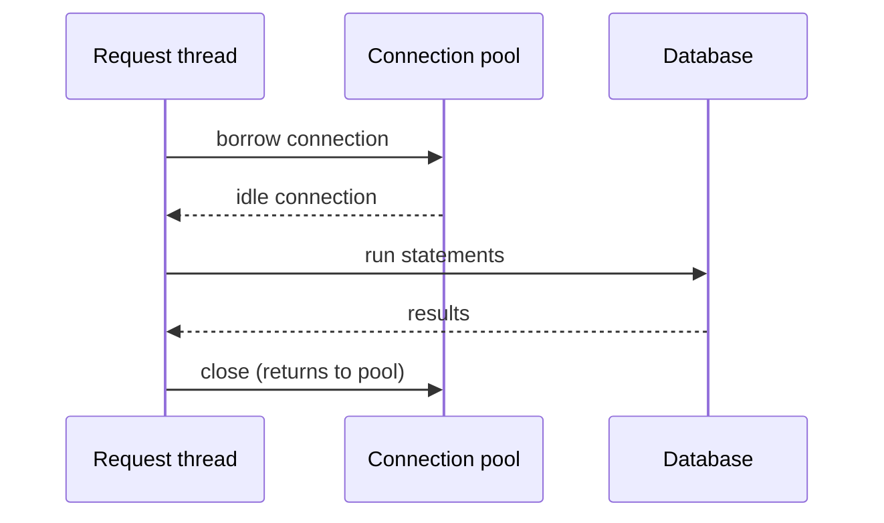
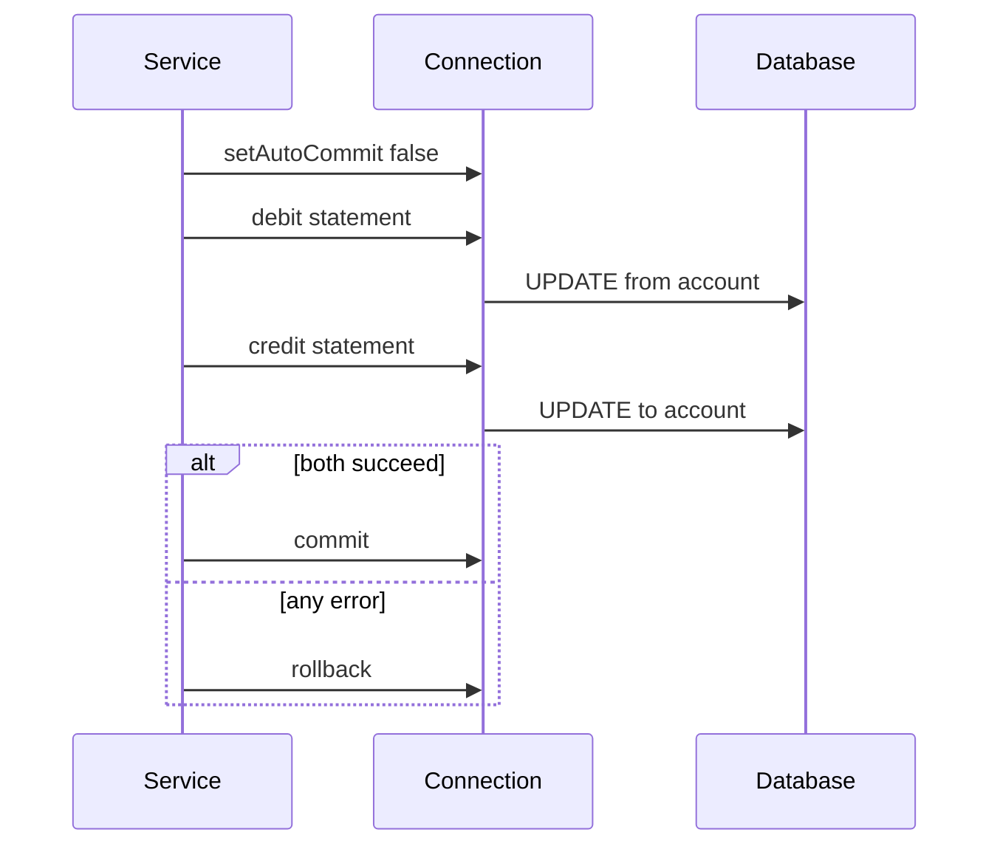

# JDBC

!!! note "In simple words"
    JDBC is the standard Java way to send SQL to a database and read the rows that come back. A vendor driver does the low-level talking, and your code works with a small set of interfaces such as `Connection`, `PreparedStatement`, and `ResultSet`.

## Why it matters

Every higher-level tool in the Java database stack runs on JDBC. JPA and Hibernate, Spring's `JdbcTemplate`, and MyBatis all end up calling it. Interviewers ask about JDBC because the questions show whether you understand what happens underneath: how connections are opened and reused, why a `PreparedStatement` is safe, how a transaction is started and ended, and how resources must be closed so the application does not leak them.

## How it works

### Architecture and drivers

The `java.sql` and `javax.sql` packages define the API. Each database vendor ships a **driver** that implements those interfaces. Your code depends on the interfaces, and the driver JAR is a runtime dependency.


JDBC driver types:

| Type | Description | Status |
|---|---|---|
| 1 | JDBC-ODBC bridge | Removed in Java 8; do not use |
| 2 | Native API partly in Java | Needs client libraries installed on each machine |
| 3 | Network protocol through middleware | Needs a middleware server |
| 4 | Pure Java, speaks the database protocol directly | The usual choice today |

Since JDBC 4.0, drivers on the classpath register themselves through `ServiceLoader`, so you rarely call `Class.forName` by hand. `DriverManager` is the older way to get a connection. In applications you usually get connections from a `DataSource`, which is usually backed by a pool.

```java
import java.sql.Connection;
import java.sql.DriverManager;
import java.sql.SQLException;

public class ConnectDemo {
    public static void main(String[] args) throws SQLException {
        String url = "jdbc:postgresql://localhost:5432/shop";   // example URL
        try (Connection conn = DriverManager.getConnection(
                url, "app_user", System.getenv("DB_PASSWORD"))) {
            System.out.println("Connected: " + !conn.isClosed());
        }
    }
}
```

This should compile with Java 21 when a PostgreSQL driver is on the classpath. Read the password from the environment or from configuration. Never put it in source code.

### Step by step: running a query

1. Get a `Connection` from the `DataSource`. The pool lends one.
2. Prepare the SQL with `?` placeholders.
3. Bind the parameters with typed setters such as `setLong` and `setString`.
4. Execute with `executeQuery` for reads, or `executeUpdate` for writes.
5. Read the `ResultSet` into objects, then close all the resources.
6. Commit or roll back if you turned auto-commit off.

### Connection pooling

Opening a connection is expensive: the driver must authenticate, negotiate settings, and set up a session on the server. Applications therefore keep a **pool** of open connections and lend them out. HikariCP is the default pool in Spring Boot. Other pools include Apache Tomcat JDBC and C3P0.



The two most important pool settings are the maximum pool size and the connection timeout. A pool that is too large can overload the database, because each connection is a session that uses server memory and CPU. A pool that is too small makes requests wait for a connection. Size the pool from the database's capacity, not from the number of users.

### Statements

| Type | Use it for |
|---|---|
| `Statement` | Fixed SQL with no parameters. Avoid it for anything that takes input. |
| `PreparedStatement` | Parameterised SQL. The default choice. |
| `CallableStatement` | Stored procedures and functions, with IN, OUT, and INOUT parameters. |

The execute methods:

- `executeQuery()` returns a `ResultSet` for a `SELECT`.
- `executeUpdate()` returns the number of affected rows for `INSERT`, `UPDATE`, or `DELETE`.
- `execute()` returns a boolean and handles any statement, including those that return several results.

### PreparedStatement and SQL injection

A `PreparedStatement` sends the SQL text and the parameter values separately. The database parses the SQL once, and the values are treated as data, never as SQL. Building SQL with string concatenation allows SQL injection.

```java
import java.sql.Connection;
import java.sql.PreparedStatement;
import java.sql.ResultSet;
import java.sql.SQLException;

public class CustomerLookup {

    static long findCustomerId(Connection conn, String email) throws SQLException {
        // Vulnerable alternative: "... WHERE email = '" + email + "'"
        // An input such as "x' OR '1'='1" would change the query.

        // Safe: the value is bound as data
        String sql = "SELECT customer_id FROM customer WHERE email = ?";
        try (PreparedStatement ps = conn.prepareStatement(sql)) {
            ps.setString(1, email);
            try (ResultSet rs = ps.executeQuery()) {
                return rs.next() ? rs.getLong(1) : -1L;
            }
        }
    }
}
```

Parameters cannot replace table or column names. Validate those against an allow-list that your code controls.

### ResultSet

A `ResultSet` is a cursor over query results. Its type controls how it can move:

- `TYPE_FORWARD_ONLY` (the default) moves forward only and uses the least memory.
- `TYPE_SCROLL_INSENSITIVE` and `TYPE_SCROLL_SENSITIVE` move in both directions. Support depends on the driver.

Its concurrency mode is `CONCUR_READ_ONLY` (the default) or `CONCUR_UPDATABLE`. Read columns by name or by index. SQL `NULL` has a trap: `getInt` returns `0` for NULL, so call `wasNull()` right after reading a primitive, or use `getObject` for a boxed value.

### BLOB and CLOB values

A BLOB column holds binary data, and a CLOB column holds long text. JDBC maps them to `java.sql.Blob` and `java.sql.Clob`. Small values can go in as a `byte[]` or a `String`. Large values should be streamed, so the whole value never sits in memory at once.

| Direction | Small value | Large value, streamed |
|---|---|---|
| Write BLOB | `setBytes(index, byte[])` | `setBinaryStream(index, InputStream)` |
| Write CLOB | `setString(index, String)` | `setCharacterStream(index, Reader)` |
| Read BLOB | `getBytes(column)` | `getBinaryStream(column)` |
| Read CLOB | `getString(column)` | `getClob(column)`, then read the `Clob` in pieces |

```java
import java.io.IOException;
import java.io.InputStream;
import java.io.Reader;
import java.nio.file.Files;
import java.nio.file.Path;
import java.nio.file.StandardCopyOption;
import java.sql.Clob;
import java.sql.Connection;
import java.sql.PreparedStatement;
import java.sql.ResultSet;
import java.sql.SQLException;

public class DocumentStore {

    // Small binary value: send the bytes directly
    static void saveThumbnail(Connection conn, long id, byte[] thumbnail) throws SQLException {
        try (PreparedStatement ps = conn.prepareStatement(
                "INSERT INTO document (id, thumb) VALUES (?, ?)")) {
            ps.setLong(1, id);
            ps.setBytes(2, thumbnail);
            ps.executeUpdate();
        }
    }

    // Large binary value: stream the file into the BLOB column
    static void saveFile(Connection conn, long id, Path file) throws SQLException, IOException {
        try (PreparedStatement ps = conn.prepareStatement(
                "INSERT INTO document (id, content) VALUES (?, ?)");
             InputStream in = Files.newInputStream(file)) {
            ps.setLong(1, id);
            ps.setBinaryStream(2, in);
            ps.executeUpdate();
        }
    }

    // Large text value: stream the reader into the CLOB column
    static void saveText(Connection conn, long id, Path textFile) throws SQLException, IOException {
        try (PreparedStatement ps = conn.prepareStatement(
                "UPDATE document SET body = ? WHERE id = ?");
             Reader reader = Files.newBufferedReader(textFile)) {
            ps.setCharacterStream(1, reader);
            ps.setLong(2, id);
            ps.executeUpdate();
        }
    }

    // Read a BLOB by streaming it into a file
    static void readFile(Connection conn, long id, Path target) throws SQLException, IOException {
        try (PreparedStatement ps = conn.prepareStatement(
                "SELECT content FROM document WHERE id = ?")) {
            ps.setLong(1, id);
            try (ResultSet rs = ps.executeQuery()) {
                if (rs.next()) {
                    try (InputStream in = rs.getBinaryStream("content")) {
                        if (in != null) {          // null means SQL NULL
                            Files.copy(in, target, StandardCopyOption.REPLACE_EXISTING);
                        }
                    }
                }
            }
        }
    }

    // Read a CLOB through the Clob locator, then release it
    static String readText(Connection conn, long id) throws SQLException {
        try (PreparedStatement ps = conn.prepareStatement(
                "SELECT body FROM document WHERE id = ?")) {
            ps.setLong(1, id);
            try (ResultSet rs = ps.executeQuery()) {
                if (!rs.next()) {
                    return null;
                }
                Clob clob = rs.getClob("body");
                if (clob == null) {
                    return null;
                }
                try {
                    return clob.getSubString(1, (int) clob.length());   // positions start at 1
                } finally {
                    clob.free();
                }
            }
        }
    }
}
```

Points to remember:

- Read the value while the `ResultSet` and the transaction are still open. Some drivers invalidate a `Blob` or `Clob` locator when the result set or transaction ends.
- `Blob` and `Clob` positions are 1-based, not 0-based.
- Call `free()` on a locator when you finish with it, so the driver can release its resources. `readText` shows this.
- The one-argument stream setters are JDBC 4.0 forms that do not take a length. Some drivers still need the length, so check your driver's documentation.
- `readText` copies the whole value into one `String`. For very large text, read through `getCharacterStream` in chunks instead.

### Batches

A batch sends many statements in one round trip, which cuts network latency.

```java
import java.sql.Connection;
import java.sql.PreparedStatement;
import java.sql.SQLException;
import java.util.List;

public class CustomerBatch {

    static void insertEmails(Connection conn, List<String> emails) throws SQLException {
        String sql = "INSERT INTO customer (email) VALUES (?)";
        try (PreparedStatement ps = conn.prepareStatement(sql)) {
            for (String email : emails) {
                ps.setString(1, email);
                ps.addBatch();
            }
            ps.executeBatch();
        }
    }
}
```

Batching helps only when the driver supports it and the batch is large enough to matter. Many drivers also offer an option to rewrite batches into multi-row statements, which is worth checking. For very large loads, commit in chunks rather than in one giant transaction.

### Stored procedures

`CallableStatement` calls a stored procedure. The `{call ...}` escape syntax is portable across drivers. The procedure `count_orders` below is an example; it must exist in your database.

```java
import java.sql.CallableStatement;
import java.sql.Connection;
import java.sql.SQLException;
import java.sql.Types;

public class CallProc {

    static long orderCount(Connection conn, long customerId) throws SQLException {
        try (CallableStatement cs = conn.prepareCall("{call count_orders(?, ?)}")) {
            cs.setLong(1, customerId);
            cs.registerOutParameter(2, Types.BIGINT);
            cs.execute();
            return cs.getLong(2);
        }
    }
}
```

### Resource management

Every `Connection`, `Statement`, and `ResultSet` holds resources. Close them with try-with-resources. It closes them in the reverse of the order they were opened, even when an exception is thrown. A `Connection` you borrow from a pool is returned to the pool when you close it, not destroyed.

### Transactions in JDBC

JDBC runs in auto-commit mode by default, so each statement commits on its own. For a unit of work, turn auto-commit off, run the statements, and then call `commit()` or `rollback()`. Use savepoints for a partial rollback.



```java
import java.sql.Connection;
import java.sql.PreparedStatement;
import java.sql.SQLException;

public class Transfer {

    static void move(Connection conn, long fromId, long toId, long cents) throws SQLException {
        boolean previousAutoCommit = conn.getAutoCommit();
        conn.setAutoCommit(false);
        try (PreparedStatement debit = conn.prepareStatement(
                 "UPDATE account SET balance = balance - ? WHERE account_id = ?");
             PreparedStatement credit = conn.prepareStatement(
                 "UPDATE account SET balance = balance + ? WHERE account_id = ?")) {
            debit.setLong(1, cents);
            debit.setLong(2, fromId);
            debit.executeUpdate();

            credit.setLong(1, cents);
            credit.setLong(2, toId);
            credit.executeUpdate();

            conn.commit();
        } catch (SQLException e) {
            conn.rollback();
            throw e;
        } finally {
            conn.setAutoCommit(previousAutoCommit);   // restore what the pool expects
        }
    }
}
```

Returning a connection to a pool with auto-commit off, or with a transaction still open, leaks that state into the next user of the connection. Always restore it. The `Transfer` example above has no balance check. A production version should guard the debit with `AND balance >= ?` and check the row count, as shown in [Advanced SQL and Transactions](../06-databases-sql/advanced-sql-transactions.md).

## Where it is used

- **Data access layers** in plain Java services, where a framework would add more than it saves.
- **Under JPA, MyBatis, and JdbcTemplate.** Knowing JDBC explains what those tools do on each call.
- **Batch jobs and data imports** that load large files and need batching and streaming.
- **Calling stored procedures** that already hold business logic in the database.

## Benefits

- **Standard API.** The same interfaces work with every relational database that has a driver.
- **Full control.** You decide exactly which SQL runs and how it is bound and read.
- **Low overhead.** There is no mapping layer between the statement and the result.
- **Good fit for streaming and bulk work.** Batches, streamed BLOBs, and forward-only cursors keep memory low.

## Cons and limits

- **Verbose.** Mapping each row to an object by hand takes a lot of code.
- **Easy to leak resources.** A missed `close()` exhausts the pool and stalls the service.
- **Checked exceptions everywhere.** `SQLException` forces handling or propagation at every layer.
- **Vendor differences.** Driver options, `CallableStatement` behaviour, and LOB handling vary by database.
- **Manual transactions.** Auto-commit and commit or rollback logic are easy to get wrong.

## Best practices

- Use `PreparedStatement` for every statement that takes input.
- Use a `DataSource` backed by a pool, and size the pool from the database's capacity.
- Close every resource with try-with-resources. Never close a pooled connection's underlying session yourself.
- Read the password from the environment or a secrets store.
- Check `wasNull()` or use `getObject` when a column can be NULL.
- Restore auto-commit before a connection returns to the pool.
- Do not swallow `SQLException`. Log it with context, or rethrow it.
- Stream large BLOB and CLOB values, and free the locators you open.

!!! tip "Interview tip"
    **Q: Why does a `PreparedStatement` prevent SQL injection?**
    The SQL structure is sent and parsed separately from the values, so bound values are treated as data and never as SQL keywords. It can also let the database reuse the query plan. It does not protect identifiers such as table names, so those need an allow-list.

## Common pitfalls

- Concatenating user input into SQL.
- Forgetting to close a `ResultSet` or `Connection`, which exhausts the pool.
- Calling `getInt` on a NULL column and getting `0`. Check `wasNull()` or use `getObject`.
- Leaving auto-commit off when a connection goes back to the pool.
- Opening a new connection per request instead of using a pool.
- Catching `SQLException` and ignoring it, which hides failed writes.

## Quick recap

- JDBC is the base API. Drivers are type 4 in modern use, and type 1 is gone.
- Use `PreparedStatement` for all input-driven SQL.
- Pools such as HikariCP (the default in Spring Boot) manage connections. Always close and reset what you borrow.
- Batches reduce round trips. `CallableStatement` runs stored procedures.
- Turn auto-commit off for multi-statement work, and roll back on failure.

## Official documentation

- [Java SE 21 API documentation](https://docs.oracle.com/en/java/javase/21/docs/api/index.html) (the `java.sql` and `javax.sql` packages)
- [PostgreSQL documentation](https://www.postgresql.org/docs/current/) (the database behind the examples)
- [Spring Boot reference documentation](https://docs.spring.io/spring-boot/reference/index.html) (library: connection pool defaults and `JdbcTemplate`)

**See also:** [JPA and Hibernate](jpa-hibernate.md), [Spring Data JPA](spring-data-jpa.md), [SQL Advanced and Transactions](../06-databases-sql/advanced-sql-transactions.md)
