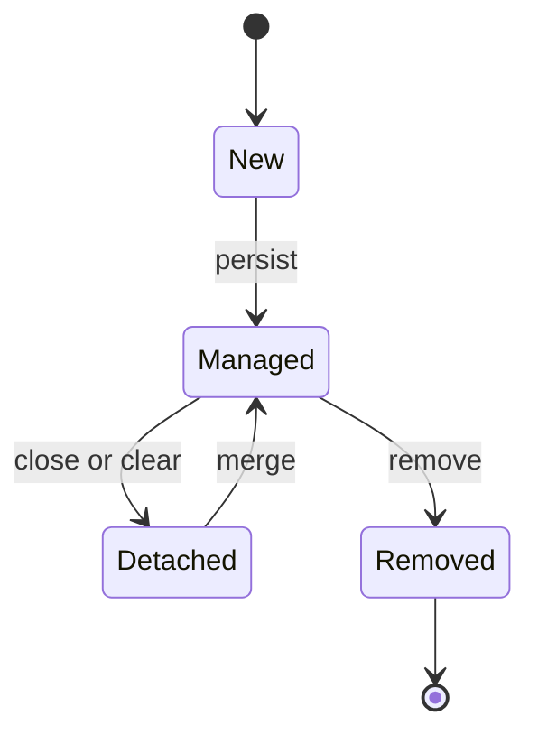

# JPA and Hibernate

!!! note "In simple words"
    JPA lets you treat database rows as Java objects. You mark a class as an entity, and the persistence layer loads, tracks, and saves it for you. Hibernate is the most common engine that does this work.

## Why it matters

JPA removes much of the SQL that a service would otherwise write by hand. The cost is hidden behaviour: a save that quietly becomes an UPDATE, a lazy field that fails outside a transaction, or a loop that fires one query per row. Interviewers ask about JPA to see whether you understand what happens behind `save()`, why lazy loading breaks outside a transaction, and how to avoid N+1 queries.

## How it works

### Entities and mapping

An entity is a class mapped to a table. The API lives in the `jakarta.persistence` package, which Spring Boot 3 uses. Older code uses `javax.persistence`.

```java
import jakarta.persistence.*;
import java.util.ArrayList;
import java.util.List;

@Entity
@Table(name = "orders")
public class Order {

    @Id
    @GeneratedValue(strategy = GenerationType.IDENTITY)
    private Long id;

    @Column(nullable = false, length = 20)
    private String status = "NEW";

    @OneToMany(mappedBy = "order", cascade = CascadeType.ALL, orphanRemoval = true)
    private List<OrderLine> lines = new ArrayList<>();

    protected Order() {                        // JPA requires a no-argument constructor
    }

    public Long getId() { return id; }
    public String getStatus() { return status; }
    public List<OrderLine> getLines() { return lines; }

    public void addLine(OrderLine line) {
        lines.add(line);
        line.setOrder(this);                  // keep both sides of the relationship in sync
    }
}
```

```java
import jakarta.persistence.*;

// Same package as Order
@Entity
public class OrderLine {

    @Id
    @GeneratedValue(strategy = GenerationType.IDENTITY)
    private Long id;

    @ManyToOne(fetch = FetchType.LAZY, optional = false)
    @JoinColumn(name = "order_id")
    private Order order;

    private String sku;
    private int quantity;

    protected OrderLine() {
    }

    public OrderLine(String sku, int quantity) {
        this.sku = sku;
        this.quantity = quantity;
    }

    void setOrder(Order order) { this.order = order; }
}
```

These classes should compile with Java 21 when Jakarta Persistence is on the classpath. `@Table`, `@Id`, `@GeneratedValue`, and `@Column` control the table and column mapping.

### Relationships, fetch defaults, and cascades

| Annotation | Default fetch | Typical use |
|---|---|---|
| `@OneToOne` | EAGER | One-to-one |
| `@OneToMany` | LAZY | Parent to children |
| `@ManyToOne` | EAGER | Child to parent (set LAZY explicitly) |
| `@ManyToMany` | LAZY | Many-to-many through a join table |

The side that holds `@JoinColumn` owns the foreign key. The side with `mappedBy` is the inverse side, and Hibernate ignores it when it writes. `cascade` passes operations such as persist, remove, and merge on to related entities. `orphanRemoval = true` deletes a child that is removed from its parent's collection.

Set `@ManyToOne` to lazy explicitly. The JPA default is eager, which can load far more data than the caller needs.

### Fetch strategies and JOIN FETCH

`LAZY` loads an association when it is first accessed. `EAGER` loads it together with the parent. A lazy association is a proxy that queries the database on first access. If the session is closed by then, the access throws `LazyInitializationException`.

To load what you need in one query, use `JOIN FETCH`:

```java
import jakarta.persistence.EntityManager;
import java.util.List;

// JPQL: returns orders with their lines in one SQL statement (JPA example)
List<Order> orders = entityManager.createQuery(
        "select distinct o from Order o join fetch o.lines where o.status = :status", Order.class)
    .setParameter("status", "NEW")
    .getResultList();
```

`distinct` removes the duplicate parent rows that the join creates. Do not fetch two `List` collections in one query. The result becomes a cross product, and Hibernate may reject it with a `MultipleBagFetchException`. Hibernate's `@Fetch` annotation chooses the SQL strategy (`SELECT`, `JOIN`, or `SUBSELECT`). Batch loading is a separate setting, `@BatchSize`.

### Queries

- **JPQL** queries entities and their attributes rather than tables. It is portable across JPA providers.
- **HQL** is Hibernate's superset of JPQL. For everyday queries the two are almost the same.
- **Criteria API** builds queries as typed Java objects. It suits dynamic filters but is verbose.
- **Native SQL** runs raw SQL through `createNativeQuery`. Use it for database-specific features, and map the results carefully.

Always bind parameters with `:name` or `?1`. Concatenating strings into JPQL carries the same injection risk as concatenating SQL in JDBC.

### Lifecycle and dirty checking

An entity moves between states. A managed entity's changes are written at flush time, without an explicit update call. Hibernate finds those changes by comparing the entity with a snapshot of its loaded state. This is called dirty checking.



Lifecycle callbacks run on those transitions:

```java
import jakarta.persistence.*;
import java.time.Instant;

@Entity
public class Customer {

    @Id
    private Long id;

    private Instant createdAt;
    private Instant updatedAt;

    @PrePersist
    void onCreate() {
        createdAt = Instant.now();
        updatedAt = createdAt;
    }

    @PreUpdate
    void onUpdate() {
        updatedAt = Instant.now();
    }
}
```

Keep callbacks simple. A callback that calls other services is hard to test and easy to get wrong.

### Auditing timestamps

Filling `created` and `updated` columns by hand in every service is easy to forget. Hibernate's `@CreationTimestamp` and `@UpdateTimestamp` fill them automatically.

```java
import jakarta.persistence.*;
import java.time.Instant;
import org.hibernate.annotations.CreationTimestamp;
import org.hibernate.annotations.UpdateTimestamp;

@Entity
@Table(name = "invoices")
public class Invoice {

    @Id
    @GeneratedValue(strategy = GenerationType.IDENTITY)
    private Long id;

    @CreationTimestamp
    @Column(nullable = false, updatable = false)   // written once, on insert
    private Instant createdAt;

    @UpdateTimestamp
    @Column(nullable = false)                      // refreshed on every update
    private Instant updatedAt;
}
```

- `@CreationTimestamp` sets the value on insert. `updatable = false` protects it from later changes.
- `@UpdateTimestamp` sets the value on insert and again whenever a flush writes changes. An unchanged entity keeps its old value.

Prefer `Instant` or `OffsetDateTime` for stored timestamps. A `LocalDateTime` has no time zone, so it is ambiguous when the application runs in more than one zone.

Some writes skip these annotations, and interviewers often test this. A bulk JPQL or HQL update runs in the database and never touches the entity, so `updatedAt` stays stale unless the query sets it. Lifecycle callbacks such as `@PreUpdate` do not run for bulk updates either. Native SQL and direct JDBC writes bypass Hibernate completely.

Spring Data offers a portable alternative with `@CreatedDate`, `@LastModifiedDate`, and `@EnableJpaAuditing`. The Hibernate annotations need no setup, but they are specific to Hibernate.

### The persistence context

The `EntityManager` (Hibernate's `Session` underneath) holds the **persistence context**, which is also the first-level cache. Within one context, loading the same ID twice returns the same Java object. The cache lasts as long as the context, usually one transaction. A second-level cache is optional, shared across sessions, and needs its own configuration and invalidation rules.

### Detached entities and merge

An entity becomes detached when its context closes. Changes to a detached object are not saved. `merge()` copies the detached object's state onto a managed copy and returns that copy. Use the returned instance, not the original argument.

### ID generation strategies

The `@GeneratedValue` strategy decides where an identifier comes from. Choose it with the target database in mind.

| Strategy | Source of the ID | Notes |
|---|---|---|
| `IDENTITY` | Auto-increment column | Simple. Hibernate must run the INSERT to learn the ID, so insert batching is limited |
| `SEQUENCE` | Database sequence | Preferred on PostgreSQL, Oracle, and similar. `allocationSize` must match the sequence's increment |
| `TABLE` | Rows in a helper table | Portable, but slow under contention. Rarely the right choice now |
| `AUTO` | Chosen by the dialect | Convenient, but the strategy can change when you switch databases |
| Assigned in code | Your application | UUIDs created in the application, and imports that carry their own IDs |

```java
import jakarta.persistence.*;

@Entity
public class Invoice {

    @Id
    @GeneratedValue(strategy = GenerationType.SEQUENCE, generator = "invoice_seq")
    @SequenceGenerator(name = "invoice_seq", sequenceName = "invoice_seq", allocationSize = 50)
    private Long id;   // the database sequence must be created with INCREMENT BY 50
}
```

A UUID assigned in code needs no database round trip, and it stays unique across services:

```java
import jakarta.persistence.Entity;
import jakarta.persistence.Id;
import java.util.UUID;

@Entity
public class Shipment {

    @Id
    private UUID id = UUID.randomUUID();   // assigned before persist
}
```

Spring Data treats an entity with a non-null ID as existing, so `save` calls `merge` for it. That can add a SELECT before the INSERT. Implement `Persistable` or use a version field when this matters.

### persist, save, merge, and update

The four operations differ in the state the entity must be in when you call them.

| Operation | Expected input | Result | Typical use |
|---|---|---|---|
| `persist` (JPA `EntityManager`) | New (transient) | Managed; INSERT at flush or commit | Creating new entities |
| `save` (Spring Data) | New or detached | Returns the managed instance | Everyday repository writes |
| `merge` (JPA) | Detached | Returns a new managed copy; the argument stays detached | Writing back a detached object |
| `update` (Hibernate `Session`) | Detached | Reattaches the same object for an UPDATE | Rare. Hibernate-native; `EntityManager` has no `update` method |

Spring Data's `save` calls `persist` for a new entity. An entity is new when its ID is null, or, if it has a version attribute, when that version is null. Otherwise `save` calls `merge`.

In a Spring service (a library example, not compiled here), `em.find` inside a `@Transactional` method returns a managed object, and changing it is enough: dirty checking writes the UPDATE at commit. `em.merge` on a detached object returns a new managed copy, so the service must return or use that copy.

### Flush and dirty checking in practice

- A flush sends pending SQL to the database. It always runs before a commit. In the default `AUTO` mode it also runs before a query that touches the affected tables, so the query sees the pending changes.
- `em.flush()` sends pending SQL now, still inside the transaction. `em.clear()` detaches every entity, which helps in long batch jobs.
- Without a transaction there is no commit point. A read returns a detached entity, unless open-session-in-view is active, so later changes are never written.

### Cascade types

| Type | Effect on children |
|---|---|
| `PERSIST` | Persisted with the parent |
| `MERGE` | Merged with the parent |
| `REMOVE` | Removed with the parent |
| `REFRESH` | Reloaded with the parent |
| `DETACH` | Detached with the parent |
| `ALL` | All of the above |

`orphanRemoval = true` goes further: a child removed from the collection is deleted. Use cascades for children the parent owns, such as order lines. Cascading `REMOVE` across a shared association deletes rows that other parents still use.

### Many-to-many and one-to-one

A many-to-many association needs a join table. One side owns it with `@JoinTable`, and the other side points back with `mappedBy`.

```java
import jakarta.persistence.*;
import java.util.HashSet;
import java.util.Set;

@Entity
class Student {
    @Id @GeneratedValue(strategy = GenerationType.IDENTITY)
    Long id;

    @ManyToMany
    @JoinTable(name = "student_course",
            joinColumns = @JoinColumn(name = "student_id"),
            inverseJoinColumns = @JoinColumn(name = "course_id"))
    Set<Course> courses = new HashSet<>();
}

@Entity
class Course {
    @Id @GeneratedValue(strategy = GenerationType.IDENTITY)
    Long id;

    @ManyToMany(mappedBy = "courses")
    Set<Student> students = new HashSet<>();
}
```

A one-to-one works the same way: the side with `@JoinColumn` owns the foreign key, and the inverse side uses `mappedBy`. Update both sides in code, as the `addLine` helper above does.

### Composite keys with @EmbeddedId and @MapsId

A join entity can use a composite key made of two foreign keys. `@MapsId` says that the `order` association supplies one part of that key.

```java
import jakarta.persistence.*;
import java.io.Serializable;
import java.util.Objects;

@Embeddable
class OrderItemKey implements Serializable {
    Long orderId;
    Long productId;

    @Override
    public boolean equals(Object o) {
        return o instanceof OrderItemKey k
                && Objects.equals(orderId, k.orderId)
                && Objects.equals(productId, k.productId);
    }

    @Override
    public int hashCode() {
        return Objects.hash(orderId, productId);
    }
}

@Entity
class OrderItem {
    @EmbeddedId
    OrderItemKey id;

    @ManyToOne(optional = false)
    @MapsId("orderId")
    Order order;   // the Order entity shown earlier on this page
}
```

The embedded key must implement `Serializable`, and its `equals` and `hashCode` must use every key field.

### Choosing identifiers

- Use a surrogate key (a `Long` from `IDENTITY` or `SEQUENCE`, or a `UUID`) as the primary key.
- Keep natural keys such as e-mail addresses as unique constraints, not as primary keys. If a natural key changes, it must change in every foreign key.
- Use UUIDs when IDs are created outside the database, for example by distributed services or offline clients. They are larger and index less compactly than sequential numbers.

### Batch fetching

When a join fetch is not possible, for example because you need pagination, batch fetching loads the children of several parents in one query. `@BatchSize` is Hibernate-specific. The portable form is the setting `hibernate.default_batch_fetch_size`.

```java
import jakarta.persistence.*;
import java.util.ArrayList;
import java.util.List;
import org.hibernate.annotations.BatchSize;

@Entity
class Department {
    @Id
    Long id;

    @OneToMany(mappedBy = "department")
    @BatchSize(size = 20)
    List<Employee> employees = new ArrayList<>();
}

@Entity
class Employee {
    @Id
    Long id;

    @ManyToOne(fetch = FetchType.LAZY)
    Department department;
}
```

### StatelessSession for bulk work

A `StatelessSession` has no persistence context: no first-level cache, no dirty checking, no cascades, and no lazy loading. It suits bulk inserts, where tracking every entity wastes memory. Each call writes immediately, and entity listeners are not called. Open it with `emf.unwrap(SessionFactory.class).openStatelessSession()`, and commit in chunks.

```java
import java.util.List;
import org.hibernate.SessionFactory;
import org.hibernate.StatelessSession;
import org.hibernate.Transaction;

class RowImporter {

    static <T> void insertAll(SessionFactory sessionFactory, List<T> rows) {
        StatelessSession session = sessionFactory.openStatelessSession();
        try {
            Transaction tx = session.beginTransaction();
            for (T row : rows) {
                session.insert(row);
            }
            tx.commit();
        } finally {
            session.close();
        }
    }
}
```

### Step by step: what happens during persist

1. The entity becomes managed and receives its ID.
2. Cascades run. Children mapped with `CascadeType.PERSIST` are persisted too.
3. At flush, Hibernate computes the SQL from the changes and sends it.
4. On commit, the transaction ends, the context closes, and the entities become detached.

## Where it is used

- **Service layers** in Spring Boot or Jakarta EE applications that model an aggregate, such as an order with its lines.
- **CRUD-heavy domains** such as accounts, catalogues, and customer records.
- **Bulk importers** that use `StatelessSession` or batching for large loads.
- **Repositories** built on Spring Data JPA, which wrap these entities (see [Spring Data JPA](spring-data-jpa.md)).

## Benefits

- **Less SQL to write.** Basic CRUD is generated, and the mapping is declared in one place.
- **Automatic change tracking.** Dirty checking writes only what changed.
- **A first-level cache.** Repeated loads within one transaction reuse the same object.
- **Portability.** The JPA API lets you change providers, and JPQL works across them.
- **A clear object model.** Relationships are expressed as fields and collections.

## Cons and limits

- **Hidden queries.** Lazy loading and cascades can trigger SQL that is not visible in the calling code.
- **The N+1 problem.** Loading parents and then children one by one is the most common performance bug.
- **Lazy loading outside a transaction** throws `LazyInitializationException`.
- **Bulk operations bypass the model.** Callbacks, timestamps, and the persistence context do not see bulk JPQL or native SQL changes.
- **Identity strategy limits.** `IDENTITY` restricts insert batching.
- **Equality is tricky.** `equals` and `hashCode` based on mutable fields, or on an ID not yet assigned, can break `Set` membership.
- **Open-session-in-view** keeps the session open for the whole web request. Spring Boot enables it by default and logs a warning. It hides lazy-loading mistakes and holds a connection longer.

## Best practices

- Mark `@ManyToOne` and `@OneToMany` as `LAZY`, and load what you need with `JOIN FETCH`, an entity graph, or batch fetching.
- Fetch two `List` collections in separate queries, never in one.
- Use the instance returned by `merge()`, and do not keep using the detached argument.
- Use `Instant` for stored timestamps, and set bulk-update timestamps in the query.
- Use `SEQUENCE` on PostgreSQL and Oracle, with an `allocationSize` that matches the database.
- Base `equals` and `hashCode` on a stable business key, or on identity with care.
- Turn off open-session-in-view, fetch explicitly in the service layer, and use `em.clear()` or `StatelessSession` in long batch work.

!!! tip "Interview tip"
    **Q: What is the N+1 problem and how do you fix it?**
    Loading N parents, then running one query for each parent's children, produces N+1 queries. Fix it with a `JOIN FETCH` in JPQL, an `@EntityGraph`, or batch fetching with `@BatchSize` or `hibernate.default_batch_fetch_size`. Measure the SQL with logging before and after the change.

## Quick recap

- JPA is the specification, and Hibernate is a common implementation.
- Mark `@ManyToOne` as `LAZY`. A lazy association must be loaded inside a transaction.
- `JOIN FETCH` fixes N+1, but do not fetch two `List` collections at once.
- The persistence context is a first-level cache, and it tracks changes through dirty checking.
- After a context closes, entities are detached. Use the instance returned by `merge()`.

## Official documentation

- [Spring Data JPA reference documentation](https://docs.spring.io/spring-data/jpa/reference/index.html) (library: how Spring wraps JPA)
- [Spring Boot reference documentation](https://docs.spring.io/spring-boot/reference/index.html) (library: open-session-in-view and JPA auto-configuration)
- [PostgreSQL documentation](https://www.postgresql.org/docs/current/) (sequences and identity columns)

**See also:** [JDBC](jdbc.md), [Spring Data JPA](spring-data-jpa.md), [DTO Mapping](dto-mapping.md)
