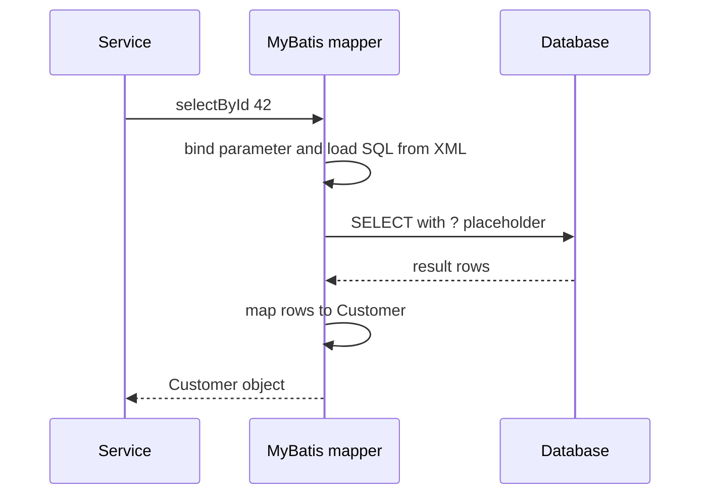
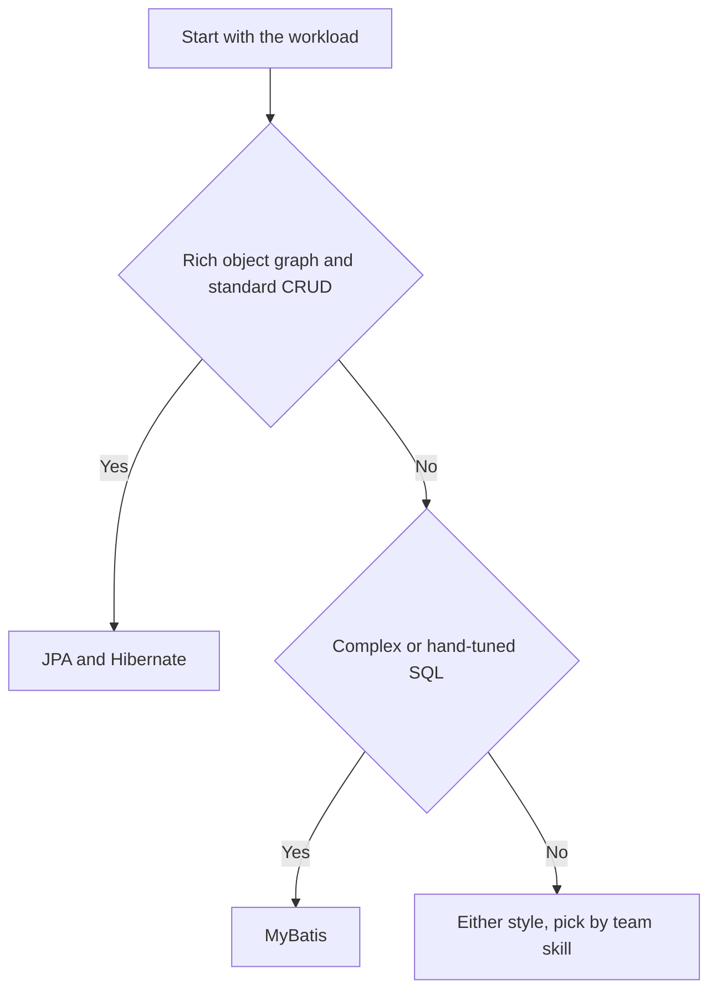

# MyBatis and JPA: Choosing a Persistence Style

!!! note "In simple words"
    With MyBatis you write the SQL and the library maps the results to objects. With JPA you describe the objects and the library writes the SQL. Both work; the question is which style fits the work your application does most.

## Why it matters

Persistence is one of the largest parts of most backend services, and the choice between a mapper and an ORM shapes how the team writes and reviews queries for years. Interviewers ask about this trade-off to see whether you pick a style on purpose, and whether you can use both in one application without surprises. A good answer names the workload, the team's skills, and the cost of hidden SQL.

## How it works

### What MyBatis does

MyBatis runs SQL that you write, in XML or in annotations. It fills the `#{...}` parameters from your objects and maps each result row onto a property or a nested object. It does not track changes, has no persistence context, and never builds SQL from your object graph. Every statement it runs is visible in a mapper file, which makes performance and code review easier.



### Setup in Spring Boot

Add the `mybatis-spring-boot-starter` dependency. Use the version that matches your Spring Boot release, as listed in the MyBatis documentation. The placeholder below must be replaced with that version.

```xml
<dependency>
    <groupId>org.mybatis.spring.boot</groupId>
    <artifactId>mybatis-spring-boot-starter</artifactId>
    <version><!-- replace with the version that matches your Spring Boot line --></version>
</dependency>
```

Mapper interfaces are found through `@Mapper` on the interface, or through `@MapperScan` on a configuration class. XML files are found through a property. The settings below are a Spring Boot example:

```yaml
# application.yaml (Spring Boot example)
mybatis:
  mapper-locations: classpath*:mapper/**/*.xml
  configuration:
    map-underscore-to-camel-case: true   # first_name maps to firstName
```

### Mapper interface and XML

The interface declares the operations, and the XML file supplies the SQL. The `namespace` must be the fully qualified name of the interface, and each `id` must match a method name.

```java
import java.util.List;
import org.apache.ibatis.annotations.Mapper;
import org.apache.ibatis.annotations.Param;

@Mapper
public interface CustomerMapper {

    Customer selectById(long id);

    List<Customer> selectAll();

    int insert(Customer customer);

    int updateEmail(@Param("id") long id, @Param("email") String email);

    int deleteById(long id);
}
```

```java
// Customer.java: a plain bean. MyBatis sets fields through setters.
public class Customer {

    private Long id;
    private String firstName;
    private String email;

    public Long getId() { return id; }
    public void setId(Long id) { this.id = id; }
    public String getFirstName() { return firstName; }
    public void setFirstName(String firstName) { this.firstName = firstName; }
    public String getEmail() { return email; }
    public void setEmail(String email) { this.email = email; }
}
```

```xml
<?xml version="1.0" encoding="UTF-8"?>
<!DOCTYPE mapper PUBLIC "-//mybatis.org//DTD Mapper 3.0//EN"
        "https://mybatis.org/dtd/mybatis-3-mapper.dtd">
<mapper namespace="com.example.shop.CustomerMapper">

    <resultMap id="customerMap" type="com.example.shop.Customer">
        <id column="customer_id" property="id"/>
        <result column="first_name" property="firstName"/>
        <result column="email" property="email"/>
    </resultMap>

    <select id="selectById" resultMap="customerMap">
        SELECT customer_id, first_name, email
        FROM customer
        WHERE customer_id = #{id}
    </select>

    <select id="selectAll" resultMap="customerMap">
        SELECT customer_id, first_name, email
        FROM customer
        ORDER BY customer_id
    </select>

    <insert id="insert" useGeneratedKeys="true" keyProperty="id">
        INSERT INTO customer (first_name, email)
        VALUES (#{firstName}, #{email})
    </insert>

    <update id="updateEmail">
        UPDATE customer
        SET email = #{email}
        WHERE customer_id = #{id}
    </update>

    <delete id="deleteById">
        DELETE FROM customer WHERE customer_id = #{id}
    </delete>
</mapper>
```

`useGeneratedKeys` with `keyProperty` copies the database-generated ID back onto the object you passed in. This works the same way as an identity column in JPA.

### Annotation-based mappers

Short queries can live on the interface, next to the method. Long statements are hard to read inside a Java string, so XML is the usual choice for anything complex.

```java
import org.apache.ibatis.annotations.Insert;
import org.apache.ibatis.annotations.Options;
import org.apache.ibatis.annotations.Select;

public interface CustomerLookupMapper {

    @Select("SELECT customer_id AS id, first_name AS firstName, email FROM customer WHERE email = #{email}")
    Customer selectByEmail(String email);

    @Insert("INSERT INTO customer (first_name, email) VALUES (#{firstName}, #{email})")
    @Options(useGeneratedKeys = true, keyProperty = "id")
    int insert(Customer customer);
}
```

### Result maps and nested collections

A `<collection>` in a result map turns joined rows into one parent with a list of children. MyBatis groups the rows by the parent's `<id>` column, so that column must appear in the select.

```xml
<resultMap id="customerWithInvoices" type="com.example.shop.Customer">
    <id column="customer_id" property="id"/>
    <result column="first_name" property="firstName"/>
    <collection property="invoices" ofType="com.example.shop.Invoice">
        <id column="invoice_id" property="id"/>
        <result column="amount_cents" property="amountCents"/>
    </collection>
</resultMap>

<select id="selectWithInvoices" resultMap="customerWithInvoices">
    SELECT c.customer_id, c.first_name, i.invoice_id, i.amount_cents
    FROM customer c
    LEFT JOIN invoice i ON i.customer_id = c.customer_id
    WHERE c.customer_id = #{id}
</select>
```

A nested `<association>` or `<collection>` that uses a `select` attribute runs one extra query for each row. That is the N+1 problem again. When the data is always needed, a join with a result map is the better choice.

### Dynamic SQL

MyBatis builds the statement from `<if>`, `<where>`, `<set>`, `<choose>`, and `<foreach>` elements. The `<where>` element adds `WHERE` only when a condition is present, and it removes a leading `AND`.

```xml
<select id="search" resultMap="customerMap">
    SELECT customer_id, first_name, email
    FROM customer
    <where>
        <if test="firstName != null">AND first_name = #{firstName}</if>
        <if test="emailPattern != null">AND email LIKE #{emailPattern}</if>
    </where>
    <choose>
        <when test="sortByName">ORDER BY first_name</when>
        <otherwise>ORDER BY customer_id</otherwise>
    </choose>
</select>

<insert id="insertAll">
    INSERT INTO customer (first_name, email) VALUES
    <foreach collection="list" item="c" separator=",">
        (#{c.firstName}, #{c.email})
    </foreach>
</insert>
```

### Binding with #{} and ${}

`#{name}` creates a JDBC parameter, the same as a `?` in a `PreparedStatement`. `${name}` inserts the text into the SQL unchanged. Use `${}` only for identifiers that come from a fixed list in your code, such as a sort column chosen from an allow-list. Passing user input through `${}` is SQL injection.

### Step by step: a mapper call

1. At startup, Spring creates an implementation for each `@Mapper` interface.
2. A call runs the matching statement and binds the `#{}` parameters.
3. The database returns rows. Each row is mapped to the result type, and nested results are grouped by their `<id>` columns.
4. Nothing is tracked afterwards. A later call runs its own SQL.

### JPA versus MyBatis

| Aspect | JPA and Hibernate | MyBatis |
|---|---|---|
| Style | Object-centric ORM | SQL-centric mapper |
| Boilerplate | Little; basic CRUD is generated | More; you write SQL for each operation |
| SQL control | Generated, tunable with fetch plans | Exact; you write every statement |
| Relationships | Mapped with annotations, cascades, lazy loading | Joins and nested result maps written by hand |
| Change tracking | Yes, dirty checking in a persistence context | No |
| Performance | Good with careful fetching; surprises from lazy loading | Predictable; no hidden queries |
| Learning curve | Lazy loading, cascades, and the persistence context | Mostly SQL plus mapping rules |

#### When to use each



Use JPA and Hibernate for:

- Domain-driven models with rich object relationships
- Standard create, read, update, and delete work
- Teams that prefer objects to SQL

Use MyBatis for:

- Complex or hand-tuned queries, including reports
- Legacy schemas with unusual names or structures
- Bulk operations where you want exact SQL
- Teams that are comfortable writing and reviewing SQL

### Using both in one application

Both can run in the same application. A few rules keep them from interfering:

- Share one `DataSource` and one transaction manager, so both sets of work join the same `@Transactional` boundary.
- JPA does not see writes made through MyBatis. An entity loaded earlier in the same transaction can be stale after a MyBatis update. Call `em.clear()` or refresh the entity when that matters.
- Split the work by module, not by individual statement. Keep aggregate writes in JPA and reporting queries in MyBatis, so each style is used where it fits.

## Where it is used

- **Reporting services** where the SQL is complex, tuned by hand, and reviewed line by line.
- **Legacy databases** with unusual table names, composite keys, or stored procedures.
- **Mixed applications** where JPA handles the domain model and MyBatis handles reports or bulk updates.
- **Batch and data-migration jobs** that need exact control of each statement.

## Benefits

- **Predictable SQL.** Each statement is visible in a mapper file, so there are no surprise queries.
- **Full control.** You can use any database feature, and tune any query.
- **Simple model.** There is no persistence context, no dirty checking, and no lazy loading to reason about.
- **Easy to review.** A reviewer can read the SQL directly.

## Cons and limits

- **More code for basic CRUD.** Every operation needs SQL and a mapping.
- **Manual relationships.** Joins, nested result maps, and grouping are written by hand.
- **No change tracking.** Updates must be written out explicitly, and a missed column is easy to overlook.
- **Database-specific SQL.** Upserts, paging, and identity handling differ by database, and the SQL is yours to maintain.
- **Two styles to learn.** A team that uses both must understand both sets of rules.

## Best practices

- Pick the style by the workload, and write the reason in the design notes.
- Use `#{}` for every value. Reserve `${}` for allow-listed identifiers.
- Select the columns explicitly, and use `useGeneratedKeys` for generated IDs.
- Avoid nested `select` associations in lists. Use a join and a result map instead.
- Share one transaction manager and one `DataSource` when both styles are used.
- Clear or refresh JPA entities after a MyBatis write when the same transaction reads them again.
- Keep reporting SQL in XML files, reviewed like code.

!!! tip "Interview tip"
    **Q: When would you pick MyBatis over JPA?**
    When the queries matter more than the object model. If the team needs exact SQL control, the schema is awkward, or the work is mostly reports and bulk writes, MyBatis gives predictable statements with no hidden lazy loads. For a rich domain with many relationships and simple CRUD, JPA saves most of the typing. Many systems use both, split by module.

## Common pitfalls

- Using `${}` with values that came from a user, which opens SQL injection.
- Forgetting `useGeneratedKeys`, so the ID is never set on the object.
- Nested `select` associations inside a list, which cause one query per row.
- Writing upsert or paging syntax that is specific to one database. `ON DUPLICATE KEY UPDATE` is MySQL, PostgreSQL uses `ON CONFLICT`, and `LIMIT` and `OFFSET` also differ between databases.
- Mixing JPA and MyBatis writes in one transaction without clearing the persistence context.
- Relying on a column-to-property mapping that is not configured, such as `first_name` without the camel-case setting or an alias.

## Quick recap

- MyBatis maps SQL you write to objects. JPA maps objects to tables and generates SQL.
- Use `#{}` for values, and reserve `${}` for allow-listed identifiers.
- Result maps group joined rows into parents and children. Watch for N+1 in nested selects.
- JPA and MyBatis can share a transaction, but JPA does not see MyBatis writes without a refresh or clear.
- Choose by the work: rich domains and CRUD suit JPA, and complex queries and legacy schemas suit MyBatis.

## Official documentation

- [Spring Boot reference documentation](https://docs.spring.io/spring-boot/reference/index.html) (library: configuration properties and auto-configuration; the MyBatis starter itself is documented by the MyBatis project, whose link is not in the verified list)
- [Spring Data JPA reference documentation](https://docs.spring.io/spring-data/jpa/reference/index.html) (library: the JPA side of the comparison)
- [PostgreSQL documentation](https://www.postgresql.org/docs/current/) (the database behind the upsert and paging examples)

**See also:** [JPA and Hibernate](jpa-hibernate.md), [Spring Data JPA](spring-data-jpa.md), [JDBC](jdbc.md), [DTO Mapping](dto-mapping.md)
