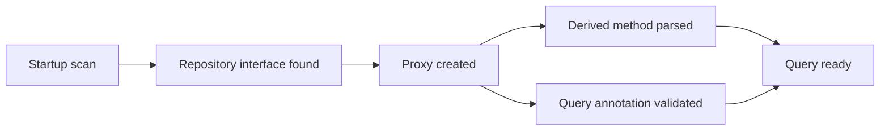
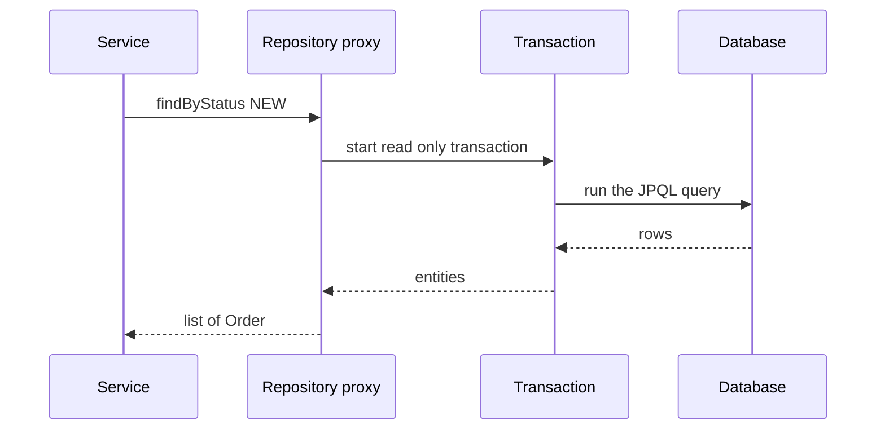

# Spring Data JPA

!!! note "In simple words"
    You write an interface that describes the data you need, such as "find orders by status". Spring Data creates the working class at startup and writes the query for you, using the method name or an annotation you add.

## Why it matters

Data access code in a Spring service is repetitive: save, find by ID, list with paging, filter by a few fields. Spring Data JPA removes most of that boilerplate. Interviewers ask about it to see whether you know what the framework generates at startup, where its limits are, and how to paginate and filter safely without loading far more data than you need.

Spring code on this page is a library example. Its snippets are shown for explanation and have not been compiled.

## How it works

### The repository hierarchy

Spring Data defines a family of repository interfaces. Each one adds methods to the one above it.

| Interface | Adds |
|---|---|
| `Repository<T, ID>` | A marker with no methods |
| `CrudRepository<T, ID>` | `save`, `findById`, `findAll`, `delete`, `count` |
| `PagingAndSortingRepository<T, ID>` | `findAll(Sort)` and `findAll(Pageable)` |
| `JpaRepository<T, ID>` | JPA-specific methods such as `flush`, `saveAndFlush`, and batch deletes |

You declare the interface, and Spring provides the implementation:

```java
import java.util.List;
import java.util.Optional;
import org.springframework.data.jpa.repository.JpaRepository;

// Spring Data example: not compiled here. Order is the entity from JPA and Hibernate.
public interface OrderRepository extends JpaRepository<Order, Long> {

    List<Order> findByStatus(String status);

    Optional<Order> findFirstByStatusOrderByIdDesc(String status);

    long countByStatus(String status);

    void deleteByStatus(String status);      // derived delete: needs a transaction
}
```

The interface has no implementation class. At startup, Spring creates a proxy for it. The proxy handles the CRUD methods with a generic implementation, and it turns the other methods into queries.



### Derived query methods

Spring parses method names into queries. The grammar uses a prefix such as `findBy`, `readBy`, `countBy`, `existsBy`, or `deleteBy`. Then come property names, operators (`And`, `Or`, `Between`, `LessThan`, `Like`, `IsNull`), and modifiers (`OrderBy`, `First`, `Top`, `Distinct`).

```java
import java.util.List;

// Spring Data example: not compiled here.
public interface OrderQueryMethods {
    List<Order> findByStatusAndTotalGreaterThan(String status, long total);
    boolean existsByCustomerIdAndStatus(Long customerId, String status);
}
```

Long method names are a sign to switch to `@Query`. A property name that does not exist fails the application at startup, which is useful, because the mistake is found before any request runs.

### Custom queries with @Query

`@Query` takes JPQL, or native SQL when `nativeQuery = true` is set. Parameters are bound by name with `@Param`.

```java
import java.time.LocalDate;
import java.util.List;
import org.springframework.data.jpa.repository.JpaRepository;
import org.springframework.data.jpa.repository.Modifying;
import org.springframework.data.jpa.repository.Query;
import org.springframework.data.repository.query.Param;

// Spring Data example: not compiled here.
public interface OrderQueries extends JpaRepository<Order, Long> {

    @Query("select o from Order o join fetch o.lines where o.status = :status")
    List<Order> findWithLines(@Param("status") String status);

    @Query(value = "select * from orders where created_on < :cutoff", nativeQuery = true)
    List<Order> findOlderThan(@Param("cutoff") LocalDate cutoff);

    @Modifying
    @Query("update Order o set o.status = :status where o.id = :id")
    int updateStatus(@Param("id") Long id, @Param("status") String status);
}
```

`@Modifying` is required for an `UPDATE` or `DELETE` query, and the method must run in a transaction. The return value is the number of affected rows. Note that a bulk update bypasses the persistence context, as described in [JPA and Hibernate](jpa-hibernate.md).

### Specifications for optional filters

When filters are optional, combining derived method names becomes unmanageable. A `Specification` builds one `WHERE` clause from small parts. The repository must also extend `JpaSpecificationExecutor`.

```java
import java.util.ArrayList;
import java.util.List;
import org.springframework.data.jpa.domain.Specification;
import org.springframework.data.jpa.repository.JpaRepository;
import org.springframework.data.jpa.repository.JpaSpecificationExecutor;

// Spring Data example: not compiled here.
public interface OrderSearch extends JpaRepository<Order, Long>, JpaSpecificationExecutor<Order> {

    static Specification<Order> hasStatus(String status) {
        return (root, query, cb) -> status == null ? null : cb.equal(root.get("status"), status);
    }
}
```

Combine specifications with `Specification.where(...)`, `.and(...)`, and `.or(...)`. Spring Data ignores a `null` predicate when it combines specifications, which keeps optional filters simple. Pass the result to `findAll(Specification, Pageable)`.

### Named queries

`@NamedQuery` on an entity defines a JPQL query under a name. The repository finds it by convention, using names such as `Order.findByStatus`. Named queries are validated at startup. Most teams prefer `@Query` on the repository, because the query sits next to the method that uses it.

### Pagination and sorting

`Pageable` describes a page and `Sort` describes the order. `Page<T>` includes the total count, which costs an extra `COUNT` query. `Slice<T>` skips the count and only tells you whether a next page exists.

```java
import org.springframework.data.domain.PageRequest;
import org.springframework.data.domain.Pageable;
import org.springframework.data.domain.Sort;

// Spring Data example: not compiled here.
public class OrderPaging {
    static Pageable firstTen() {
        return PageRequest.of(0, 10, Sort.by(Sort.Direction.DESC, "id"));
    }
}
```

```java
import org.springframework.data.domain.Page;
import org.springframework.data.domain.Pageable;

// In the repository interface (Spring Data example, not compiled here)
Page<Order> findByStatus(String status, Pageable pageable);
```

Sorting on a column that is not indexed is slow in a large table. Deep pages with big offsets are slow for the same reason described in [Query Optimisation](../06-databases-sql/query-optimisation.md). For long feeds, prefer keyset pagination, where the query starts after the last row seen.

### Projections

A projection returns only the fields a caller needs, so the full entity does not have to load. An interface projection lists getters, and Spring implements the interface for you.

```java
import java.util.List;

// Spring Data example: not compiled here.
interface OrderSummary {
    Long getId();
    String getStatus();
}

interface OrderSummaryRepository {
    List<OrderSummary> findByStatus(String status);
}
```

Class-based (DTO) projections and dynamic projections are also supported. See [DTO Mapping](dto-mapping.md).

### Saving and dirty checking

`save` returns the entity that the persistence context manages. For a new entity it calls `persist`. For an existing entity it calls `merge`, which can return a different object from the one you passed in. Always use the returned instance.

For an entity you load inside a transaction, `save` is often unnecessary. Dirty checking writes the change at commit:

```java
import org.springframework.stereotype.Service;
import org.springframework.transaction.annotation.Transactional;

// Spring example: not compiled here. Order is the entity from JPA and Hibernate.
@Service
public class OrderStatusService {

    private final OrderRepository orders;

    public OrderStatusService(OrderRepository orders) {
        this.orders = orders;
    }

    @Transactional
    public void markShipped(Long id) {
        Order order = orders.findById(id).orElseThrow();
        order.setStatus("SHIPPED");   // no save(): dirty checking writes the UPDATE at commit
    }
}
```

Without `@Transactional`, the same method changes nothing in the database. The change stays in memory, and no commit ever flushes it. The example assumes that `Order` has a `setStatus` method.

### Entity graphs and aggregate queries

An entity graph names the associations to load with a query. It avoids the N+1 problem without a hand-written join.

```java
import java.util.List;
import org.springframework.data.jpa.repository.EntityGraph;
import org.springframework.data.jpa.repository.JpaRepository;

// Spring Data example: not compiled here.
public interface OrderGraphRepository extends JpaRepository<Order, Long> {

    @EntityGraph(attributePaths = "lines")
    List<Order> findByStatus(String status);
}
```

For aggregates and joins, write JPQL. It works the same way as HQL, which is Hibernate's superset:

```java
import java.math.BigDecimal;
import java.util.List;
import org.springframework.data.jpa.repository.JpaRepository;
import org.springframework.data.jpa.repository.Query;
import org.springframework.data.repository.query.Param;

// Spring Data example: not compiled here. Customer is an entity with an orders collection.
public interface CustomerReportRepository extends JpaRepository<Customer, Long> {

    @Query("select count(o) from Order o where o.status = :status")
    long countOrdersWithStatus(@Param("status") String status);

    @Query("select distinct c from Customer c join c.orders o where o.total > :amount")
    List<Customer> customersWithOrdersOver(@Param("amount") BigDecimal amount);
}
```

Do not combine a collection entity graph or a fetch join with a `Page` request. Hibernate then pages in memory and logs a warning, because the row count no longer matches the parent count.

### Step by step: a repository call



1. At startup, Spring scans for repository interfaces and creates a proxy for each.
2. Derived methods are parsed into JPQL or criteria queries. `@Query` strings are validated.
3. At call time, the proxy runs the query inside a transaction. Query methods are read-only by default, and save and delete methods are read-write.
4. Results are converted to entities or projections and returned.

## Where it is used

- **Service classes** in Spring Boot applications that need standard CRUD on entities.
- **Admin and search screens** that combine several optional filters, handled with specifications.
- **Paged list endpoints** that return one page of orders at a time.
- **Reporting queries** written with `@Query` when the derived method name would be too long.

## Benefits

- **Little boilerplate.** The standard CRUD methods exist without any code.
- **Readable intent.** A method name such as `findByStatus` says what it does.
- **Early errors.** Invalid property names and named queries fail at startup.
- **Flexible.** `@Query`, specifications, projections, and entity graphs cover most needs.
- **Works with the rest of Spring.** Transactions, paging, and auditing integrate with the framework.

## Cons and limits

- **Long method names** are hard to read and review. Move them to `@Query` or a specification when they grow.
- **Hidden behaviour.** Read-only and read-write transaction defaults, and the proxy itself, are easy to forget.
- **Derived deletes load every entity first.** They are not bulk deletes, so they can be slow on large sets.
- **Page costs an extra count.** `Slice` avoids it when a total is not needed.
- **Entities leak into APIs** if controllers return them directly, which exposes lazy associations and internal fields.

## Best practices

- Keep derived method names short. Use `@Query` for anything longer.
- Mark update and delete queries with `@Modifying`, and run them in a transaction.
- Use `Slice` for infinite scrolling, and `Page` only when you need a total.
- Use projections or DTOs for list screens, and load full entities only for edits.
- Use entity graphs or fetch joins to avoid N+1 queries, and never combine a collection fetch with `Page`.
- Build optional filters with `Specification`, not with string concatenation.
- Always use the instance returned by `save`.
- Put `@Transactional` on service methods that change data, and make read-only queries explicit.

!!! tip "Interview tip"
    **Q: How does Spring Data create a repository implementation without you writing one?**
    At startup, Spring creates a dynamic proxy for each repository interface. The proxy routes CRUD calls to a generic implementation, and parses derived method names and `@Query` annotations into queries. You write the interface, and the framework provides the class.

## Common pitfalls

- Assuming a derived method name is always clear. Long names are hard to read and review.
- Forgetting `@Modifying` on an update query, which fails at runtime.
- Using `Page` where `Slice` would avoid an extra count query.
- Returning entities from a controller, which exposes lazy associations and internal fields (see [DTO Mapping](dto-mapping.md)).
- Calling `deleteBy...` without a transaction, or expecting it to delete efficiently in bulk. Derived deletes load each entity first.
- Building JPQL strings by concatenating user input.

## Quick recap

- `JpaRepository` provides CRUD and paging. You declare only the interface.
- Derived methods are parsed from their names. `@Query` handles complex queries.
- `@Modifying` marks update and delete queries.
- `Specification` builds optional filters without a combinatorial explosion of methods.
- `Page` costs an extra count, while `Slice` does not. Projections load only the fields you need.

## Official documentation

- [Spring Data JPA reference documentation](https://docs.spring.io/spring-data/jpa/reference/index.html)
- [Spring Boot reference documentation](https://docs.spring.io/spring-boot/reference/index.html) (library: auto-configuration of Spring Data repositories)
- [Spring Framework reference documentation](https://docs.spring.io/spring-framework/reference/) (library: transaction management with `@Transactional`)

**See also:** [JPA and Hibernate](jpa-hibernate.md), [DTO Mapping](dto-mapping.md), [JDBC](jdbc.md)
