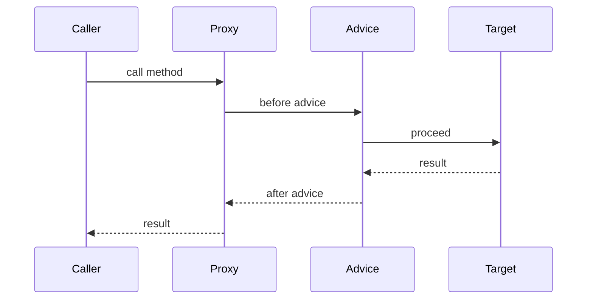

# Aspect-Oriented Programming

!!! note "In simple words"
    AOP lets you write code once, such as logging or timing, and apply it to many methods without editing each one. Spring does this by wrapping your bean in a proxy that runs the extra code around your method.

## Why it matters

Some work, such as logging, security checks, timing, and transactions, appears in many places but is not the business logic itself. These are cross-cutting concerns. AOP separates them from the business code. Spring AOP applies aspects at runtime through proxies. Interviewers ask about AOP to test whether you understand the proxy mechanism, its limits (especially self-invocation), and how `@Transactional` and similar annotations really work.

## How it works

Spring creates a proxy around each bean that has matching advice. Callers talk to the proxy, and the proxy runs the advice and then calls the real target. The Spring snippets on this page show the shape of the code; they are not compiled as part of this page.

1. A bean post-processor notices that advice matches the bean and wraps the bean in a proxy.
2. A caller receives the proxy, either through injection or from the container.
3. Calling a method on the proxy runs the matching advice in order: `@Before`, then the target method (wrapped by `@Around` if present), then `@AfterReturning` or `@AfterThrowing`, then `@After`.
4. The target's return value or exception goes back to the caller.



### Vocabulary

| Term | Meaning |
|---|---|
| Aspect | A class that groups advice and pointcuts, marked with `@Aspect` |
| Join point | A point in execution. Spring AOP supports only method execution |
| Pointcut | An expression that selects join points |
| Advice | Code that runs at a join point (before, after, or around) |
| Weaving | Linking aspects into the code. Happens at compile time, load time, or runtime |
| Target | The object being advised |

### Advice types

| Annotation | Runs |
|---|---|
| `@Before` | Before the method |
| `@AfterReturning` | After the method returns normally. Can read the return value |
| `@AfterThrowing` | After the method throws. Can read the exception |
| `@After` | After the method, whether it returned or threw. Works like `finally` |
| `@Around` | Wraps the method. Decides whether and how the method runs |

`@Around` is the most powerful type. It receives a `ProceedingJoinPoint` and must call `proceed()` to run the target.

```java
import org.aspectj.lang.ProceedingJoinPoint;
import org.aspectj.lang.annotation.Around;
import org.aspectj.lang.annotation.Aspect;
import org.springframework.stereotype.Component;

@Aspect
@Component
public class TimingAspect {

    @Around("execution(* com.example.orders..*(..))")
    public Object time(ProceedingJoinPoint pjp) throws Throwable {
        long start = System.nanoTime();
        try {
            return pjp.proceed();                          // run the advised method
        } finally {
            long millis = (System.nanoTime() - start) / 1_000_000;
            System.out.println(pjp.getSignature() + " took " + millis + " ms");
        }
    }
}
```

The `execution(...)` pattern selects methods in the `orders` package and its subpackages. Spring AOP needs `spring-boot-starter-aop`, or the AspectJ libraries, on the classpath to read `@Aspect` annotations.

### Pointcut expressions

The common designators are:

- `execution(...)`: matches method signatures. The most common choice in Spring AOP.
- `within(...)`: matches all methods of types in a package or class.
- `@annotation(...)`: matches methods that carry an annotation, such as `@Audited`.
- `bean(...)`: matches beans by name. This is a Spring-specific extension.

```java
import org.aspectj.lang.annotation.Aspect;
import org.aspectj.lang.annotation.Before;
import org.springframework.stereotype.Component;

@Aspect
@Component
public class AuditAspect {

    @Before("@annotation(com.example.audit.Audited) && within(com.example.payments..*)")
    public void record() {
        // runs before any @Audited method in the payments package
    }
}
```

`@Pointcut` lets you name an expression once and reuse it across several advice methods.

### Proxy-based AOP

- If the bean implements an interface, Spring can use a **JDK dynamic proxy**, which proxies the interface.
- Otherwise, or when configured, Spring uses **CGLIB**, which creates a subclass of the bean.
- Spring Boot defaults to CGLIB (`spring.aop.proxy-target-class=true`), so proxies work for classes without interfaces.

This design has consequences:

- Advice applies to public methods called through the proxy. Spring's documentation presents public methods as the supported target, so design around them.
- `final` classes and `final` methods cannot be proxied by CGLIB.
- A call from one method of a bean to another method of the same bean (**self-invocation**) bypasses the proxy, so the advice does not run.

### Self-invocation

```java
import org.springframework.stereotype.Service;
import org.springframework.transaction.annotation.Transactional;

@Service
public class ReportService {

    public void publish() {
        refresh();          // this.refresh(): bypasses the proxy, so no transaction starts
    }

    @Transactional
    public void refresh() {
        // runs without a transaction when called from publish()
    }
}
```

Three fixes exist. The clean one is to move the advised method into another bean and call it through injection. Injecting the bean into itself also works, but it signals a class with too many jobs. A third option is to expose the proxy with `@EnableAspectJAutoProxy(exposeProxy = true)` and call `AopContext.currentProxy()`, but that couples the code to Spring.

### Weaving types

| Weaving | When | Used by |
|---|---|---|
| Compile-time | Source or bytecode changes during the build | AspectJ compiler (`ajc`) |
| Load-time | Classes change as the JVM loads them | AspectJ with a Java agent |
| Runtime | Proxies are created while the application runs | Spring AOP |

Spring AOP uses runtime proxies, so it can advise only beans that Spring manages, and only method execution. Full AspectJ can also advise fields, constructors, and objects that Spring does not create, at the cost of more setup.

### Typical cross-cutting concerns

- Logging and tracing of method entry and exit.
- Security checks, such as `@PreAuthorize` in Spring Security, which is implemented as an interceptor.
- Transactions. `@Transactional` uses a transaction interceptor. See [Transactions](transactions.md).
- Caching (`@Cacheable`) and retries.
- Validation of arguments at method boundaries.

## Where it is used

- **Transactions and caching:** Spring's own `@Transactional` and `@Cacheable` are proxy-based advice.
- **Security:** method-level checks such as `@PreAuthorize`.
- **Observability:** timing and tracing around service methods.
- **Custom rules:** an audit annotation that records who called a payment operation.

## Benefits

- Cross-cutting code lives in one place and stays out of business methods.
- Advice is applied by annotation or pointcut, so new methods get it automatically.
- Spring AOP needs no compiler or agent, because it works with ordinary proxies.

## Cons and limits

- Behaviour is hidden. A reader may not know that advice runs around a method.
- Self-invocation is the most common bug. The advice silently does not run.
- Spring AOP only advises Spring beans and method execution.
- Each advised call adds a proxy hop and advice work.

## Performance considerations

Each advised call adds a proxy call and an advice chain. For normal service methods, that cost is small next to database and network calls, but it can show up on hot paths.

- **Breadth:** advising many beans or methods adds proxies and advice to each one. Narrow pointcuts to an annotation or a specific package.
- **Runtime checks:** static matches are computed once and cached per method. Pointcuts that test arguments or other runtime values are checked on every call.
- **Advice body:** string building for logs, reflection, and locking run on every call. Check the log level before building a message.
- **Around advice:** `@Around` needs a `ProceedingJoinPoint` and adds a frame. For simple before or after work, `@Before` or `@AfterReturning` is cheaper and clearer.
- **Self-invocation:** a call inside the same class skips the proxy, so it has no advice cost. The advice does not run at all, which is a correctness issue rather than a speed gain.

Avoid advice on getters, tight loops, and per-element methods. Keep I/O out of `@Around` advice. Measure with a profiler such as Java Flight Recorder, or with a JMH benchmark, before you blame AOP.

## How to think about it

Advice is best for behaviour that is the same in many places and does not change the result of the business logic. If the rule decides what the business result is, put it in the service. A reader who looks at a service method should see the business steps, not a hidden rule that changes the outcome.

## Best practices

- Use advice for logging, timing, auditing, and security checks. Keep business logic in services.
- Use specific pointcuts, such as an annotation or a package, rather than broad patterns.
- Always call `proceed()` in `@Around` advice, unless you intend to replace the method.
- Do not swallow exceptions in `@Around` advice. Rethrow them, or handle them on purpose.
- Know the self-invocation trap. Move the advised method to another bean.

!!! tip "Interview tip"
    **Q: Why does `@Transactional` not work when I call the method from the same class?**
    The annotation is applied by a proxy. A call from inside the class goes to `this`, which is the raw target, so the proxy never runs and no transaction starts. Move the method to another bean, or restructure the code so the call goes through the proxy.

## Quick recap

- AOP separates cross-cutting concerns. Advice runs at method join points.
- `@Around` wraps the method and must call `proceed()`.
- Spring AOP uses runtime proxies: JDK proxies for interfaces, CGLIB for classes (the Boot default).
- Self-invocation bypasses the proxy, so the advice does not apply.
- Advice applies to public methods called through the proxy. `final` classes and methods cannot be proxied by CGLIB.

## Official documentation

- [Spring Framework reference](https://docs.spring.io/spring-framework/reference/)
- [Spring Boot reference](https://docs.spring.io/spring-boot/reference/index.html)

**See also:** [Transactions](transactions.md), [Stereotypes and Configuration](stereotypes-and-configuration.md), [Spring MVC](spring-mvc.md)
