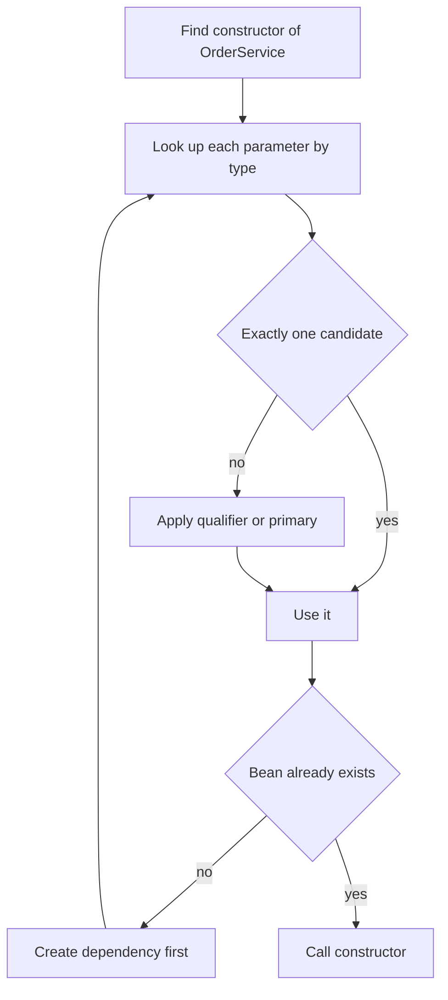

# Dependency Injection

!!! note "In simple words"
    Dependency injection means a class receives the objects it needs from outside, usually through its constructor, instead of creating them itself. Spring is the one that passes them in.

## Why it matters

A class that receives its collaborators is easier to test, easier to change, and honest about what it needs. Dependency injection (DI) is the mechanism behind this in Spring. Interviewers ask about it to see whether you prefer constructor injection and can explain why, whether you can resolve ambiguity between several candidate beans, and whether you know what to do about circular dependencies.

## How it works

Constructor injection is the case you should know best. The steps below describe what Spring does when it builds a bean that has constructor arguments. The Spring snippets show the shape of the code; they are not compiled as part of this page.

1. Spring finds the constructor it should use. With one constructor, it uses that one. With several, it uses the one marked `@Autowired`.
2. For each parameter, Spring looks for a matching bean by type. If several beans match, it applies a qualifier, then `@Primary`, then the parameter name.
3. If a matching bean does not exist yet, Spring creates that bean first, following the same steps. This is recursive.
4. Spring calls the constructor with the resolved beans, then runs the rest of the bean lifecycle.

If step 3 reaches a bean that is already being created further up the chain, Spring has found a cycle.



### Constructor injection (preferred)

Constructor injection passes dependencies through the constructor. The fields can be `final`, the object is never half-built, and a unit test can call `new` with fake collaborators.

```java
import org.springframework.stereotype.Service;

@Service
public class OrderService {

    private final PaymentClient payments;
    private final OrderRepository orders;

    public OrderService(PaymentClient payments, OrderRepository orders) {
        this.payments = payments;
        this.orders = orders;
    }

    public void place(long orderId) {
        // use payments and orders
    }
}
```

When a class has one constructor, Spring uses it without `@Autowired`. When it has several, mark the one Spring should use.

### Setter injection

Setter injection suits optional dependencies that can be changed after construction. The object is only partly built until the setter is called, so use it sparingly.

```java
import org.springframework.beans.factory.annotation.Autowired;
import org.springframework.stereotype.Service;

@Service
public class ReceiptPrinter {

    private Formatter formatter;

    @Autowired(required = false)           // optional: skipped when no Formatter bean exists
    public void setFormatter(Formatter formatter) {
        this.formatter = formatter;
    }
}

interface Formatter {                      // application interface, not java.util.Formatter
    String format(String text);
}
```

### Field injection

Field injection puts `@Autowired` directly on a field. It is short, but it has real costs. The fields cannot be `final`, the dependencies do not appear in the constructor, and tests need reflection or a Spring context to fill the fields. Avoid it in new code.

### Method injection

A method marked `@Autowired` is called once the bean is constructed, and Spring injects its parameters. It works like a setter that takes several arguments. Use it rarely.

### Autowiring modes in XML

In XML configuration, the `autowire` attribute chooses how collaborators are matched:

| Mode | Matches by |
|---|---|
| `no` | Nothing. Dependencies must be wired explicitly (the default) |
| `byName` | Property name equals bean name |
| `byType` | Property type matches exactly one bean |
| `constructor` | Constructor parameter type matches a bean |

Annotation-based injection matches by type first and uses the name as a tie-breaker. It does not use these XML modes. Know them for legacy code and interviews.

### Annotations: @Autowired, @Resource, @Inject

| Annotation | From | Notes |
|---|---|---|
| `@Autowired` | Spring | Matches by type. Supports `required` and `Optional` |
| `@Resource` | JSR-250 (`jakarta.annotation`) | Matches by name first, then by type |
| `@Inject` | JSR-330 (`jakarta.inject`) | Matches by type. Has no `required` attribute |

`@Autowired` is Spring's default and the one most codebases use. Choose one style and apply it everywhere.

### Resolving ambiguity: @Qualifier and @Primary

When two beans match a type, Spring fails at startup with `NoUniqueBeanDefinitionException` unless you disambiguate.

```java
import org.springframework.beans.factory.annotation.Qualifier;
import org.springframework.context.annotation.Primary;
import org.springframework.stereotype.Component;
import org.springframework.stereotype.Service;

public interface PaymentGateway {
    void charge(long cents);
}

@Component("cardGateway")
@Primary                              // used when no qualifier is given
class CardGateway implements PaymentGateway {
    public void charge(long cents) { }
}

@Component("bankGateway")
class BankTransferGateway implements PaymentGateway {
    public void charge(long cents) { }
}

@Service
class Checkout {
    private final PaymentGateway gateway;

    Checkout(@Qualifier("bankGateway") PaymentGateway gateway) {   // overrides @Primary
        this.gateway = gateway;
    }
}
```

`@Primary` sets the default choice. `@Qualifier` picks a specific bean at one injection point. Use `@Primary` for the common case and `@Qualifier` for the exceptions.

### Custom qualifiers with a meta-annotation

Repeating `@Qualifier("bankGateway")` with string literals across many classes invites typos. A custom qualifier turns the choice into a named annotation, so the injection point reads like a domain term. You create an annotation and mark it with `@Qualifier`. Spring then compares the annotation's attributes with those on each candidate.

```java
import java.lang.annotation.Documented;
import java.lang.annotation.ElementType;
import java.lang.annotation.Retention;
import java.lang.annotation.RetentionPolicy;
import java.lang.annotation.Target;
import org.springframework.beans.factory.annotation.Qualifier;

@Target({ElementType.TYPE, ElementType.FIELD, ElementType.PARAMETER, ElementType.METHOD})
@Retention(RetentionPolicy.RUNTIME)
@Documented
@Qualifier
public @interface Channel {
    String value();
}
```

The candidates carry the same annotation, and the injection point asks for it:

```java
import org.springframework.stereotype.Service;

public interface Notifier {
    void send(String recipient, String message);
}

@Service
@Channel("email")
class EmailNotifier implements Notifier {
    public void send(String recipient, String message) { }
}

@Service
@Channel("sms")
class SmsNotifier implements Notifier {
    public void send(String recipient, String message) { }
}

@Service
class ReminderService {

    private final Notifier notifier;

    ReminderService(@Channel("sms") Notifier notifier) {   // selects SmsNotifier
        this.notifier = notifier;
    }
}
```

A misspelt value such as `@Channel("smss")` fails at startup with a "no qualifying bean" error. That is far better than a silent wrong choice. To avoid repeating literals, keep the values in a constants class and write `@Channel(Channels.SMS)`. For a marker with no value, such as "the cached implementation", declare the annotation without a `value` element and match on the annotation alone.

### Collections and optional dependencies

Spring can inject every bean of one type as a `List`, `Set`, or `Map` keyed by bean name. This suits strategy patterns, where you choose behaviour from a set of implementations.

```java
import java.util.List;
import org.springframework.stereotype.Service;

@Service
public class PaymentRouter {
    private final List<PaymentGateway> gateways;

    public PaymentRouter(List<PaymentGateway> gateways) {   // every PaymentGateway bean
        this.gateways = gateways;
    }
}
```

For an optional bean, declare the parameter as `Optional<T>`. Use `ObjectProvider<T>` when you also want lazy or repeated lookup.

```java
import java.util.Optional;

public class AuditHook {
    private final Optional<Auditor> auditor;

    public AuditHook(Optional<Auditor> auditor) {   // empty, not an error, when no Auditor bean exists
        this.auditor = auditor;
    }
}

interface Auditor { }
```

### Circular dependencies

A circular dependency means bean A needs bean B and bean B needs bean A. Constructor injection cannot solve it, because neither bean can be built first. Since Spring Boot 2.6, circular references are prohibited by default (`spring.main.allow-circular-references` is `false`).

Fix the design instead of enabling the flag:

- Move the shared logic into a third bean that both depend on.
- Replace one direct call with an application event. The publisher fires the event, and the listener reacts.
- Pass a function or callback instead of the whole bean.
- Use `@Lazy` on one injection point as a last resort. It defers creation through a proxy and hides the design problem.

The event approach is usually the cleanest. The publisher does not know who listens, so the dependency points one way only:

```java
import org.springframework.context.ApplicationEventPublisher;
import org.springframework.context.event.EventListener;
import org.springframework.stereotype.Service;

record OrderPlaced(String orderId) { }

@Service
class OrderPlacement {

    private final ApplicationEventPublisher events;

    OrderPlacement(ApplicationEventPublisher events) {
        this.events = events;
    }

    void place(String orderId) {
        events.publishEvent(new OrderPlaced(orderId));   // no reference to the listener
    }
}

@Service
class LoyaltyPoints {

    @EventListener
    void onOrderPlaced(OrderPlaced event) {
        // award points; OrderPlacement never depends on this class
    }
}
```

A cycle is usually a sign that two classes share too much responsibility.

## Where it is used

- **Services and controllers:** constructor injection of repositories, clients, and other services.
- **Strategy selection:** a list of implementations, filtered or routed at runtime.
- **Optional features:** an auditor, a metrics hook, or a formatter that may or may not exist.
- **Tests:** unit tests call `new` with fakes, and integration tests let Spring wire the real beans.

## Benefits

- Dependencies are visible in the constructor, so a class's needs are obvious.
- Fields can be `final`, which makes the object safe to share.
- Missing required beans fail at startup, not during a request.
- Unit tests need no container at all.

## Cons and limits

- Constructors with many parameters are a hint that the class has too many jobs.
- Ambiguity needs explicit rules. Without them, startup fails.
- Circular designs cannot be built with constructor injection and must be redesigned.
- Injected `List` order follows bean ordering, which needs `@Order` when order matters.

## Best practices

- Use constructor injection for required dependencies by default.
- Use `Optional<T>` or `ObjectProvider<T>` for dependencies that may be missing.
- Resolve ambiguity with `@Primary` for the default and `@Qualifier` for explicit choices.
- Do not add `@Autowired(required = false)` to a dependency that is actually required. It hides a missing bean until the code uses it.
- Never enable `allow-circular-references` to make the application start.
- Inject a request-scoped bean into a singleton only through a scoped proxy.

!!! tip "Interview tip"
    **Q: Why is constructor injection preferred over field injection?**
    The dependencies are explicit and required, the fields can be `final`, the class is easy to test with plain `new`, and missing dependencies fail at startup. Field injection hides dependencies, needs reflection in tests, and cannot enforce immutability.

## Quick recap

- Constructor injection is the default. Setter injection suits optional dependencies.
- `@Autowired` matches by type. `@Resource` matches by name first.
- Resolve ambiguity with `@Primary` (default) and `@Qualifier` (explicit).
- Inject `List<T>` to get all beans of a type. Use `Optional<T>` for optional ones.
- Since Spring Boot 2.6, circular dependencies are prohibited by default. Redesign rather than enable them.

## Official documentation

- [Spring Framework reference](https://docs.spring.io/spring-framework/reference/)
- [Spring Boot reference](https://docs.spring.io/spring-boot/reference/index.html)

**See also:** [IoC and Beans](ioc-and-beans.md), [Stereotypes and Configuration](stereotypes-and-configuration.md), [Transactions](transactions.md)
