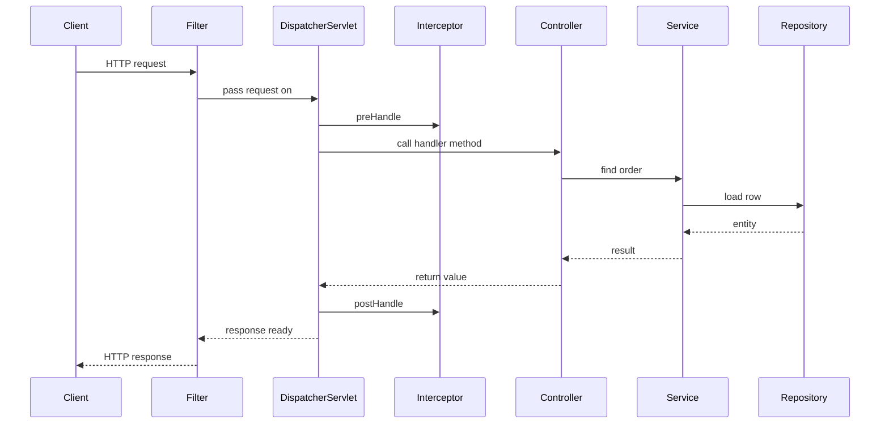

# Spring MVC

!!! note "In simple words"
    Spring MVC is the web layer. One servlet, `DispatcherServlet`, receives every request, finds the right controller method, runs it, and turns the result into a page or JSON.

## Why it matters

Every web request in a Spring application passes through the same pipeline. Knowing that pipeline tells you where to put a filter, where an interceptor runs, why a return value becomes JSON or a view name, and why an exception ends up as an error response. Interviewers ask about Spring MVC to check that you understand how a URL becomes a method call, not just which annotations to use.

## How it works

`DispatcherServlet` is the front controller. Every request enters through it, and it delegates to other components in a fixed order:

1. Servlet filters run first, in the container, before Spring MVC sees the request.
2. `DispatcherServlet` asks a `HandlerMapping` which handler matches the request.
3. It asks a `HandlerAdapter` to call that handler. The adapter converts path variables and parameters and invokes the method.
4. `HandlerInterceptor.preHandle` runs before the handler, and `postHandle` runs after it.
5. The handler returns data or a view name. A `ViewResolver` produces HTML pages. For REST responses, an `HttpMessageConverter` writes the body.
6. `afterCompletion` runs whether or not an exception occurred.



Spring Boot registers `DispatcherServlet` automatically on the embedded server, so you do not configure it by hand.

### Controllers and request mapping

```java
import org.springframework.stereotype.Controller;
import org.springframework.web.bind.annotation.GetMapping;
import org.springframework.web.bind.annotation.PathVariable;
import org.springframework.web.bind.annotation.RequestMapping;
import org.springframework.web.servlet.ModelAndView;

@Controller
@RequestMapping("/orders")
public class OrderPageController {

    @GetMapping("/{id}")
    public ModelAndView show(@PathVariable long id) {
        ModelAndView mav = new ModelAndView("order-detail");   // the view name
        mav.addObject("orderId", id);                          // a model attribute
        return mav;
    }
}
```

A `@Controller` returns view names, which a `ViewResolver` turns into pages. `@RestController` combines `@Controller` with `@ResponseBody`, so return values are written straight to the response body.

`@RequestMapping` sets the path and the HTTP method. The shortcut annotations `@GetMapping`, `@PostMapping`, and their relatives set the method for you. Method-level mappings are appended to class-level ones.

### Request context

Handlers often need details about the current request, such as the locale, the path, or the model. Prefer method parameters (`HttpServletRequest`, `Locale`, `Model`). When a non-web bean needs the current request, `RequestContextHolder` exposes it for the current thread. `RequestContext`, in `org.springframework.web.servlet.support`, gives helper methods for the request and its locale.

### Model and views

`Model` or `ModelAndView` carries data from the controller to the view. The view resolver turns the view name into a template, such as Thymeleaf or JSP. REST APIs skip the model and return data directly.

### Interceptors and filters

| | Servlet filter | `HandlerInterceptor` |
|---|---|---|
| Layer | Servlet container, before `DispatcherServlet` | Inside Spring MVC, around the handler |
| Knows the handler? | No | Yes. It receives the handler object |
| Hooks | `doFilter`, which wraps the whole chain | `preHandle`, `postHandle`, `afterCompletion` |
| Typical use | Encoding, container-level CORS, the entry point of a security chain | Per-controller logging, authorisation checks, timing |
| Registration | `FilterRegistrationBean`, or a `@Component` that implements `Filter` | `WebMvcConfigurer.addInterceptors` |

```java
import jakarta.servlet.http.HttpServletRequest;
import jakarta.servlet.http.HttpServletResponse;
import org.springframework.web.servlet.HandlerInterceptor;

public class TimingInterceptor implements HandlerInterceptor {

    @Override
    public boolean preHandle(HttpServletRequest request, HttpServletResponse response, Object handler) {
        request.setAttribute("startNanos", System.nanoTime());
        return true;                        // false stops the request here
    }
}
```

Register the interceptor in a `WebMvcConfigurer` with `registry.addInterceptor(new TimingInterceptor())`. Use a filter when you need the raw request before Spring MVC runs, such as at the entry point of a security chain.

### Locale and theme resolution

- **LocaleResolver** decides the request's locale. It can read a cookie, a session attribute, or the `Accept-Language` header. `LocaleChangeInterceptor` lets a request parameter change the locale.
- **ThemeResolver** picks a theme, which is a set of message bundles and stylesheets. Modern APIs rarely use it.

### REST responses and content negotiation

`@ResponseBody`, which `@RestController` implies, passes the return value to an `HttpMessageConverter`. The converter writes JSON, XML, or another media type. Content negotiation chooses the type from the `Accept` header. `ResponseEntity` controls the status code and headers.

```java
import org.springframework.http.ResponseEntity;
import org.springframework.web.bind.annotation.GetMapping;
import org.springframework.web.bind.annotation.PathVariable;
import org.springframework.web.bind.annotation.RestController;

@RestController
public class OrderApiController {

    @GetMapping("/api/orders/{id}")
    public ResponseEntity<String> get(@PathVariable long id) {
        return ResponseEntity.ok("order " + id);   // 200 with a text body
    }
}
```

For error bodies, RFC 9457 (Problem Details) defines a standard shape. See [Exception Handling](../09-spring-boot/exception-handling.md).

## Server-side templating

Server-side templating renders HTML on the server from the model, so the browser receives a finished page. Thymeleaf is a common choice in Spring Boot. Adding `spring-boot-starter-thymeleaf` makes Boot configure a view resolver that maps a returned view name to `src/main/resources/templates/<name>.html`.

- A `@Controller` method returns the view name and fills the model. In a `@RestController`, the same return value would go to the response body instead.
- Thymeleaf uses natural templates. They are valid HTML, and attributes such as `th:text` add the dynamic parts.
- `th:text` escapes output by default. Avoid `th:utext` with user input.
- Choose server rendering when the server should own the page. Choose JSON when a separate client needs the data.

```java
import org.springframework.stereotype.Controller;
import org.springframework.ui.Model;
import org.springframework.web.bind.annotation.GetMapping;
import org.springframework.web.bind.annotation.RequestParam;

@Controller
class GreetingController {

    @GetMapping("/greet")
    String greet(@RequestParam(defaultValue = "world") String name, Model model) {
        model.addAttribute("name", name);
        return "greeting";                          // resolves to templates/greeting.html
    }
}
```

```html
<!DOCTYPE html>
<html xmlns:th="http://www.thymeleaf.org">
<body>
  <p th:text="'Hello, ' + ${name} + '!'">Hello, world!</p>
</body>
</html>
```

## Where it is used

- **REST APIs:** `@RestController` classes that return JSON for a frontend or another service.
- **Server-rendered pages:** Thymeleaf templates for internal tools or simple admin screens.
- **Cross-cutting web rules:** interceptors for timing and authorisation checks, filters for security entry points and encoding.

## Benefits

- One front controller gives every request the same, predictable path.
- Annotations map URLs and parameters to plain Java methods.
- Message converters and content negotiation handle serialisation.
- Interceptors and filters add cross-cutting behaviour without touching controllers.

## Cons and limits

- Each request uses a thread for its whole life in the default blocking model.
- The layers are many. A missing response, or a filter that stops the chain, can be hard to trace.
- Returning the wrong kind of object, such as a view name from a REST controller, produces confusing errors.
- Model state does not survive across requests unless you store it in a session scope.

## Best practices

- Use `@RestController` for APIs. Use `@Controller` only when you return views.
- Return DTOs from controllers, not JPA entities. Entities expose internal fields and can trigger lazy loading during serialisation.
- Use filters for things that must run before Spring MVC, and interceptors for things that need the handler.
- If an interceptor's `preHandle` returns `false`, write the response yourself. Otherwise the client receives an empty response.
- Keep controllers thin. Put business work in services, and do not run heavy blocking work on request threads without a plan.
- Keep request-scoped data in parameters or the request context, not in singletons.

!!! tip "Interview tip"
    **Q: What is the difference between a filter and an interceptor?**
    A filter is part of the Servlet API. It runs before Spring MVC and sees the raw request, but it does not know which controller will handle it. An interceptor is part of Spring MVC. It runs around the handler and can use handler information. Use filters for container-level concerns and interceptors for controller-level concerns.

## Quick recap

- `DispatcherServlet` is the front controller. It uses handler mapping, a handler adapter, and then a view or a message converter.
- `@Controller` returns views. `@RestController` writes bodies directly.
- Filters run before Spring MVC. Interceptors run around handlers.
- `ResponseEntity` controls the status and headers. Message converters handle JSON.
- Keep request-scoped data out of singletons.

## Official documentation

- [Spring Framework reference](https://docs.spring.io/spring-framework/reference/)
- [Spring Boot reference](https://docs.spring.io/spring-boot/reference/index.html)

**See also:** [AOP](aop.md), [Transactions](transactions.md), [Dependency Injection](dependency-injection.md), [Building REST APIs](../09-spring-boot/rest-apis.md)
