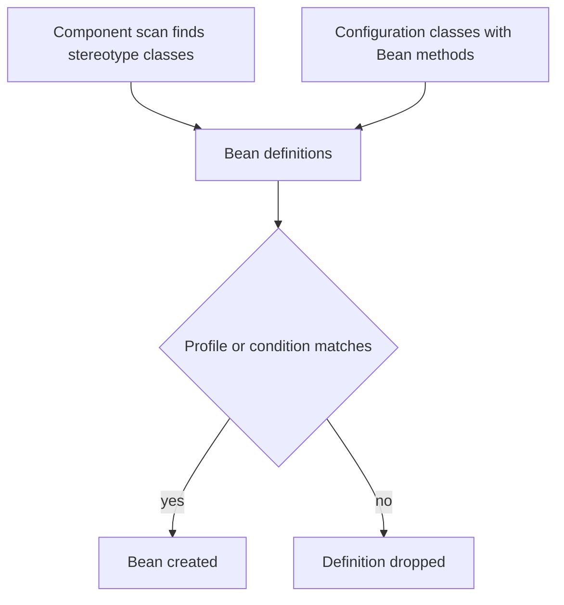

# Stereotypes and Configuration

!!! note "In simple words"
    Put a stereotype annotation such as `@Service` on your own class and Spring finds it and manages it. Put `@Bean` on a method in a `@Configuration` class when you need to create an object yourself.

## Why it matters

Spring has to learn about your beans somehow. Stereotype annotations let it discover your classes during scanning, and `@Configuration` with `@Bean` lets you describe objects you did not write, such as a clock or an HTTP client. Interviewers ask about this to check that you pick the right annotation for each situation, that you understand how scanning chooses candidates, and what `@Configuration` does that a plain class does not.

## How it works

Component scanning and configuration classes both produce bean definitions. Spring then filters those definitions and creates the beans.

1. The container scans the configured packages and registers every class marked with a stereotype annotation.
2. It processes each `@Configuration` class and creates a bean definition for every `@Bean` method.
3. It applies `@Profile` and `@Conditional` checks, and drops the definitions that do not apply.
4. It creates the remaining beans, following the lifecycle described in [IoC and Beans](ioc-and-beans.md).



### Stereotype annotations

A stereotype marks a class as a bean and states its role. Each one is meta-annotated with `@Component`, so component scanning finds all of them.

| Annotation | Role | Extra behaviour |
|---|---|---|
| `@Component` | Any managed component | Registration only |
| `@Service` | Business logic | A marker that helps AOP pointcuts target the service layer |
| `@Repository` | Data access | Translates persistence exceptions into Spring's `DataAccessException` hierarchy |
| `@Controller` | Web request handling | Lets Spring MVC find request-handling methods |

```java
import org.springframework.stereotype.Repository;
import org.springframework.stereotype.Service;

@Repository
class JdbcOrderRepository {
    // persistence code; exceptions are translated to DataAccessException
}

@Service
class OrderService {
    private final JdbcOrderRepository orders;

    OrderService(JdbcOrderRepository orders) {
        this.orders = orders;
    }
}
```

`@Repository` gets exception translation from a post-processor that wraps the bean in a proxy. This works for JDBC templates and JPA repositories. In Spring Boot, `@RestController` is simply `@Controller` plus `@ResponseBody`.

### Java configuration: @Configuration and @Bean

A `@Configuration` class declares beans with `@Bean` methods. The method's return value becomes a bean, and its name defaults to the method name.

```java
import java.time.Clock;
import org.springframework.context.annotation.Bean;
import org.springframework.context.annotation.Configuration;

@Configuration
public class ClockConfig {

    @Bean
    public Clock clock() {
        return Clock.systemUTC();
    }
}
```

Use `@Bean` for classes you do not own, such as a third-party client, `Clock`, or an `ObjectMapper`, because you cannot put an annotation on them. Use stereotypes for your own classes.

### Full mode and lite mode

By default (`proxyBeanMethods = true`), Spring subclasses the `@Configuration` class with CGLIB. A call from one `@Bean` method to another returns the existing singleton instead of creating a new one.

```java
import org.springframework.context.annotation.Bean;
import org.springframework.context.annotation.Configuration;

@Configuration
public class DataConfig {

    @Bean
    public Store primaryStore() {
        return new Store(connection());   // goes through the proxy and gets the singleton
    }

    @Bean
    public Store auditStore() {
        return new Store(connection());   // the same connection instance
    }

    @Bean
    public DbConnection connection() {
        return new DbConnection();
    }
}

record Store(DbConnection connection) { }

class DbConnection { }
```

With `@Configuration(proxyBeanMethods = false)`, the class runs in "lite" mode. Calls between `@Bean` methods then create new objects, but startup is faster. Use lite mode when your bean methods do not call each other.

A class without `@Configuration` that declares `@Bean` methods still registers beans, but Spring does not intercept calls between its methods.

### Component scanning

`@ComponentScan` lists the packages Spring searches for stereotype-annotated classes. `@SpringBootApplication` includes a `@ComponentScan` that starts at the package of the main class and covers its subpackages.

```java
import org.springframework.context.annotation.ComponentScan;
import org.springframework.context.annotation.ComponentScan.Filter;
import org.springframework.context.annotation.Configuration;
import org.springframework.context.annotation.FilterType;

@Configuration
@ComponentScan(
    basePackages = "com.example.orders",
    excludeFilters = @Filter(type = FilterType.REGEX, pattern = ".*Legacy.*"),
    includeFilters = @Filter(type = FilterType.ASSIGNABLE_TYPE, classes = PaymentGateway.class)
)
public class OrdersScanConfig {
}

interface PaymentGateway { }
```

Filter types include `ANNOTATION`, `ASSIGNABLE_TYPE`, `ASPECTJ`, `REGEX`, and `CUSTOM`. Filters help in tests. In production, a simple package layout is easier to read than a web of filters.

### Choosing where a bean comes from

| Situation | Use |
|---|---|
| Your own class with one implementation | `@Service`, `@Component`, or `@Repository` |
| A third-party class | `@Bean` in a `@Configuration` class |
| A bean that depends on a property or a class on the classpath | `@Bean` with `@ConditionalOnProperty` or `@Profile` |
| Several implementations of one interface | A stereotype or `@Bean`, plus `@Qualifier` or `@Primary` |

### Profiles and conditions

`@Profile("prod")` includes a bean only when that profile is active. Spring Boot's auto-configuration uses `@Conditional` annotations so that library beans appear only when they are needed. Use profiles for differences between environments, and use properties for plain values.

## Where it is used

- **Application packages:** `@Service`, `@Repository`, and `@RestController` classes in your own code.
- **Infrastructure beans:** clients, `ObjectMapper` customisation, security filter chains, and thread pools, declared with `@Bean`.
- **Environment switches:** a fake gateway in `dev` and a real one in `prod`, selected with `@Profile`.
- **Libraries:** auto-configuration classes, guarded by `@Conditional`.

## Benefits

- Stereotypes state a class's role, which makes the codebase easier to read.
- `@Bean` lets you register code you do not control, with full constructor control.
- Profiles and conditions keep environment differences out of the business code.

## Cons and limits

- Scanning is implicit. A class in the wrong package is silently missed.
- A `@Bean` method runs at startup, so heavy work in one slows every start.
- Two beans of the same type cause ambiguity errors until you add a qualifier or `@Primary`.
- Lite mode and full mode behave differently, which surprises people who expect plain method calls.

## Best practices

- Put the main class in a root package above the code it must scan.
- Use stereotypes for your own classes and `@Bean` for everything else.
- Keep `@Bean` methods cheap. Move expensive setup into a separate, well-named bean.
- Do not make `@Configuration` classes `final`, because the CGLIB proxy cannot subclass them.
- Avoid broad scanning that picks up test or legacy components by accident.
- Use `@Profile` for environment-specific beans and properties for values.

!!! tip "Interview tip"
    **Q: What is the difference between `@Component` and `@Bean`?**
    `@Component` goes on a class you wrote. Spring finds it through scanning and creates it. `@Bean` goes on a method inside a configuration class. It registers an object you did not write, or one that needs special construction. Both produce singleton beans by default.

## Quick recap

- `@Service`, `@Repository`, and `@Controller` are specialised `@Component` annotations. `@Repository` also translates exceptions.
- `@Configuration` with `@Bean` methods declares beans explicitly. In full mode, inter-method calls return the same singleton.
- Component scanning finds stereotypes in the packages you configure. Filters can include or exclude candidates.
- Use `@Profile` for environment-specific beans and `@Conditional` for auto-configuration.

## Official documentation

- [Spring Framework reference](https://docs.spring.io/spring-framework/reference/)
- [Spring Boot reference](https://docs.spring.io/spring-boot/reference/index.html)

**See also:** [IoC and Beans](ioc-and-beans.md), [Dependency Injection](dependency-injection.md), [AOP](aop.md)
