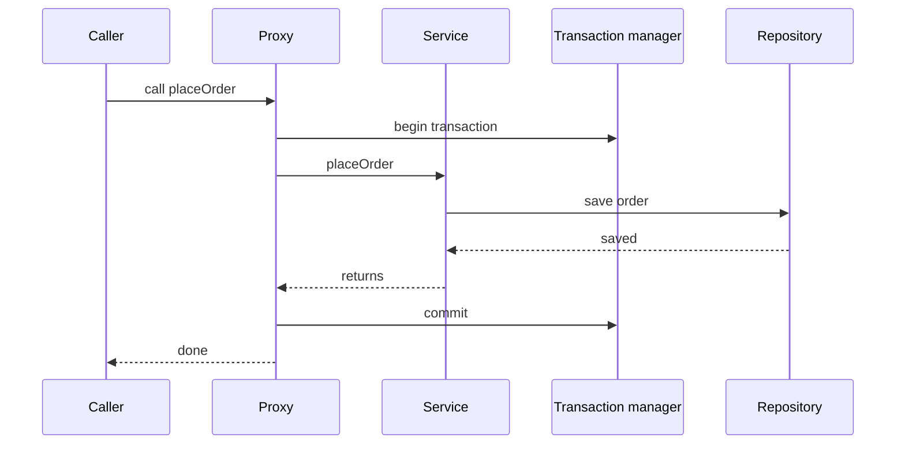

# Transactions in Spring

!!! note "In simple words"
    A transaction groups several database changes so they all save together or none do. In Spring you usually add `@Transactional` to a service method and let the framework start, commit, and roll back the transaction for you.

## Why it matters

Money transfers, orders, and stock updates fail when only half of their writes land. Transactions prevent that. Spring hides the differences between JDBC, JPA, and other resources behind one abstraction, so the same annotation works across them. Interviewers ask about transactions to test three things: propagation rules, rollback rules, and why an annotation sometimes does nothing at all.

## How it works

Spring manages transactions declaratively with `@Transactional`, or programmatically with `TransactionTemplate`. Both use a `PlatformTransactionManager`, which knows how to begin, commit, and roll back a transaction for one resource type. The Spring snippets on this page show the shape of the code; they are not compiled as part of this page.

When a `@Transactional` method is called through the proxy, the following happens:

1. The transaction interceptor asks the `PlatformTransactionManager` for a transaction, applying the propagation rules.
2. If a new transaction is needed, the manager obtains a connection or `EntityManager` and begins the transaction.
3. The method runs.
4. On a normal return, the transaction commits. If the transaction was joined from an outer call, the outer call commits later.
5. If an exception matches the rollback rules, the transaction rolls back and the exception continues to the caller.



### Declarative transactions with @Transactional

`@Transactional` marks a method or a class as transactional. Put it on the service layer, where a unit of work is defined. Repositories and controllers are the wrong place.

```java
import org.springframework.stereotype.Service;
import org.springframework.transaction.annotation.Transactional;

@Service
public class PaymentService {

    @Transactional
    public void capture(long orderId) {
        // all database work here commits together, or rolls back together
    }
}
```

### Propagation

Propagation decides what happens when a transactional method is called while a transaction is already running.

| Propagation | Behaviour |
|---|---|
| `REQUIRED` (default) | Join the current transaction, or start one if none exists |
| `REQUIRES_NEW` | Suspend the current transaction and start a separate, independent one |
| `NESTED` | Run inside a savepoint of the current transaction. Needs savepoint support, which JDBC provides. The JPA transaction manager does not allow it unless you enable nested transactions |
| `SUPPORTS` | Join a transaction if one exists. Otherwise run without one |
| `NOT_SUPPORTED` | Run without a transaction, suspending any existing one |
| `MANDATORY` | Require an existing transaction. Fail if none exists |
| `NEVER` | Fail if a transaction exists |

```java
import org.springframework.transaction.annotation.Propagation;
import org.springframework.transaction.annotation.Transactional;

public class AuditService {

    @Transactional(propagation = Propagation.REQUIRES_NEW)
    public void recordFailure(String message) {
        // commits even if the calling transaction later rolls back
    }
}
```

`REQUIRES_NEW` suits audit records that must survive a failed business operation. It takes a second database connection, so calling it in a loop can exhaust the connection pool.

### Rollback rules

By default, Spring rolls back when a method throws an unchecked exception (a `RuntimeException` or an `Error`). A checked exception commits the transaction unless you say otherwise. This surprises many developers.

```java
import org.springframework.transaction.annotation.Transactional;

public class ImportService {

    @Transactional(rollbackFor = Exception.class)      // roll back on checked exceptions too
    public void importFile(String path) throws java.io.IOException {
        // any exception now rolls back the import
    }

    @Transactional(noRollbackFor = IllegalStateException.class)
    public void tolerateWarnings() {
        // this exception type does not trigger a rollback
    }
}
```

Catching an exception inside a transactional method and not rethrowing it commits the transaction, because Spring never sees the failure. If you must catch it, mark the transaction for rollback with `TransactionAspectSupport.currentTransactionStatus().setRollbackOnly()`, or rethrow the exception.

### Isolation levels

The `isolation` attribute sets the isolation level for the transaction. It applies when the transaction starts, and only if the database supports that level. See [Advanced SQL and Transactions](../06-databases-sql/advanced-sql-transactions.md) for what each level allows.

```java
import org.springframework.transaction.annotation.Isolation;
import org.springframework.transaction.annotation.Transactional;

public class InventoryService {

    @Transactional(isolation = Isolation.REPEATABLE_READ)
    public void reportStock(long itemId) {
        // reads inside this method see a consistent snapshot of the item
    }
}
```

Stronger levels reduce anomalies but also reduce concurrency. For a counter update, a single atomic `UPDATE` statement or an explicit row lock is often clearer and cheaper than raising the isolation level.

### Read-only optimisation

`@Transactional(readOnly = true)` is a hint. Spring passes it to the transaction manager, which may let JPA skip dirty checking and may let the driver route the query to a replica. It is not a security control. Some setups still allow writes, so never rely on it to block changes.

```java
import java.util.List;
import org.springframework.transaction.annotation.Transactional;

public class OrderQueryService {

    @Transactional(readOnly = true)
    public List<String> recentOrderIds() {
        return List.of();   // placeholder for a read-only query
    }
}
```

### Programmatic transactions: TransactionTemplate

`TransactionTemplate` runs a block inside a transaction without relying on a proxy. It is useful when you need a boundary in the middle of a method, or when self-invocation makes the annotation ineffective.

```java
import org.springframework.stereotype.Service;
import org.springframework.transaction.PlatformTransactionManager;
import org.springframework.transaction.support.TransactionTemplate;

@Service
public class SettlementService {

    private final TransactionTemplate tx;

    public SettlementService(PlatformTransactionManager transactionManager) {
        this.tx = new TransactionTemplate(transactionManager);
    }

    public void settle(long batchId) {
        tx.executeWithoutResult(status -> {
            // work inside the transaction
            if (batchId < 0) {
                status.setRollbackOnly();      // roll back without throwing
            }
        });
    }
}
```

Spring Boot configures a `PlatformTransactionManager` automatically: `JpaTransactionManager` when JPA is on the classpath, and `DataSourceTransactionManager` for plain JDBC.

### Multiple databases and transaction managers

When an application writes to two databases, each database needs its own transaction manager. Spring cannot make one `@Transactional` method commit both atomically. Name the managers, mark one as `@Primary`, and select the other explicitly on the annotation.

```java
import jakarta.persistence.EntityManagerFactory;
import org.springframework.beans.factory.annotation.Qualifier;
import org.springframework.context.annotation.Bean;
import org.springframework.context.annotation.Configuration;
import org.springframework.context.annotation.Primary;
import org.springframework.orm.jpa.JpaTransactionManager;
import org.springframework.transaction.PlatformTransactionManager;

@Configuration
class TransactionManagers {

    @Bean
    @Primary
    PlatformTransactionManager ordersTx(@Qualifier("ordersEmf") EntityManagerFactory emf) {
        return new JpaTransactionManager(emf);
    }

    @Bean
    PlatformTransactionManager auditTx(@Qualifier("auditEmf") EntityManagerFactory emf) {
        return new JpaTransactionManager(emf);
    }
}
```

```java
import org.springframework.stereotype.Service;
import org.springframework.transaction.annotation.Transactional;

@Service
class OrderWithAudit {

    @Transactional                                        // uses the primary manager
    public void placeOrder() { }

    @Transactional(transactionManager = "auditTx")        // a separate transaction on the audit database
    public void recordAudit() { }
}
```

Two points come up in interviews. First, Boot's JPA auto-configuration backs off once you define your own `EntityManagerFactory` and transaction manager, so you take responsibility for both. Second, if the audit write must match the order write, one transaction cannot cover both databases. Use an outbox table in the primary database, or a saga with compensating steps, instead of two commits that might disagree.

### Wiring a DataSource and EntityManagerFactory per database

A transaction manager is only half of a second database. Each database also needs its own `DataSource` and its own `EntityManagerFactory`, and each factory must scan the right entity package. Boot creates one set automatically and steps back once you define your own, so you define both sets. The pattern below keeps Boot's Hibernate settings by using the `EntityManagerFactoryBuilder` that Boot provides.

```java
import org.springframework.beans.factory.annotation.Qualifier;
import org.springframework.boot.autoconfigure.jdbc.DataSourceProperties;
import org.springframework.boot.autoconfigure.orm.jpa.EntityManagerFactoryBuilder;
import org.springframework.boot.context.properties.ConfigurationProperties;
import org.springframework.context.annotation.Bean;
import org.springframework.context.annotation.Configuration;
import org.springframework.context.annotation.Primary;
import org.springframework.orm.jpa.LocalContainerEntityManagerFactoryBean;
import javax.sql.DataSource;

@Configuration
class OrdersDatabaseConfig {

    @Bean
    @Primary
    @ConfigurationProperties("app.orders.datasource")
    DataSourceProperties ordersDataSourceProperties() {
        return new DataSourceProperties();
    }

    @Bean
    @Primary
    DataSource ordersDataSource(@Qualifier("ordersDataSourceProperties") DataSourceProperties props) {
        return props.initializeDataSourceBuilder().build();
    }

    @Bean
    @Primary
    LocalContainerEntityManagerFactoryBean ordersEmf(
            @Qualifier("ordersDataSource") DataSource dataSource,
            EntityManagerFactoryBuilder builder) {
        return builder.dataSource(dataSource)
                .packages("com.example.orders.domain")   // only the orders entities
                .persistenceUnit("orders")
                .build();
    }
}

@Configuration
class AuditDatabaseConfig {

    @Bean
    @ConfigurationProperties("app.audit.datasource")
    DataSourceProperties auditDataSourceProperties() {
        return new DataSourceProperties();
    }

    @Bean
    DataSource auditDataSource(@Qualifier("auditDataSourceProperties") DataSourceProperties props) {
        return props.initializeDataSourceBuilder().build();
    }

    @Bean
    LocalContainerEntityManagerFactoryBean auditEmf(
            @Qualifier("auditDataSource") DataSource dataSource,
            EntityManagerFactoryBuilder builder) {
        return builder.dataSource(dataSource)
                .packages("com.example.audit.domain")
                .persistenceUnit("audit")
                .build();
    }
}
```

Each factory has its own persistence unit name and its own entity package, so Hibernate never maps an entity to the wrong database. The transaction managers in the previous section refer to these factories by name. Keep the two packages separate. An entity picked up by both factories is mapped twice.

Two cautions. Repositories must also be bound to the right factory. Spring Data does this with `@EnableJpaRepositories` and the `entityManagerFactoryRef` and `transactionManagerRef` attributes, with one configuration per database. Also, a JPA entity in one database cannot be joined to an entity in the other database in SQL, so store a plain id as the link.

### Read-write split with a routing DataSource

When a database has a read replica, you can send reads to the replica and writes to the primary. Spring's `AbstractRoutingDataSource` chooses a `DataSource` for each connection, based on a lookup key. Use the transaction's read-only flag as that key. A method marked `@Transactional(readOnly = true)` then reads from the replica without any change to the repository code.

```java
import java.util.Map;
import javax.sql.DataSource;
import org.springframework.beans.factory.annotation.Qualifier;
import org.springframework.boot.jdbc.DataSourceBuilder;
import org.springframework.context.annotation.Bean;
import org.springframework.context.annotation.Configuration;
import org.springframework.context.annotation.Primary;
import org.springframework.jdbc.datasource.LazyConnectionDataSourceProxy;
import org.springframework.jdbc.datasource.lookup.AbstractRoutingDataSource;
import org.springframework.transaction.support.TransactionSynchronizationManager;

enum Route { WRITE, READ }

class ReadWriteRouter extends AbstractRoutingDataSource {

    @Override
    protected Object determineCurrentLookupKey() {
        return TransactionSynchronizationManager.isCurrentTransactionReadOnly()
                ? Route.READ
                : Route.WRITE;
    }
}

@Configuration
class ReadWriteConfig {

    @Bean("primaryDataSource")
    DataSource primaryDataSource() {
        return DataSourceBuilder.create().url("jdbc:postgresql://primary-host/orders").build();
    }

    @Bean("replicaDataSource")
    DataSource replicaDataSource() {
        return DataSourceBuilder.create().url("jdbc:postgresql://replica-host/orders").build();
    }

    @Bean
    @Primary
    DataSource routingDataSource(@Qualifier("primaryDataSource") DataSource primary,
                                 @Qualifier("replicaDataSource") DataSource replica) {
        ReadWriteRouter router = new ReadWriteRouter();
        router.setTargetDataSources(Map.of(Route.WRITE, primary, Route.READ, replica));
        router.setDefaultTargetDataSource(primary);
        return new LazyConnectionDataSourceProxy(router);   // choose the connection after the flag is known
    }
}
```

The `LazyConnectionDataSourceProxy` wrapper is essential. It delays acquiring a physical connection until the first statement, so the routing decision sees the read-only flag. Without it, the connection can be opened before the flag is set, and every query goes to the primary.

Three cautions for an interview answer:

- Replicas lag behind the primary. A read right after a write can miss that write. Send read-your-own-write flows to the primary.
- Test the routing. Write a test that checks which database a read-only query used. The timing depends on the transaction manager. In a JPA transaction the flag may be set after a connection is already taken, so confirm the behaviour in your setup.
- Mark only truly read-only methods as `readOnly = true`. A write sent through a read-only transaction goes to the replica and fails.

### Self-invocation and visibility

Two common reasons an annotation has no effect:

- **Self-invocation:** calling a `@Transactional` method from another method of the same class bypasses the proxy. See [AOP](aop.md).
- **Non-public methods:** the proxy does not intercept private methods, and by default only public methods are transactional.

## Where it is used

- **Service methods** that change several rows, such as placing an order and reserving stock.
- **Read-only queries** that should use a replica or skip dirty checking.
- **Audit or outbox writes** that must survive a failed business operation, using `REQUIRES_NEW` or a separate manager.
- **Batch jobs**, where `TransactionTemplate` commits in chunks.

## Benefits

- All-or-nothing writes without manual commit and rollback code.
- The same annotation works across JDBC, JPA, and other resources.
- Propagation rules let services compose without knowing about each other's transactions.
- Routing and multiple managers handle larger architectures without changing the business code.

## Cons and limits

- The proxy only sees calls from outside the bean. Self-invocation silently skips the transaction.
- A transaction holds a database connection for its whole length. Slow work inside it reduces throughput.
- Rollback rules are easy to get wrong with checked exceptions and swallowed exceptions.
- One transaction cannot span two databases. Cross-database consistency needs patterns such as an outbox or sagas.
- Replicas return slightly stale data.

## Best practices

- Put `@Transactional` on service methods, not on controllers or repositories.
- Keep transactions short. Do not call external HTTP services while a transaction is open.
- Declare `rollbackFor` for checked exceptions that should roll back.
- Never catch and swallow an exception inside a transactional method unless you mark the transaction for rollback.
- Avoid `REQUIRES_NEW` in loops, because each call takes another connection.
- Do not treat `readOnly = true` as a security boundary.

!!! tip "Interview tip"
    **Q: Why did my `@Transactional` method not roll back when an exception was thrown?**
    Check three things. Was the exception checked? Checked exceptions commit by default, so add `rollbackFor`. Was the exception caught inside the method? A caught exception never reaches the proxy. Did the call bypass the proxy through self-invocation? Those three causes cover most cases.

## Quick recap

- `@Transactional` is applied by a proxy, so it covers calls that come through the proxy, not internal calls.
- `REQUIRED` joins or starts a transaction. `REQUIRES_NEW` always starts a new one.
- Runtime exceptions roll back by default. Checked exceptions commit unless `rollbackFor` is set.
- `TransactionTemplate` gives explicit control over the boundary.
- Keep transactions short, and never hold them open during network calls.

## Official documentation

- [Spring Framework reference](https://docs.spring.io/spring-framework/reference/)
- [Spring Data JPA reference](https://docs.spring.io/spring-data/jpa/reference/index.html)
- [Spring Boot reference](https://docs.spring.io/spring-boot/reference/index.html)

**See also:** [AOP](aop.md), [Dependency Injection](dependency-injection.md), [Spring Data JPA](../07-jdbc-jpa/spring-data-jpa.md), [JDBC](../07-jdbc-jpa/jdbc.md)
