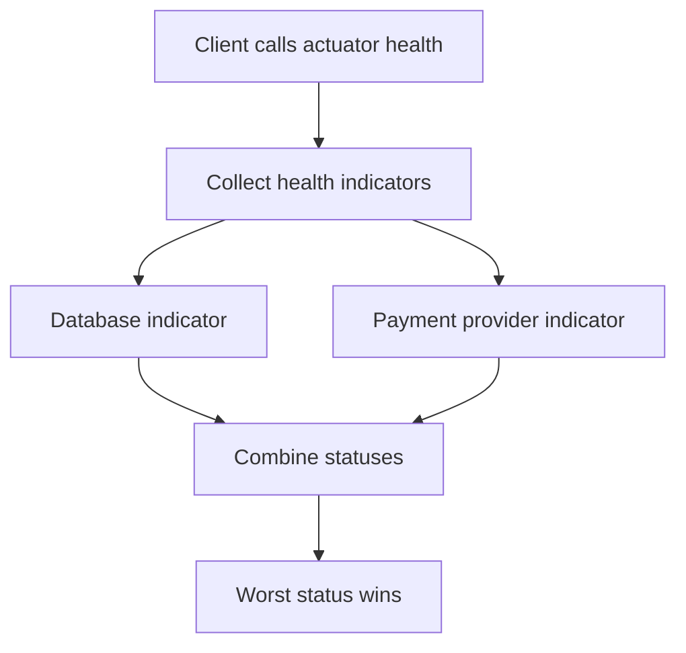

# Actuator and API Documentation

!!! note "In simple words"
    Actuator gives a running service a set of operational endpoints, such as health, metrics, and build info. springdoc generates API documentation from your controllers. Expose only what you need, and protect the rest.

## Why it matters

Once a service runs in production, someone must answer questions about it: is it up, is it ready for traffic, which version runs, and what is it doing? Actuator answers these questions with endpoints, and Micrometer provides the metrics behind them. Some endpoints are also dangerous to expose, because they reveal configuration, memory, and routes. Interviewers ask about this to see whether you can run a service in production and whether you know which endpoints must stay private.

## How it works

Actuator registers its endpoints as beans and maps them under `/actuator` once they are exposed. Health checks, metrics, and API documentation work in separate, but related, ways. The Spring snippets show the shape of the code; they are not compiled as part of this page.

1. Actuator maps each exposed endpoint under `/actuator`.
2. When `/actuator/health` is requested, Actuator collects every health indicator and combines them. The worst status wins.
3. Micrometer records metrics in a registry, and an exporter such as Prometheus scrapes them.
4. springdoc inspects the controller mappings and annotations at startup, and builds the OpenAPI document served at `/v3/api-docs`.



### Enabling and exposing endpoints

Add `spring-boot-starter-actuator`. Actuator endpoints live under `/actuator`. Over HTTP, only a small set is exposed by default, and you choose what to add:

```yaml
management:
  endpoints:
    web:
      exposure:
        include: health,info,metrics
  endpoint:
    health:
      show-details: when-authorized
```

`show-details: when-authorized` returns component details only to authenticated callers. Expose the minimum you need, and protect the rest with Spring Security.

### The info endpoint and build metadata

`/actuator/info` returns descriptive data about the running build, such as the version that is deployed. Three sources feed it:

- Properties under the `info` prefix in your configuration files.
- Build metadata. If the build plugin writes `build-info.properties`, Boot adds a `build` section automatically. Maven projects create it with the `build-info` goal of the Spring Boot plugin.
- Beans that implement `InfoContributor`, for values known only at runtime.

```yaml
info:
  app:
    name: order-service
    team: payments
management:
  info:
    env:
      enabled: true              # expose info.* values from the environment
```

Resource filtering can copy the project version into a property. The Boot parent POM enables filtering for the `application` files, so `version: @project.version@` in `application.yml` is replaced at build time.

```java
import org.springframework.boot.actuate.info.Info;
import org.springframework.boot.actuate.info.InfoContributor;
import org.springframework.stereotype.Component;

@Component
class RuntimeInfo implements InfoContributor {

    @Override
    public void contribute(Info.Builder builder) {
        builder.withDetail("region", "eu-west-1");   // known only at runtime, or from the platform
    }
}
```

Do not put secrets, connection strings, or internal host names in the info output. It is often public, even when other endpoints are protected.

### Health checks

The `/actuator/health` endpoint combines health indicators. Each indicator is a bean that implements `HealthIndicator`. Its bean name, without the suffix, becomes the component name in the output.

```java
import org.springframework.boot.actuate.health.Health;
import org.springframework.boot.actuate.health.HealthIndicator;
import org.springframework.stereotype.Component;

@Component
class PaymentProviderHealth implements HealthIndicator {

    @Override
    public Health health() {
        boolean reachable = checkProvider();   // replace with a cheap, bounded check
        return reachable
                ? Health.up().build()
                : Health.down().withDetail("reason", "provider unreachable").build();
    }

    private boolean checkProvider() {
        return true;
    }
}
```

Keep health checks cheap and time-bounded. A check that calls a slow dependency can make the whole endpoint slow, and a load balancer may then remove a healthy instance.

### Liveness and readiness

Kubernetes uses two probes. Liveness asks whether the process should be restarted. Readiness asks whether the instance should receive traffic now. Spring Boot exposes both when probes are enabled:

```yaml
management:
  endpoint:
    health:
      probes:
        enabled: true
```

The endpoints are `/actuator/health/liveness` and `/actuator/health/readiness`. Keep liveness independent of downstream services. Otherwise a dependency outage restarts every pod. Readiness can reflect dependencies, so traffic stops reaching an instance that cannot serve it. Containers are covered in [Kubernetes](../16-kubernetes/index.md).

Readiness is not only about the database being reachable. An application can tell the platform to hold traffic, for example while a cache loads. Publish an `AvailabilityChangeEvent` with `ReadinessState.REFUSING_TRAFFIC`, and switch back to `ACCEPTING_TRAFFIC` when the work finishes:

```java
import org.springframework.boot.availability.AvailabilityChangeEvent;
import org.springframework.boot.availability.ReadinessState;
import org.springframework.context.ApplicationEventPublisher;
import org.springframework.stereotype.Component;

@Component
class CatalogLoader {

    private final ApplicationEventPublisher publisher;

    CatalogLoader(ApplicationEventPublisher publisher) {
        this.publisher = publisher;
    }

    void reload() {
        publisher.publishEvent(new AvailabilityChangeEvent<>(this, ReadinessState.REFUSING_TRAFFIC));
        try {
            // load reference data here
        } finally {
            publisher.publishEvent(new AvailabilityChangeEvent<>(this, ReadinessState.ACCEPTING_TRAFFIC));
        }
    }
}
```

The readiness probe reports the state, and the orchestrator stops routing traffic during the reload. Use a `finally` block, as shown, so the instance returns to `ACCEPTING_TRAFFIC` even when the load fails. Otherwise it stays out of service.

### Metrics with Micrometer

Micrometer is a metrics facade. You record metrics through `MeterRegistry`, and a registry implementation exports them to a backend such as Prometheus. Spring Boot configures the registry for you.

```java
import io.micrometer.core.instrument.Counter;
import io.micrometer.core.instrument.MeterRegistry;
import org.springframework.stereotype.Service;

@Service
class OrderMetrics {
    private final Counter created;

    OrderMetrics(MeterRegistry registry) {
        this.created = registry.counter("orders.created");
    }

    void recordCreated() {
        created.increment();
    }
}
```

Name metrics for what is measured, not for who measured it. Avoid high-cardinality tags such as user IDs or raw URLs. Each unique tag value creates a new time series.

### Prometheus

To scrape metrics with Prometheus, add the Micrometer registry and expose its endpoint. The endpoint then serves text in the Prometheus exposition format at `/actuator/prometheus`.

```xml
<dependency>
    <groupId>io.micrometer</groupId>
    <artifactId>micrometer-registry-prometheus</artifactId>
</dependency>
```

```yaml
management:
  endpoints:
    web:
      exposure:
        include: health,info,prometheus
```

### Other endpoints and their risk

| Endpoint | What it shows | Risk |
|---|---|---|
| `/actuator/env` | Configuration properties | Can reveal secrets unless they are sanitised |
| `/actuator/beans` | Every bean in the context | Reveals internal structure |
| `/actuator/mappings` | Request mappings | Reveals routes |
| `/actuator/threaddump` | Thread states | Can reveal internal logic |
| `/actuator/heapdump` | A full memory snapshot | Can contain passwords and tokens |

Do not expose `heapdump` or `env` publicly. If you need them, restrict them to an internal management port or require strong authentication. A separate management port is set with `management.server.port`.

### API documentation with springdoc-openapi

For Spring Boot 3 with Spring MVC, use the springdoc starter `springdoc-openapi-starter-webmvc-ui`. Choose the version that matches your Boot line. It scans controllers at runtime, serves the OpenAPI document at `/v3/api-docs`, and provides Swagger UI in the browser.

Annotations from `io.swagger.v3.oas.annotations` add descriptions:

```java
import io.swagger.v3.oas.annotations.Operation;
import io.swagger.v3.oas.annotations.Parameter;
import io.swagger.v3.oas.annotations.responses.ApiResponse;
import io.swagger.v3.oas.annotations.responses.ApiResponses;
import io.swagger.v3.oas.annotations.tags.Tag;
import org.springframework.web.bind.annotation.GetMapping;
import org.springframework.web.bind.annotation.PathVariable;
import org.springframework.web.bind.annotation.RequestMapping;
import org.springframework.web.bind.annotation.RestController;

@RestController
@RequestMapping("/api/orders")
@Tag(name = "Orders", description = "Order lifecycle")
class OrderApiController {

    @Operation(summary = "Fetch an order by id")
    @ApiResponses({
            @ApiResponse(responseCode = "200", description = "Order found"),
            @ApiResponse(responseCode = "404", description = "Order not found")
    })
    @GetMapping("/{id}")
    String get(@Parameter(description = "Order identifier") @PathVariable long id) {
        return "order " + id;
    }
}
```

The docs are only as accurate as the code and annotations. Generate them from the code rather than maintaining a separate spec by hand, and review the generated output as part of each change.

### Securing docs and actuator

Swagger UI and `/actuator/**` are often left open by accident. Add rules for them in your security configuration, and decide per environment whether the docs are exposed at all. A common pattern is to serve the docs in development and staging only, or behind authentication in production.

### Audit events and their security

Boot can record audit events through an `AuditEventRepository`. Spring Security publishes sign-in successes and failures, and Boot's audit listener stores them, so you get that trail without writing code. The default repository is in memory and bounded, and it is lost on restart. For anything you must keep, export the events to a durable store.

Your own business events go through the same repository. The principal is the user or service that acted, and the data map holds only the detail you need to investigate:

```java
import java.util.Map;
import org.springframework.boot.actuate.audit.AuditEvent;
import org.springframework.boot.actuate.audit.AuditEventRepository;
import org.springframework.stereotype.Service;

@Service
class PriceAudit {

    private final AuditEventRepository audit;

    PriceAudit(AuditEventRepository audit) {
        this.audit = audit;
    }

    void priceChanged(String actor, String sku) {
        audit.add(new AuditEvent(actor, "PRICE_CHANGED", Map.of("sku", sku)));
    }
}
```

Audit data is often personal data, because it records who did what and from where. Three rules follow. Do not write tokens, passwords, or full request bodies into an event. Set a retention period that matches your policy, and delete events when it ends. Restrict the `auditevents` endpoint, because it shows the trail to anyone who can call it.

## Where it is used

- **Orchestrators:** Kubernetes liveness and readiness probes on the health endpoints.
- **Monitoring:** Prometheus scraping `/actuator/prometheus`, with dashboards and alerts built on those metrics.
- **Deployment checks:** `/actuator/info` confirms which version runs.
- **Partner integration:** the OpenAPI document served at `/v3/api-docs` for client generation.

## Benefits

- Operational questions get answers without custom code.
- Metrics and health use standard formats that tools already understand.
- Generated API documentation stays close to the code that defines the API.
- Readiness and liveness let the platform act on the real state of each instance.

## Cons and limits

- Some endpoints reveal sensitive detail, so they need deliberate protection.
- Health checks that call dependencies can cause outages through restarts or removals.
- Generated docs can drift from behaviour if annotations are missing or wrong.
- High-cardinality metrics can overload the metrics backend.

## Troubleshooting

Most actuator problems come down to one of four causes. Check them in this order:

| Symptom | Likely cause | What to check |
|---|---|---|
| `404` on an endpoint such as `/actuator/metrics` | The endpoint is not exposed, or the actuator starter is missing | `management.endpoints.web.exposure.include` and the dependency list |
| `401` or `403` on `/actuator/...` | Spring Security rules cover the actuator paths | The security filter chain, and whether the request carries credentials |
| Health is `DOWN` but the app works | One health indicator reports a failure | The component details in `/actuator/health`, shown to authorised callers |
| A metric is missing from `/actuator/metrics` | The meter has not been recorded yet, or the name differs | Whether the code has run once, and the exact name in the list |

Some details cause confusion:

- A counter or timer usually appears only after its first recording, so a new metric may be absent right after a deploy. Trigger the code path once before you look.
- Prometheus converts dots to underscores. A metric called `orders.created` appears as `orders_created` in the scrape output.
- A `DOWN` health result from a slow dependency can make an orchestrator remove the instance. Check the timeout on the indicator before you blame the dependency.
- Probe endpoints such as `/actuator/health/readiness` appear only when probes are enabled. If a platform reports them as missing, check that property first.

## Best practices

- Expose only the endpoints you need. Never expose `*` in production.
- Protect actuator and Swagger UI with authentication, or serve them on a separate internal port.
- Implement `HealthIndicator` for custom checks, and keep each one cheap and bounded.
- Keep liveness independent of downstream services. Let readiness reflect dependencies.
- Record metrics with Micrometer, using low-cardinality tags.
- Generate OpenAPI docs with springdoc, and keep them behind authentication in production.

!!! tip "Interview tip"
    **Q: What is the difference between liveness and readiness?**
    Liveness decides whether a container should be restarted, so it should detect only a broken process. Readiness decides whether to send traffic, so it can include dependencies. Mixing them causes restarts during a dependency outage, which makes things worse.

## Quick recap

- Expose only the actuator endpoints you need, and protect the rest.
- Implement `HealthIndicator` for custom checks, and keep them cheap and bounded.
- Use liveness and readiness probes, each with its own responsibility.
- Record metrics through Micrometer with low-cardinality tags.
- Generate OpenAPI docs with springdoc, and do not expose them unguarded in production.

## Official documentation

- [Spring Boot reference](https://docs.spring.io/spring-boot/reference/index.html)
- [Prometheus overview](https://prometheus.io/docs/introduction/overview/)
- [OpenAPI Specification](https://spec.openapis.org/oas/latest.html)

**See also:** [Building REST APIs](rest-apis.md) | [Observability](../20-observability/index.md) | [Spring Security Authorisation](../10-security/spring-security-authorisation.md)
