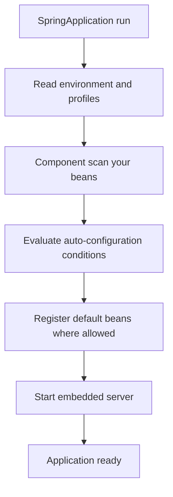

# Spring Boot Basics and Configuration

!!! note "In simple words"
    Spring Boot starts a Spring application for you. It adds a web server, picks sensible defaults based on the libraries you include, and reads settings from files, environment variables, and the command line.

## Why it matters

Plain Spring needs a lot of setup before anything runs. Boot removes most of it, which makes applications quick to start. The risk is that auto-configuration becomes magic that nobody understands, and that gap shows up when something breaks at startup or in production. Interviewers ask about Boot to see whether you know what it decides for you, how it decides, and how to override it.

## How it works

Boot does its work in a fixed order when `SpringApplication.run` is called. The flowchart shows the sequence. The Spring snippets on this page show the shape of the code; they are not compiled as part of this page.

1. `SpringApplication.run` creates the application context and reads the environment: command-line arguments, environment variables, property files, and active profiles.
2. Component scanning registers your own beans, starting from the package of the main class.
3. Auto-configuration classes are checked against their conditions. Each one that applies registers default beans, unless you already defined a bean of that type.
4. The embedded server starts, and the application is ready to serve requests.



### Spring versus Spring Boot

Spring Boot is not a replacement for Spring. It is a layer on top of the Spring Framework that makes common choices for you.

| Topic | Spring Framework | Spring Boot |
|---|---|---|
| What you get | Dependency injection, AOP, MVC, data access, and transactions | The same features, preconfigured for common cases |
| Wiring | You declare beans and infrastructure yourself, in Java or XML | Auto-configuration creates default beans based on the classpath |
| Web server | You deploy a WAR to an external servlet container | An embedded server runs inside an executable JAR |
| Library versions | You choose compatible versions of each library | Starters and the parent POM or BOM align the versions |
| Configuration | Explicit beans, plus property files you load yourself | Standard `application` files, profiles, and typed properties |
| Operations | You build health checks and metrics | Actuator endpoints are available once you expose them |
| Testing | You assemble the context for each test | `@SpringBootTest` and test slices load only what a test needs |

For an interview, the short answer is: Spring provides the building blocks, and Boot chooses defaults for them and steps aside when you define your own.

### @SpringBootApplication

`@SpringBootApplication` is a convenience annotation. It combines three others: `@Configuration` (the class can declare beans), `@EnableAutoConfiguration` (turns on auto-configuration), and `@ComponentScan` (finds components in this package and below).

```java
import org.springframework.boot.SpringApplication;
import org.springframework.boot.autoconfigure.SpringBootApplication;

@SpringBootApplication
public class OrderServiceApplication {
    public static void main(String[] args) {
        SpringApplication.run(OrderServiceApplication.class, args);
    }
}
```

Place this class in the root package of your application. Scanning starts from its package, so classes outside that tree are not found unless you configure scanning yourself.

### How auto-configuration decides

Each starter jar lists its auto-configuration classes in `META-INF/spring/org.springframework.boot.autoconfigure.AutoConfiguration.imports`. This file replaced the older `spring.factories` entry for these classes in Spring Boot 2.7 and later. Each candidate is guarded by conditions:

- `@ConditionalOnClass`: the library is on the classpath.
- `@ConditionalOnMissingBean`: you have not defined your own bean of that type.
- `@ConditionalOnProperty`: a property has a given value.

Because of `@ConditionalOnMissingBean`, a bean you define always wins over Boot's default. That is the normal way to override Boot.

```java
import javax.sql.DataSource;
import org.springframework.context.annotation.Bean;
import org.springframework.context.annotation.Configuration;
import org.springframework.jdbc.datasource.DriverManagerDataSource;

@Configuration
class DataSourceOverride {

    // Boot's DataSource auto-configuration backs off because this bean exists.
    @Bean
    DataSource dataSource() {
        DriverManagerDataSource ds = new DriverManagerDataSource();
        ds.setUrl("jdbc:postgresql://db.example.com/orders");
        ds.setUsername("app");
        ds.setPassword(System.getenv("DB_PASSWORD"));   // read the secret from the environment
        return ds;
    }
}
```

### Embedded servers

`spring-boot-starter-web` brings in Tomcat as the default embedded servlet container, so the application runs with a plain `java -jar`. To use another server, exclude the Tomcat starter and add a different one, such as Jetty. Check the support matrix for your Boot version before you choose a server, because support changes between releases.

### Profiles and environment abstraction

Profiles group configuration and beans for each environment. Activate them with `spring.profiles.active` or the `SPRING_PROFILES_ACTIVE` environment variable. A profile-specific file such as `application-prod.yml` overrides the base `application.yml`.

```java
import org.springframework.context.annotation.Profile;
import org.springframework.stereotype.Service;

public interface PaymentGateway {
    boolean charge(String customerId, int amountCents);
}

@Service
@Profile("dev")
class FakePaymentGateway implements PaymentGateway {
    @Override
    public boolean charge(String customerId, int amountCents) {
        return true;   // never call a real provider in dev
    }
}
```

### Configuration binding

`@Value` injects one value. `@ConfigurationProperties` binds a whole group of keys to a type, which is safer and easier to test. Records work well for this in Spring Boot 3.

```java
import java.time.Duration;
import org.springframework.boot.context.properties.ConfigurationProperties;

@ConfigurationProperties(prefix = "app.payment")
public record PaymentProperties(String url, Duration timeout) {}
```

Register the class with `@ConfigurationPropertiesScan` on the application class, or with `@EnableConfigurationProperties(PaymentProperties.class)`.

```yaml
app:
  payment:
    url: https://payments.example.com
    timeout: 3s
```

Boot uses relaxed binding. The environment variable `APP_PAYMENT_URL` maps to `app.payment.url`. Keep secrets out of files. See [Secrets Management](../10-security/secrets-management.md).

### Property source precedence

Higher sources override lower ones for the same key. The order interviewers expect you to know is:

| Source (highest priority first) | Example |
|---|---|
| Command-line arguments | `--server.port=9090` |
| `SPRING_APPLICATION_JSON` (inline JSON in an environment variable) | `{"server.port":9090}` |
| Java system properties | `-Dserver.port=9090` |
| OS environment variables | `SERVER_PORT=9090` |
| Profile-specific file | `application-prod.yml` |
| Default file | `application.yml` |
| `@PropertySource` on a configuration class | `@PropertySource("classpath:extra.properties")` |
| Built-in defaults | `server.port` defaults to 8080 |

A profile-specific file beats the default file, but an environment variable beats both. That is why a secret the platform injects wins over anything committed to the repository. The reference documentation for your Boot version has the complete list.

### Starters and packaging

A starter is a curated set of dependencies for one purpose, such as `spring-boot-starter-data-jpa`. Starters contain no application code. They pull in libraries and the auto-configuration that uses them. Boot's parent POM or BOM manages the versions, so you leave the version off the starter.

| Starter | Use it for | Brings in (main parts) |
|---|---|---|
| `spring-boot-starter-web` | REST APIs and MVC applications | Spring MVC, embedded Tomcat, Jackson |
| `spring-boot-starter-webflux` | Non-blocking web applications | Spring WebFlux, Reactor, embedded Netty |
| `spring-boot-starter-data-jpa` | Relational persistence with entities | Spring Data JPA, Hibernate, HikariCP |
| `spring-boot-starter-jdbc` | Plain JDBC with `JdbcTemplate` | Spring JDBC, HikariCP |
| `spring-boot-starter-data-r2dbc` | Reactive relational access | Spring Data R2DBC. Add your database driver |
| `spring-boot-starter-data-mongodb` | Document storage with MongoDB | Spring Data MongoDB |
| `spring-boot-starter-data-redis` | Redis as a cache or data store | Spring Data Redis, Lettuce client |
| `spring-boot-starter-security` | Authentication and authorisation | Spring Security |
| `spring-boot-starter-oauth2-resource-server` | Accepting bearer tokens such as JWTs | Spring Security resource-server support |
| `spring-boot-starter-validation` | Bean validation on requests and entities | Jakarta Bean Validation, Hibernate Validator |
| `spring-boot-starter-actuator` | Health, metrics, and operational endpoints | Actuator and Micrometer |
| `spring-boot-starter-cache` | The cache abstraction | Spring Cache. Add a provider such as Caffeine |
| `spring-boot-starter-amqp` | Messaging with RabbitMQ | Spring AMQP |
| `spring-boot-starter-aop` | Cross-cutting behaviour, such as timing service methods | Spring AOP and the AspectJ weaver |
| `spring-boot-starter-test` | Tests | JUnit 5, AssertJ, Mockito, Spring Test |

Your database driver is usually not part of a starter. Add it yourself, such as the PostgreSQL or MySQL JDBC driver, and check that its version suits your Boot release.

Packaging with the Spring Boot Maven or Gradle plugin produces an executable "fat" JAR. It contains the application, its dependencies, and an embedded server. Layered JARs let container builds reuse the unchanged dependency layers.

### Startup and shutdown hooks

Boot publishes events as the application starts. A listener for `ApplicationReadyEvent` runs after the context is fully refreshed and the server accepts requests. That makes it the right place for work that needs the whole application, such as warming a cache. Work a bean needs before anything else belongs in a `@PostConstruct` method, which runs during bean creation.

```java
import org.springframework.boot.context.event.ApplicationReadyEvent;
import org.springframework.context.event.EventListener;
import org.springframework.stereotype.Component;

@Component
class CatalogWarmup {

    @EventListener(ApplicationReadyEvent.class)
    void warm() {
        // load reference data once the application can serve requests
    }
}
```

For cleanup, a `@PreDestroy` method runs when the context closes, which happens on a normal shutdown and on SIGTERM. Keep it short and bounded, because the platform may stop the process after a grace period.

```java
import jakarta.annotation.PreDestroy;
import org.springframework.stereotype.Component;

@Component
class ConnectionReleaser {

    @PreDestroy
    void release() {
        // flush buffers and close outbound connections
    }
}
```

### @EntityScan and entity discovery

Boot's JPA auto-configuration looks for `@Entity` classes in the package of the application class and its subpackages. Entities outside that tree are unknown to Hibernate until you say where to look.

- `@EntityScan(basePackages = "...")` or `basePackageClasses` extends the entity search to other packages.
- It affects only entities. Beans still come from component scanning, and repositories still come from `@EnableJpaRepositories`.
- Repositories outside the default package also need `@EnableJpaRepositories`.
- A missing entity usually surfaces at first use as a "Not a managed type" error.

```java
import org.springframework.boot.SpringApplication;
import org.springframework.boot.autoconfigure.SpringBootApplication;
import org.springframework.boot.autoconfigure.domain.EntityScan;
import org.springframework.data.jpa.repository.config.EnableJpaRepositories;

@SpringBootApplication
@EntityScan(basePackages = "com.example.billing.model")
@EnableJpaRepositories(basePackages = "com.example.billing.repository")
public class ShopApplication {
    public static void main(String[] args) {
        SpringApplication.run(ShopApplication.class, args);
    }
}
```

## Where it is used

- **Microservices and REST APIs:** a single executable JAR with an embedded server.
- **Batch and scheduled jobs:** an application with no web starter, started by the scheduler.
- **Environment-specific settings:** profiles and environment variables for dev, test, and production.
- **Platform deployments:** containers that inject configuration through environment variables.

## Benefits

- Quick start, with defaults for the common path.
- Consistent dependency versions through starters and the parent POM.
- Typed, validated configuration through `@ConfigurationProperties`.
- Override points everywhere, through `@ConditionalOnMissingBean` and properties.

## Cons and limits

- Auto-configuration is hard to debug until you know the conditions.
- Excluding an auto-configuration without understanding it causes confusing missing-bean errors.
- Defaults are sensible for the common case, not for every workload.
- Server and library support changes between Boot releases, so each upgrade needs checking.

## Best practices

- Put `@SpringBootApplication` in the root package of the application.
- Use profiles and environment variables for values that change between environments.
- Prefer a typed `@ConfigurationProperties` class to many scattered `@Value` fields.
- Override a Boot default by defining a bean, not by excluding the whole auto-configuration.
- Register new auto-configuration in the `AutoConfiguration.imports` file, not in `spring.factories`, on Boot 2.7 and later.
- Keep secrets out of committed files, and do not print configuration records with their default `toString`, because that exposes secrets. See [Secrets Management](../10-security/secrets-management.md).

!!! tip "Interview tip"
    **Q: What happens when you add a library to the classpath?**
    Its auto-configuration becomes eligible. It activates only when the classes it needs are present, and it backs off if you define a bean of the same type. The default rule is: use what is on the classpath, unless you say otherwise.

## Quick recap

- `@SpringBootApplication` is `@Configuration` plus `@EnableAutoConfiguration` plus `@ComponentScan`.
- Auto-configuration is conditional, and beans you define take precedence.
- Profiles and property sources, with their defined precedence, drive environment configuration.
- `@ConfigurationProperties` gives typed, testable configuration.
- Starters bundle dependencies. The fat JAR bundles the server and the application.

## Official documentation

- [Spring Boot reference](https://docs.spring.io/spring-boot/reference/index.html)
- [Spring Framework reference](https://docs.spring.io/spring-framework/reference/)
- [Spring Data JPA reference](https://docs.spring.io/spring-data/jpa/reference/index.html)

**See also:** [Spring Core](../08-spring-core/index.md) | [Building REST APIs](rest-apis.md) | [HTTP Clients and Testing](http-clients-and-testing.md)
