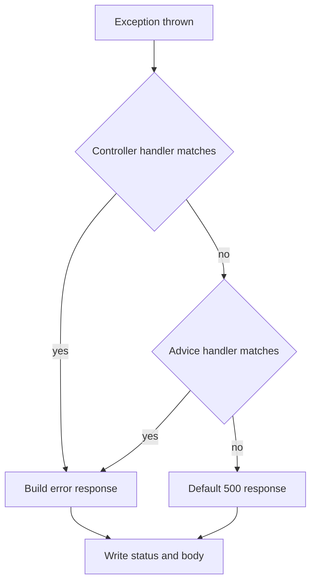

# Exception Handling in Spring Boot

!!! note "In simple words"
    When something goes wrong, the client should get a clear status code and a consistent error body, and the server should keep the details to itself. Put that mapping in one place with `@RestControllerAdvice`.

## Why it matters

Exception handling decides what the client sees when a request fails. A good design returns the right status, a machine-readable body, and no internal details. Without it, every controller invents its own format, clients need special cases, and stack traces leak to the outside world. Interviewers ask about this to test whether you can keep controllers clean and errors predictable across a large API.

## How it works

When a controller or service throws an exception, Spring looks for a handler that matches it. The flowchart shows the search order. The Spring snippets show the shape of the code; they are not compiled as part of this page.

1. A controller or service throws an exception.
2. Spring searches for an `@ExceptionHandler` method in the controller that threw. It then checks the `@RestControllerAdvice` beans.
3. The most specific matching exception type wins.
4. The handler builds the response, usually a `ProblemDetail`, and Spring writes it with the status the handler set.
5. An exception that no handler matches becomes a `500`. Log those with a correlation ID, and return the ID without internal detail.



When several advice classes match, use `@Order` to decide which one runs first.

### @ExceptionHandler and @RestControllerAdvice

`@ExceptionHandler` marks a method that handles one or more exception types. Inside a controller, it applies only to that controller. On a class marked `@RestControllerAdvice` (or `@ControllerAdvice`), it applies globally.

```java
import java.net.URI;
import org.springframework.http.HttpStatus;
import org.springframework.http.ProblemDetail;
import org.springframework.web.bind.annotation.ExceptionHandler;
import org.springframework.web.bind.annotation.RestControllerAdvice;

class OrderNotFoundException extends RuntimeException {
    OrderNotFoundException(long id) {
        super("Order " + id + " was not found");
    }
}

@RestControllerAdvice
class ApiExceptionHandler {

    @ExceptionHandler(OrderNotFoundException.class)
    ProblemDetail handleNotFound(OrderNotFoundException ex) {
        ProblemDetail problem = ProblemDetail.forStatusAndDetail(HttpStatus.NOT_FOUND, ex.getMessage());
        problem.setTitle("Order not found");
        problem.setType(URI.create("https://example.com/problems/order-not-found"));
        return problem;
    }
}
```

### ProblemDetail and RFC 9457

`ProblemDetail` is Spring Framework's implementation of RFC 9457, "Problem Details for HTTP APIs". That RFC replaces RFC 7807. It defines the standard fields `type`, `title`, `status`, `detail`, and `instance`, and you can add your own properties. The response uses the `application/problem+json` media type, so clients get a predictable shape.

Spring Boot 3 can also apply `ProblemDetail` to Spring MVC's own exceptions, such as a malformed body, when you set `spring.mvc.problemdetails.enabled=true`.

### Extending ResponseEntityExceptionHandler

`ResponseEntityExceptionHandler` is a base class. It already handles Spring MVC's standard exceptions, such as `MethodArgumentNotValidException` and `HttpMessageNotReadableException`, and returns `ProblemDetail` bodies. Extend it and add your own handlers, so you do not rewrite the defaults.

```java
import org.springframework.http.HttpHeaders;
import org.springframework.http.HttpStatus;
import org.springframework.http.ResponseEntity;
import org.springframework.web.bind.annotation.ExceptionHandler;
import org.springframework.web.bind.annotation.RestControllerAdvice;
import org.springframework.web.context.request.WebRequest;
import org.springframework.web.servlet.mvc.method.annotation.ResponseEntityExceptionHandler;

@RestControllerAdvice
class GlobalHandler extends ResponseEntityExceptionHandler {

    @ExceptionHandler(IllegalStateException.class)
    ResponseEntity<Object> handleConflict(IllegalStateException ex, WebRequest request) {
        return handleExceptionInternal(ex, null, new HttpHeaders(), HttpStatus.CONFLICT, request);
    }
}
```

`handleExceptionInternal` is the hook the base class uses to build every error response. Calling it keeps your errors in the same format as the framework's.

### Choosing the right status

| Situation | Status |
|---|---|
| Malformed JSON or a parameter of the wrong type | `400 Bad Request` |
| Failed validation | `400 Bad Request` (some APIs use `422` instead) |
| Not authenticated | `401 Unauthorized` |
| Authenticated but not allowed | `403 Forbidden` |
| Resource does not exist | `404 Not Found` |
| State conflict, such as a duplicate or version mismatch | `409 Conflict` |
| Unexpected server fault | `500 Internal Server Error` |

Authentication and authorisation failures are usually handled by Spring Security's filters, not by your advice class. See [Spring Security Authorisation](../10-security/spring-security-authorisation.md).

### Field-level validation errors

Clients need to know which field failed, not only that something did. Add the field errors to the `ProblemDetail` as a custom property. Handle `MethodArgumentNotValidException` in one place. Two advice classes that handle the same exception cause confusion.

```java
import java.util.Map;
import java.util.stream.Collectors;
import org.springframework.http.HttpStatus;
import org.springframework.http.ProblemDetail;
import org.springframework.web.bind.MethodArgumentNotValidException;
import org.springframework.web.bind.annotation.ExceptionHandler;
import org.springframework.web.bind.annotation.RestControllerAdvice;

@RestControllerAdvice
class ValidationErrorHandler {

    @ExceptionHandler(MethodArgumentNotValidException.class)
    ProblemDetail handleInvalid(MethodArgumentNotValidException ex) {
        Map<String, String> fields = ex.getBindingResult().getFieldErrors().stream()
                .collect(Collectors.toMap(e -> e.getField(), e -> e.getDefaultMessage(), (a, b) -> a));

        ProblemDetail problem = ProblemDetail.forStatusAndDetail(
                HttpStatus.BAD_REQUEST, "One or more fields are invalid");
        problem.setTitle("Validation failed");
        problem.setProperty("fields", fields);
        return problem;
    }
}
```

The merge function `(a, b) -> a` keeps the first message when one field has several violations, so `toMap` does not throw on a duplicate key.

### Logging without leaking

Log the full exception on the server with a correlation or trace ID, and return that same ID to the client. Support can then find the log line from the report. For `500` responses, keep the body generic. Log `4xx` responses at a lower level, because bad input is expected traffic, not a server fault.

```java
import org.slf4j.Logger;
import org.slf4j.LoggerFactory;
import org.springframework.http.HttpStatus;
import org.springframework.http.ProblemDetail;
import org.springframework.web.bind.annotation.ExceptionHandler;
import org.springframework.web.bind.annotation.RestControllerAdvice;

@RestControllerAdvice
class ServerErrorHandler {

    private static final Logger log = LoggerFactory.getLogger(ServerErrorHandler.class);

    @ExceptionHandler(RuntimeException.class)
    ProblemDetail handleUnexpected(RuntimeException ex) {
        String errorId = java.util.UUID.randomUUID().toString();
        log.error("unhandled error {}", errorId, ex);
        ProblemDetail problem = ProblemDetail.forStatusAndDetail(
                HttpStatus.INTERNAL_SERVER_ERROR, "An unexpected error occurred. Reference: " + errorId);
        problem.setTitle("Internal error");
        return problem;
    }
}
```

In production, use the trace ID from your tracing library instead of a random UUID. That way the reference links straight to the trace. Tests for these responses fit the MockMvc approach in [API Testing and Code Coverage](../11-testing/api-testing-and-coverage.md).

### A base exception that carries its HTTP status

Throwing a domain exception from deep in the service layer should not force the service to know about HTTP. A useful middle ground is an abstract base exception that stores the status it maps to. The advice then needs one handler for the whole family, and each subclass decides only its own status.

```java
import org.springframework.http.HttpStatus;

abstract class ApiException extends RuntimeException {

    private final HttpStatus status;

    protected ApiException(HttpStatus status, String message) {
        super(message);
        this.status = status;
    }

    HttpStatus status() {
        return status;
    }
}

class MissingOrderException extends ApiException {
    MissingOrderException(long orderId) {
        super(HttpStatus.NOT_FOUND, "Order " + orderId + " was not found");
    }
}

class PaymentDeclinedException extends ApiException {
    PaymentDeclinedException(String reason) {
        super(HttpStatus.PAYMENT_REQUIRED, "Payment declined: " + reason);
    }
}
```

```java
import org.springframework.http.HttpStatus;
import org.springframework.http.ProblemDetail;
import org.springframework.http.ResponseEntity;
import org.springframework.web.bind.annotation.ExceptionHandler;
import org.springframework.web.bind.annotation.RestControllerAdvice;

@RestControllerAdvice
class ApiExceptionAdvice {

    @ExceptionHandler(ApiException.class)
    ResponseEntity<ProblemDetail> handle(ApiException ex) {
        ProblemDetail problem = ProblemDetail.forStatusAndDetail(ex.status(), ex.getMessage());
        return ResponseEntity.status(ex.status()).body(problem);
    }
}
```

The status is set in one place, next to the exception that knows what went wrong. `@ResponseStatus` on the exception class is a simpler alternative. It gives you no way to read the status in code, such as for logging.

### @ExceptionHandler on a single controller

A handler method inside a controller applies only to that controller's requests. Use it for an error that only one endpoint produces, and keep it out of the global advice so the global mapping stays small.

```java
import org.springframework.http.HttpStatus;
import org.springframework.http.ProblemDetail;
import org.springframework.web.bind.annotation.ExceptionHandler;
import org.springframework.web.bind.annotation.PostMapping;
import org.springframework.web.bind.annotation.RequestBody;
import org.springframework.web.bind.annotation.RequestMapping;
import org.springframework.web.bind.annotation.RestController;

record RefundRequest(String orderId, long cents) { }

class RefundLimitExceededException extends RuntimeException {
    RefundLimitExceededException(long cents) {
        super("Refund of " + cents + " exceeds the allowed limit");
    }
}

@RestController
@RequestMapping("/api/refunds")
class RefundController {

    @PostMapping
    String create(@RequestBody RefundRequest request) {
        if (request.cents() > 100_000) {
            throw new RefundLimitExceededException(request.cents());
        }
        return "accepted";
    }

    // Applies only to RefundController. Other controllers never reach it.
    @ExceptionHandler(RefundLimitExceededException.class)
    ProblemDetail limitExceeded(RefundLimitExceededException ex) {
        return ProblemDetail.forStatusAndDetail(HttpStatus.UNPROCESSABLE_ENTITY, ex.getMessage());
    }
}
```

When a controller and an advice both handle the same exception type, the controller's method wins. The advice runs only for exceptions the controller does not handle. Use this on purpose: put endpoint-specific wording in the controller and the general rule in the advice.

### An error DTO with custom fields

`ProblemDetail` covers the RFC 9457 fields, and `setProperty` adds more. Some clients already expect their own error shape, though. In that case a plain record is simpler to keep stable. The record below carries a timestamp, the request path, and optional field errors. Empty field errors are left out of the JSON.

```java
import com.fasterxml.jackson.annotation.JsonInclude;
import jakarta.servlet.http.HttpServletRequest;
import java.time.Instant;
import java.util.Map;
import org.springframework.http.HttpStatus;
import org.springframework.http.ResponseEntity;
import org.springframework.web.bind.annotation.ExceptionHandler;
import org.springframework.web.bind.annotation.RestControllerAdvice;

record ApiError(
        int status,
        String message,
        Instant timestamp,
        String path,
        @JsonInclude(JsonInclude.Include.NON_EMPTY) Map<String, String> fieldErrors) {
}

@RestControllerAdvice
class LegacyShapeAdvice {

    @ExceptionHandler(MissingOrderException.class)
    ResponseEntity<ApiError> notFound(MissingOrderException ex, HttpServletRequest request) {
        ApiError body = new ApiError(HttpStatus.NOT_FOUND.value(), ex.getMessage(),
                Instant.now(), request.getRequestURI(), Map.of());
        return ResponseEntity.status(HttpStatus.NOT_FOUND).body(body);
    }
}
```

Choose one error shape for the whole API and document it. A new API should normally start with `ProblemDetail`, because clients and tooling already understand it. Use a custom DTO only when a fixed contract must be kept.

## Where it is used

- **REST APIs:** one advice class that maps domain exceptions to statuses for every controller.
- **Validation failures:** field-level errors for forms and JSON bodies.
- **Unexpected faults:** a catch-all handler that logs with a correlation ID and returns a safe message.
- **Legacy contracts:** a custom error record that an existing client already parses.

## Benefits

- Every endpoint returns the same error shape, so clients handle failures in one way.
- Controllers stay free of try and catch blocks.
- Domain code can throw meaningful exceptions without knowing about HTTP.
- Server-side logs keep the detail that the client must not see.

## Cons and limits

- A catch-all handler can hide bugs if it logs at the wrong level or returns a vague message.
- Advice ordering needs `@Order` when several advice classes match the same exception.
- Security failures are handled by Spring Security's filters, which run before controller advice.
- A custom error shape adds maintenance, because it is outside the RFC standard.

## Best practices

- Map domain exceptions to status codes in one `@RestControllerAdvice`.
- Return `ProblemDetail` bodies, and extend `ResponseEntityExceptionHandler` so framework errors use the same format.
- Use accurate status codes. Never return `200` for an error.
- Never expose stack traces, SQL, class names, or host names in responses.
- Log `4xx` at a lower level than `5xx`. A `404` is not an `ERROR`.
- Use `@Order` to control precedence when several advice classes match.
- Use a trace ID in error responses so support can find the matching log line.

!!! tip "Interview tip"
    **Q: How do you return consistent errors across a large API?**
    Map domain exceptions to HTTP status codes in one `@RestControllerAdvice`. Return RFC 9457 `ProblemDetail` bodies. Extend `ResponseEntityExceptionHandler` so framework exceptions follow the same format. Log the detail on the server, and return only what the client needs.

## Quick recap

- `@RestControllerAdvice` with `@ExceptionHandler` centralises error mapping.
- `ProblemDetail` implements RFC 9457, which replaces RFC 7807.
- Extend `ResponseEntityExceptionHandler` to keep framework errors in the same format.
- Use accurate status codes. Never return `200` for an error.
- Never leak internal details in error bodies.

## Official documentation

- [RFC 9457: Problem Details for HTTP APIs](https://www.rfc-editor.org/rfc/rfc9457)
- [RFC 9110: HTTP Semantics](https://www.rfc-editor.org/rfc/rfc9110)
- [Spring Framework reference](https://docs.spring.io/spring-framework/reference/)

**See also:** [Building REST APIs](rest-apis.md) | [Validation](validation.md) | [Security Headers and CORS](../10-security/cors-csrf-tls-headers.md)
