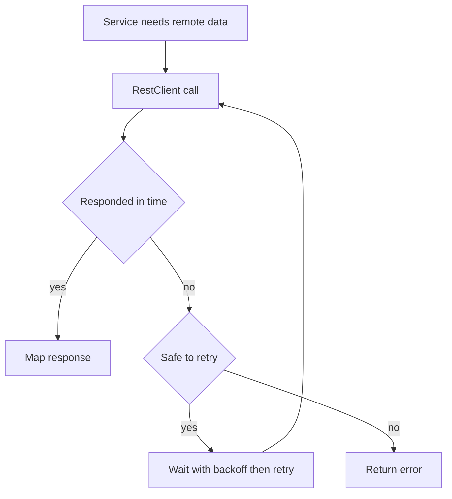

# HTTP Clients and Testing in Spring Boot

!!! note "In simple words"
    Your service calls other services over HTTP, so give every call a timeout and a clear retry rule. For tests, start with the smallest slice of the application that proves the behaviour, and load the full application only for a few end-to-end checks.

## Why it matters

A remote call can hang, fail, or succeed twice, and each of those outcomes needs a plan. Tests have the same issue in a different form: a suite that starts the whole application for every case becomes slow and is ignored. Interviewers ask about HTTP clients to see whether you think about timeouts, retries, and client choice. They ask about testing to see whether you can keep tests fast without losing confidence.

## How it works

An outbound call in a Spring Boot service passes through a client, a timeout, and an optional retry policy. A test follows a separate path: Spring loads a slice of the context, and the test checks one layer. The Spring snippets show the shape of the code; they are not compiled as part of this page.

1. The service calls a client bean, such as `RestClient`, which was built once with a base URL and timeouts.
2. The client sends the request. If the response is slow, the timeout fires.
3. A failure can be retried, but only when the operation is safe to repeat. Retries use backoff and a cap.
4. For tests, a slice annotation such as `@WebMvcTest` loads only the web layer. A mock server or a mock bean stands in for the other parts.



### Choosing an HTTP client

| Client | Model | Status |
|---|---|---|
| `RestTemplate` | Blocking | Maintenance mode. Know it, but do not start new code with it |
| `RestClient` | Blocking, fluent API | Recommended for synchronous calls (Spring Framework 6.1 and later) |
| `WebClient` | Reactive, non-blocking | Recommended for reactive stacks and high fan-out |
| OpenFeign | Declarative interface | Good when you want client interfaces generated from annotations |

### RestClient

`RestClient` offers a fluent API over the same HTTP infrastructure. Set the base URL and timeouts once, on the builder.

```java
import java.net.http.HttpClient;
import java.time.Duration;
import org.springframework.http.client.JdkClientHttpRequestFactory;
import org.springframework.web.client.RestClient;

record PaymentStatus(String id, String state) {}

class PaymentApi {
    private final RestClient client;

    PaymentApi() {
        HttpClient http = HttpClient.newBuilder()
                .connectTimeout(Duration.ofSeconds(2))
                .build();
        this.client = RestClient.builder()
                .baseUrl("https://payments.example.com")
                .requestFactory(new JdkClientHttpRequestFactory(http))
                .build();
    }

    PaymentStatus status(String id) {
        return client.get()
                .uri("/payments/{id}", id)
                .retrieve()
                .body(PaymentStatus.class);
    }
}
```

Set a read timeout as well as a connect timeout. Without them, a stuck remote call holds a thread indefinitely. Check the request-factory API for your Spring version, because timeout settings differ between factories.

### WebClient

`WebClient` returns reactive types, `Mono` and `Flux`, and does not block the calling thread.

```java
import org.springframework.web.reactive.function.client.WebClient;
import reactor.core.publisher.Mono;

record PaymentStatus(String id, String state) {}

class ReactivePaymentApi {
    private final WebClient web = WebClient.builder()
            .baseUrl("https://payments.example.com")
            .build();

    Mono<PaymentStatus> status(String id) {
        return web.get()
                .uri("/payments/{id}", id)
                .retrieve()
                .bodyToMono(PaymentStatus.class);
    }
}
```

Nothing happens until someone subscribes to the `Mono`. Returning it without subscribing is a common mistake. See [Reactive WebFlux](reactive-webflux.md).

### Declarative clients with OpenFeign

With `spring-cloud-starter-openfeign` and `@EnableFeignClients`, you declare an interface and Spring generates the implementation.

```java
import org.springframework.cloud.openfeign.FeignClient;
import org.springframework.web.bind.annotation.GetMapping;
import org.springframework.web.bind.annotation.PathVariable;

record PaymentStatus(String id, String state) {}

@FeignClient(name = "payments", url = "https://payments.example.com")
interface PaymentFeignClient {
    @GetMapping("/payments/{id}")
    PaymentStatus status(@PathVariable("id") String id);
}
```

Feign is a Spring Cloud component, so it fits naturally in service-to-service setups. See [Spring Cloud](../14-microservices/spring-cloud.md).

### Timeouts, retries, and error handling

Three rules cover most cases:

1. Always set timeouts. A call with no timeout can hang forever.
2. Retry only idempotent operations, or operations protected by an idempotency key. Retrying a non-idempotent `POST` can charge a customer twice.
3. Use exponential backoff with a cap and a maximum number of attempts, so retries do not multiply an outage.

Spring Retry adds declarative retries:

```java
import org.springframework.retry.annotation.Backoff;
import org.springframework.retry.annotation.Recover;
import org.springframework.retry.annotation.Retryable;
import org.springframework.stereotype.Service;
import org.springframework.web.client.ResourceAccessException;

record PaymentStatus(String id, String state) {}

@Service
class StatusService {

    @Retryable(retryFor = ResourceAccessException.class, maxAttempts = 3,
            backoff = @Backoff(delay = 200, multiplier = 2))
    PaymentStatus fetch(String id) {
        // call the remote service here
        throw new ResourceAccessException("simulated timeout");
    }

    @Recover
    PaymentStatus fallback(ResourceAccessException ex, String id) {
        return new PaymentStatus(id, "UNKNOWN");
    }
}
```

`@Retryable` needs `@EnableRetry` on a configuration class. A recovery method must have the same return type, and its first parameter must be the exception. Resilience4j adds production features such as circuit breakers and bulkheads. See [Resilience Patterns](../14-microservices/resilience-patterns.md).

## Testing

### Test scope

Start with the narrowest test that proves the behaviour, and widen the scope only when you need to.

| Annotation | Loads | Use for |
|---|---|---|
| None (plain JUnit) | Nothing | Pure logic |
| `@WebMvcTest(Controller.class)` | The web layer for one controller | Request mapping, validation, status codes |
| `@DataJpaTest` | JPA repositories and an embedded database by default | Queries and mappings |
| `@RestClientTest(Client.class)` | One REST client and a mock server | Outbound HTTP calls |
| `@SpringBootTest` | The full application context | End-to-end wiring |

### Slice tests with MockMvc

```java
import static org.mockito.Mockito.when;
import static org.springframework.test.web.servlet.request.MockMvcRequestBuilders.get;
import static org.springframework.test.web.servlet.result.MockMvcResultMatchers.jsonPath;
import static org.springframework.test.web.servlet.result.MockMvcResultMatchers.status;

import org.junit.jupiter.api.Test;
import org.springframework.beans.factory.annotation.Autowired;
import org.springframework.boot.test.autoconfigure.web.servlet.WebMvcTest;
import org.springframework.test.context.bean.override.mockito.MockitoBean;
import org.springframework.test.web.servlet.MockMvc;

@WebMvcTest(OrderApiController.class)
class OrderApiControllerTest {

    @Autowired MockMvc mvc;
    @MockitoBean OrderService orders;

    @Test
    void returnsOrder() throws Exception {
        when(orders.describe(1L)).thenReturn("book");

        mvc.perform(get("/api/orders/1"))
           .andExpect(status().isOk())
           .andExpect(jsonPath("$").exists());
    }
}

interface OrderService {
    String describe(long id);
}
```

`OrderApiController` is the controller from the Actuator page, here assumed to inject `OrderService`. Spring Boot 3.4 deprecated `@MockBean` in favour of `@MockitoBean`, which comes from `org.springframework.test.context.bean.override.mockito`. Older code still uses `@MockBean`, and you will see both in real projects.

### Client tests with MockRestServiceServer

`@RestClientTest` configures a mock server for your REST client. You can then test serialisation and URLs without a network call.

```java
import static org.springframework.test.web.client.match.MockRestRequestMatchers.requestTo;
import static org.springframework.test.web.client.response.MockRestResponseCreators.withSuccess;

import org.springframework.beans.factory.annotation.Autowired;
import org.springframework.boot.test.autoconfigure.web.client.RestClientTest;
import org.springframework.http.MediaType;
import org.springframework.test.web.client.MockRestServiceServer;

@RestClientTest(PaymentApi.class)
class PaymentApiTest {

    @Autowired PaymentApi api;
    @Autowired MockRestServiceServer server;

    void readsStatus() {
        server.expect(requestTo("https://payments.example.com/payments/p1"))
              .andRespond(withSuccess("{\"id\":\"p1\",\"state\":\"PAID\"}", MediaType.APPLICATION_JSON));

        // assert on api.status("p1") here
    }
}
```

`PaymentApi` is the client from the RestClient example. For the mock server to intercept its calls, it must be a Spring bean built from the auto-configured builder. This sketch shows the approach, so it is not a drop-in test.

### Full context tests and real dependencies

`@SpringBootTest` loads everything. Use it for a few end-to-end checks, because starting a context is slow. Spring caches contexts that share the same configuration, so keep configuration differences to a minimum.

For databases, an embedded database such as H2 is fast but is not identical to production. Testcontainers starts a real database in Docker for the duration of a test. With `@ServiceConnection`, available since Spring Boot 3.1, Spring wires the connection automatically. See [Integration Testing](../11-testing/integration-testing.md).

## Where it is used

- **Service-to-service calls:** `RestClient` or `WebClient` with timeouts and retry rules.
- **Controller tests:** `@WebMvcTest` with `MockMvc`.
- **Client tests:** `@RestClientTest` with `MockRestServiceServer`.
- **Repository tests:** `@DataJpaTest` with Testcontainers for production-like SQL.

## Benefits

- Clients with timeouts fail fast and free their threads.
- Test slices keep the suite fast and focused.
- Mock servers let client tests run offline and deterministic.
- Testcontainers catches SQL that only works on the real database.

## Cons and limits

- Retries can multiply load during an outage if they lack backoff and caps.
- Slices load less of the application, so wiring bugs need a full-context test.
- Embedded databases and real databases differ in SQL dialect and behaviour.
- Mocks test your assumptions about the other service, which can be wrong.

## Best practices

- Build each client once, and reuse it. Do not create a new client per request.
- Set connect and read timeouts on every client.
- Retry only idempotent operations, and skip retries for validation errors that will never succeed.
- Choose the narrowest slice that proves the behaviour.
- Mock the collaborator for a controller test. Do not mock the repository in a `@DataJpaTest`, because that skips the query you need to test.
- Do not rely on H2 behaviour for SQL that only works on the production database.
- Subscribe to `WebClient` results, or return them to a caller that does.

!!! tip "Interview tip"
    **Q: How would you test a controller without starting the whole application?**
    Use `@WebMvcTest` with `MockMvc`. It loads only the web layer and the named controller, and you mock its collaborators with `@MockitoBean`. Keep `@SpringBootTest` for a small number of end-to-end checks, so the suite stays fast.

## Quick recap

- Choose `RestClient` for synchronous calls and `WebClient` for reactive ones. `RestTemplate` is in maintenance mode.
- Always set timeouts. Retry only idempotent operations, with backoff and a cap.
- Pick the narrowest test slice that proves the behaviour.
- Use `MockMvc` for controllers and `MockRestServiceServer` for clients.
- Use Testcontainers when you need a real database.

## Official documentation

- [Spring Framework reference](https://docs.spring.io/spring-framework/reference/)
- [Spring Boot reference](https://docs.spring.io/spring-boot/reference/index.html)
- [JUnit 5 user guide](https://junit.org/junit5/docs/current/user-guide/)
- [Mockito documentation](https://site.mockito.org/)

**See also:** [Integration Testing](../11-testing/integration-testing.md) | [Resilience Patterns](../14-microservices/resilience-patterns.md) | [Building REST APIs](rest-apis.md)
