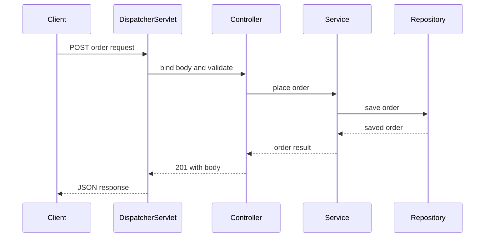

# Building REST APIs with Spring Boot

!!! note "In simple words"
    A REST API maps web addresses and HTTP verbs to controller methods. Request data goes in as Java values, and Java results go back out as JSON with a proper status code.

## Why it matters

A good API is more than annotations. Clients depend on HTTP meaning: a `GET` must be safe, a `PUT` must be idempotent, a create should return `201`, and a missing item should return `404`. Interviewers ask about REST APIs to check that you understand these rules, so that clients can retry safely and integrate without guessing.

## How it works

A request follows a predictable path through Spring MVC. The diagram shows the layers. The Spring snippets show the shape of the code; they are not compiled as part of this page.

1. `DispatcherServlet` receives the request and finds the handler method by path, HTTP verb, and media type.
2. Argument resolvers fill the parameters, such as `@PathVariable` and `@RequestBody`. Jackson turns a JSON body into a Java object.
3. Validation runs if you asked for it (see [Validation](validation.md)).
4. The method runs. Its return value goes through a message converter, which for JSON is Jackson.
5. If an exception is thrown, it is routed to an exception handler (see [Exception Handling](exception-handling.md)).



### @RestController and request mapping

`@RestController` is `@Controller` plus `@ResponseBody`. Every return value is written to the response body, usually as JSON. The shortcut annotations `@GetMapping`, `@PostMapping`, `@PutMapping`, `@PatchMapping`, and `@DeleteMapping` are `@RequestMapping` with a fixed method.

```java
import java.net.URI;
import java.util.List;
import org.springframework.http.ResponseEntity;
import org.springframework.web.bind.annotation.*;

public record CreateOrderRequest(String item, int quantity) {}
public record OrderResponse(long id, String item, String status) {}

@RestController
@RequestMapping("/api/orders")
class OrderController {

    @GetMapping("/{id}")
    ResponseEntity<OrderResponse> get(@PathVariable long id) {
        return ResponseEntity.ok(new OrderResponse(id, "book", "NEW"));
    }

    @GetMapping
    List<OrderResponse> list(@RequestParam(defaultValue = "NEW") String status) {
        return List.of(new OrderResponse(1L, "book", status));
    }

    @PostMapping
    ResponseEntity<OrderResponse> create(@RequestBody CreateOrderRequest request) {
        OrderResponse created = new OrderResponse(42L, request.item(), "NEW");
        return ResponseEntity.created(URI.create("/api/orders/42")).body(created);
    }

    @DeleteMapping("/{id}")
    ResponseEntity<Void> delete(@PathVariable long id) {
        return ResponseEntity.noContent().build();
    }
}
```

### Binding request data

| Annotation | Reads from | Notes |
|---|---|---|
| `@PathVariable` | The URL template, such as `/orders/{id}` | Required by default |
| `@RequestParam` | The query string or a form field | Supports `defaultValue` and `required = false` |
| `@RequestHeader` | An HTTP header | Use for `Authorization`, `If-Match`, and similar headers |
| `@RequestBody` | The request body | Deserialised by Jackson for JSON |
| `@ResponseBody` | The return value | Implied by `@RestController` |

```java
import org.springframework.web.bind.annotation.GetMapping;
import org.springframework.web.bind.annotation.RequestHeader;
import org.springframework.web.bind.annotation.RestController;

@RestController
class AuditController {
    @GetMapping("/whoami")
    String whoAmI(@RequestHeader(value = "X-Request-Id", required = false) String requestId) {
        return requestId == null ? "no request id" : requestId;
    }
}
```

### HttpEntity, ResponseEntity, and status codes

`ResponseEntity<T>` sets the status, headers, and body together. Choose status codes that match the outcome:

- `200 OK` for a successful read or update.
- `201 Created` with a `Location` header after a create (`ResponseEntity.created(uri)`).
- `204 No Content` after a delete that returns no body.
- `400 Bad Request` for invalid input, `404 Not Found` for an unknown resource, and `409 Conflict` for a state conflict.

`HttpEntity` is the parent type of `ResponseEntity`. You also use it to send headers and a body from a client.

### HTTP semantics that interviewers probe

- `GET` is safe and cacheable. `PUT` and `DELETE` are idempotent, which means repeating them leaves the server in the same state. `POST` is generally neither. `PATCH` is not guaranteed to be idempotent. These rules are defined in RFC 9110.
- `PUT` replaces the resource. `PATCH` changes part of it.
- For `PATCH`, accept a DTO that carries only the fields a client may change, and document the semantics, for example JSON Merge Patch.

### Content negotiation

Spring picks a message converter from the request's `Accept` header and the method's `produces` attribute. Jackson handles JSON when it is on the classpath. XML needs an extra converter such as `jackson-dataformat-xml`.

```java
import org.springframework.http.ResponseEntity;
import org.springframework.web.bind.annotation.PostMapping;
import org.springframework.web.bind.annotation.RequestBody;

@PostMapping(path = "/api/orders", consumes = "application/json", produces = "application/json")
ResponseEntity<OrderResponse> createJson(@RequestBody CreateOrderRequest request) {
    return ResponseEntity.status(201).body(new OrderResponse(43L, request.item(), "NEW"));
}
```

An unsupported request media type gets `415 Unsupported Media Type`. An `Accept` header that cannot be satisfied gets `406 Not Acceptable`.

### @ModelAttribute and @RequestBody

`@ModelAttribute` binds query-string parameters and form fields to a bean's properties through Spring's data binder. It fits HTML forms and `application/x-www-form-urlencoded` or multipart posts. `@RequestBody` works differently. It passes the whole body to a message converter, usually Jackson for JSON. Form binding works field by field, while body deserialisation reads the entire document.

| | `@ModelAttribute` | `@RequestBody` |
|---|---|---|
| Source | Query string and form fields | The whole request body |
| Typical content type | `application/x-www-form-urlencoded`, multipart | `application/json` |
| Mechanism | `WebDataBinder`, with type conversion and binding by name | `HttpMessageConverter`, usually Jackson |
| Errors | `BindingResult` for type and validation errors | An unreadable body, usually `400` |

```java
import org.springframework.web.bind.annotation.ModelAttribute;
import org.springframework.web.bind.annotation.PostMapping;
import org.springframework.web.bind.annotation.RequestBody;
import org.springframework.web.bind.annotation.RestController;

@RestController
class OrderFormController {

    @PostMapping(value = "/orders/form", consumes = "application/x-www-form-urlencoded")
    String fromForm(@ModelAttribute OrderForm form) {
        return form.getItem() + " x" + form.getQuantity();
    }

    @PostMapping(value = "/orders/json", consumes = "application/json")
    String fromJson(@RequestBody OrderForm order) {
        return order.getItem() + " x" + order.getQuantity();
    }
}

class OrderForm {
    private String item;
    private int quantity;
    public String getItem() { return item; }
    public void setItem(String item) { this.item = item; }
    public int getQuantity() { return quantity; }
    public void setQuantity(int quantity) { this.quantity = quantity; }
}
```

Bind form data into a dedicated form class, not directly into a JPA entity. That way clients cannot set fields they should not control. A JSON body sent to a `@ModelAttribute` parameter is not parsed as JSON. Use `@RequestBody` for JSON.

## Where it is used

- **Public and partner APIs:** resource-oriented JSON endpoints with documented status codes.
- **Frontends:** single-page apps that call the API for data and actions.
- **Service-to-service calls:** other services call the same endpoints with a client such as `RestClient`.
- **Form submissions:** `@ModelAttribute` for classic HTML forms.

## Benefits

- Annotations map HTTP verbs, paths, and parameters directly to Java methods.
- Message converters handle JSON, so controllers deal with plain objects.
- `ResponseEntity` makes the status code and headers explicit.
- Clear HTTP semantics let clients retry safely.

## Cons and limits

- JSON mapping has its own rules, such as naming and null handling, which must match the contract.
- Clients can only retry a `POST` safely if the server supports idempotency keys.
- Large collections need pagination. A plain `List` return value loads everything.
- Annotations do not enforce the contract. Documentation and tests must.

## Best practices

- Return DTOs, not JPA entities. Entities expose internal fields, can trigger lazy-loading errors during serialisation, and couple the API to the schema.
- Return `201` with a `Location` header on create. Do not return `200` for a create.
- Keep controllers thin: parse input, validate, delegate to a service, and map the response.
- Name resources with nouns, and let the HTTP verb express the action. Avoid `/createOrder`.
- Make `@RequestParam` optional with `required = false` or a `defaultValue` when a value is not always present. Otherwise a missing value returns `400`.
- For `POST` calls that clients may retry, accept an idempotency key in a header. See [Pagination, Errors, and Idempotency](../21-api-design/pagination-errors-idempotency.md).

!!! tip "Interview tip"
    **Q: Why is `PUT` idempotent but `POST` is not?**
    `PUT` targets a known resource URL and sets its full state, so sending the same request twice leaves the same result. `POST` usually asks the server to create a new resource each time, so repeating it can create duplicates. Clients that need safe retries of `POST` send an idempotency key in a header.

## Quick recap

- Controllers map verbs and paths to methods. `@RestController` writes return values to the body.
- Bind inputs with `@PathVariable`, `@RequestParam`, `@RequestHeader`, and `@RequestBody`.
- Use `ResponseEntity` to return the correct status, headers, and body.
- Know which verbs are safe and idempotent, and design `PUT` and `PATCH` to match.
- Use DTOs, not entities, at the API boundary.

## Official documentation

- [Spring Framework reference](https://docs.spring.io/spring-framework/reference/)
- [RFC 9110: HTTP Semantics](https://www.rfc-editor.org/rfc/rfc9110)
- [OpenAPI Specification](https://spec.openapis.org/oas/latest.html)

**See also:** [Validation](validation.md) | [Exception Handling](exception-handling.md) | [Actuator and API Documentation](actuator-and-api-docs.md)
