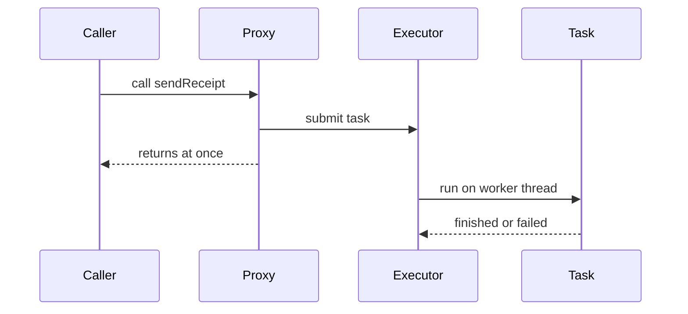

# Async Work and Threading in Spring Boot

!!! note "In simple words"
    Async work runs off the request thread, so the caller does not wait for it. Spring offers three tools for this: `@Async` for background methods, `CompletableFuture` for combining results, and virtual threads for cheap blocking code on Java 21.

## Why it matters

A slow email send or a call to three services should not hold up the user's request. Async work lets the request finish sooner and lets independent calls overlap. Interviewers ask about this to see whether you know where the work actually runs, why an `@Async` annotation sometimes does nothing, and when virtual threads make a reactive stack unnecessary.

## How it works

`@Async` only works after you enable async processing with `@EnableAsync`. Spring then wraps the bean in a proxy. Each call from outside the bean is handed to a `TaskExecutor` instead of running on the caller's thread. The Spring snippets show the shape of the code; they are not compiled as part of this page.

1. `@EnableAsync` registers an interceptor that wraps beans with `@Async` methods.
2. A call from outside the bean goes through the proxy, which packages the call as a task.
3. The task is submitted to the named executor, or to the default one.
4. The caller returns straight away. A `void` method returns nothing, and a future returns a handle.
5. When the task finishes, the future completes with a value or an exception. A failing `void` task goes to the uncaught-exception handler.



### Enabling @Async

```java
import org.springframework.context.annotation.Configuration;
import org.springframework.scheduling.annotation.EnableAsync;

@Configuration
@EnableAsync
class AsyncSettings {
}
```

### Return types

An `@Async` method can return `void`, `Future<T>`, or `CompletableFuture<T>`. A `void` method is fire-and-forget. The caller gets nothing back, and failures go to an uncaught-exception handler. A `CompletableFuture` lets the caller compose, wait for, or time out the result.

```java
import java.util.concurrent.CompletableFuture;
import org.springframework.scheduling.annotation.Async;
import org.springframework.stereotype.Service;

@Service
class ReceiptMailer {

    @Async
    public void sendReceipt(String address) {
        // runs on an executor thread; the caller does not wait
    }

    @Async
    public CompletableFuture<Boolean> sendReceiptChecked(String address) {
        boolean delivered = address.contains("@");   // stand-in for a real send
        return CompletableFuture.completedFuture(delivered);
    }
}
```

A plain `String` or `boolean` return type gives no asynchrony to the caller. The caller has nothing to wait on. Return a `CompletableFuture` when you need a result.

### The self-invocation trap

The proxy only intercepts calls from outside the bean. If a method in the same class calls an `@Async` method directly, the call runs synchronously. The clean fix is to move the async method into another bean. Injecting the bean into itself also works, but it suggests the class has too many jobs.

```java
import org.springframework.stereotype.Service;

@Service
class OrderService {

    private final ReceiptMailer mailer;

    OrderService(ReceiptMailer mailer) {   // a different bean, so the proxy is used
        this.mailer = mailer;
    }

    void complete(String address) {
        mailer.sendReceipt(address);       // asynchronous
    }
}
```

### Configuring a TaskExecutor

Spring Boot auto-configures an executor named `applicationTaskExecutor`, backed by a `ThreadPoolTaskExecutor`. If you define your own `Executor` or `TaskExecutor` bean, Boot backs off from its default, so check which executor your `@Async` methods use.

```java
import java.util.concurrent.Executor;
import org.springframework.context.annotation.Bean;
import org.springframework.context.annotation.Configuration;
import org.springframework.scheduling.concurrent.ThreadPoolTaskExecutor;

@Configuration
class ExecutorSettings {

    @Bean(name = "mailExecutor")
    Executor mailExecutor() {
        ThreadPoolTaskExecutor pool = new ThreadPoolTaskExecutor();
        pool.setCorePoolSize(4);
        pool.setMaxPoolSize(8);
        pool.setQueueCapacity(200);
        pool.setThreadNamePrefix("mail-");
        pool.setWaitForTasksToCompleteOnShutdown(true);
        pool.setAwaitTerminationSeconds(30);
        pool.initialize();
        return pool;
    }
}
```

Name the executor on the annotation to route work to it:

```java
import org.springframework.scheduling.annotation.Async;
import org.springframework.stereotype.Service;

@Service
class ReportJobs {

    @Async("reportExecutor")   // needs a bean called "reportExecutor"
    public void buildNightlyReport() {
        // long-running work kept away from the mail pool
    }
}
```

Size the pool for the kind of work. I/O-bound work tolerates more threads than CPU-bound work. The queue capacity decides how much waiting is allowed before new tasks are rejected.

### Composing CompletableFuture results

`CompletableFuture` describes a pipeline of steps. Pass your own executor to `supplyAsync`. The default common pool is shared by the whole JVM, so it is a poor place for blocking I/O.

```java
import java.util.concurrent.CompletableFuture;
import java.util.concurrent.Executor;
import org.springframework.stereotype.Service;

@Service
class PriceService {

    private final Executor ioPool;

    PriceService(Executor ioPool) {
        this.ioPool = ioPool;
    }

    CompletableFuture<Integer> total(int unitPrice, int quantity) {
        CompletableFuture<Integer> base =
                CompletableFuture.supplyAsync(() -> unitPrice * quantity, ioPool);
        CompletableFuture<Integer> tax =
                CompletableFuture.supplyAsync(() -> (unitPrice * quantity) / 10, ioPool);
        return base.thenCombine(tax, Integer::sum);   // runs once both are done
    }
}
```

The operators you will be asked about:

| Method | Purpose |
|---|---|
| `thenApply` | Transform a result synchronously |
| `thenCompose` | Chain a step that itself returns a future |
| `thenCombine` | Merge two independent futures |
| `allOf` and `anyOf` | Wait for all of them, or for the first one |
| `exceptionally` | Supply a fallback value for a failure |
| `handle` | Receive either the result or the exception |
| `orTimeout` and `completeOnTimeout` | Fail or fall back after a deadline (Java 9 and later) |

`exceptionally` sees only failures from the stages before it. Place it after the step that might fail.

### A controller that returns a CompletableFuture

Spring MVC accepts a `CompletableFuture` as a controller return value. The request thread is released while the work runs, and the response is written when the future completes. This is the usual way to fan out several independent calls. Start them together, then combine them with `allOf`.

```java
import java.util.List;
import java.util.concurrent.CompletableFuture;
import org.springframework.http.ResponseEntity;
import org.springframework.web.bind.annotation.GetMapping;
import org.springframework.web.bind.annotation.PathVariable;
import org.springframework.web.bind.annotation.RequestMapping;
import org.springframework.web.bind.annotation.RestController;

record Price(long cents) { }
record ProductPage(String sku, Price price, int unitsInStock, List<String> reviews) { }

interface PricingClient { CompletableFuture<Price> priceFor(String sku); }
interface StockClient { CompletableFuture<Integer> unitsFor(String sku); }
interface ReviewClient { CompletableFuture<List<String>> latestFor(String sku); }

@RestController
@RequestMapping("/api/product-pages")
class ProductPageController {

    private final PricingClient pricing;
    private final StockClient stock;
    private final ReviewClient reviews;

    ProductPageController(PricingClient pricing, StockClient stock, ReviewClient reviews) {
        this.pricing = pricing;
        this.stock = stock;
        this.reviews = reviews;
    }

    @GetMapping("/{sku}")
    CompletableFuture<ResponseEntity<ProductPage>> page(@PathVariable String sku) {
        CompletableFuture<Price> price = pricing.priceFor(sku);     // all three start now
        CompletableFuture<Integer> units = stock.unitsFor(sku);
        CompletableFuture<List<String>> latest = reviews.latestFor(sku);

        return CompletableFuture.allOf(price, units, latest)
                .thenApply(done -> ResponseEntity.ok(
                        new ProductPage(sku, price.join(), units.join(), latest.join())));
    }
}
```

The three calls overlap, so the response takes about as long as the slowest call, not the sum of all three. `allOf` returns a `CompletableFuture<Void>` that completes when every input has completed. That is why the `join` calls inside `thenApply` do not block. If any input fails, `allOf` fails too. Attach `exceptionally` or `exceptionallyCompose` when a partial page is acceptable.

### Falling back when a dependency fails

A cascading failure happens when one slow or broken dependency makes its callers fail too. A fallback stage keeps the flow going. Use `exceptionallyCompose` when the fallback is itself asynchronous, because it returns a future rather than a plain value.

```java
import java.util.concurrent.CompletableFuture;
import org.springframework.stereotype.Service;

interface PaymentClient { CompletableFuture<String> charge(String orderId, long cents); }
interface PendingQueue { CompletableFuture<Void> enqueue(String orderId); }

@Service
class CheckoutFlow {

    private final PaymentClient payments;
    private final PendingQueue pending;

    CheckoutFlow(PaymentClient payments, PendingQueue pending) {
        this.payments = payments;
        this.pending = pending;
    }

    CompletableFuture<String> checkout(String orderId, long cents) {
        return payments.charge(orderId, cents)
                .thenApply(receiptId -> "CONFIRMED:" + receiptId)
                .exceptionallyCompose(ex ->                  // payment failed or timed out
                        pending.enqueue(orderId)             // record it for a later retry
                               .thenApply(ignored -> "PENDING"));
    }
}
```

The fallback must report honestly. `PENDING` tells the caller that the money has not moved, so the order flow has to handle that state. Also, an exception passing through a dependent stage is often wrapped in a `CompletionException`. Unwrap it with `getCause()` when you need the original type.

### Virtual threads

Java 21 finalised virtual threads (JEP 444). A virtual thread is cheap to create, and blocking it frees its carrier thread. Blocking code therefore scales far better than it did with platform threads. In Spring Boot 3.2 and later, one property asks the framework to use them for request handling and for the default task executor:

```properties
spring.threads.virtual.enabled=true
```

If you need a custom executor for `@Async`, `SimpleAsyncTaskExecutor` can create virtual threads when you enable them explicitly:

```java
import org.springframework.context.annotation.Bean;
import org.springframework.context.annotation.Configuration;
import org.springframework.core.task.SimpleAsyncTaskExecutor;
import org.springframework.core.task.TaskExecutor;

@Configuration
class VirtualExecutorSettings {

    @Bean(name = "virtualExecutor")
    TaskExecutor virtualExecutor() {
        SimpleAsyncTaskExecutor executor = new SimpleAsyncTaskExecutor("vt-");
        executor.setVirtualThreads(true);   // without this, it creates platform threads
        return executor;
    }
}
```

`SimpleAsyncTaskExecutor` does not pool threads. Without virtual threads, it starts a new platform thread per task, which can grow without limit. Do not use it unbounded in production.

If you want to control the request executor yourself, for example on an older Boot line or with a different policy, register a Tomcat customizer. It swaps the connector's executor for one that starts a virtual thread per task:

```java
import java.util.concurrent.Executors;
import org.apache.coyote.ProtocolHandler;
import org.springframework.boot.web.embedded.tomcat.TomcatProtocolHandlerCustomizer;
import org.springframework.context.annotation.Bean;
import org.springframework.context.annotation.Configuration;

@Configuration
class TomcatThreadingConfig {

    @Bean
    TomcatProtocolHandlerCustomizer<ProtocolHandler> virtualThreadRequests() {
        return protocol -> protocol.setExecutor(Executors.newVirtualThreadPerTaskExecutor());
    }
}
```

Each request then gets its own virtual thread, so a blocking handler parks cheaply. Keep the database connection pool bounded. Threads are no longer the limit. The pool is.

### Virtual threads with @Async

With virtual threads, you can write a blocking sequence and let the thread wait cheaply:

```java
import org.springframework.scheduling.annotation.Async;
import org.springframework.stereotype.Service;

@Service
class FulfilmentService {

    @Async("virtualExecutor")
    public void fulfil(String orderId) {
        // each step blocks like ordinary code; the virtual thread parks while waiting
        reserveStock(orderId);
        chargeCard(orderId);
        notifyCustomer(orderId);
    }

    private void reserveStock(String orderId) { }
    private void chargeCard(String orderId) { }
    private void notifyCustomer(String orderId) { }
}
```

On Java 21, a virtual thread that blocks while holding a `synchronized` monitor is pinned to its carrier thread. Prefer `ReentrantLock` in code that blocks for a long time.

### Scheduled tasks with @Scheduled

`@Scheduled` runs a method on a timer. It needs `@EnableScheduling` on a configuration class. The method must return `void` and take no arguments.

```java
import org.springframework.context.annotation.Configuration;
import org.springframework.scheduling.annotation.EnableScheduling;
import org.springframework.scheduling.annotation.Scheduled;
import org.springframework.stereotype.Component;

@Configuration
@EnableScheduling
class SchedulingSettings {
}

@Component
class MaintenanceJobs {

    @Scheduled(fixedRate = 60_000)                  // start every 60 seconds, measured start to start
    void heartbeat() {
    }

    @Scheduled(fixedDelay = 30_000, initialDelay = 10_000)   // 30 seconds after the previous run ends
    void syncCatalog() {
    }

    @Scheduled(cron = "0 30 2 * * *", zone = "Europe/London")  // 02:30 every day
    void nightlyCleanup() {
    }
}
```

The three attributes answer different questions. `fixedRate` keeps a steady cadence, measured from one start to the next. `fixedDelay` waits a set time after each run finishes, so runs never overlap. `cron` uses six fields in Spring's order: second, minute, hour, day of month, month, and day of week. Use `initialDelay` so that everything does not start at once when the application boots.

Three operational points come up in interviews:

- By default, all scheduled methods share one thread, so a slow job delays the others. Raise `spring.task.scheduling.pool.size` when jobs overlap.
- Every instance of the service runs its own copy of each job. For a job that must run once across a cluster, use a lock, such as a database lock or a library like ShedLock.
- A scheduled method that throws is logged, and the schedule continues. Do not rely on an exception to stop a job.

### Choosing between the three approaches

| Feature | `@Async` | `CompletableFuture` | Virtual threads |
|---|---|---|---|
| How you enable it | `@EnableAsync` plus the annotation | Plain Java, no annotation | Java 21, or `spring.threads.virtual.enabled` on Boot 3.2 and later |
| Code shape | A method call that runs elsewhere | An explicit pipeline of stages | Ordinary blocking code |
| Return value | `void`, `Future`, or `CompletableFuture` | Always a future | A plain value |
| Composing results | Limited to what the return type allows | Strong: combine, chain, race, `allOf` | Not needed. Call in sequence on the same thread |
| Error handling | Uncaught-exception handler for `void` | `exceptionally`, `handle`, `exceptionallyCompose` | Normal `try` and `catch` |
| Main risk | Self-invocation and the wrong executor | Hard-to-read chains and a forgotten `join` | Pinning on `synchronized` blocks, and unbounded concurrency |
| Best fit | Fire-and-forget work behind a service call | Fan-out and composition of several calls | Many blocking calls on Java 21 |

These approaches work together. A common combination is `@Async` on a virtual-thread executor for background work, with `CompletableFuture` to compose the results.

### Exceptions in async code

Exceptions behave differently depending on the return type:

- For `CompletableFuture` results, the exception is stored in the future. The caller sees it through `join`, `get`, or `exceptionally`.
- For `void` methods, the exception never reaches the caller. Register an `AsyncUncaughtExceptionHandler` by implementing `AsyncConfigurer`, so the failure is logged with the method name and parameters.

```java
import org.springframework.aop.interceptor.AsyncUncaughtExceptionHandler;
import org.springframework.context.annotation.Configuration;
import org.springframework.scheduling.annotation.AsyncConfigurer;
import org.springframework.scheduling.annotation.EnableAsync;

@Configuration
@EnableAsync
class AsyncErrors implements AsyncConfigurer {

    @Override
    public AsyncUncaughtExceptionHandler getAsyncUncaughtExceptionHandler() {
        return (ex, method, params) ->
                System.err.println("Async failure in " + method.getName() + ": " + ex.getMessage());
    }
}
```

In a real service, use a logger rather than `System.err`. Do not log raw parameters that may contain personal data.

## Where it is used

- **Background work:** sending receipts, generating reports, and syncing data after a request.
- **Fan-out reads:** a page that needs price, stock, and reviews from three services.
- **Fallbacks:** a checkout that queues a payment for later when the provider is down.
- **Scheduled jobs:** cleanup, catalogue sync, and heartbeats.

## Benefits

- Requests finish sooner when slow work moves off the request thread.
- Independent calls overlap, so total latency follows the slowest call.
- Virtual threads let blocking code scale without a reactive rewrite.
- Explicit executors make concurrency limits visible.

## Cons and limits

- Async code is harder to debug, test, and follow.
- Self-invocation silently removes the async behaviour.
- Unbounded executors let a traffic spike consume memory or threads.
- The request's context, such as the security principal or log fields, does not follow the work to another thread unless you propagate it.
- Virtual threads do not fix a slow database. The connection pool still limits throughput.

## Best practices

- Put `@EnableAsync` on a configuration class. Without it, `@Async` is silently ignored.
- Move async methods into other beans to avoid the self-invocation trap.
- Name your executor, and bound its pool and queue.
- Pass an explicit executor to `CompletableFuture.supplyAsync`.
- Check which executor Boot provides before you define your own.
- Return a `CompletableFuture` when the caller needs the result. A plain value gives the caller nothing to wait on.
- Propagate the security principal and log context to executor threads when your code depends on them.

!!! tip "Interview tip"
    **Q: Does `@Async` make my method run in parallel with the caller?**
    Only when the call goes through the proxy and the executor has a free thread. A self-invoked method runs synchronously. A method that returns a plain value gives the caller nothing to wait on. Return a `CompletableFuture` when the caller needs the result, and mention the executor choice and the self-invocation trap.

## Quick recap

- `@Async` needs `@EnableAsync`, works only through the proxy, and should return `void`, `Future`, or `CompletableFuture`.
- Name your executor, bound its pool and queue, and check which executor Boot provides.
- Pass an explicit executor to `CompletableFuture.supplyAsync`.
- Use virtual threads (Java 21 or later, or `spring.threads.virtual.enabled` on Boot 3.2 and later) for blocking I/O. Avoid `synchronized` around long blocking calls.
- Handle async failures by return type: in the future for values, in the uncaught-exception handler for `void`.

## Official documentation

- [Java java.util.concurrent package](https://docs.oracle.com/en/java/javase/21/docs/api/java.base/java/util/concurrent/package-summary.html)
- [JEP 444: Virtual Threads](https://openjdk.org/jeps/444)
- [Spring Framework reference](https://docs.spring.io/spring-framework/reference/)

**See also:** [Executors and Futures](../02c-concurrency-io/executors-futures.md) | [Threads Basics](../02c-concurrency-io/threads-basics.md) | [Java 21 Features](../03a-modern-java/java21-features.md) | [Reactive WebFlux](reactive-webflux.md) | [Boot Basics and Configuration](boot-basics-configuration.md)
