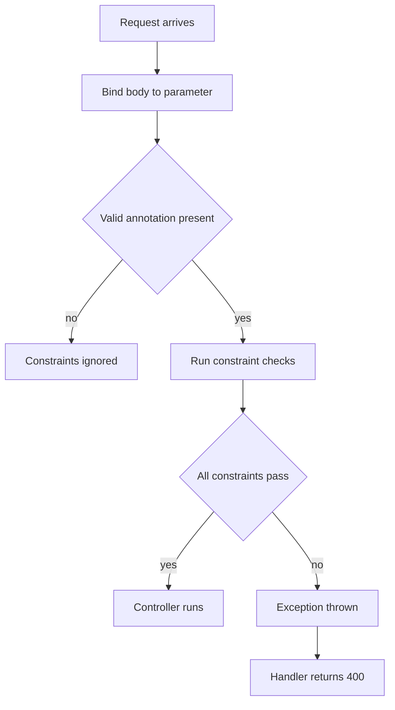

# Validation in Spring Boot

!!! note "In simple words"
    Validation checks that incoming data follows your rules before your business code runs. You describe the rules with annotations such as `@NotBlank` and `@Min`, and Spring rejects bad input with a `400` response.

## Why it matters

Bad input causes bugs, security holes, and corrupt data. Validation at the edge of the application stops most of it early and gives clients a clear answer about what went wrong. Interviewers ask about validation to see whether you know where checks belong, which exception each path throws, and why service-layer checks still matter even when the controller validates.

## How it works

Spring Boot uses Jakarta Bean Validation, which lives in the `jakarta.validation` package. It replaced `javax.validation` in Spring Boot 3. The validator checks a request in a fixed order. The Spring snippets show the shape of the code; they are not compiled as part of this page.

1. The request is bound to the method parameter. For JSON, Jackson converts the body to a record or class.
2. Because the parameter has `@Valid`, the validator checks every constraint on the object, and on nested objects that are also marked `@Valid`.
3. If any constraint fails, Spring throws an exception. Request bodies raise `MethodArgumentNotValidException`. Method-level checks raise `ConstraintViolationException`, and in Spring Framework 6.1 and later, controller parameter checks can raise `HandlerMethodValidationException`.
4. An exception handler, or Spring's default handling, turns the failure into a `400` response. See [Exception Handling](exception-handling.md).



### Constraint annotations

Constraints sit on fields, record components, or parameters. Common ones include `@NotNull`, `@NotBlank` (not null and at least one non-whitespace character), `@NotEmpty`, `@Email`, `@Pattern`, `@Min`, `@Max`, and `@Size`.

```java
import jakarta.validation.constraints.*;

public record CreateUserRequest(
        @NotBlank @Size(max = 80) String name,
        @NotBlank @Email String email,
        @Min(18) int age,
        @Pattern(regexp = "^[A-Z]{2}\\d{4}$") String memberCode) {}
```

Constraints placed on record components are copied to the canonical constructor's parameters, which is where Bean Validation checks them.

### @Valid and @Validated

Add `@Valid` to a `@RequestBody` parameter to validate it when the request is bound. A failure throws `MethodArgumentNotValidException`, which becomes a `400` by default.

```java
import jakarta.validation.Valid;
import org.springframework.http.ResponseEntity;
import org.springframework.web.bind.annotation.*;

@RestController
@RequestMapping("/api/users")
class UserController {

    @PostMapping
    ResponseEntity<Void> create(@Valid @RequestBody CreateUserRequest request) {
        // the request is already valid here
        return ResponseEntity.accepted().build();
    }
}
```

`@Validated` is Spring's annotation, and it does two jobs. On a class, it turns on method validation for constraints on that class's parameters. On a parameter, with a group, it chooses which validation groups apply.

```java
import jakarta.validation.constraints.Min;
import org.springframework.validation.annotation.Validated;
import org.springframework.web.bind.annotation.*;

@Validated
@RestController
@RequestMapping("/api/items")
class ItemController {

    @GetMapping("/{id}")
    String byId(@Min(1) @PathVariable long id) {
        return "item " + id;
    }
}
```

Validation groups let one DTO follow different rules for create and update:

```java
import jakarta.validation.constraints.NotBlank;
import jakarta.validation.constraints.Null;

public interface OnCreate {}
public interface OnUpdate {}

public record ProductRequest(
        @Null(groups = OnCreate.class) Long id,
        @NotBlank(groups = {OnCreate.class, OnUpdate.class}) String name) {}
```

```java
// in a controller method
// void save(@Validated(OnCreate.class) @RequestBody ProductRequest request) { ... }
```

### Method validation

`MethodValidationPostProcessor` adds validation to any Spring bean marked with `@Validated`. Spring Boot registers it when a validator is on the classpath. This protects service methods, not only controllers. Method validation raises `ConstraintViolationException`. Spring Framework 6.1 and later can raise `HandlerMethodValidationException` for controller parameters instead, so check which one your version throws before you write a handler for it.

### Custom constraints

A custom constraint is an annotation linked to a validator class.

```java
import jakarta.validation.Constraint;
import jakarta.validation.ConstraintValidator;
import jakarta.validation.ConstraintValidatorContext;
import jakarta.validation.Payload;
import java.lang.annotation.*;
import java.util.Set;

@Documented
@Constraint(validatedBy = AllowedCountryValidator.class)
@Target({ElementType.FIELD, ElementType.PARAMETER, ElementType.RECORD_COMPONENT})
@Retention(RetentionPolicy.RUNTIME)
@interface AllowedCountry {
    String message() default "country is not supported";
    Class<?>[] groups() default {};
    Class<? extends Payload>[] payload() default {};
}

class AllowedCountryValidator implements ConstraintValidator<AllowedCountry, String> {
    private static final Set<String> ALLOWED = Set.of("IN", "US", "GB");

    @Override
    public boolean isValid(String value, ConstraintValidatorContext context) {
        return value == null || ALLOWED.contains(value);   // null is handled by @NotNull
    }
}
```

Keep validators stateless and free of I/O. A check that needs a database lookup, such as "this email already exists", belongs in the service layer.

### Messages

Default messages come from `ValidationMessages.properties` and can be localised. Set a short, clear message on each annotation, and keep user-facing wording out of validator code.

## Where it is used

- **Request DTOs:** `@Valid @RequestBody` on every create and update endpoint.
- **Service methods:** `@Validated` on a service class to protect calls from messages and schedulers.
- **Domain rules:** custom constraints for codes or formats the team uses often.
- **Configuration:** `@ConfigurationProperties` classes validated at startup.

## Benefits

- Rules sit next to the data they check, so they are easy to read and review.
- Failures are consistent and happen before business logic runs.
- Validation groups let one DTO serve several operations.
- Custom constraints keep repeated checks in one place.

## Cons and limits

- Annotations check shape and format, not state. Stock levels, ownership, and uniqueness need the service layer.
- Constraints on nested objects are ignored unless each nested field is marked `@Valid`.
- Error messages from the default handling are not always friendly, so an exception handler is usually needed.
- Two validators that repeat the same rule can drift apart over time.

## Best practices

- Put `@Valid` on every request body. A missing annotation lets bad data through silently.
- Use `@NotBlank` for strings. `@NotNull` accepts `"   "`.
- Check business rules in the service, where they can be reached from every entry point. The controller is a convenience layer, not the only gate.
- Map database conflicts such as duplicate emails to `409 Conflict`, not to a validation error.
- Do not leak internal field names or stack traces in error responses.
- Define each rule once, in one DTO or one constraint, and reuse it.

!!! tip "Interview tip"
    **Q: Where would you validate an order request, and why not just in the controller?**
    Validate the shape and format at the boundary with `@Valid`. These checks are cheap and need no I/O. Validate business rules in the service, because they depend on state such as stock, limits, and ownership, and the service is reachable from more than one entry point, such as a message listener or a scheduler.

## Quick recap

- Use Jakarta constraints (`jakarta.validation.*`) on DTO fields and record components.
- `@Valid` triggers request-body validation. `@Validated` enables method validation and groups.
- Method validation protects service beans too, and throws its own exception types.
- Write a custom constraint as an annotation plus a stateless validator.
- Keep stateful business rules in the service layer.

## Official documentation

- [Spring Framework reference](https://docs.spring.io/spring-framework/reference/)
- [Spring Boot reference](https://docs.spring.io/spring-boot/reference/index.html)
- [RFC 9457: Problem Details for HTTP APIs](https://www.rfc-editor.org/rfc/rfc9457)

**See also:** [Building REST APIs](rest-apis.md) | [Exception Handling](exception-handling.md) | [Boot Basics and Configuration](boot-basics-configuration.md)
