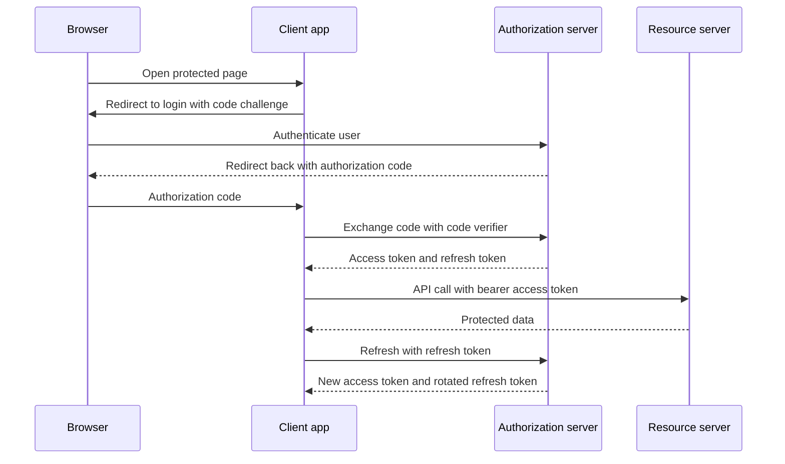

# Authentication: JWT, OAuth 2.0, and OpenID Connect

!!! note "In simple words"
    Authentication means proving who you are. A JWT is a signed card that names the caller. OAuth 2.0 gives an app a key for calling an API. OpenID Connect adds a sign-in identity on top, so the app also learns which person logged in.

## Why it matters

Each request to a protected API must answer one question: who is calling? A wrong answer lets one person act as another. JWT, OAuth 2.0, and OpenID Connect (OIDC) are often confused. The practical split is this: OAuth 2.0 governs access to an API, and OIDC tells the client who signed in. Working out which one a design needs is most of the battle.

## How it works

A token-based login involves four parties: the user, a client application, an authorisation server that verifies the user, and a resource server that hosts the API.

1. The user signs in at the authorisation server, using a password, a second factor, or single sign-on.
2. The server returns a short-lived access token, usually a JWT, plus often a refresh token.
3. The client sends the access token on every API call, in an `Authorization: Bearer` header.
4. The resource server checks the signature, issuer, audience, and expiry, then applies its own rules.
5. When the access token expires, the client trades the refresh token for a new pair. The old refresh token is retired.

The sequence below follows a browser client through login, an API call, and a refresh.



### Basic authentication and form login

HTTP Basic sends a username and password with every request. The values are base64-encoded, which hides nothing, so Basic must run only over TLS. Form login pairs a sign-in page with a session cookie. Both suit internal tools and server-rendered pages, but both depend on server-side state or repeated credential checks, which fits stateless APIs poorly.

### JWT (JSON Web Tokens)

A JWT is three base64url segments separated by dots. The header names the signing algorithm. The payload holds claims: `sub` (subject), `iss` (issuer), `aud` (audience), `exp` (expiry), and any custom claims. The signature covers the first two segments.

```text
eyJhbGciOiJSUzI1NiJ9.eyJzdWIiOiJ1c2VyLTEiLCJleHAiOjE3MDAwMDAwMDB9.<signature>
```

- Anyone holding a JWT can read its payload, so never put a secret in one.
- The signature shows that the content was not altered. It does not hide the content, and the verifier must use the expected key.
- Check `iss`, `aud`, `exp`, and the algorithm. Reject `none`, and never accept whatever algorithm the header claims.
- Verification needs no lookup, which makes revocation hard. Keep access tokens short-lived.

A refresh token lasts longer, and it exists only to mint new access tokens. Rotate it on every use, and bind it to the client that received it.

Spring Boot 3 acts as a JWT resource server once `spring-boot-starter-oauth2-resource-server` is on the classpath. Setting the issuer URI is enough for Spring to fetch the signing keys and validate tokens.

*Spring Security example (library code, not compiled here).*

```java
import org.springframework.context.annotation.Bean;
import org.springframework.context.annotation.Configuration;
import org.springframework.security.config.Customizer;
import org.springframework.security.config.annotation.web.builders.HttpSecurity;
import org.springframework.security.web.SecurityFilterChain;

@Configuration
class ResourceServerConfig {

    @Bean
    SecurityFilterChain apiChain(HttpSecurity http) throws Exception {
        http
            .authorizeHttpRequests(auth -> auth
                .requestMatchers("/api/**").authenticated()
                .anyRequest().permitAll())
            .oauth2ResourceServer(oauth -> oauth.jwt(Customizer.withDefaults()));
        return http.build();
    }
}
```

### Where to keep tokens in a browser

`localStorage` is readable by every script on the page, so a single cross-site scripting flaw exposes the token. A cookie marked `HttpOnly`, `Secure`, and `SameSite` is invisible to scripts, but the browser attaches it automatically, which brings CSRF into play. See [CORS, CSRF, TLS, and Security Headers](cors-csrf-tls-headers.md). Neither option is flawless, so be ready to defend your choice.

### OAuth 2.0

OAuth 2.0 is a delegation framework. A client receives an access token from an authorisation server and presents it to a resource server. Grant types you will encounter:

- **Authorisation code with PKCE** for browser and mobile apps, which cannot hold a secret. PKCE (Proof Key for Code Exchange) makes an intercepted code useless without the matching verifier.
- **Client credentials** for service-to-service calls with no end user.
- **Resource owner password grant**, removed in OAuth 2.1 and not to be used in new designs.
- **Implicit grant**, which returned tokens in the browser URL. It is deprecated, so use the code grant with PKCE instead.

Spring Boot configures OAuth 2.0 clients under `spring.security.oauth2.client.registration.<id>`. The authorisation server can be one you run, for example through Spring Authorization Server, or a hosted product such as Microsoft Entra ID (formerly Azure AD).

### OpenID Connect

OIDC sits on top of OAuth 2.0. Requesting the `openid` scope adds an ID token, a JWT that states who signed in and when. The user info endpoint returns more profile claims for the access token.

Read the ID token to learn who signed in, and send the access token when calling APIs. An ID token is addressed to the client, so sending it to a resource server as if it were an access token is a mistake.

Spring Security supports OIDC login through `oauth2Login()`, which places the authenticated identity into the `SecurityContext`.

### SAML and multi-factor authentication

SAML 2.0 passes signed XML statements between an identity provider and a service provider. It remains common in enterprise single sign-on, and Spring Security supports it through `saml2Login()`. Newer APIs usually choose OIDC.

Multi-factor authentication (MFA) adds a factor from another category to the password. Typical second factors are TOTP codes from an authenticator app (RFC 6238), which are a solid default; push approvals, which users can be tricked into accepting; and SMS codes, which are weaker because of SIM swapping and interception. Spring Security does not ship a full MFA product, so MFA usually comes from the identity provider or a dedicated library.

### Checking issuer, audience, and expiry together

The default JWT validator covers the signature, the issuer, and the validity window. An API should also verify the audience. The `aud` claim says which resource a token was minted for, so a token issued for a different API must be refused even if its signature is valid.

*Spring Security example (library code, not compiled here).*

```java
import org.springframework.context.annotation.Bean;
import org.springframework.context.annotation.Configuration;
import org.springframework.security.oauth2.core.DelegatingOAuth2TokenValidator;
import org.springframework.security.oauth2.core.OAuth2Error;
import org.springframework.security.oauth2.core.OAuth2TokenValidator;
import org.springframework.security.oauth2.core.OAuth2TokenValidatorResult;
import org.springframework.security.oauth2.jwt.Jwt;
import org.springframework.security.oauth2.jwt.JwtDecoder;
import org.springframework.security.oauth2.jwt.JwtValidators;
import org.springframework.security.oauth2.jwt.NimbusJwtDecoder;

@Configuration
class JwtConfig {

    @Bean
    JwtDecoder jwtDecoder() {
        String issuer = "https://auth.example.com/realms/shop";
        NimbusJwtDecoder decoder = NimbusJwtDecoder.withIssuerLocation(issuer).build();

        OAuth2TokenValidator<Jwt> audience = jwt -> jwt.getAudience().contains("orders-api")
                ? OAuth2TokenValidatorResult.success()
                : OAuth2TokenValidatorResult.failure(
                        new OAuth2Error("invalid_token", "token is not for this API", null));

        decoder.setJwtValidator(new DelegatingOAuth2TokenValidator<>(
                JwtValidators.createDefaultWithIssuer(issuer), audience));
        return decoder;
    }
}
```

The default validator checks the issuer and the `exp` and `nbf` times. The audience rule adds what the default cannot know. Custom claims such as roles or a tenant ID should be checked on the server, never accepted just because the client sent them.

## Sessions versus JWTs

A server-side session keeps state on the server, so logout is immediate, but scaling needs a shared store or sticky routing. A JWT keeps state inside the token, so any instance can verify it, but revocation needs a deny-list or a short lifetime. Sessions suit server-rendered apps that need instant logout, and JWTs suit stateless APIs.

## Issuing and verifying your own JWT

If you mint tokens yourself, the JJWT library (version 0.12 or later) handles building and parsing. An HS256 key must be at least 256 bits, and it must come from configuration rather than source code.

*JJWT library example (library code, not compiled here).*

```java
import io.jsonwebtoken.Claims;
import io.jsonwebtoken.Jwts;
import io.jsonwebtoken.security.Keys;
import java.nio.charset.StandardCharsets;
import java.time.Duration;
import java.util.Date;
import java.util.List;
import javax.crypto.SecretKey;

public class JwtIssuer {

    private static final Duration ACCESS_TTL = Duration.ofMinutes(15);

    private final SecretKey key;

    public JwtIssuer(String secret) {
        // Throws if the secret is shorter than 256 bits
        this.key = Keys.hmacShaKeyFor(secret.getBytes(StandardCharsets.UTF_8));
    }

    public String issue(String username, List<String> roles) {
        Date now = new Date();
        return Jwts.builder()
                .subject(username)
                .claim("roles", roles)
                .issuedAt(now)
                .expiration(new Date(now.getTime() + ACCESS_TTL.toMillis()))
                .signWith(key)
                .compact();
    }

    public Claims verify(String token) {
        // Throws a JwtException subclass for a bad signature, expiry, or malformed token
        return Jwts.parser()
                .verifyWith(key)
                .build()
                .parseSignedClaims(token)
                .getPayload();
    }
}
```

Older tutorials call `setSigningKey(String)` and `signWith(SignatureAlgorithm, String)`. JJWT 0.12 removed those methods, so check the version in your build. Catch `JwtException` wherever `verify` is called, and reject the request. Never log the token.

## A bearer token filter for stateless APIs

The filter reads the `Authorization: Bearer` header, verifies the token, and stores the caller in the `SecurityContext` for the current request. No session is involved.

*Spring Security and Servlet example (library code, not compiled here).*

```java
import io.jsonwebtoken.Claims;
import io.jsonwebtoken.JwtException;
import jakarta.servlet.FilterChain;
import jakarta.servlet.ServletException;
import jakarta.servlet.http.HttpServletRequest;
import jakarta.servlet.http.HttpServletResponse;
import java.io.IOException;
import java.util.List;
import org.springframework.security.authentication.UsernamePasswordAuthenticationToken;
import org.springframework.security.core.authority.SimpleGrantedAuthority;
import org.springframework.security.core.context.SecurityContextHolder;
import org.springframework.web.filter.OncePerRequestFilter;

public class BearerTokenFilter extends OncePerRequestFilter {

    private final JwtIssuer jwtIssuer;

    public BearerTokenFilter(JwtIssuer jwtIssuer) {
        this.jwtIssuer = jwtIssuer;
    }

    @Override
    protected void doFilterInternal(HttpServletRequest request, HttpServletResponse response,
                                    FilterChain chain) throws ServletException, IOException {
        String header = request.getHeader("Authorization");
        if (header != null && header.startsWith("Bearer ")) {
            try {
                Claims claims = jwtIssuer.verify(header.substring(7));
                List<?> roles = claims.get("roles", List.class);
                List<SimpleGrantedAuthority> authorities = roles == null
                        ? List.of()
                        : roles.stream()
                                .map(r -> new SimpleGrantedAuthority("ROLE_" + r))
                                .toList();
                SecurityContextHolder.getContext().setAuthentication(
                        new UsernamePasswordAuthenticationToken(claims.getSubject(), null, authorities));
            } catch (JwtException | IllegalArgumentException ex) {
                // Leave the context empty; the authorisation rules will answer 401.
            }
        }
        chain.doFilter(request, response);
    }
}
```

The chain below places the filter in front of the username-password filter. Disabling CSRF protection is acceptable only because this API never accepts cookies as credentials. See [CORS, CSRF, TLS, and Security Headers](cors-csrf-tls-headers.md).

*Spring Security example (library code, not compiled here).*

```java
import org.springframework.beans.factory.annotation.Value;
import org.springframework.context.annotation.Bean;
import org.springframework.context.annotation.Configuration;
import org.springframework.security.config.annotation.web.builders.HttpSecurity;
import org.springframework.security.config.annotation.web.configuration.EnableWebSecurity;
import org.springframework.security.config.http.SessionCreationPolicy;
import org.springframework.security.web.SecurityFilterChain;
import org.springframework.security.web.authentication.UsernamePasswordAuthenticationFilter;

@Configuration
@EnableWebSecurity
class ApiSecurityConfig {

    @Bean
    JwtIssuer jwtIssuer(@Value("${app.jwt.secret}") String secret) {
        return new JwtIssuer(secret);
    }

    @Bean
    SecurityFilterChain apiChain(HttpSecurity http, JwtIssuer jwtIssuer) throws Exception {
        http
            .csrf(csrf -> csrf.disable())
            .sessionManagement(s -> s.sessionCreationPolicy(SessionCreationPolicy.STATELESS))
            .authorizeHttpRequests(auth -> auth
                .requestMatchers("/auth/**").permitAll()
                .requestMatchers("/admin/**").hasRole("ADMIN")
                .anyRequest().authenticated())
            .addFilterBefore(new BearerTokenFilter(jwtIssuer), UsernamePasswordAuthenticationFilter.class);
        return http.build();
    }
}
```

Create the filter with `new` inside this configuration rather than declaring it as a bean. Spring Boot registers each `Filter` bean with the servlet container, so a bean-declared filter would run twice.

## Refresh token flow

An access token lasts minutes. A refresh token lasts days, and the token endpoint is the only place it is accepted. The server decides whether each exchange is allowed.

1. Sign-in yields a brief access token together with a refresh token.
2. The access token carries requests until it lapses.
3. The client posts the refresh token to the refresh endpoint.
4. The server verifies that the refresh token is stored, unexpired, and unspent, marks it spent, and issues a fresh pair.
5. Logout removes the refresh token server-side, so it cannot be redeemed later.

The snippet below generates refresh tokens with `SecureRandom` and keeps the types in one file to make the rotation logic visible.

```java
import java.security.SecureRandom;
import java.time.Duration;
import java.time.Instant;
import java.util.Base64;
import java.util.List;
import java.util.Optional;

interface AccessTokenIssuer {
    String issue(String username, List<String> roles);
}

record TokenPair(String accessToken, String refreshToken) {
}

interface RefreshTokenStore {

    /** Returns the username for an unspent, unexpired token, and marks that token as spent. */
    Optional<String> consume(String refreshTokenHash);

    void store(String refreshTokenHash, String username, Instant expiresAt);
}

class TokenService {

    private static final SecureRandom RANDOM = new SecureRandom();

    private final RefreshTokenStore refreshTokens;
    private final AccessTokenIssuer accessTokens;

    TokenService(RefreshTokenStore refreshTokens, AccessTokenIssuer accessTokens) {
        this.refreshTokens = refreshTokens;
        this.accessTokens = accessTokens;
    }

    Optional<TokenPair> refresh(String presentedRefreshToken) {
        return refreshTokens.consume(hash(presentedRefreshToken)).map(username -> {
            String access = accessTokens.issue(username, List.of());   // reload roles from storage here
            String next = newRefreshToken();
            refreshTokens.store(hash(next), username, Instant.now().plus(Duration.ofDays(7)));
            return new TokenPair(access, next);
        });
    }

    private static String newRefreshToken() {
        byte[] bytes = new byte[32];
        RANDOM.nextBytes(bytes);
        return Base64.getUrlEncoder().withoutPadding().encodeToString(bytes);
    }

    private static String hash(String token) {
        return Integer.toHexString(token.hashCode());   // placeholder: use SHA-256 or an HMAC in real code
    }
}
```

Store refresh tokens in hashed form, as with passwords, so a database read exposes nothing usable. The `hash` method above is a stand-in and must be replaced. A spent token showing up again is a theft signal, so revoke all of that user's refresh tokens and force a fresh sign-in.

## Logout and revocation

Logout cannot erase a JWT that was already issued, so it needs a deny-list. Store each revoked token's `jti` (its unique ID claim) together with its expiry time. Once that time passes, the entry is no longer needed, because the token would be rejected anyway.

```java
import java.time.Instant;
import java.util.Map;
import java.util.concurrent.ConcurrentHashMap;

public class TokenDenyList {

    private final Map<String, Instant> revokedUntil = new ConcurrentHashMap<>();

    public void revoke(String jti, Instant tokenExpiresAt) {
        revokedUntil.put(jti, tokenExpiresAt);
    }

    public boolean isRevoked(String jti) {
        Instant until = revokedUntil.get(jti);
        return until != null && until.isAfter(Instant.now());   // expired entries no longer matter
    }
}
```

An in-memory map covers one instance, and it is lost on restart. Across several instances, move the deny-list to a shared store such as Redis, with a TTL equal to the token's remaining life. A plain `HashSet` is unsafe under concurrent access and grows without limit.

## Multi-tenant claims

A tenant claim lets a single API serve several organisations. Trust it only once the signature checks out, and filter every query by it. A tenant taken from a header or query parameter is client-controlled and cannot be trusted.

```java
import java.util.Map;

public class TenantClaimDemo {
    // Minimal stand-in for the claims object your JWT library returns
    static class Claims {
        private final Map<String, Object> values;

        Claims(Map<String, Object> values) {
            this.values = values;
        }

        <T> T get(String name, Class<T> type) {
            return type.cast(values.get(name));
        }
    }

    public static void main(String[] args) {
        Claims claims = new Claims(Map.of("tenant_id", "acme"));
        // Read the tenant only from claims that verify(token) has already accepted.
        String tenant = claims.get("tenant_id", String.class);
        System.out.println(tenant);
    }
}
```

## Role checks

Enforce role rules on handlers, for example with `@PreAuthorize("hasRole('ADMIN')")` on a controller method, and never inside the token parser. The full rule set is covered in [Spring Security Authorisation](spring-security-authorisation.md).

Roles carried in a JWT are advisory for the client. The server re-checks them on each request, because a role may be withdrawn after the token was issued.

## Other authentication mechanisms

- **API keys** identify a calling application. Keep a hash rather than the raw key on the server, attach an owner and a scope to each key, and read them from a header. A leaked key exposes whatever it can reach.
- **Mutual TLS (mTLS)** authenticates both ends with certificates, and it is common between services. See [CORS, CSRF, TLS, and Security Headers](cors-csrf-tls-headers.md).
- **HMAC request signing** proves that a holder of a shared secret sent an unmodified request. Compare the tag in constant time. See [Password Security and OWASP](password-security-owasp.md).
- **Session cookies** remain the right default for server-rendered applications.

## Configuration

Read the signing key and token lifetimes from configuration. Give the secret no default, since a missing variable would otherwise fall back to a key that anyone could guess.

```yaml
app:
  jwt:
    secret: ${JWT_SECRET}          # no default: startup fails if it is missing
    access-token-ttl: PT15M
    refresh-token-ttl: P7D
```

Spring's `Duration` binding parses those ISO-8601 values. Load the secret from a vault at startup, as described in [Secrets Management](secrets-management.md).

## Where it is used

- Public APIs that accept tokens from mobile and single-page clients.
- Single sign-on across internal web applications, through OIDC.
- Service-to-service calls that use the client credentials grant.
- Partner integrations that receive scoped API keys or client certificates.

## Benefits

- Stateless verification lets any instance check a token without a session lookup.
- OAuth 2.0 keeps the user's password away from third-party clients.
- OIDC provides a standard way to learn identity, not just access.
- Short-lived access tokens limit the harm from a stolen token.

## Cons and limits

- A JWT cannot be revoked instantly without extra state such as a deny-list.
- Claims are frozen at issue time, so they can go stale.
- Refresh token handling is easy to get wrong, and a bug can keep sessions alive too long.
- Several specifications interact, and small configuration differences break validation.
- MFA sits outside the token format, so it depends on the identity provider.

### Common pitfalls

- Accepting a JWT without verifying its signature, issuer, audience, and expiry.
- Long-lived access tokens with no way to revoke them.
- Choosing the implicit or password grant for a new design.
- Redirect URIs matched loosely, so codes can be sent to attacker-owned hosts.
- Keeping tokens in `localStorage` while ignoring cross-site scripting.
- Logging whole tokens or authorisation headers.

## Best practices

- Keep access tokens short-lived, and rotate refresh tokens on every use.
- Validate issuer, audience, expiry, and algorithm on every request.
- Pick the code grant with PKCE for browsers and phones, and client credentials for machine-to-machine traffic.
- Store refresh tokens hashed, and treat a reused spent token as theft.
- Keep signing keys in a secrets manager, with a rotation plan.
- Delegate MFA to the identity provider instead of building your own.

!!! tip "Interview tip"
    **Q: What is the difference between OAuth 2.0 and OpenID Connect?**
    OAuth 2.0 is about permission: a token lets a client reach an API, and it does not define who the user is. OpenID Connect is about identity: the ID token tells the client who signed in and how. Log users in with OIDC, and call APIs with access tokens.

## Quick recap

- A JWT is signed, not hidden. Check its issuer, audience, expiry, and algorithm every time.
- Short access tokens and rotated refresh tokens limit the damage from a leak.
- Browser and mobile apps use the code grant with PKCE. Service calls use client credentials.
- The ID token is how OIDC adds identity to OAuth 2.0.
- Favour app-based TOTP codes over SMS when you can.

## Official documentation

- [JWT Introduction](https://jwt.io/introduction)
- [RFC 7519: JSON Web Token](https://www.rfc-editor.org/rfc/rfc7519)
- [Spring Security Reference](https://docs.spring.io/spring-security/reference/index.html)
- [OWASP Top 10](https://owasp.org/www-project-top-ten/)

**See also:** [Spring Security Authorisation](spring-security-authorisation.md) | [Inter-Service Communication](../14-microservices/inter-service-communication.md) | [Secrets Management](secrets-management.md) | [Password Security and OWASP](password-security-owasp.md)
