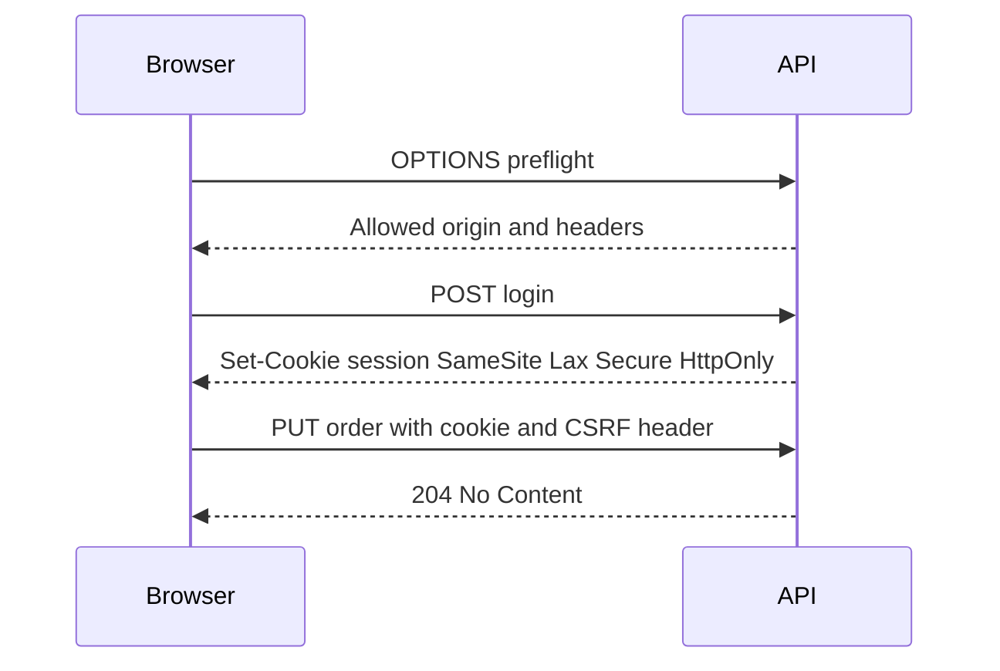

# CORS, CSRF, TLS, and Security Headers

!!! note "In simple words"
    Browsers follow rules that stop one website from reading another site's data, and stop other sites from using a logged-in user's cookies. CORS, CSRF protection, TLS, and security headers are the settings you use on the server to tell the browser which rules to apply.

## Why it matters

Many attacks on web applications travel through the browser. A browser stores cookies and certificates for many sites, and it obeys the instructions a server sends back. When those instructions are missing or too loose, a malicious page can read responses that should stay private, or trigger actions the user never meant to take. Interviewers ask about these four topics because the terms are easy to confuse, and one wrong setting can quietly weaken an application.

## How it works

Each of the four topics guards a different part of the path between browser and server.

1. CORS decides which other origins may read a response.
2. CSRF protection stops a forged request from succeeding when the browser attaches a cookie on its own.
3. TLS encrypts the traffic and proves the server's identity.
4. Security headers tell the browser to enforce extra rules, such as where scripts may load from.

### Same-origin policy and CORS

An origin is the combination of scheme, host, and port. The browser's same-origin policy stops a script loaded from one origin from reading responses that came from another origin. CORS (Cross-Origin Resource Sharing) is the controlled exception. The server adds headers such as `Access-Control-Allow-Origin` to name the origins that may read its responses.

Some requests are "simple" and go out directly. Others, such as a `PUT` or a JSON request that carries an `Authorization` header, need a preflight. The browser first sends an `OPTIONS` request that asks which methods and headers are allowed. It sends the real request only when the answer permits it.

CORS is enforced by the browser alone. A command-line client ignores it, so CORS does not protect an API from direct callers. Authentication and authorisation remain the real controls.

*The following is a Spring Security example. It is library code, shown for shape, and it has not been compiled here.*

```java
import java.util.List;
import org.springframework.context.annotation.Bean;
import org.springframework.context.annotation.Configuration;
import org.springframework.security.config.annotation.web.builders.HttpSecurity;
import org.springframework.security.web.SecurityFilterChain;
import org.springframework.web.cors.CorsConfiguration;
import org.springframework.web.cors.CorsConfigurationSource;
import org.springframework.web.cors.UrlBasedCorsConfigurationSource;

@Configuration
class CorsConfig {

    @Bean
    SecurityFilterChain apiChain(HttpSecurity http) throws Exception {
        http.cors(cors -> cors.configurationSource(corsSource()));
        return http.build();
    }

    @Bean
    CorsConfigurationSource corsSource() {
        CorsConfiguration config = new CorsConfiguration();
        config.setAllowedOrigins(List.of("https://app.example.com"));
        config.setAllowedMethods(List.of("GET", "POST", "PUT", "DELETE"));
        config.setAllowedHeaders(List.of("Content-Type", "Authorization"));
        config.setAllowCredentials(true);

        UrlBasedCorsConfigurationSource source = new UrlBasedCorsConfigurationSource();
        source.registerCorsConfiguration("/api/**", config);
        return source;
    }
}
```

A wildcard origin (`*`) cannot be combined with credentials. List the exact origins you need. If you echo the request's `Origin` header back, check it against an allow-list first, or any site can read your responses.

### CSRF

Cross-Site Request Forgery makes a logged-in browser send a request the user did not intend. It works because the browser attaches cookies to every request to the site, including requests started by another page. The standard defence is a token that the attacker's page cannot read. The server issues the token, and state-changing requests (`POST`, `PUT`, `DELETE`) must send it back.

Spring Security enables CSRF protection by default. A server-rendered application that uses session cookies should keep it on. A single-page application can read a cookie-based token and echo it in a header:

*Spring Security example (library code, not compiled here).*

```java
import org.springframework.security.config.annotation.web.builders.HttpSecurity;
import org.springframework.security.web.csrf.CookieCsrfTokenRepository;

class CsrfSetup {

    void configure(HttpSecurity http) throws Exception {
        // The cookie is readable by scripts so the front end can copy it into a header.
        http.csrf(csrf -> csrf
                .csrfTokenRepository(CookieCsrfTokenRepository.withHttpOnlyFalse()));
    }
}
```

An API that authenticates with an `Authorization` bearer header is not exposed to classic CSRF, because browsers never attach that header by themselves. Such APIs often turn CSRF protection off. That is safe only when no cookie can authenticate a request. If one endpoint accepts both a cookie and a bearer token, keep CSRF protection enabled for the cookie path.

### SameSite cookies

The `SameSite` attribute tells the browser whether to send a cookie on cross-site requests.

- `Strict` means the cookie is never sent cross-site. It is the safest setting, but it can break links that arrive from other sites.
- `Lax` means the cookie is sent on top-level navigations that use safe methods. It is a common default.
- `None` means the cookie is sent on every cross-site request, and it must also be marked `Secure`.

`SameSite` is a strong second layer, not a replacement for CSRF tokens. In Spring Boot you can set it with `server.servlet.session.cookie.same-site`, and set `secure` and `http-only` on the same cookie.

### TLS

TLS encrypts traffic between client and server and lets the client check the server's certificate. Points worth knowing for an interview:

- Use TLS 1.2 or later, and turn off older protocols and weak cipher suites.
- A certificate needs a trusted chain, a host name that matches, and a renewal plan. An expired certificate is a common cause of outages.
- Spring Boot can terminate TLS itself through the `server.ssl.*` properties. Many systems terminate TLS at a load balancer or ingress instead, and then the internal hop needs its own decision.
- Mutual TLS (mTLS) adds a client certificate, so both sides authenticate. Services often use it for traffic between themselves. See [Inter-Service Communication](../14-microservices/inter-service-communication.md).

Do not store key store passwords in files. Load them from a secrets store; see [Secrets Management](secrets-management.md).

### HSTS

HTTP Strict Transport Security (the `Strict-Transport-Security` header) tells the browser to use HTTPS for the site for a set period. That blocks downgrade attacks, where an attacker forces a plain HTTP connection. Spring Security sends HSTS on secure requests by default. Add `includeSubDomains` and `preload` only after every subdomain serves HTTPS, because a subdomain that does not will become unreachable.

### Security headers

Spring Security already writes several headers, such as `X-Content-Type-Options` and `X-Frame-Options`. You can adjust them when the defaults do not fit:

*Spring Security example (library code, not compiled here).*

```java
import org.springframework.security.config.annotation.web.builders.HttpSecurity;
import org.springframework.security.web.header.writers.ReferrerPolicyHeaderWriter;

class HeaderSetup {

    void configure(HttpSecurity http) throws Exception {
        http.headers(headers -> headers
                .contentSecurityPolicy(csp -> csp
                        .policyDirectives("default-src 'self'; frame-ancestors 'none'"))
                .referrerPolicy(ref -> ref
                        .policy(ReferrerPolicyHeaderWriter.ReferrerPolicy.STRICT_ORIGIN_WHEN_CROSS_ORIGIN))
                .permissionsPolicy(perm -> perm
                        .policy("camera=(), microphone=(), geolocation=()")));
    }
}
```

| Header | Purpose |
|---|---|
| `Content-Security-Policy` (CSP) | Limits where scripts, styles, and frames may load from. It reduces the damage of cross-site scripting |
| `X-Content-Type-Options: nosniff` | Stops the browser from guessing a content type |
| `X-Frame-Options` | Blocks clickjacking by refusing to be framed (`DENY` or `SAMEORIGIN`). The CSP `frame-ancestors` directive is the modern equivalent |
| `Referrer-Policy` | Controls how much of the page URL goes into the `Referer` header |
| `Permissions-Policy` | Switches off browser features, such as camera or location, that the page does not use |

A CSP is easy to get wrong. Run it in report-only mode first, and avoid `unsafe-inline` for scripts, because that allows injected scripts to run.

### Login and token flow with CORS and cookies

The sequence below shows a typical browser session. The preflight runs first, the login sets a hardened cookie, and a later state-changing call carries the cookie and a CSRF token.



## Where it is used

- Single-page applications that call an API hosted on another origin.
- Server-rendered web applications that rely on session cookies and forms.
- Public APIs that must be reachable over HTTPS only, behind a load balancer or ingress.
- Service-to-service traffic that uses mTLS inside a cluster.

## Benefits

- The browser enforces CORS, so a malicious page cannot read responses from an API the user is logged in to.
- CSRF tokens block forged state changes even when the user is signed in.
- TLS keeps tokens, cookies, and personal data from being read on the network.
- Headers such as CSP and `nosniff` reduce the impact of an injection bug that slips through.

## Cons and limits

- CORS only governs browsers. Non-browser clients can still call the API, so authentication is still required.
- CSRF tokens add work for front-end code and for any client that sends cookies.
- `SameSite=Lax` still allows some cross-site top-level navigations with `GET`, so state changes must not happen on `GET`.
- A strict CSP can break third-party widgets, and it takes time to tune.
- Certificates expire, and the renewal process can fail silently.

### Common pitfalls

- Treating CORS as authentication. It controls reads in a browser and nothing else.
- Allowing `*` as an origin together with credentials, or echoing any `Origin` header back.
- Turning CSRF off globally for an application that authenticates with session cookies.
- Assuming `SameSite` alone makes CSRF tokens unnecessary.
- Setting HSTS `preload` before every subdomain supports HTTPS.
- Writing a CSP with `unsafe-inline` and believing it stops cross-site scripting.
- Letting a certificate expire because nobody owns its renewal.

## Best practices

- List exact origins for CORS, and keep the list in configuration.
- Keep CSRF protection on for any endpoint that a cookie can authenticate.
- Set `Secure`, `HttpOnly`, and `SameSite` on every session cookie.
- Use TLS 1.2 or later, automate certificate renewal, and monitor expiry dates.
- Roll out CSP in report-only mode, fix the violations, then enforce it.
- Review headers with a scanner as part of the release checklist.

!!! tip "Interview tip"
    **Q: What is the difference between CORS and CSRF?**
    Think of CORS as a rule about reading: the browser blocks a script from one origin from reading another origin's response, but the request still goes out. CSRF is about writing: a foreign page triggers a state change that rides on the victim's cookies. Anti-CSRF tokens and `SameSite` cookies are what stop the forged request itself.

## Quick recap

- In browsers, CORS governs reads only. Name exact origins, and never pair `*` with credentials.
- Cookie-authenticated endpoints need CSRF tokens; bearer-only APIs can usually skip them.
- Cookie flags `SameSite`, `Secure`, and `HttpOnly` each close a different gap.
- TLS 1.2 is the floor, and certificate renewal needs an owner.
- Tune CSP, `nosniff`, framing rules, `Referrer-Policy`, and `Permissions-Policy` on purpose.

## Official documentation

- [Spring Security Reference](https://docs.spring.io/spring-security/reference/index.html)
- [Spring Boot Reference](https://docs.spring.io/spring-boot/reference/index.html)
- [RFC 9110: HTTP Semantics](https://www.rfc-editor.org/rfc/rfc9110)

**See also:** [Password Security and OWASP](password-security-owasp.md) | [Authentication: JWT, OAuth 2.0, and OpenID Connect](authentication-jwt-oauth.md) | [Secure Coding and Supply Chain](secure-coding-and-supply-chain.md) | [Secrets Management](secrets-management.md)
