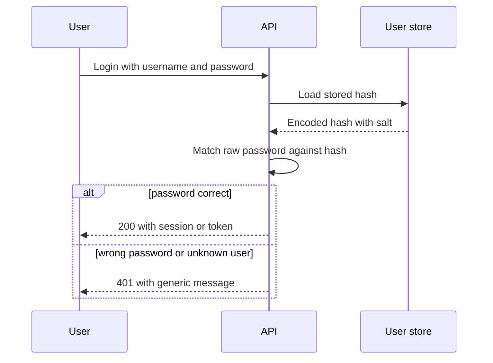

# Password Security and the OWASP Top 10

!!! note "In simple words"
    Never store a password as readable text, and never store it with a fast hash. Mix each password with a random salt, run it through a deliberately slow algorithm, and check logins in a way that does not give away which part was wrong.

## Why it matters

A database leak is the worst case for any login system. If the stored passwords can be reversed or guessed quickly, every account falls once the data escapes. That is why password storage is one of the first things an interviewer checks. The OWASP Top 10 is the usual list of web risk categories, and it gives you a shared vocabulary for the other defences around passwords.

## How it works

Password handling has two halves: storing a password safely at sign-up, and checking it safely at sign-in. Both halves rely on the same primitives.

1. At registration, the server calls the encoder with the raw password. The encoder creates a random salt and runs the adaptive algorithm.
2. The encoded string, which holds the algorithm id, the cost settings, the salt, and the hash, is saved. The raw password is discarded.
3. At sign-in, the server calls `matches` with the raw password and the stored string. The encoder rebuilds the hash from the stored salt and settings, then compares the results in constant time.
4. If the algorithm or its cost has changed, the server can re-encode the password on the next successful login.

### Hashing, encryption, and HMAC

These three terms are easy to mix up:

- **Hashing** is one-way. A hash cannot be turned back into the input. Password storage uses it with a salt and an adaptive algorithm. Integrity checks use it too, such as the SHA-256 digest of a downloaded file.
- **Encryption** is reversible when you hold the key. Symmetric algorithms such as AES use one key for both directions. Asymmetric algorithms such as RSA and ECC use a key pair. Encryption protects confidentiality, but by itself it does not prove who sent a message.
- **HMAC** is a hash keyed with a secret. Only holders of the key can create or check the tag, so the tag shows the message is intact and came from a party that has the key. Webhook providers often sign their payloads this way.

When you check an HMAC, compare the expected tag and the received tag in constant time. A normal `equals` stops at the first mismatch, and the timing can reveal how many leading bytes were correct.

```java
import java.nio.charset.StandardCharsets;
import java.security.MessageDigest;
import java.util.HexFormat;
import javax.crypto.Mac;
import javax.crypto.spec.SecretKeySpec;

public final class PayloadSigner {

    private PayloadSigner() {
    }

    public static String sign(byte[] secret, String payload) throws Exception {
        Mac mac = Mac.getInstance("HmacSHA256");
        mac.init(new SecretKeySpec(secret, "HmacSHA256"));
        return HexFormat.of().formatHex(mac.doFinal(payload.getBytes(StandardCharsets.UTF_8)));
    }

    public static boolean isValid(byte[] secret, String payload, String receivedHex) throws Exception {
        byte[] expected = sign(secret, payload).getBytes(StandardCharsets.UTF_8);
        return MessageDigest.isEqual(expected, receivedHex.getBytes(StandardCharsets.UTF_8));
    }
}
```

`HexFormat` requires Java 17 or later. The same constant-time rule applies to API keys, reset tokens, and any other secret you compare.

### Why fast hashes are wrong for passwords

A general-purpose hash such as SHA-256 is built for speed. An attacker holding a leaked table and a graphics card can test billions of guesses each second. A password hash should be slow and tunable, so every guess costs real computation. Adaptive algorithms let you raise that cost as hardware gets faster.

### Salts and peppers

A salt is random data created for each password. It is stored next to the hash. A salt stops two users with the same password from getting the same hash, and it makes precomputed tables useless.

A pepper is a secret value kept outside the database, in a secrets store or in configuration. It is mixed into the hash, so a database leak on its own is not enough to attack the passwords. The cost is key management: if the pepper is lost, no existing hash can be verified, so store it with the same care as any other key.

### Choosing an algorithm

| Algorithm | Notes |
|---|---|
| BCrypt | Widely used and well understood. Only the first 72 bytes of input count |
| Argon2 (Argon2id) | Memory-hard, and the modern recommendation where available. Spring's encoder needs Bouncy Castle on the classpath |
| SCrypt | Memory-hard, with tunable CPU and memory cost |
| PBKDF2 | Standard, and approved by FIPS. It needs a high iteration count |

Take the exact cost settings from the current OWASP password storage guidance, because those values change as hardware improves.

### Spring Security password encoders

`PasswordEncoder` hides the algorithm behind one interface. `DelegatingPasswordEncoder` writes the algorithm id in braces at the start of each stored hash, such as `{bcrypt}`. That lets you move to a new algorithm without resetting every password at once: old hashes keep verifying, and new hashes use the new algorithm.

*Spring Security example (library code, not compiled here).*

```java
import org.springframework.context.annotation.Bean;
import org.springframework.context.annotation.Configuration;
import org.springframework.security.crypto.factory.PasswordEncoderFactories;
import org.springframework.security.crypto.password.PasswordEncoder;

@Configuration
class PasswordConfig {

    @Bean
    PasswordEncoder passwordEncoder() {
        return PasswordEncoderFactories.createDelegatingPasswordEncoder();
    }
}
```

*Spring Security example (library code, not compiled here).*

```java
import org.springframework.security.crypto.password.PasswordEncoder;

class Registration {

    private final PasswordEncoder encoder;

    Registration(PasswordEncoder encoder) {
        this.encoder = encoder;
    }

    String hashForStorage(String rawPassword) {
        return encoder.encode(rawPassword);   // yields something like "{bcrypt}$2a$..."
    }

    boolean isCorrect(String rawPassword, String storedHash) {
        return encoder.matches(rawPassword, storedHash);   // compares in constant time
    }
}
```

Never compare two hashes with `equals`. Always call `matches`, which handles the salt and the settings for you.

### Password policy and login protection

NIST SP 800-63B favours length over composition rules, such as "one symbol and one digit". It also recommends checking new passwords against lists of breached passwords. Forced periodic changes are not recommended unless there is a reason, such as a suspected breach. Pair the hashing with these controls:

- Rate limits on login attempts, both per account and per source address.
- Short delays or temporary lockouts. Be careful, because a lockout rule can be abused to lock real users out.
- Generic error messages, so a response never reveals whether an account exists.
- Multi-factor authentication. See [Authentication](authentication-jwt-oauth.md).

### Login flow with password verification

The sequence below shows what happens at sign-in. The server gives the same answer for an unknown user and for a wrong password, and it never sends the stored hash to the client.



### OWASP Top 10 (2021 edition)

The 2021 edition is the reference used in this section. Check the current edition before you quote it.

| Category | Example defence |
|---|---|
| A01 Broken Access Control | Deny by default, and check permissions on the server for every request |
| A02 Cryptographic Failures | Encrypt data in transit and at rest, use current algorithms, and manage keys |
| A03 Injection (including XSS) | Parameterised queries and context-aware output encoding |
| A04 Insecure Design | Threat modelling before coding, and proven secure design patterns |
| A05 Security Misconfiguration | Hardened defaults, and no unused features or endpoints |
| A06 Vulnerable and Outdated Components | Dependency scanning and timely upgrades |
| A07 Identification and Authentication Failures | MFA, strong password hashing, and secure session management |
| A08 Software and Data Integrity Failures | No unsafe deserialisation, and verified artefact signatures |
| A09 Security Logging and Monitoring Failures | Log security events and alert on them |
| A10 Server-Side Request Forgery (SSRF) | Allow-list outbound destinations and block internal address ranges |

### Injection in Java, in one example

SQL injection happens when user input is joined into a query string. A parameterised query avoids it, because the driver sends the value separately from the SQL text.

```java
import java.sql.Connection;
import java.sql.PreparedStatement;
import java.sql.ResultSet;
import java.sql.SQLException;

class CustomerLookup {

    String findName(Connection conn, String email) throws SQLException {
        String sql = "SELECT name FROM customer WHERE email = ?";
        try (PreparedStatement ps = conn.prepareStatement(sql)) {
            ps.setString(1, email);
            try (ResultSet rs = ps.executeQuery()) {
                return rs.next() ? rs.getString("name") : null;
            }
        }
    }
}
```

JPA and JPQL follow the same rule. Use named or positional parameters, and never concatenate values into the query.

## Where it is used

- Sign-up and sign-in endpoints for any user-facing system.
- Password reset flows, which must store reset tokens in a hashed form too.
- Service accounts and admin logins, which deserve the strictest settings.
- Webhook receivers, which verify HMAC signatures on each incoming payload.

## Benefits

- A slow, salted hash makes a leaked table costly to crack.
- `DelegatingPasswordEncoder` allows the algorithm to change over time without a mass reset.
- Constant-time checks remove a class of timing leaks.
- The OWASP table gives reviewers a common checklist for each category.

## Cons and limits

- Stronger hashing costs more CPU on each login, so the cost setting is a trade-off with latency and server capacity.
- BCrypt silently ignores bytes after the first 72, which can affect very long passphrases.
- A pepper that is lost makes every stored hash unverifiable.
- Password rules do not stop phishing. Multi-factor authentication covers that gap.
- OWASP is a list of categories, so it does not tell you that a particular feature is safe.

### Common pitfalls

- Storing passwords with reversible encryption instead of a one-way hash.
- Using SHA-256 or MD5 on their own for passwords.
- Using BCrypt with very long passwords, where input past 72 bytes is ignored. Set a maximum length, or pre-hash the input.
- Hard-coding a salt, or sharing one salt across users.
- Logging passwords, including on failed login attempts.
- Revealing which accounts exist through different error messages or different response times.
- Treating the OWASP list as a checklist to finish, rather than a set of categories to reason about.

## Best practices

- Hash every password with Argon2id, BCrypt, or SCrypt, using current OWASP cost settings.
- Use `DelegatingPasswordEncoder` so the algorithm can change later.
- Verify passwords with `matches`, and never compare hashes directly.
- Rate-limit logins, return generic errors, and offer multi-factor authentication.
- Keep passwords and hashes out of logs, metrics, and error messages.
- Check new passwords against a list of breached passwords.

!!! tip "Interview tip"
    **Q: How would you store user passwords?**
    Pick a slow, salted, cost-tunable function such as Argon2id, BCrypt, or SCrypt. Give every user a random salt, record the algorithm alongside the hash so it can change later, check logins with `matches`, throttle repeated attempts, and optionally keep a pepper outside the database.

## Quick recap

- Passwords belong in slow, salted hashes, never in fast digests or reversible ciphers.
- A delegating encoder makes it possible to switch algorithms without a mass reset.
- Throttle login attempts and answer with vague error messages.
- Each OWASP category should map to at least one control you can name.
- Parameterised statements remain the main defence against injection.

## Official documentation

- [OWASP Top 10](https://owasp.org/www-project-top-ten/)
- [Spring Security Reference](https://docs.spring.io/spring-security/reference/index.html)
- [Spring Framework Reference](https://docs.spring.io/spring-framework/reference/)
- [Java 21 API Documentation](https://docs.oracle.com/en/java/javase/21/docs/api/index.html)

**See also:** [Spring Security Authorisation](spring-security-authorisation.md) | [Authentication: JWT, OAuth 2.0, and OpenID Connect](authentication-jwt-oauth.md) | [Secrets Management](secrets-management.md) | [CORS, CSRF, TLS, and Security Headers](cors-csrf-tls-headers.md)
