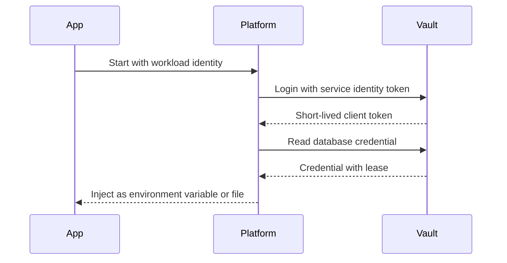

# Secrets Management

!!! note "In simple words"
    A secret is any value that unlocks something, such as a database password or an API key. Keep secrets out of your code and your logs, hand them to the app only when it starts, and change them when they might have leaked.

## Why it matters

A secret that leaks gives an attacker the same access your application has. Leaked credentials sit behind a large share of real breaches, and they are often found in places nobody reviews: a commit from years ago, a container image layer, a log line, or a debug endpoint. Interviewers ask about this because the correct response to a leak is a process question as much as a technical one. You need to know where secrets live, who can read them, and how they get replaced without an outage.

## How it works

A secret moves through a short lifecycle. Each stage has a control that limits the damage if something goes wrong.

1. The secret is created inside a secrets store, with a policy that names the services allowed to read it.
2. The application starts and proves its identity to the store with a workload identity, not a stored password.
3. The store returns the secret, which is loaded into the Spring Environment or mounted as a file.
4. The application uses the secret and never writes it to logs, images, or source code.
5. When the secret rotates, the store issues a new value, consumers reload it, and the old value is revoked.

### Rule one: never commit secrets

Git keeps history. Once a secret has been pushed, assume that everyone who can read the repository, including clones and forks, now has it. Deleting the line in a later commit removes it from the latest version only. The real fix is to rotate the secret. Editing the file comes second.

Practical defences:

- Keep local configuration files that hold credentials out of Git, using `.gitignore`.
- Run secret scanning both before the push and on the server, so a commit that contains a credential is rejected.
- Commit template files that show the required keys with placeholder values, never real values.

### Configuration from the environment

The twelve-factor method keeps configuration in the environment, so the built artefact stays the same across environments. Spring Boot's relaxed binding maps environment variables to properties. A variable named `DB_PASSWORD` can supply `spring.datasource.password`, or a custom property you define.

*Spring Boot example (library code, not compiled here).*

```java
import org.springframework.boot.context.properties.ConfigurationProperties;

@ConfigurationProperties(prefix = "app.db")
public record DbProperties(String url, String username, String password) {

    // A record's generated toString() prints every component, including the password.
    // Override it so logs and error messages show a mask instead.
    @Override
    public String toString() {
        return "DbProperties[url=" + url + ", username=" + username + ", password=****]";
    }
}
```

Environment variables beat files in the repository, but they are still visible to anyone who can inspect the process or the deployment definition. Treat them as a step toward a secrets store, not the destination.

### Dedicated secrets stores

A secrets manager encrypts values at rest, limits access through policies, records each read, and supports rotation. Common choices:

| Store | Notes |
|---|---|
| HashiCorp Vault | Self-hosted or managed. Offers dynamic credentials with leases |
| AWS Secrets Manager | Managed service on AWS. Rotation works with supported integrations |
| Azure Key Vault | Managed service on Azure. Stores keys, secrets, and certificates |
| Spring Cloud Vault | Reads secrets from Vault into the Spring Environment |

Spring Boot 3 imports external configuration through `spring.config.import`, so a secret source can supply properties at startup. Spring Cloud Vault builds on that mechanism for HashiCorp Vault. Property names change between releases, so check the current Spring Cloud documentation before you copy them.

### Kubernetes Secrets

A Kubernetes `Secret` stores its values base64-encoded. Base64 is an encoding, so it hides nothing. Unless encryption at rest is turned on for the cluster's data store, anyone with API read access to the Secret can decode it. Restrict RBAC on Secret objects. Consider an external secrets operator that syncs values from a managed store into the cluster. Container topics are covered in [Kubernetes](../16-kubernetes/index.md).

### Least privilege and short-lived credentials

Give each service its own credential with only the permissions it needs. A payments service has no reason to read the user-profile database password. Where possible, use credentials that expire on their own, such as dynamic database users, cloud IAM roles, or workload identity. A credential that expires leaves less to steal.

### Rotation

Rotation replaces a secret on a schedule or after an incident. Plan it so it causes no downtime:

1. Create the new secret, and make it valid alongside the old one.
2. Move consumers to the new value by restarting them or through a tested refresh path.
3. Revoke the old secret after nothing uses it.

Signing keys, such as the keys behind JWTs, need the same care. Publish the new public key before you sign with it, and keep the old key valid until every token signed with it has expired.

### Keeping secrets out of logs and errors

Secrets leak through logs, stack traces, metric labels, and error responses. Do not log request bodies or headers that carry credentials. Mask values whenever configuration is printed. Protect actuator endpoints such as `/actuator/env`, which can reveal property values. See [Actuator and API Documentation](../09-spring-boot/actuator-and-api-docs.md).

### Wiring secrets into Spring Boot

Refer to a secret through a placeholder, and do not give it a default value:

```yaml
spring:
  datasource:
    url: jdbc:postgresql://localhost:5432/orders
    username: ${DB_USERNAME}
    password: ${DB_PASSWORD}   # no default: startup fails if the variable is missing
```

A default such as `${DB_PASSWORD:changeme}` is a trap. When the variable is missing, the application quietly uses a known password. Failing at startup is the safer outcome.

When secrets are mounted as files, which is a common Kubernetes pattern, Spring Boot can read a directory with `configtree`. Each file name becomes a property key, and the file content becomes the value:

```yaml
spring:
  config:
    import: "optional:configtree:/run/secrets/"
```

Use the `optional:` prefix only where a missing directory is acceptable, such as on a developer's laptop.

### Rotating without downtime in practice

A rotation that works in staging can still break production when consumers cache the old value. Check these points before you rotate:

- Every consumer reads the secret at startup, or through a refresh path you have tested.
- Connection pools that hold the old credential are recycled after the change.
- The old credential stays valid until the last consumer has switched over.
- The rotation is recorded with an owner and a date, so the next one is planned.

For database passwords, a common approach is to create a second database user, move services to it, and then disable the first user. That avoids changing the password under live connections.

### Scanning and prevention

Preventing a leak is cheaper than cleaning one up:

- Turn on secret scanning in the repository host and in the CI pipeline, so a push that contains a credential-shaped string fails.
- Offer a local pre-commit hook so developers get feedback before they push.
- Block `.env` files and key files by pattern in `.gitignore`.
- Give every scanning finding an owner and a rotation process. An alert with no owner is not a fix.

## Where it is used

- Database and message broker passwords for each service.
- API keys for third-party payment or mail providers.
- TLS private keys and key store passwords.
- JWT signing keys and OAuth client secrets.
- Cloud credentials used by build pipelines.

The flow below shows how a service receives a database credential at startup. The service never sees a password stored in its own image or repository.



## Benefits

- Secrets are not part of the source code or the image, so a code leak does not expose them.
- A central store gives one place to audit access and to rotate.
- Short-lived credentials limit how long a stolen value is useful.
- Least privilege per service limits the damage from one compromised component.

## Cons and limits

- A secrets store is another critical system. If it is down, services may not start.
- Injection at startup means the app must restart, or implement a refresh path, to pick up a rotated value.
- Dynamic credentials add load on the store and need careful client handling.
- Environment variables are still visible to anyone who can inspect the process.
- Kubernetes Secrets need extra configuration before they are protected at rest.

### Common pitfalls

- Committing a secret, then fixing the file with a new commit and assuming the secret is gone.
- Baking secrets into Docker images, or passing them as build arguments that stay in image layers.
- Printing configuration objects, including records with the default `toString()`.
- Sharing one database account across every service.
- Treating base64-encoded Kubernetes Secrets as encrypted.
- Rotating a key in one place without updating its consumers, which causes an outage.
- Long-lived API keys with no owner and no expiry.

## Best practices

- Inject secrets at runtime from a secrets store, and keep them out of code, images, and logs.
- Give each service its own identity and its own credential.
- Prefer short-lived, automatically issued credentials over static ones.
- Fail fast when a required secret is missing. Do not add defaults.
- Run secret scanning in both pre-commit and CI.
- Rotate on a schedule and after any suspected exposure, and test the rotation path before you need it.
- Keep a written runbook for revoking a leaked credential.

!!! tip "Interview tip"
    **Q: A developer accidentally committed a database password. What do you do?**
    Assume the credential is already in someone else's hands. Rotate it straight away, in the database and in each service that reads it. Review access logs for misuse, rewrite history if policy demands it, and turn on scanning so the next push is refused. A later commit that deletes the line does not undo the exposure.

## Quick recap

- A committed secret is compromised; rotate it rather than hoping nobody saw it.
- Hand secrets to the process at runtime, from variables or a vault.
- Prefer credentials that expire on their own and cover only one service.
- Rotation should be a rehearsed procedure, not an emergency.
- Secrets must stay out of log lines, error bodies, actuator endpoints, and image layers.

## Official documentation

- [Kubernetes Secrets](https://kubernetes.io/docs/concepts/configuration/secret/)
- [AWS Identity and Access Management User Guide](https://docs.aws.amazon.com/IAM/latest/UserGuide/introduction.html)
- [Spring Boot Reference](https://docs.spring.io/spring-boot/reference/index.html)
- [The Twelve-Factor App: Config](https://12factor.net/)

**See also:** [Boot Basics and Configuration](../09-spring-boot/boot-basics-configuration.md) | [Password Security and OWASP](password-security-owasp.md) | [CI/CD Pipelines](../17-cicd/index.md) | [CORS, CSRF, TLS, and Security Headers](cors-csrf-tls-headers.md)
