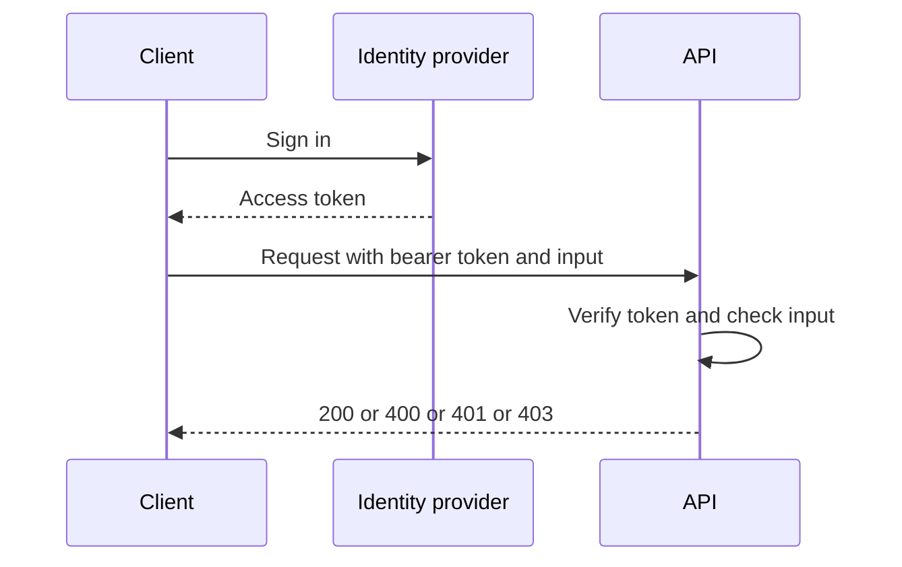

# Secure Coding and Supply Chain

!!! note "In simple words"
    Secure coding means your code refuses hostile input and checks permissions on every call. Supply-chain security extends that to the libraries you import: keep them current, scan them for known flaws, and know exactly which ones ship with your product.

## Why it matters

Attackers rarely break in through the clever route. They use the easy one: a query assembled from user input, an endpoint that forgot its permission check, or a dependency with a published flaw. Most of an application is code written by other people, so their mistakes become yours. The OWASP Top 10 gives you a shared list of common risks, and it helps you link each risk to a control you can verify.

## How it works

A security review is a set of questions asked about every change. The same questions apply to your own code and to the libraries it pulls in.

1. List every input that crosses a trust boundary: HTTP requests, message consumers, uploaded files, and responses from third parties.
2. Confirm that each input is validated and encoded for the place it lands, whether SQL, HTML, a URL, or a shell command.
3. Confirm that the server checks authorisation on each endpoint, not just on the screens that expose the feature.
4. Review new and changed dependencies for need, currency, and known advisories.
5. Confirm that secrets come from a vault, and that errors do not disclose stack traces or internal host names.
6. Confirm that the change writes logs and alerts that make abuse visible.

The sequence below shows how a protected API is reached. The token is checked and the input is validated before any business logic runs.



### OWASP Top 10 (2021 edition)

This section uses the 2021 edition of the OWASP Top 10. The list is revised periodically, so verify the current edition before you quote it.

1. **Broken access control.** A user does something beyond their rights, such as reading another customer's order by editing an ID in the URL.
2. **Cryptographic failures.** Sensitive data travels or rests without proper encryption, or with weak algorithms or keys. This category was formerly called "sensitive data exposure".
3. **Injection.** Untrusted text is interpreted as code or query syntax. Targets include SQL, operating system commands, and LDAP.
4. **Insecure design.** The weakness is in the design. No faithful implementation can repair a control that was never planned.
5. **Security misconfiguration.** Default accounts, verbose errors, publicly readable storage, or unused features stay switched on.
6. **Vulnerable and outdated components.** A library or platform with known defects remains in service.
7. **Identification and authentication failures.** Weak passwords, no brute-force protection, or poor session management.
8. **Software and data integrity failures.** Code or data is accepted without verifying its origin, such as unsigned updates or unsafe deserialisation.
9. **Security logging and monitoring failures.** Attacks pass unnoticed because nothing was logged or nobody was alerted.
10. **Server-side request forgery (SSRF).** The server is coaxed into requesting a URL of the attacker's choosing, often to reach internal services.

### Common attacks and their defences

| Attack | Main defence |
|--------|-----------------|
| SQL injection | Parameterised queries and ORMs that bind parameters |
| Cross-site scripting (XSS) | Context-aware output encoding, a Content Security Policy, and sanitising any HTML you allow |
| Cross-site request forgery (CSRF) | Anti-CSRF tokens and `SameSite` cookie settings |
| SSRF | An allow-list of outbound hosts, and blocking of internal address ranges |
| Broken access control | Server-side authorisation on every request, denied by default |
| Sensitive data exposure | TLS in transit, encryption at rest, and masking of personal data in logs |

### Parameterised queries stop SQL injection

A parameterised query sends the SQL text and the values separately. The database compiles the statement first, so input can supply data but can never change the statement's structure. Concatenating strings to build the query is the pattern to avoid.

```java
import java.sql.Connection;
import java.sql.PreparedStatement;
import java.sql.ResultSet;
import java.sql.SQLException;

class CustomerLookup {

    // Unsafe alternative: building the SQL text by concatenating the email lets input rewrite the query.
    String findName(Connection connection, String email) throws SQLException {
        String sql = "SELECT full_name FROM customers WHERE email = ?";
        try (PreparedStatement statement = connection.prepareStatement(sql)) {
            statement.setString(1, email);
            try (ResultSet rows = statement.executeQuery()) {
                return rows.next() ? rows.getString("full_name") : null;
            }
        }
    }
}
```

JPA and JPQL follow the same rule. Use named or positional parameters, and never splice values into the query text.

### Allow-listing outbound requests against SSRF

If the server fetches a URL that a user supplied, that URL can point at an internal service, such as a cloud metadata endpoint or an admin panel. An explicit allow-list of destinations closes that path. The check parses the URL and compares its host with the list.

```java
import java.net.URI;
import java.util.Set;

class OutboundUrlPolicy {

    private static final Set<String> ALLOWED_HOSTS = Set.of("api.payments.example.com");

    boolean isAllowed(String rawUrl) {
        URI uri = URI.create(rawUrl);
        return "https".equalsIgnoreCase(uri.getScheme())
                && uri.getHost() != null
                && ALLOWED_HOSTS.contains(uri.getHost());
    }
}
```

This is the outline of the check, not a complete control. A real defence also resolves the host, blocks private, loopback, and link-local addresses, and refuses redirects that leave the allow-list. `URI.create` throws `IllegalArgumentException` on malformed input, and callers must handle it.

### Validating input at the boundary

Validate input the moment it enters, and accept only the shape you expect. An allow-list describing a valid format beats a block-list of bad characters, because an attacker needs to find only one character you forgot.

```java
import java.util.regex.Pattern;

class OrderIdValidator {

    private static final Pattern ORDER_ID = Pattern.compile("ORD-\\d{4}-[A-Z]{2}");

    static String requireOrderId(String raw) {
        if (raw == null || !ORDER_ID.matcher(raw).matches()) {
            // Do not echo the raw value back; it may carry a payload.
            throw new IllegalArgumentException("Invalid order id");
        }
        return raw;
    }
}
```

Validation does not replace output encoding or parameterised queries. Every sink needs its own protection, since a value that is harmless in one context can be dangerous in another.

### Secrets and configuration

- Keep passwords, API keys, and signing keys out of source control, container images, and logs.
- Supply secrets at runtime from a vault or the platform's store, and restrict which services can read each one.
- Use separate credentials per environment, so a development leak does not reach production.
- Revoke and rotate credentials when someone leaves the team or a value may have been exposed.
- Disable debug endpoints, sample accounts, and verbose stack traces in production builds.

### Dependency and supply-chain security

Most of a modern service is third-party code, so the weakest imported library sets your risk level.

- **Scan for known vulnerabilities.** OWASP Dependency-Check, Snyk, and cloud scanners compare your versions against vulnerability databases.
- **Pin versions and upgrade deliberately.** A lock file or a dependency-management section makes each build resolve the same versions. Move to a fixed release as soon as a patch exists.
- **Follow advisories.** Log4Shell (CVE-2021-44228) showed how one widely used library could expose huge numbers of systems in days. The CISA Known Exploited Vulnerabilities catalogue lists flaws attackers are using today, and those deserve priority.
- **Verify downloads.** Check checksums or signatures, and prefer packages from trusted repositories.
- **Shrink the surface.** Remove dependencies you do not use. Code you never ship cannot be exploited through your application.
- **Know your contents.** A software bill of materials (SBOM) lists every component in a release, so a new advisory can be answered with "are we affected?" in minutes.
- **Guard the build.** Limit who can edit pipeline steps or read pipeline secrets. A compromised build can inject code without anyone touching the source.

### Secure coding principles

- **Least privilege.** Each user, service, and database account receives only the access it requires.
- **Defence in depth.** Stack validation, authorisation, encryption, and monitoring, so no single control is the only barrier.
- **Fail closed.** If a check throws, deny the request.
- **Validate at the boundary.** Inspect data where it enters: HTTP, queues, files, and third-party replies.
- **Distrust the client.** Hidden fields, browser-side checks, and roles sent by the browser are all under attacker control.
- **Compare secrets in constant time.** A plain equality test can leak timing information. `MessageDigest.isEqual` compares byte arrays without early exit.
- **Log events, not secrets.** Record logins, failures, and permission changes with enough detail to investigate, and never log passwords, tokens, or full card numbers.

## Where it is used

- Every HTTP endpoint and message consumer in a backend service.
- Security checklists applied to each pull request.
- Dependency management in Maven and Gradle builds.
- Release pipelines that produce SBOMs and run vulnerability scans.

## Benefits

- Grouping defences by risk category makes reviews repeatable.
- Parameterised queries and allow-lists remove whole families of bugs.
- Dependency scanning catches known flaws before attackers do.
- An SBOM turns a new advisory into a fast, precise answer.

## Cons and limits

- The OWASP list names categories. It cannot tell you that one feature is safe.
- Scanners produce false positives, and they miss flaws that are not yet catalogued.
- Pinned versions fall behind if nobody reviews the lock file.
- Validation at the edge cannot know later uses of a value, so each sink still needs protection.
- A web application firewall blocks some attacks, but it does not repair the code.

### Common pitfalls

- Relying on a web application firewall instead of fixing the code.
- Building SQL by concatenation, even for values that look internal.
- Trusting a role or price that the client sent.
- Checking authorisation in the interface but not in the API.
- Upgrading a library without checking whether its transitive dependencies changed.
- Leaving debug endpoints or default credentials active in production.
- Logging whole request bodies, which can contain passwords or tokens.

## Best practices

- Make parameterised queries the only way SQL gets built in the codebase.
- Enforce authorisation in the service layer on every endpoint, denying by default.
- Run dependency scanning in CI, and fail the build on critical findings in direct dependencies.
- Keep an SBOM for every release, stored alongside the build artefacts.
- Review changes to pipeline definitions as carefully as application code.
- Write negative tests for controls, such as a request without a token that must be refused.

!!! tip "Interview tip"
    **Q: How do you prevent SQL injection in a Java application?**
    Bind values through `PreparedStatement` or through an ORM's parameter binding, and do not build query text from user-supplied strings. Pair that with a database account that holds only the rights it needs, so a missed case still has a small blast radius.

## Quick recap

- Map each OWASP category to a control you can point to in code.
- Parameter binding keeps query text and data apart, which blocks injection.
- SSRF is contained by an outbound allow-list plus a block on internal address ranges.
- Keep dependencies scanned, pinned, and listed in an SBOM.
- Layer least privilege, fail-closed logic, and server-side validation.
- Store secrets in a vault, and compare them in constant time.

## Official documentation

- [OWASP Top 10](https://owasp.org/www-project-top-ten/)
- [Spring Security Reference](https://docs.spring.io/spring-security/reference/index.html)
- [Apache Maven Guides](https://maven.apache.org/guides/)
- [Git Documentation](https://git-scm.com/doc)

**See also:** [Authentication, JWT, and OAuth](authentication-jwt-oauth.md) | [Secrets Management](secrets-management.md) | [CORS, CSRF, TLS, and Headers](cors-csrf-tls-headers.md) | [Web Fundamentals](../foundations/web-fundamentals.md)
