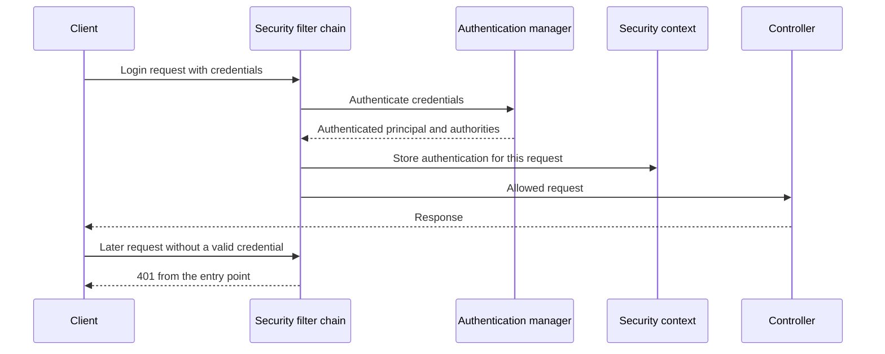

# Spring Security: Filter Chain, Authorisation, and Method Security

!!! note "In simple words"
    Spring Security checks every request before your controller sees it. It first works out who the caller is, then decides whether that caller may do the action. Failing the first check returns 401, and failing the second returns 403.

## Why it matters

Most security bugs in Spring applications come from misreading the filter chain, getting the rule order wrong, or assuming method security applies in places where it does not. An interviewer who asks about these topics wants to hear that you know where the checks run, what order they run in, and what happens when one fails.

## How it works

A request moves through a fixed sequence before it reaches application code. Understanding that sequence explains almost every behaviour you will see.

1. The servlet container hands the request to `DelegatingFilterProxy`, a standard servlet filter that delegates to a Spring bean.
2. `FilterChainProxy` picks the first `SecurityFilterChain` whose request matcher fits the URL.
3. That chain runs its filters in order: CSRF protection, authentication (basic, form, or bearer token), and then the authorisation check.
4. If authentication is missing or fails, the entry point returns `401`. If authorisation fails, the access-denied handler returns `403`.
5. On success, the `Authentication` object sits in the `SecurityContext` and the request reaches the `DispatcherServlet` and your controller.
6. Method-level annotations are checked when a secured bean's method is called through its Spring proxy.

The sequence below shows a login request that carries credentials, followed by a request that uses the stored authentication.



### Authentication versus authorisation

Authentication answers "who are you?", usually by checking a password, a token, or a certificate. Authorisation answers "are you allowed to do this?", using roles, authorities, or ownership of the data. A request can pass authentication and still be refused. That is the difference between `401` (the caller is unknown or the credential is invalid) and `403` (the caller is known but not permitted).

### Declaring a SecurityFilterChain

Spring Security 6 removed `WebSecurityConfigurerAdapter`. You now declare one or more `SecurityFilterChain` beans, each with its own rules.

*Spring Security example (library code, not compiled here).*

```java
import org.springframework.context.annotation.Bean;
import org.springframework.context.annotation.Configuration;
import org.springframework.security.config.Customizer;
import org.springframework.security.config.annotation.method.configuration.EnableMethodSecurity;
import org.springframework.security.config.annotation.web.builders.HttpSecurity;
import org.springframework.security.web.SecurityFilterChain;

@Configuration
@EnableMethodSecurity
class SecurityConfig {

    @Bean
    SecurityFilterChain apiChain(HttpSecurity http) throws Exception {
        http
            .authorizeHttpRequests(auth -> auth
                .requestMatchers("/public/**", "/actuator/health").permitAll()
                .requestMatchers("/admin/**").hasRole("ADMIN")
                .anyRequest().authenticated())
            .httpBasic(Customizer.withDefaults());
        return http.build();
    }
}
```

Rules are checked from top to bottom, and the first match wins. Put the most specific rules first, and end with a catch-all such as `anyRequest().authenticated()`. Then any new endpoint is protected until someone deliberately opens it.

### SecurityContext, Authentication, and GrantedAuthority

After a successful login, Spring stores an `Authentication` in the `SecurityContext`. The context is bound to the current thread, or to the reactive context in WebFlux. The `Authentication` holds the principal (who the caller is), the credentials (normally cleared after login), and a set of `GrantedAuthority` values. An authority is a string such as `ROLE_ADMIN` or `INVOICE_READ`.

`hasRole("ADMIN")` checks for `ROLE_ADMIN`, because Spring adds the `ROLE_` prefix. `hasAuthority("ADMIN")` checks the exact string. Mixing the two is a common source of confusion.

### UserDetailsService and UserDetails

`UserDetailsService.loadUserByUsername` loads a user by name. `UserDetails` describes the stored password hash, the authorities, and the account flags such as enabled or locked. The `DaoAuthenticationProvider` uses this service together with a `PasswordEncoder` to check credentials.

*Spring Security example (library code, not compiled here).*

```java
import java.util.List;
import java.util.Optional;
import org.springframework.security.core.userdetails.User;
import org.springframework.security.core.userdetails.UserDetails;
import org.springframework.security.core.userdetails.UserDetailsService;
import org.springframework.security.core.userdetails.UsernameNotFoundException;
import org.springframework.stereotype.Service;

record AppUser(String email, String passwordHash, List<String> roles) {}

interface AppUserRepository {
    Optional<AppUser> findByEmail(String email);
}

@Service
class DbUserDetailsService implements UserDetailsService {

    private final AppUserRepository users;

    DbUserDetailsService(AppUserRepository users) {
        this.users = users;
    }

    @Override
    public UserDetails loadUserByUsername(String username) {
        AppUser user = users.findByEmail(username)
                .orElseThrow(() -> new UsernameNotFoundException("unknown user"));
        return User.withUsername(user.email())
                .password(user.passwordHash())
                .authorities(user.roles().toArray(String[]::new))   // for example "ROLE_ADMIN"
                .build();
    }
}
```

Pass the stored hash to `password(...)`, never the raw password. `authorities(...)` takes complete authority names, while `roles(...)` adds the `ROLE_` prefix for you.

### Role-based access control and fine-grained rules

Role-based access control (RBAC) grants permissions through roles. It works well when roles map to clear job functions. Some rules depend on the data itself, such as "only the owner of this invoice may read it". Those rules need the object's values, so they belong in method security, where the arguments are available.

### Method security

`@EnableMethodSecurity` replaces the older `@EnableGlobalMethodSecurity` and switches on method annotations for Spring beans.

- `@PreAuthorize` is checked before the method runs. It can use SpEL and the method's parameters.
- `@PostAuthorize` is checked after the method runs, and it can inspect `returnObject`.
- `@Secured` checks role names only.
- `@RolesAllowed` comes from JSR-250, and you must enable JSR-250 support to use it.

*Spring Security example (library code, not compiled here).*

```java
import org.springframework.security.access.prepost.PostAuthorize;
import org.springframework.security.access.prepost.PreAuthorize;
import org.springframework.stereotype.Service;

record Invoice(String id, String ownerId, long amountCents) {}

@Service
class InvoiceService {

    @PreAuthorize("hasAuthority('INVOICE_READ') or #ownerId == authentication.name")
    Invoice find(String ownerId, String invoiceId) {
        return new Invoice(invoiceId, ownerId, 1200L);   // load from storage here
    }

    @PostAuthorize("returnObject.ownerId() == authentication.name")
    Invoice byIdForAnyone(String invoiceId) {
        // The method has already run and loaded the data when this check happens.
        return new Invoice(invoiceId, "someone", 500L);
    }
}
```

Method security applies only when the call passes through the Spring proxy. When one method calls another method on the same class, for example `this.find(...)`, the call bypasses the proxy and the check does not run. This is one of the most common mistakes in practice.

### Authentication providers

An `AuthenticationManager` passes the credentials to one or more `AuthenticationProvider` beans. Each provider handles one kind of credential, such as a username and password, a JWT, or a certificate. A custom provider is the extension point when your login does not fit the defaults.

## Login, ownership, and error handling

### A login endpoint that uses AuthenticationManager

A login endpoint hands the submitted credentials to the `AuthenticationManager`. Spring exposes the manager as a bean, usually from `AuthenticationConfiguration.getAuthenticationManager()`.

*Spring Boot and Spring Security example (library code, not compiled here).*

```java
import java.util.Map;
import org.springframework.http.HttpStatus;
import org.springframework.http.ResponseEntity;
import org.springframework.security.authentication.AuthenticationManager;
import org.springframework.security.authentication.BadCredentialsException;
import org.springframework.security.authentication.UsernamePasswordAuthenticationToken;
import org.springframework.security.core.Authentication;
import org.springframework.web.bind.annotation.PostMapping;
import org.springframework.web.bind.annotation.RequestBody;
import org.springframework.web.bind.annotation.RequestMapping;
import org.springframework.web.bind.annotation.RestController;

record LoginRequest(String username, String password) {}

@RestController
@RequestMapping("/auth")
class LoginController {

    private final AuthenticationManager authenticationManager;

    LoginController(AuthenticationManager authenticationManager) {
        this.authenticationManager = authenticationManager;
    }

    @PostMapping("/login")
    ResponseEntity<Map<String, String>> login(@RequestBody LoginRequest request) {
        try {
            Authentication auth = authenticationManager.authenticate(
                    UsernamePasswordAuthenticationToken.unauthenticated(
                            request.username(), request.password()));
            // A real API issues a token at this point. See the authentication page.
            return ResponseEntity.ok(Map.of("user", auth.getName()));
        } catch (BadCredentialsException ex) {
            // The same message is returned for an unknown user and for a wrong password.
            return ResponseEntity.status(HttpStatus.UNAUTHORIZED)
                    .body(Map.of("error", "invalid username or password"));
        }
    }
}
```

Throw `BadCredentialsException`, not a generic `RuntimeException`, so the status code is right. The DAO authentication provider also reports an unknown user as bad credentials. That keeps account names from leaking through the response.

### Ownership rules with a custom principal

An expression such as `authentication.principal.id` needs the principal to expose an `id` property. Spring's default `User` has no such property. Create a `UserDetails` implementation with a `getId()` method, load it in your `UserDetailsService`, and the expression will work.

### Custom permission checks

A `PermissionEvaluator` answers `hasPermission(...)` expressions. It suits rules that depend on the owner or the state of an object. Register it in a `MethodSecurityExpressionHandler`, or the expression fails at runtime.

*Spring Security example (library code, not compiled here).*

```java
import java.io.Serializable;
import org.springframework.security.access.PermissionEvaluator;
import org.springframework.security.core.Authentication;
import org.springframework.stereotype.Component;

record Post(Long id, String authorName) {}

@Component
class PostPermissionEvaluator implements PermissionEvaluator {

    @Override
    public boolean hasPermission(Authentication authentication, Object target, Object permission) {
        if (target instanceof Post post && "EDIT".equals(permission)) {
            return post.authorName().equals(authentication.getName()) || hasRole(authentication, "ADMIN");
        }
        return false;
    }

    @Override
    public boolean hasPermission(Authentication authentication, Serializable targetId,
                                 String targetType, Object permission) {
        return false;   // an ID-based check would load the object here
    }

    private boolean hasRole(Authentication authentication, String role) {
        return authentication.getAuthorities().stream()
                .anyMatch(a -> a.getAuthority().equals("ROLE_" + role));
    }
}
```

*Spring Security example (library code, not compiled here).*

```java
import org.springframework.context.annotation.Bean;
import org.springframework.context.annotation.Configuration;
import org.springframework.security.access.PermissionEvaluator;
import org.springframework.security.access.expression.method.DefaultMethodSecurityExpressionHandler;
import org.springframework.security.access.expression.method.MethodSecurityExpressionHandler;
import org.springframework.security.config.annotation.method.configuration.EnableMethodSecurity;

@Configuration
@EnableMethodSecurity
class MethodSecurityConfig {

    @Bean
    static MethodSecurityExpressionHandler methodSecurityExpressionHandler(PermissionEvaluator evaluator) {
        DefaultMethodSecurityExpressionHandler handler = new DefaultMethodSecurityExpressionHandler();
        handler.setPermissionEvaluator(evaluator);
        return handler;
    }
}
```

*Spring Security example (library code, not compiled here).*

```java
import org.springframework.security.access.prepost.PreAuthorize;
import org.springframework.stereotype.Service;

@Service
class PostService {

    @PreAuthorize("hasPermission(#post, 'EDIT')")
    Post update(Post post) {
        return post;   // persist the change here
    }
}
```

The expression refers to the parameter by name, `#post`. Spring Boot's parent POM compiles with `-parameters`, so those names are available at run time. Without that flag, annotate the parameter with `@P("post")`.

### Shaping responses by role

Prefer a separate response type for each audience over setting fields to `null` for non-admin callers. With separate types, a new sensitive field cannot reach the wrong audience by accident. Choose the endpoint or the response type from the caller's authorities, and keep admin-only fields out of the public type.

```java
import java.time.Instant;
import java.util.List;

public record UserView(long id, String username) {}

public record AdminUserView(long id, String username, String email,
                            List<String> roles, Instant createdAt) {}
```

### JSON errors for 401 and 403

Spring Security's default error responses do not match your API's format. Replace the access-denied handler, and add an authentication entry point for missing or invalid credentials. Both should return an RFC 9457 Problem Details body. See [Pagination, Errors, and Idempotency](../21-api-design/pagination-errors-idempotency.md).

*Spring Security and Spring Web example (library code, not compiled here).*

```java
import com.fasterxml.jackson.databind.ObjectMapper;
import jakarta.servlet.http.HttpServletRequest;
import jakarta.servlet.http.HttpServletResponse;
import java.io.IOException;
import org.springframework.http.HttpStatus;
import org.springframework.http.MediaType;
import org.springframework.http.ProblemDetail;
import org.springframework.security.access.AccessDeniedException;
import org.springframework.security.web.access.AccessDeniedHandler;
import org.springframework.stereotype.Component;

@Component
class JsonAccessDeniedHandler implements AccessDeniedHandler {

    private final ObjectMapper mapper;

    JsonAccessDeniedHandler(ObjectMapper mapper) {
        this.mapper = mapper;
    }

    @Override
    public void handle(HttpServletRequest request, HttpServletResponse response,
                       AccessDeniedException ex) throws IOException {
        ProblemDetail problem = ProblemDetail.forStatusAndDetail(
                HttpStatus.FORBIDDEN, "You do not have permission for this action.");
        problem.setTitle("Access denied");
        response.setStatus(HttpStatus.FORBIDDEN.value());
        response.setContentType(MediaType.APPLICATION_PROBLEM_JSON_VALUE);
        mapper.writeValue(response.getOutputStream(), problem);
    }
}
```

Register the handler with `http.exceptionHandling(ex -> ex.accessDeniedHandler(handler))`. Write an `AuthenticationEntryPoint` for `401` in the same way.

### Auditing access with AOP

An aspect can record who called a sensitive method. You mark the method with an annotation, and the aspect reads the caller from the `SecurityContext`.

```java
import java.lang.annotation.ElementType;
import java.lang.annotation.Retention;
import java.lang.annotation.RetentionPolicy;
import java.lang.annotation.Target;

@Target(ElementType.METHOD)
@Retention(RetentionPolicy.RUNTIME)
@interface Audited {
}
```

*Spring AOP example (library code, not compiled here).*

```java
import org.aspectj.lang.ProceedingJoinPoint;
import org.aspectj.lang.annotation.Around;
import org.aspectj.lang.annotation.Aspect;
import org.slf4j.Logger;
import org.slf4j.LoggerFactory;
import org.springframework.security.core.Authentication;
import org.springframework.security.core.context.SecurityContextHolder;
import org.springframework.stereotype.Component;

@Aspect
@Component
class AuditAspect {

    private static final Logger log = LoggerFactory.getLogger(AuditAspect.class);

    @Around("@annotation(com.example.security.Audited)")
    public Object audit(ProceedingJoinPoint joinPoint) throws Throwable {
        Authentication auth = SecurityContextHolder.getContext().getAuthentication();
        String caller = auth == null ? "anonymous" : auth.getName();
        log.info("audit caller={} operation={}", caller, joinPoint.getSignature().toShortString());
        return joinPoint.proceed();
    }
}
```

The aspect needs `spring-boot-starter-aop`. Log identifiers only, never request bodies or secrets. For compliance, write to a protected audit table rather than to an ordinary application log. Decide whether to record before or after the call. This example records before it runs, so a failed call still leaves a trace.

## Where it is used

- Admin consoles that must be locked to a specific role.
- Multi-user applications where each person may see only their own records.
- Internal APIs that enforce permissions through method security.
- Regulated systems that must record who did what and when.

## Benefits

- Deny-by-default rules protect new endpoints without extra work.
- Method security keeps data rules next to the code that uses the data.
- The filter chain runs before any controller code, so one mistake in a controller cannot skip the checks.
- Custom evaluators let the rules express business ownership clearly.

## Cons and limits

- Rule order is easy to get wrong, and a broad rule above a specific one can silently make the specific rule unreachable.
- Method security works only through the proxy, so self-invocation bypasses it.
- `@PostAuthorize` runs after the data has been loaded, so it does not prevent the load itself.
- Complex expressions in annotations are hard to read and test.
- A single rule set for many clients can grow until nobody understands it.

### Common pitfalls

- Relying on the front end to hide buttons. Every endpoint must check on the server.
- Putting a broad `permitAll()` above a specific `hasRole` rule, which makes the specific rule unreachable.
- Writing `hasRole("ROLE_ADMIN")`, which checks for `ROLE_ROLE_ADMIN`.
- Forgetting `@EnableMethodSecurity`, so `@PreAuthorize` annotations are silently ignored.
- Calling a secured method from the same class, which bypasses method security.
- Leaking data through `@PostAuthorize`, because the method has already loaded it.
- Exposing internal details in `401` or `403` responses.

## Best practices

- Declare a `SecurityFilterChain` bean and end every chain with `anyRequest().authenticated()`.
- Enable method security with `@EnableMethodSecurity`, and use `@PreAuthorize` for ownership rules.
- Use `hasRole` with plain role names, and `hasAuthority` for fine-grained permissions.
- Write separate response types for each audience.
- Return consistent Problem Details for `401` and `403`.
- Add tests that call protected endpoints without credentials and with the wrong role, and assert the status codes.

!!! tip "Interview tip"
    **Q: How does Spring Security decide whether a request is allowed?**
    `FilterChainProxy` picks the first chain whose matcher accepts the URL. That chain's filters establish the caller and store the result in the `SecurityContext`, and then the URL rules compare the caller's authorities with what the route demands. Rules are read in order, so the earliest match decides. Method security performs one more check on the proxied bean.

## Quick recap

- A `401` means the caller could not be identified; a `403` means the caller is known but not allowed.
- Requests flow from `DelegatingFilterProxy` to `FilterChainProxy` and then into one `SecurityFilterChain`.
- Spring Security 6 expects `SecurityFilterChain` beans, not `WebSecurityConfigurerAdapter` subclasses.
- Pair `@EnableMethodSecurity` with `@PreAuthorize` and `@PostAuthorize` for data-level rules.
- End every chain with `anyRequest().authenticated()` so that new routes default to locked.

## Official documentation

- [Spring Security Reference](https://docs.spring.io/spring-security/reference/index.html)
- [Spring Framework Reference](https://docs.spring.io/spring-framework/reference/)
- [Spring Boot Reference](https://docs.spring.io/spring-boot/reference/index.html)
- [OWASP Top 10](https://owasp.org/www-project-top-ten/)

**See also:** [Authentication: JWT, OAuth 2.0, and OpenID Connect](authentication-jwt-oauth.md) | [Password Security and OWASP](password-security-owasp.md) | [Integration Testing](../11-testing/integration-testing.md)
