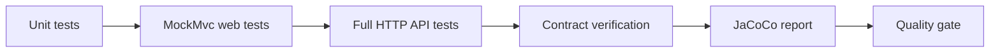

# API Testing and Code Coverage

!!! note "In simple words"
    API tests send real requests to your endpoints and check the status codes, bodies, and error formats that clients depend on. Coverage tools show which lines ran during tests, which is useful, but a high number does not prove that the tests check anything useful.

## Why it matters

An API is a promise to its callers. If a field disappears, a status code changes, or an error body takes a new shape, clients break even though the code still compiles. API tests catch those breaks before release. Contract tests extend that protection across teams, so a provider and its consumers agree on the same behaviour. Coverage metrics tell you where tests never reach, and they are often misread as a measure of quality. Interviewers ask about all of this to see whether you can test an HTTP interface and whether you know what a coverage number actually means.

## How it works

An API test pipeline usually has four layers, each with a different cost and speed.

1. Tests run in the build, and the coverage agent records which instructions and branches execute.
2. Web-layer tests use `MockMvc` to send requests into Spring MVC without opening a socket.
3. Full API tests start the application on a real port and send HTTP requests, using a client such as REST Assured.
4. Contract tests compare the provider with the expectations of each consumer, and the coverage report and quality gate then decide whether the build passes.

The flow below shows how these layers feed a single build result.



### MockMvc

`MockMvc` runs requests through the Spring MVC stack without starting a server. It is quick, and it covers routing, JSON conversion, validation, and exception handling. It is a good default for a controller's behaviour.

*Spring Boot and Spring MVC example (library code, not compiled here). The controller is a sketch, so use the application's own controller in a real suite.*

```java
import static org.springframework.test.web.servlet.request.MockMvcRequestBuilders.post;
import static org.springframework.test.web.servlet.result.MockMvcResultMatchers.status;

import org.junit.jupiter.api.Test;
import org.springframework.beans.factory.annotation.Autowired;
import org.springframework.boot.test.autoconfigure.web.servlet.WebMvcTest;
import org.springframework.http.MediaType;
import org.springframework.test.web.servlet.MockMvc;

@WebMvcTest(UserController.class)
class UserControllerTest {

    @Autowired
    MockMvc mvc;

    @Test
    void rejectsMalformedEmail() throws Exception {
        mvc.perform(post("/api/users")
                        .contentType(MediaType.APPLICATION_JSON)
                        .content("{\"name\":\"Ada\",\"email\":\"not-an-email\",\"age\":30}"))
           .andExpect(status().isBadRequest());
    }

    @Test
    void acceptsValidUser() throws Exception {
        mvc.perform(post("/api/users")
                        .contentType(MediaType.APPLICATION_JSON)
                        .content("{\"name\":\"Ada\",\"email\":\"ada@example.com\",\"age\":30}"))
           .andExpect(status().isAccepted());
    }
}

@org.springframework.web.bind.annotation.RestController
@org.springframework.web.bind.annotation.RequestMapping("/api/users")
class UserController {

    @org.springframework.web.bind.annotation.PostMapping
    org.springframework.http.ResponseEntity<Void> create(
            @jakarta.validation.Valid @org.springframework.web.bind.annotation.RequestBody UserRequest request) {
        return org.springframework.http.ResponseEntity.accepted().build();
    }
}

record UserRequest(
        @jakarta.validation.constraints.NotBlank String name,
        @jakarta.validation.constraints.Email String email,
        @jakarta.validation.constraints.Min(18) int age) {}
```

The first test sends an invalid email and expects `400`. Once a `@RestControllerAdvice` returns RFC 9457 Problem Details (see [Exception Handling](../09-spring-boot/exception-handling.md)), add assertions on the body fields, such as `$.status` and `$.title`. Use `andDo(print())` while you debug, so the full request and response appear in the output.

### REST Assured

REST Assured is a Java library for HTTP tests with a `given().when().then()` layout. It runs against a real server, typically a test started with `RANDOM_PORT`, and it reads well for scenarios that span several calls.

*REST Assured and Spring Boot example (library code, not compiled here). The endpoints are illustrative.*

```java
import static io.restassured.RestAssured.given;
import static org.hamcrest.Matchers.equalTo;

import io.restassured.RestAssured;
import org.junit.jupiter.api.BeforeEach;
import org.junit.jupiter.api.Test;
import org.springframework.boot.test.context.SpringBootTest;
import org.springframework.boot.test.web.server.LocalServerPort;

@SpringBootTest(webEnvironment = SpringBootTest.WebEnvironment.RANDOM_PORT)
class OrderApiTest {

    @LocalServerPort
    int port;

    @BeforeEach
    void setUp() {
        RestAssured.port = port;
    }

    @Test
    void createsAndFetchesOrder() {
        given()
            .contentType("application/json")
            .body("{\"item\":\"book\",\"quantity\":1}")
        .when()
            .post("/api/orders")
        .then()
            .statusCode(201);

        given()
        .when()
            .get("/api/orders/42")
        .then()
            .statusCode(200)
            .body("status", equalTo("NEW"));
    }
}
```

Keep the scenario steps realistic, and assert only on the fields that clients depend on. A test that asserts every field of a response breaks whenever a harmless field is added.

### Testing error responses

Error responses are part of the contract, so test them as carefully as success responses. For each endpoint, check the cases a client can trigger:

- `400` for invalid input, with a body that names the field at fault.
- `401` for a missing or invalid credential.
- `403` for a caller who lacks permission.
- `404` for a resource that does not exist.
- `409` for a conflict, such as a duplicate key or an out-of-date version.

Assert the status code, the content type, and the stable parts of the body. Avoid asserting on messages that might be reworded.

### Postman and Newman

Postman collections are useful for exploratory testing and for sharing example requests with other teams. Newman is the command-line runner for those collections, so the same collection can run in a pipeline. Keep collections focused on contract checks. They are harder to version and review than code, so do not make them the only test layer.

### Contract testing with Spring Cloud Contract

In a contract test, the provider publishes the interactions it promises, and each consumer proves that it can handle them. Spring Cloud Contract lets you write contracts in Groovy or YAML, generates provider tests from them, and generates stubs that consumers can run against. Breaking changes show up before deployment, and you do not need every service running at the same time.

Use contract tests when several teams depend on one API and an integration environment is often broken. They cost more to set up than MockMvc tests, so start with the interfaces where a break would be expensive. Design of the service interaction itself is covered in [Inter-Service Communication](../14-microservices/inter-service-communication.md).

### Code coverage with JaCoCo

JaCoCo measures which instructions, branches, lines, methods, and classes run during tests. The report shows four main counters:

- Line coverage: which lines executed.
- Branch coverage: which sides of each `if` and `switch` decision ran.
- Method and class coverage: which methods and classes were reached at all.

A Maven setup normally uses three goals. `prepare-agent` instruments the tests, `report` writes the HTML and XML output, and `check` fails the build when coverage drops below a minimum.

```xml
<plugin>
  <groupId>org.jacoco</groupId>
  <artifactId>jacoco-maven-plugin</artifactId>
  <executions>
    <execution>
      <goals><goal>prepare-agent</goal></goals>
    </execution>
    <execution>
      <id>report</id>
      <phase>verify</phase>
      <goals><goal>report</goal></goals>
    </execution>
    <execution>
      <id>check</id>
      <goals><goal>check</goal></goals>
      <configuration>
        <rules>
          <rule>
            <element>BUNDLE</element>
            <limits>
              <limit>
                <counter>LINE</counter>
                <value>COVEREDRATIO</value>
                <minimum>0.80</minimum>
              </limit>
            </limits>
          </rule>
        </rules>
      </configuration>
    </execution>
  </executions>
</plugin>
```

Set minimums with care. A high figure on a critical package is useful. A blanket target for every class encourages tests that run code without checking anything.

### SonarQube and quality gates

SonarQube analyses code for bugs, vulnerabilities, code smells, and coverage, using the JaCoCo report as its coverage source. A quality gate is a set of conditions, such as "no new critical issues" or "coverage on new code of at least a set figure", that a branch must meet before it merges. Gating on new code is more practical than gating on an old codebase, because a legacy project with thousands of old issues would fail every build.

## Where it is used

- Controller tests in a Spring Boot service, which run on every commit.
- End-to-end API tests that verify a deployed build in a staging environment.
- Consumer-driven contracts between a payments service and an order service.
- Coverage and quality checks in continuous integration.

## Benefits

- Web-layer tests are quick and catch routing, validation, and serialisation mistakes early.
- Real HTTP tests catch problems that a mocked stack cannot show, such as filter order and header handling.
- Contract tests catch breaking changes without a shared test environment.
- Coverage reports point to code that no test reaches, which is a useful starting list.

## Cons and limits

- Coverage shows what ran. It does not show that the result was checked.
- Contract tests need a discipline to keep contracts up to date, or they become stale.
- Full HTTP tests are slower than MockMvc tests and need more setup.
- Quality gates on new code can be gamed by writing trivial tests.
- Postman collections drift from the code unless someone maintains them.

### Common pitfalls

- Treating coverage as proof of quality. A test with no assertions can still produce full coverage.
- Chasing a coverage target on trivial code, such as getters or generated classes.
- Testing only the success path of an API, and leaving out the `400`, `404`, and `409` responses.
- Asserting on whole JSON bodies that include timestamps or generated IDs, which makes tests brittle.
- Relying on manual Postman runs as the only check. A manual run is not a regression test.
- Looking at line coverage alone and ignoring branch coverage.

## Best practices

- Test controllers with `MockMvc`, and reserve full HTTP tests for flows that cross layers.
- Assert on status codes, content types, and the fields that clients rely on.
- Cover the error responses of every endpoint, not only the happy path.
- Put contract tests between services that several teams depend on.
- Use branch coverage, and set the minimum on new code in SonarQube.
- Read the coverage report to find untested logic, then decide whether the missing test is worth writing.

!!! tip "Interview tip"
    **Q: Your team has 90% line coverage. Is the test suite good?**
    Not necessarily. Count the assertions, check whether the error paths and branches have any tests, and ask whether a deliberate behaviour change would turn the suite red. Mutation tools such as PIT inject faults to answer that last question. Coverage only reports what executed.

## Quick recap

- MockMvc is fast for the web layer; REST Assured drives a live server with a fluent API.
- Error responses belong to the contract, so test them too.
- Spring Cloud Contract confirms that provider and consumer still agree, with no shared environment.
- JaCoCo produces the numbers, and SonarQube can enforce a bar on new code.
- A coverage figure tells you what ran, not whether anything was asserted.

## Official documentation

- [Spring Framework Reference](https://docs.spring.io/spring-framework/reference/)
- [Spring Boot Reference](https://docs.spring.io/spring-boot/reference/index.html)
- [RFC 9457: Problem Details for HTTP APIs](https://www.rfc-editor.org/rfc/rfc9457)
- [OpenAPI Specification](https://spec.openapis.org/oas/latest.html)

**See also:** [Integration Testing](integration-testing.md) | [Unit Testing with JUnit 5](unit-testing-junit.md) | [Mocking with Mockito](mockito.md) | [Inter-Service Communication](../14-microservices/inter-service-communication.md)
