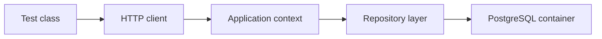

# Integration Testing

!!! note "In simple words"
    An integration test checks that real parts of your application work together, such as the Spring wiring, the database mapping, and the transactions. It is slower than a unit test, so write a focused set of them for the places where the parts meet.

## Why it matters

A unit test can pass while the application still fails. The SQL may be wrong, a transaction boundary may commit too early, or a bean may be missing from the context. Integration tests catch those problems because they use the real components. Interviewers ask about this because it shows you understand the trade-off between confidence and speed, and that you know which faults only appear when the parts are combined.

## How it works

Spring tests run in a sequence that you can influence through annotations and configuration.

1. The test class declares its scope with an annotation, such as `@SpringBootTest` for the whole application or `@DataJpaTest` for the persistence layer.
2. Spring builds an application context for that scope, or reuses one that a previous test already built with the same configuration.
3. Testcontainers starts any containers the test declares before the context is created, and `@ServiceConnection` passes their connection details to the application.
4. The tests run against the real components.
5. Data is cleared between tests, and the containers stop when the run finishes.

The diagram below shows where the integration boundary sits. The test drives the application through its HTTP port, and the application talks to a real database that runs in a container.



### @SpringBootTest and the test context

`@SpringBootTest` starts an application context that is close to production. It has the widest scope in the standard test set, so reserve it for a focused list of end-to-end flows instead of using it for every case.

*Spring Boot example (library code, not compiled here).*

```java
import static org.junit.jupiter.api.Assertions.assertEquals;

import org.junit.jupiter.api.Test;
import org.springframework.beans.factory.annotation.Autowired;
import org.springframework.boot.test.context.SpringBootTest;
import org.springframework.boot.test.context.SpringBootTest.WebEnvironment;
import org.springframework.boot.test.web.client.TestRestTemplate;
import org.springframework.http.ResponseEntity;

@SpringBootTest(webEnvironment = WebEnvironment.RANDOM_PORT)
class OrderFlowIT {

    @Autowired
    TestRestTemplate rest;

    @Test
    void healthEndpointReturnsOk() {
        ResponseEntity<String> response = rest.getForEntity("/actuator/health", String.class);
        assertEquals(200, response.getStatusCode().value());
    }
}
```

`RANDOM_PORT` starts a real server on a free port, which exercises the whole HTTP stack, including filters. `TestRestTemplate` is a test helper for calling that server. It is separate from the production `RestTemplate`, which is discussed in [HTTP Clients and Testing](../09-spring-boot/http-clients-and-testing.md).

### Context caching

Spring caches test contexts. Test classes with the same configuration, meaning the same annotations and properties, share one context, which saves startup time. A different `@MockBean` set or a different `@TestPropertySource` starts a new context. A suite with many configuration variants becomes slow, and memory grows with each cached context.

### @DirtiesContext

`@DirtiesContext` throws away the cached context after a test or a class, so the next test starts fresh. It fixes state that leaks between tests, but every use adds startup time. Resetting the data is usually the better fix.

### Resetting data between tests

Options, from the lightest to the heaviest:

- `@Transactional` on the test rolls back its changes at the end. It is convenient, but it never commits, so commit behaviour and separate transactions go untested.
- `@Sql` runs SQL scripts before or after a method.
- Deleting rows in a `@BeforeEach` method, through a repository or `JdbcTemplate`.
- Recreating the database container for each class. It is slow, but each class is fully isolated.

*Spring JDBC example (library code, not compiled here).*

```java
import org.junit.jupiter.api.BeforeEach;
import org.springframework.beans.factory.annotation.Autowired;
import org.springframework.boot.test.context.SpringBootTest;
import org.springframework.jdbc.core.JdbcTemplate;

@SpringBootTest
class CleanStateExample {

    @Autowired
    JdbcTemplate jdbc;

    @BeforeEach
    void clean() {
        jdbc.update("DELETE FROM orders");
    }
}
```

### Slice tests for focused integration

Between a unit test and `@SpringBootTest` sit the slice tests from [HTTP Clients and Testing](../09-spring-boot/http-clients-and-testing.md). `@DataJpaTest` loads only the persistence layer, `@WebMvcTest` loads only the controllers, and `@RestClientTest` loads only the HTTP clients. Use a slice when it covers the risk, because it starts faster than the full context.

### Testcontainers

Testcontainers starts real services, such as PostgreSQL, Kafka, or Redis, in Docker for the duration of a test run. It is more faithful than an in-memory database. H2 may accept SQL that production rejects, and it can behave differently for locking, JSON columns, and SQL dialects.

*Spring Boot and Testcontainers example (library code, not compiled here). The Testcontainers package for PostgreSQL changed in version 2, so check the import against the version your project uses.*

```java
import org.junit.jupiter.api.Test;
import org.springframework.beans.factory.annotation.Autowired;
import org.springframework.boot.test.context.SpringBootTest;
import org.springframework.boot.testcontainers.service.connection.ServiceConnection;
import org.springframework.data.jpa.repository.JpaRepository;
import org.testcontainers.junit.jupiter.Container;
import org.testcontainers.junit.jupiter.Testcontainers;
import org.testcontainers.postgresql.PostgreSQLContainer;

@SpringBootTest
@Testcontainers
class OrderRepositoryIT {

    @Container
    @ServiceConnection
    static PostgreSQLContainer<?> postgres = new PostgreSQLContainer<>("postgres:16");

    @Autowired
    OrderRepository orders;

    @Test
    void savesOrder() {
        orders.save(new OrderEntity("book", 2));
        org.junit.jupiter.api.Assertions.assertEquals(1, orders.count());
    }
}

interface OrderRepository extends JpaRepository<OrderEntity, Long> {}

@jakarta.persistence.Entity
class OrderEntity {

    @jakarta.persistence.Id
    @jakarta.persistence.GeneratedValue
    Long id;

    String item;
    int quantity;

    protected OrderEntity() {}

    OrderEntity(String item, int quantity) {
        this.item = item;
        this.quantity = quantity;
    }
}
```

`@ServiceConnection`, available from Spring Boot 3.1, wires the container's connection details into the application, so you do not set URLs by hand. It needs the `spring-boot-testcontainers` module. The `postgres:16` tag is an example. Pin a tag that matches your production database version.

Starting a container takes seconds, so share one container across a test suite where you can. Ryuk, the Testcontainers cleanup container, removes containers when the run ends.

### Testing Kafka and other messaging

The same pattern works for Kafka and RabbitMQ. Start a container, publish a message, and wait until the listener has acted. Use a bounded wait, such as Awaitility, instead of `Thread.sleep`, and avoid assertions about timing.

## Where it is used

- Repository tests that run the real SQL against the same database engine as production.
- Flows that cross several layers, such as an HTTP call that writes a row and publishes an event.
- Checks that the application context starts with its production configuration.
- Messaging tests that confirm a listener processes a real message.

## Benefits

- Real components expose wiring, mapping, and SQL faults that unit tests cannot see.
- Testcontainers gives production-like behaviour without a shared test database.
- Slices let you choose the scope, so you do not always pay for the full context.
- A small number of integration tests can protect many critical flows.

## Cons and limits

- Integration tests are slower, and they add build time.
- Docker must be available on the machine or the CI runner.
- Shared containers and cached contexts can cause order-dependent failures if the data is not reset.
- A passing integration test shows that one scenario works, not that every path does.
- Wide tests are harder to diagnose when they fail.

### Common pitfalls

- Using `@SpringBootTest` for every test, which makes the suite slow.
- Creating many small configuration variants, which fills memory with cached contexts.
- Relying on `@Transactional` rollback to test commit behaviour.
- Using H2 while production runs PostgreSQL, then finding SQL differences only in production.
- Hard-coding ports or host names instead of letting containers assign them.
- Calling `Thread.sleep` in tests, which makes them flaky.
- Running Docker-based tests in CI without Docker, so they are skipped silently or fail at random.

## Best practices

- Keep the number of full-context tests small, and cover the critical flows with them.
- Use the narrowest slice that covers the risk.
- Run the same database engine as production through Testcontainers, and pin the image tag.
- Reset data explicitly between tests, and avoid depending on test order.
- Replace fixed sleeps with waits that have a timeout.
- Make Docker availability a clear precondition in CI, so a missing Docker fails loudly.

!!! tip "Interview tip"
    **Q: How do you test a repository against a real database?**
    Spin up a container running the same engine as production, connect it with `@ServiceConnection` or `@DynamicPropertySource`, and keep the context and data boundaries explicit. A throwaway in-memory database runs faster, but it can conceal dialect quirks that only show up in production.

## Quick recap

- Reserve `@SpringBootTest` for the few flows that need the whole application, and keep its configuration stable.
- Clean data deliberately; a rolled-back test never exercises a real commit.
- Containers give you production-grade dependencies inside Docker.
- `@ServiceConnection` does the URL plumbing for you.
- Replace sleeps with bounded waits.

## Official documentation

- [Spring Boot Reference](https://docs.spring.io/spring-boot/reference/index.html)
- [Spring Data JPA Reference](https://docs.spring.io/spring-data/jpa/reference/index.html)
- [Spring Framework Reference](https://docs.spring.io/spring-framework/reference/)
- [JUnit 5 User Guide](https://junit.org/junit5/docs/current/user-guide/)

**See also:** [HTTP Clients and Testing](../09-spring-boot/http-clients-and-testing.md) | [Kafka](../13-messaging/kafka.md) | [Databases and SQL](../06-databases-sql/index.md) | [API Testing and Code Coverage](api-testing-and-coverage.md)
