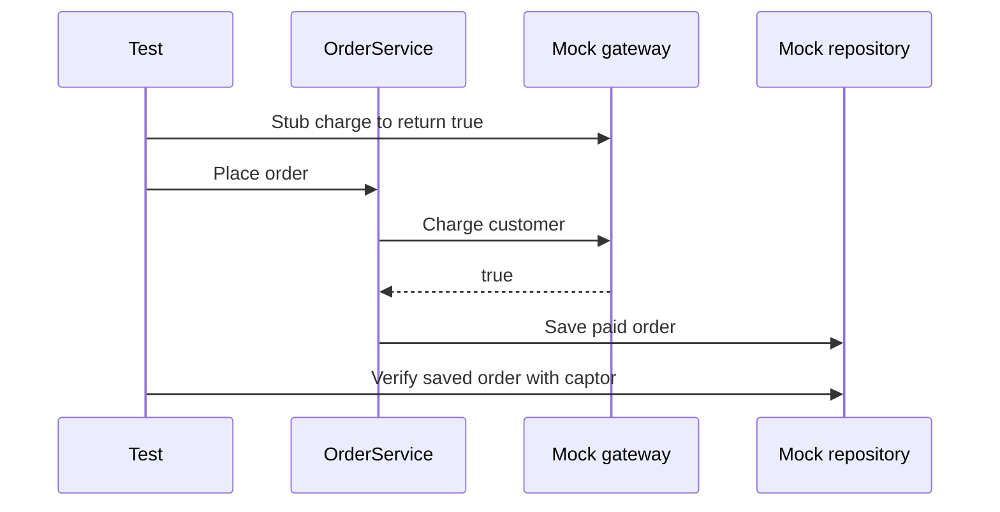

# Mocking with Mockito

!!! note "In simple words"
    A mock is a stand-in object for something a class depends on, such as a payment client. You script its answers, run the code under test, and then confirm how that code called it. Mock the things you cannot or should not run for real, and use real objects for simple logic.

## Why it matters

Few classes work alone. An order service talks to a payment gateway and a repository. A test of the service's own logic should not charge a card or write to a live database. Mockito provides those stand-ins with very little ceremony. The hard part is judgement: a test where every collaborator is mocked can pass even when the real components would fail together. Interviewers are checking whether you know both when a mock helps and when it quietly hides a defect.

## How it works

A Mockito test runs through four stages, and each stage maps to a method you will see below.

1. `@Mock` or `mock(...)` creates a proxy for each collaborator. The proxy records every call and returns default values.
2. `when(...).thenReturn(...)` scripts the answers for the calls the test cares about.
3. The code under test runs and calls those proxies.
4. `verify` checks the recorded calls against expectations. Under strict stubbing, a stub that was never used fails the test.

The sequence below shows one test of the order service, where the gateway and the repository are both replaced.



### The example under test

The snippets on this page all use one small service. The production types appear once here, so every later example compiles against the same declarations.

```java
package com.example.orders;

interface PaymentGateway {
    boolean charge(String customerId, int amount);
}

interface OrderRepository {
    void save(Order order);
}

record Order(String customerId, int amount, String status) {}

class OrderService {

    private final PaymentGateway gateway;
    private final OrderRepository repository;

    OrderService(PaymentGateway gateway, OrderRepository repository) {
        this.gateway = gateway;
        this.repository = repository;
    }

    void place(String customerId, int amount) {
        String status = gateway.charge(customerId, amount) ? "PAID" : "DECLINED";
        repository.save(new Order(customerId, amount, status));
    }
}
```

### Setting up Mockito with JUnit 5

Put `@ExtendWith(MockitoExtension.class)` on the test class. Before each test, the extension builds the `@Mock`, `@Spy`, `@InjectMocks`, and `@Captor` fields. It also enables strict stubbing, which means an unused stub fails the test. The extension lives in the `mockito-junit-jupiter` artefact.

`@InjectMocks` constructs the class under test and hands it the mocks through its constructor.

```java
package com.example.orders;

import static org.junit.jupiter.api.Assertions.assertEquals;
import static org.junit.jupiter.api.Assertions.assertThrows;
import static org.mockito.ArgumentMatchers.any;
import static org.mockito.ArgumentMatchers.anyInt;
import static org.mockito.ArgumentMatchers.anyString;
import static org.mockito.Mockito.never;
import static org.mockito.Mockito.verify;
import static org.mockito.Mockito.when;

import org.junit.jupiter.api.Test;
import org.junit.jupiter.api.extension.ExtendWith;
import org.mockito.ArgumentCaptor;
import org.mockito.InjectMocks;
import org.mockito.Mock;
import org.mockito.junit.jupiter.MockitoExtension;

@ExtendWith(MockitoExtension.class)
class OrderServiceTest {

    @Mock
    PaymentGateway gateway;

    @Mock
    OrderRepository repository;

    @InjectMocks
    OrderService service;

    @Test
    void savesPaidOrderWhenChargeSucceeds() {
        when(gateway.charge("customer-1", 500)).thenReturn(true);

        service.place("customer-1", 500);

        ArgumentCaptor<Order> captor = ArgumentCaptor.forClass(Order.class);
        verify(repository).save(captor.capture());
        assertEquals("PAID", captor.getValue().status());
    }

    @Test
    void savesDeclinedOrderWhenChargeFails() {
        when(gateway.charge(anyString(), anyInt())).thenReturn(false);

        service.place("customer-2", 80);

        verify(repository).save(new Order("customer-2", 80, "DECLINED"));
    }

    @Test
    void gatewayFailureSavesNothing() {
        when(gateway.charge(anyString(), anyInt()))
                .thenThrow(new IllegalStateException("gateway down"));

        assertThrows(IllegalStateException.class, () -> service.place("customer-3", 10));

        verify(repository, never()).save(any());
    }
}
```

### Scripting answers

`when(...).thenReturn(...)` decides what a call returns. Other options:

- `thenThrow(...)` makes the call throw.
- `thenAnswer(...)` derives the result from the arguments the call received.
- A `void` method cannot be wrapped by `when(...)`, so script it with `doThrow(...).when(mock).method(...)`.

```java
package com.example.orders;

import static org.mockito.ArgumentMatchers.any;
import static org.mockito.Mockito.doThrow;
import static org.mockito.Mockito.mock;
import static org.mockito.Mockito.when;

class StubbingExamples {

    void demo() {
        PaymentGateway gateway = mock(PaymentGateway.class);
        OrderRepository repository = mock(OrderRepository.class);

        when(gateway.charge("customer-1", 500)).thenReturn(true);
        when(gateway.charge("vip-customer", 500)).thenAnswer(
                invocation -> invocation.<String>getArgument(0).startsWith("vip"));
        doThrow(new IllegalStateException("disk full")).when(repository).save(any());
    }
}
```

### Argument matchers

Matchers such as `any()`, `anyString()`, `anyInt()`, `eq(...)`, and `argThat(...)` stand in for values you cannot predict. One rule is absolute: if any argument in a call is a matcher, every argument must be one. Mixing matchers with raw values raises `InvalidUseOfMatchersException`. Wrap the literal in `eq(...)` to resolve it.

```java
package com.example.orders;

import static org.mockito.ArgumentMatchers.anyString;
import static org.mockito.ArgumentMatchers.eq;
import static org.mockito.Mockito.when;

class GatewayStubbing {

    interface PaymentGateway {
        boolean charge(String account, int cents);
    }

    PaymentGateway gateway;   // a mock in a real test

    void stub() {
        // Correct: every argument is a matcher.
        when(gateway.charge(anyString(), eq(500))).thenReturn(true);

        // Wrong: a matcher mixed with a raw value fails at run time.
        // when(gateway.charge(anyString(), 500)).thenReturn(true);
    }
}
```

### Verification

`verify` confirms that an interaction took place. Add `times`, `never`, `atLeastOnce`, or `atMost` to state the expected count. `InOrder` confirms that calls happened in sequence across several mocks.

```java
package com.example.orders;

import static org.mockito.ArgumentMatchers.any;
import static org.mockito.ArgumentMatchers.anyInt;
import static org.mockito.ArgumentMatchers.anyString;
import static org.mockito.Mockito.atLeastOnce;
import static org.mockito.Mockito.inOrder;
import static org.mockito.Mockito.mock;
import static org.mockito.Mockito.times;
import static org.mockito.Mockito.verify;

import org.mockito.InOrder;

class VerificationExamples {

    void demo() {
        PaymentGateway gateway = mock(PaymentGateway.class);
        OrderRepository repository = mock(OrderRepository.class);
        OrderService service = new OrderService(gateway, repository);

        service.place("customer-1", 500);

        verify(gateway, times(1)).charge("customer-1", 500);
        verify(repository, atLeastOnce()).save(any());

        InOrder order = inOrder(gateway, repository);
        order.verify(gateway).charge(anyString(), anyInt());
        order.verify(repository).save(any());
    }
}
```

Verify the interactions that define the behaviour, such as a charge or a saved record. Verifying every internal call ties the test to the current implementation, and each refactor then breaks it.

### Argument captors

An `ArgumentCaptor` keeps a reference to the object a mock received, so you can examine its fields. It helps when the code under test builds the object and the test cannot predict its exact contents. `OrderServiceTest` uses one. Outside the extension, create it with `ArgumentCaptor.forClass(...)`. A `@Captor` field is initialised only when `MockitoExtension` is active.

### Mocks, spies, and real objects

| Kind | Behaviour | Use when |
|---|---|---|
| Mock | Every method returns a default value unless scripted | A dependency must be replaced completely |
| Spy | Real methods run, while you can script or observe some calls | You need real behaviour plus a check on one call |
| Real object | Your actual code runs | The logic is simple and free of external effects |

```java
import static org.mockito.Mockito.spy;
import static org.mockito.Mockito.verify;

import java.util.ArrayList;
import java.util.List;

class SpyExample {

    void demo() {
        List<String> items = spy(new ArrayList<String>());
        items.add("book");
        verify(items).add("book");
    }
}
```

Spies help when you must wrap legacy code you cannot change yet. If you need them often, the class probably mixes responsibilities that should be split apart.

### What to mock

Mock what you do not control: a payment provider's client, an HTTP client, the system clock. Leave value objects, records, and pure utility methods alone, and use the real thing.

Mockito 5 uses the inline mock maker by default, so `final` classes can be mocked. Static methods can be mocked with `Mockito.mockStatic(...)` inside a try-with-resources block. Do this sparingly, because static mocks bind tests to global state.

## Where it is used

- Replacing payment, shipping, or email clients in service tests.
- Exercising retry or fallback logic by making a dependency fail on command.
- Confirming that a service emits the right message without a live broker.
- Isolating a class from the clock by mocking its time source.

## Benefits

- Tests stay focused on one class, and failure paths that are hard to trigger for real become easy.
- A slow or flaky collaborator, once stubbed, no longer slows or destabilises the suite.
- Strict stubbing reports unused stubs, which keeps tests honest.
- Captors let you assert on objects built inside the code under test.

## Cons and limits

- Heavy mocking can conceal integration faults, letting tests pass while real components fail.
- Tests that verify many internal calls become brittle.
- A mock cannot reproduce a query plan, a mapping rule, or a database constraint.
- Static mocks and spies make tests harder to read and maintain.

### Common pitfalls

- Over-mocking, where nearly every collaborator is replaced and the test says little about real behaviour.
- Verifying private details or every internal call, which breaks on each refactor.
- Keeping stubs nobody uses. Strict stubbing flags them, which is a cue to delete them.
- Combining matchers and raw values in the same call.
- Mocking records or value objects, which hides behaviour you actually want to test.
- Using `@InjectMocks` with a constructor parameter that has no matching mock. Mockito passes `null` for it, and the code later fails with a `NullPointerException`.
- Testing persistence with mocks. A mocked repository cannot expose a bad query or a faulty mapping, so use a real database in an integration test.

## Best practices

- Use `@ExtendWith(MockitoExtension.class)` with `@Mock`, `@InjectMocks`, and `@Captor`.
- Mock external systems and dependencies that are slow or non-deterministic, and little else.
- Verify the interactions that matter to behaviour, such as a charge or a saved record.
- Keep matchers consistent within each call, and wrap literals in `eq(...)`.
- Delete unused stubs as soon as strict stubbing reports them.
- Cover persistence and messaging with integration tests against real infrastructure.

!!! tip "Interview tip"
    **Q: When would you not use a mock?**
    If the collaborator is cheap, predictable, and harmless, just use the genuine article. Storage behaviour cannot be verified through a fake, so exercise queries against a real database in integration tests. Stand-ins earn their keep for remote services and for dependencies that are slow or unpredictable. The surrounding structure is covered in [Unit Testing with JUnit 5](unit-testing-junit.md).

## Quick recap

- Pair `@ExtendWith(MockitoExtension.class)` with the `@Mock`, `@InjectMocks`, and `@Captor` annotations.
- Script calls with `when(...)`, and check the interactions that matter with `verify`.
- Each call's matchers must be all-or-nothing, so literals get wrapped in `eq(...)`.
- Captors expose the objects that flowed out to collaborators.
- Plain logic uses real objects; mocks are for external edges.

## Official documentation

- [Mockito Documentation](https://site.mockito.org/)
- [JUnit 5 User Guide](https://junit.org/junit5/docs/current/user-guide/)
- [Spring Framework Reference](https://docs.spring.io/spring-framework/reference/)
- [Java 21 API Documentation](https://docs.oracle.com/en/java/javase/21/docs/api/index.html)

**See also:** [Unit Testing with JUnit 5](unit-testing-junit.md) | [Integration Testing](integration-testing.md) | [API Testing and Code Coverage](api-testing-and-coverage.md)
