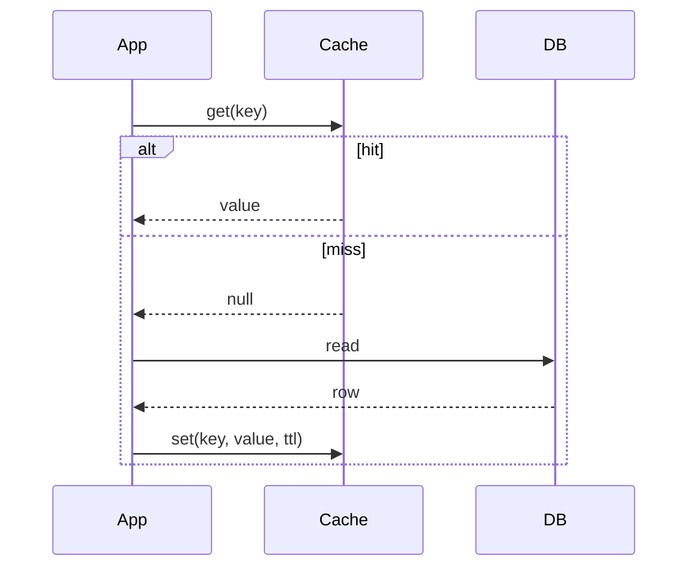

# Distributed Caching

A distributed cache is shared by many application instances, so every instance sees the same cached values. That sharing makes caching useful at scale, but it also makes consistency harder: a write on one instance must invalidate or update entries that others may hold. Interviewers ask about this to test your understanding of invalidation strategies and of the trade-offs between freshness and load on the database.

## Core concepts

### Local versus distributed caches

A local (in-process) cache, such as Caffeine, is very fast but private to one instance. Two instances can return different values after an update. A distributed cache such as Redis or Memcached is shared, so all instances read the same entry, at the cost of a network round trip. Many systems use both: a short-lived local cache in front of a shared one. Local layers need their own invalidation or very short TTLs.

### Memcached

Memcached is a simple, fast, multi-threaded key-value cache. It stores strings and binary blobs with optional expiry, has no persistence, and has no built-in data structures, replication, or cluster coordination beyond client-side sharding. It is a good fit for pure caching of values. Redis offers more features (data structures, persistence, replication, Lua scripts), so teams often choose Redis unless they need Memcached's simplicity at very high volume.

### Cache coherence across nodes

Coherence means that after a change, no instance serves the old value for longer than you can accept. A cache that is never invalidated stays wrong until its TTL expires. Common approaches:

- TTLs: a bound on staleness. Simple and always useful as a backstop.
- Explicit invalidation: delete or update the key when the data changes.
- Event-driven invalidation: publish a change event (through Redis pub/sub, Kafka, or another broker) that instances use to evict local entries.
- Versioned keys: include a version in the key, so a new version is read without deleting old ones.

Versioned keys avoid races when many writers exist, at the cost of storing old entries until they expire.

### Invalidation strategies

| Strategy | How it works | Trade-off |
|---|---|---|
| Cache-aside (lazy loading) | App reads the cache; on miss, loads from DB and fills the cache. On write, the app updates the DB and evicts the key | Simple and common; a race can briefly store stale data |
| Read-through | The cache itself loads from the DB on a miss | App code is simpler; the cache needs a loader |
| Write-through | Writes go to the cache and the DB together, synchronously | Consistent reads; writes are slower |
| Write-behind (write-back) | Writes go to the cache, and the DB is updated asynchronously later | Fast writes; risk of data loss if the cache fails before flushing |

Cache-aside is the usual default in Spring applications, because `@Cacheable` and `@CacheEvict` implement it.



### Coordinating writes between cache and database

The hard part is ordering. A common race under cache-aside:

1. Instance A reads the row (old value) from the database.
2. Instance B updates the row and deletes the cache key.
3. Instance A writes its old value into the cache.

The cache now holds stale data until the TTL expires. Mitigations:

- Keep a TTL on every entry, so the damage is bounded.
- Delete the key after the database commit, not before. Delete-after-commit avoids some races, but not all.
- Use a short-lived version check or compare-and-set when writing into the cache.
- Publish the invalidation event after the transaction commits. If it is sent before the commit, another instance can evict the key, read the still-old row, and refill the cache with stale data. A rollback after an early event only causes an extra miss, which is harmless.

Transactional events are a common approach (see [Event-Driven Architecture](../13-messaging/event-driven-architecture.md)).

### Explicit refresh endpoint
Sometimes a TTL is too slow and an event pipeline is too much work, for example after a bad data load or a price correction. An operator can then trigger invalidation with an admin endpoint. The endpoint clears one named cache, so the blast radius is known:

```java
import org.springframework.cache.Cache;
import org.springframework.cache.CacheManager;
import org.springframework.http.ResponseEntity;
import org.springframework.security.access.prepost.PreAuthorize;
import org.springframework.web.bind.annotation.PathVariable;
import org.springframework.web.bind.annotation.PostMapping;
import org.springframework.web.bind.annotation.RequestMapping;
import org.springframework.web.bind.annotation.RestController;

@RestController
@RequestMapping("/admin/caches")
class CacheRefreshController {

    private final CacheManager cacheManager;

    CacheRefreshController(CacheManager cacheManager) {
        this.cacheManager = cacheManager;
    }

    @PostMapping("/{cacheName}/refresh")
    @PreAuthorize("hasRole('ADMIN')")
    ResponseEntity<Void> refresh(@PathVariable String cacheName) {
        Cache cache = cacheManager.getCache(cacheName);
        if (cache == null) {
            return ResponseEntity.notFound().build();
        }
        cache.clear();
        return ResponseEntity.noContent().build();
    }
}
```

Points to take into account:

- Restrict the endpoint to operators. `@PreAuthorize` needs method security enabled, and the endpoint should not be reachable from the public internet.
- Clear by name rather than wiping every cache. Clearing everything at once sends a burst of traffic to the database.
- With a local cache, `cache.clear()` only affects the instance that receives the call. Call the endpoint on each instance, or publish an invalidation event that all instances consume. With a shared Redis cache, clearing the cache removes the entries for all instances, but any local layer still needs its own refresh.
- Log who called the endpoint and which cache was cleared. Cache clears can change response times for every user.

### Cache stampede

When a popular key expires, many requests miss at the same moment and all hit the database. Mitigations:

- Add jitter to TTLs, so keys do not all expire together.
- Use a single-flight lock: one request recomputes, others wait or serve a slightly stale value.
- Refresh early in the background before the TTL ends.

### Hot keys and sizing

A single very popular key can overload one cache node. Spread load by replicating hot values or by splitting them across keys. Set a maximum memory limit and an eviction policy on Redis or Memcached, so the cache does not exhaust memory. Monitor hit rate: a low hit rate means the cache is adding latency without saving work.

### Layered caching in code

A common production shape is a short-lived local cache in front of a shared one, or in front of the database. Caffeine handles the local layer, and `get(key, loader)` runs the loader once per key on that instance, which protects the database from a local stampede:

```java
import com.github.benmanes.caffeine.cache.Cache;
import com.github.benmanes.caffeine.cache.Caffeine;
import java.util.Optional;
import java.util.concurrent.TimeUnit;
import org.springframework.stereotype.Service;

record Customer(long id, String name) {}

interface CustomerStore {
    Optional<Customer> findById(long id);
}

@Service
class CustomerReadService {

    // Local layer: fast and private to this instance; the short TTL bounds staleness.
    private final Cache<Long, Customer> local = Caffeine.newBuilder()
            .maximumSize(10_000)
            .expireAfterWrite(30, TimeUnit.SECONDS)
            .build();

    private final CustomerStore store;

    CustomerReadService(CustomerStore store) {
        this.store = store;
    }

    Customer get(long id) {
        return local.get(id, key -> store.findById(key).orElseThrow());
    }

    void evictLocally(long id) {
        // Other instances still serve their copy until its TTL expires,
        // unless an invalidation event reaches them.
        local.invalidate(id);
    }
}
```

The local TTL is short on purpose. If instances must agree within seconds, combine short TTLs with invalidation events published after the database commit (see the previous section). The layers do not need to share a TTL, but each one should have a documented maximum staleness.

## How it works / Step by step

1. Choose the data to cache, based on read frequency and tolerance for staleness.
2. Choose a read pattern (usually cache-aside) and a write pattern (usually evict after commit).
3. Set TTLs with jitter, and maximum memory with an eviction policy.
4. Add invalidation on every write path, including batch jobs and admin tools.
5. Monitor hit rate, latency, evictions, and memory.

## Common pitfalls

- Relying only on TTL for correctness, then being surprised by stale data after updates.
- Invalidating before the database commit, which lets a reader refill the cache with old data.
- Storing very large values, which blocks the cache node and inflates network time.
- Write-behind caching for data that cannot be lost.
- Using a local cache in a multi-instance deployment and assuming all instances agree.
- Forgetting the cache during schema or serialisation changes.
- No monitoring, so a cache with 5% hit rate goes unnoticed.

!!! tip "Interview tip"
    **Q: How do you keep a cache consistent with the database?**
    You cannot make it perfectly consistent without costly coordination, so you bound staleness. Use cache-aside with eviction after commit, add TTLs with jitter as a backstop, publish invalidation events after commit when several instances or caches are involved, and protect hot keys from stampedes. State what staleness the business accepts.

## Quick recap

- Shared caches (Redis, Memcached) avoid the inconsistency of per-instance caches.
- Cache-aside with eviction after commit is the usual default; write-through and write-behind have different trade-offs.
- Races can store stale data; TTLs bound the damage.
- Prevent stampedes with TTL jitter, single-flight loading, and early refresh.
- Monitor hit rate, memory, and evictions.

**See also:** [Spring Cache and Redis](spring-cache-and-redis.md) | [Performance Optimisation](performance-optimisation.md) | [Event-Driven Architecture](../13-messaging/event-driven-architecture.md)
