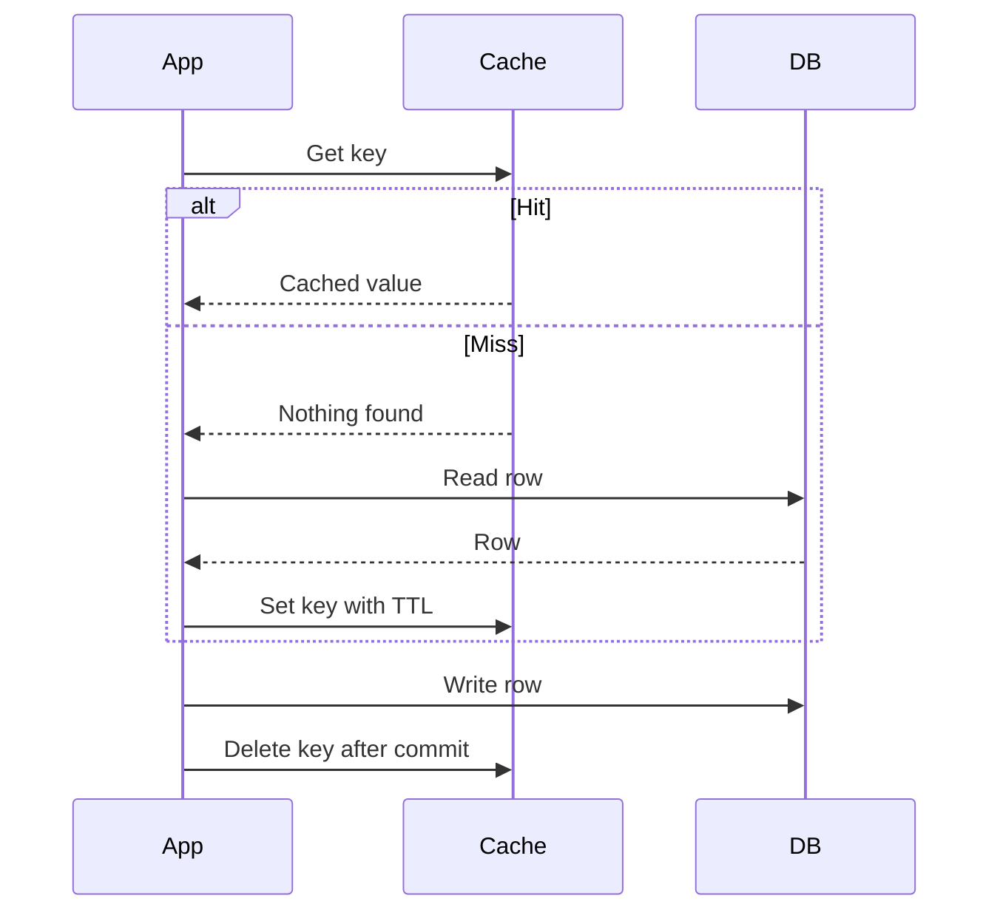

# Distributed Caching

!!! note "In simple words"
    A distributed cache is one shared store that all application instances read from. Because it is shared, a change made on one instance can be seen everywhere, but only if the old entries are removed or refreshed when the data changes.

## Why it matters

Once an application runs on several instances, a per-instance cache starts giving different answers depending on which instance you hit. A shared cache removes that split and also relieves the database. The price is coordination: every write has to remove or refresh the entries that other instances may be holding, and that coordination is where most caching bugs appear. Interviewers use this topic to see how you handle invalidation, races, and the balance between freshness and database load.

## How it works

Most distributed caches are paired with the cache-aside pattern. The application owns both the cache and the database, and it chooses when to read from and write to each one.

1. A read checks the cache first.
2. On a miss, the application queries the database, stores the result with a TTL, and returns it.
3. A write updates the database first, then deletes the cache key.
4. The next read misses, reloads, and stores the fresh value.

The sequence below covers a cache-aside read, followed by a write that evicts the key after the commit.



### Local versus distributed caches

A local cache such as Caffeine is extremely fast, yet it is private to the instance that holds it. After an update, another instance may still return the old value. A distributed cache such as Redis or Memcached is one copy visible to all instances, and each lookup pays for a network hop. Many systems combine them, with a short-lived local layer in front of the shared store, and that local layer needs either explicit invalidation or a very short TTL.

### Memcached

Memcached is a lean, multi-threaded key-value store. It keeps strings and binary values with an optional expiry, but it offers no persistence, no data structures, and no replication. Sharding happens in the client. Teams that want more than plain values, including persistence and scripting, usually choose Redis. Memcached remains attractive when simplicity matters most and the volume is very high.

### Cache coherence across nodes

Coherence means that after a change, no instance returns the old value for longer than the business allows. A key that is never invalidated stays wrong until its TTL expires. Four common tools:

- **TTL.** Caps how long a stale value can survive. It is simple and always worth having as a backstop.
- **Explicit invalidation.** Remove or overwrite the key when the underlying row changes.
- **Event-driven invalidation.** Publish a change message on Redis pub/sub, Kafka, or another broker. Each instance evicts its local copy when the message arrives.
- **Versioned keys.** Embed a version in the key, so readers move to the new version and the old entries age out untouched.

Versioned keys sidestep some races between writers, at the cost of holding old entries until they expire.

### Invalidation strategies

| Strategy | How it works | Trade-off |
|---|---|---|
| Cache-aside (lazy loading) | Read the cache. On a miss, load the database and fill the cache. On a write, update the database and evict the key | Simple and common. A race can briefly store stale data |
| Read-through | The cache itself loads from the database on a miss | Simpler application code. The cache needs a loader |
| Write-through | Writes reach the cache and the database together, synchronously | Consistent reads. Slower writes |
| Write-behind (write-back) | Writes land in the cache first, and the database catches up later | Fast writes. Data is lost if the cache fails before flushing |

Cache-aside is the usual default in Spring. `@Cacheable` and `@CacheEvict` implement it for you. See [Spring Cache and Redis](spring-cache-and-redis.md).

### The write race under cache-aside

The difficult part is ordering. Suppose two instances interleave like this:

1. Instance A loads the row, which still contains the old value.
2. Instance B writes the new value to the row, then removes the cached key.
3. Instance A puts its stale value back into the cache.

Until the TTL fires, the cache serves the stale value. The following steps reduce the damage:

- Attach a TTL to every entry, so the window of staleness has a fixed upper limit.
- Remove the key after the database commit, not before. Removing after commit closes some races, though not all.
- Use a version check or a compare-and-set when writing into the cache.
- Send the invalidation event only after the transaction commits. An early event lets another instance evict the key, reload the old row, and cache it again. If the transaction rolls back after an early event, the cost is just one extra miss.

Transactional event publishing is a common way to send events only after a commit. See [Event-Driven Architecture](../13-messaging/event-driven-architecture.md).

### Admin refresh endpoint

Sometimes a TTL is too slow to help, and building an event pipeline would cost more than the problem deserves, for example after a faulty data load or a price fix. An operator can call an admin endpoint that clears one named cache.

*Spring Boot and Spring Security example (library code, not compiled here).*

```java
import org.springframework.cache.Cache;
import org.springframework.cache.CacheManager;
import org.springframework.http.ResponseEntity;
import org.springframework.security.access.prepost.PreAuthorize;
import org.springframework.web.bind.annotation.PathVariable;
import org.springframework.web.bind.annotation.PostMapping;
import org.springframework.web.bind.annotation.RequestMapping;
import org.springframework.web.bind.annotation.RestController;

@RestController
@RequestMapping("/admin/caches")
class CacheRefreshController {

    private final CacheManager cacheManager;

    CacheRefreshController(CacheManager cacheManager) {
        this.cacheManager = cacheManager;
    }

    @PostMapping("/{cacheName}/refresh")
    @PreAuthorize("hasRole('ADMIN')")
    ResponseEntity<Void> refresh(@PathVariable String cacheName) {
        Cache cache = cacheManager.getCache(cacheName);
        if (cache == null) {
            return ResponseEntity.notFound().build();
        }
        cache.clear();
        return ResponseEntity.noContent().build();
    }
}
```

Operational notes for that endpoint:

- Limit it to operators. `@PreAuthorize` requires method security, and the route must stay off the public internet.
- Clear by name. Wiping every cache at once sends a flood of reads to the database.
- A local cache is cleared only on the instance that handled the call. Call the endpoint on each instance, or publish an event that all instances consume. A shared Redis cache is cleared for everyone, but any local layer in front of it still needs its own refresh.
- Record who called it and which cache was cleared, because a clear can change response times for every user.

### Cache stampede

A stampede happens when a hot key expires and many concurrent requests miss together, all hitting the database at once. Prevention options:

- Add jitter to TTLs, so keys written together do not expire together.
- Use a single-flight lock, so one request recomputes while the rest wait or receive a slightly stale value.
- Refresh the value in the background shortly before its TTL ends.

### Hot keys and sizing

A single very popular key can overwhelm one cache node. Replicate the value or split it across several keys to spread the load. Cap memory and choose an eviction policy on Redis or Memcached, so the server cannot run out of space. Track the hit rate, because a low hit rate means the cache adds latency without saving work.

### Layered caching in code

One frequent layout puts a brief local cache in front of a shared cache, or directly in front of the database. Caffeine supplies the local layer. Its `get(key, loader)` runs the loader once per key on each instance, which shields the database from a local stampede.

*Spring and Caffeine example (library code, not compiled here).*

```java
import com.github.benmanes.caffeine.cache.Cache;
import com.github.benmanes.caffeine.cache.Caffeine;
import java.util.Optional;
import java.util.concurrent.TimeUnit;
import org.springframework.stereotype.Service;

record Customer(long id, String name) {}

interface CustomerStore {
    Optional<Customer> findById(long id);
}

@Service
class CustomerReadService {

    // Local layer: fast and private to this instance. The short TTL limits staleness.
    private final Cache<Long, Customer> local = Caffeine.newBuilder()
            .maximumSize(10_000)
            .expireAfterWrite(30, TimeUnit.SECONDS)
            .build();

    private final CustomerStore store;

    CustomerReadService(CustomerStore store) {
        this.store = store;
    }

    Customer get(long id) {
        return local.get(id, key -> store.findById(key).orElseThrow());
    }

    void evictLocally(long id) {
        // Other instances keep their copies until those expire,
        // unless an invalidation event reaches them.
        local.invalidate(id);
    }
}
```

The local TTL is deliberately brief. When instances must agree within seconds, pair short TTLs with invalidation events sent after the database commit. The layers can use different TTLs, but each should have a written limit on how stale it may get.

## Where it is used

- Product, pricing, and catalogue data that many instances read.
- Session data and short-lived tokens shared across web servers.
- Results of costly queries that several users request at the same time.
- Rate-limit counters and other shared counters.

## Benefits

- All instances see the same cached values, so answers stay consistent across the fleet.
- The database handles fewer reads, which protects it under load.
- A TTL bounds how long a stale value can survive, even when invalidation fails.
- Event-driven invalidation can keep many caches in step with the data.

## Cons and limits

- Every lookup pays a network round trip, which a local cache avoids.
- The cache is one more system to run, monitor, and secure.
- Races between readers and writers can store stale values, so perfect consistency costs too much to pursue.
- A hot key can overload a single node.
- Invalidation logic is spread across every write path, so one path is easy to miss.

### Common pitfalls

- Treating TTL as the only correctness mechanism, then being caught out by stale data after an update.
- Invalidating before the commit, which lets a reader refill the cache with outdated data.
- Storing very large values, which ties up the cache node and inflates network time.
- Choosing write-behind for data that must never be lost.
- Running a local cache across several instances while expecting them to agree.
- Forgetting the cache when a schema or serialisation format changes.
- Running without monitoring, so a cache with a 5 percent hit rate goes unnoticed.

## Best practices

- Use cache-aside with eviction after commit as the default.
- Add TTLs with jitter to every entry, as a safety net for missed invalidations.
- Publish invalidation events after commit when several instances or caches are involved.
- Guard hot keys against stampedes with single-flight loading or early refresh.
- Restrict admin cache-clear endpoints, and log every call.
- Write down the maximum staleness each cache is allowed to show.

!!! tip "Interview tip"
    **Q: How do you keep a cache consistent with the database?**
    Accept bounded staleness instead of chasing perfect agreement. Evict after commit with cache-aside, rely on jittered TTLs as the fallback, send invalidation events post-commit when several caches or instances are involved, and shield hot keys. Finish by naming the staleness the business can tolerate.

## Quick recap

- A shared store removes the per-instance disagreement that local caches create.
- Evict after commit by default; write-through and write-behind make different trade-offs.
- Races can plant stale values, so TTLs set the ceiling on the damage.
- Stampedes are prevented with TTL jitter, single-flight loads, and early refresh.
- Track hit rate, memory use, and evictions.

## Official documentation

- [Redis Documentation](https://redis.io/docs/latest/)
- [Spring Framework Reference](https://docs.spring.io/spring-framework/reference/)
- [Spring Boot Reference](https://docs.spring.io/spring-boot/reference/index.html)
- [Spring Data JPA Reference](https://docs.spring.io/spring-data/jpa/reference/index.html)

**See also:** [Spring Cache and Redis](spring-cache-and-redis.md) | [Performance Optimisation](performance-optimisation.md) | [Event-Driven Architecture](../13-messaging/event-driven-architecture.md) | [Redis Advanced Patterns](redis-advanced-patterns.md)
