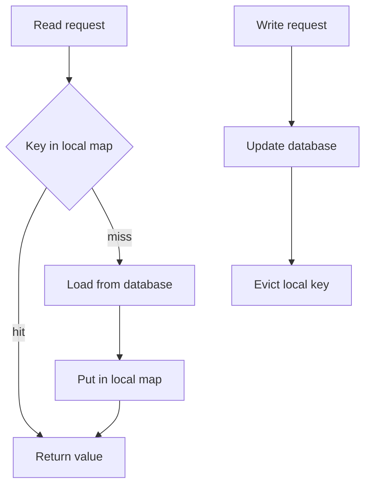

# Local Caching with Caffeine and EhCache

!!! note "In simple words"
    A local cache holds copies of values inside one application process. Reads are the quickest a program can do, but each instance keeps its own copy, so copies can drift apart. Always cap how many entries the cache holds, and give each entry an expiry.

## Why it matters

Plenty of data is read constantly and changes rarely, such as reference tables, feature flags, or a product's public details. Asking a database or a network cache for that data on every request wastes time. A local cache skips the network entirely. Interviewers use local caches to test whether you grasp the price of that speed: entries can go stale across instances, memory is capped by the heap, and the contents vanish on restart.

## How it works

A local cache is a map in the JVM with two governing rules. An expiry rule removes entries by age or idleness. A size bound evicts entries once the map is full.

1. The first lookup for a key misses, so the loader or method body runs and its result is stored.
2. Later lookups for that key are answered from the in-process map.
3. A write path removes the affected entry, or the entry expires through its TTL or TTI.
4. When the size bound is hit, the eviction policy chooses an entry to drop.
5. Hit rate and evictions are tracked. A poor hit rate points to a cache that is too small, expires too soon, or uses a weak key.

The flowchart below traces a read through the local map and a write that evicts the key.



### Why cache inside the JVM

An in-process lookup costs nanoseconds to microseconds. A call to Redis crosses the network, typically around a millisecond. A local cache removes that trip for hot data that is read often and changes rarely.

The costs are real. Every instance caches on its own, so two instances may answer differently after an update. The contents are gone after a restart. The cache lives in the heap, so one without a size limit is a memory leak waiting to happen.

### Expiry: TTL versus TTI

Expiry decides when an entry leaves the cache, whatever the memory pressure.

| Policy | Rule | Caffeine | EhCache 3 |
|---|---|---|---|
| Time-to-live (TTL) | Expires a fixed period after the write, read or not | `expireAfterWrite` | `ttl` in XML, `timeToLiveExpiration` in code |
| Time-to-idle (TTI) | Expires after a period with no access | `expireAfterAccess` | `tti` in XML, `timeToIdleExpiration` in code |

TTL is the safer default for data that changes on a schedule, because every entry has a fixed end date. TTI fits data that is hit constantly, but it hides a trap. An entry that is read continuously never expires, so a stale value can survive as long as traffic keeps it warm. Choose TTI only when staleness is tolerable, or when the source is refreshed some other way.

### Eviction: what goes when the cache is full

Eviction makes room when the cache reaches its size bound. The common strategies are:

- **LRU** (least recently used) drops the entry that has gone unread for the longest.
- **LFU** (least frequently used) drops the entry with the fewest reads.
- **FIFO** (first in, first out) drops the oldest insertion, whether or not it is still in use.

Caffeine uses a window-based policy that weighs both recency and frequency (W-TinyLFU), so you rarely need to pick a strategy yourself. EhCache's eviction order is an internal detail, so do not build logic on it. Rely on a size bound and an expiry rule as the controls you actually set.

Always set a maximum size. Without one, the cache keeps growing until the heap is full.

### Spring cache abstraction with a local provider

`@Cacheable`, `@CachePut`, and `@CacheEvict` behave identically across providers. The provider decides where entries are kept. Caffeine and EhCache are local, while Redis is shared. The annotation and key rules are described in [Spring Cache and Redis](spring-cache-and-redis.md).

Turn caching on once with `@EnableCaching`, then add a provider. For Caffeine, the `spring-boot-starter-cache` starter plus the `caffeine` library is sufficient.

### Caffeine in Spring Boot

A spec string in `application.yml` configures Caffeine without any Java code:

```yaml
spring:
  cache:
    type: caffeine
    caffeine:
      spec: maximumSize=10000,expireAfterWrite=10m
```

For finer control, configure it in Java:

*Spring Boot and Caffeine example (library code, not compiled here).*

```java
import com.github.benmanes.caffeine.cache.Caffeine;
import java.util.concurrent.TimeUnit;
import org.springframework.cache.CacheManager;
import org.springframework.cache.caffeine.CaffeineCacheManager;
import org.springframework.context.annotation.Bean;
import org.springframework.context.annotation.Configuration;

@Configuration
public class CacheConfig {

    @Bean
    public CacheManager cacheManager() {
        CaffeineCacheManager manager = new CaffeineCacheManager("users", "orders");
        manager.setCaffeine(Caffeine.newBuilder()
            .maximumSize(10_000)
            .expireAfterWrite(10, TimeUnit.MINUTES)
            .recordStats());
        return manager;
    }
}
```

`recordStats()` switches on the hit and miss counters. Without it, nothing is available to report.

A service method that reads through the cache:

*Spring Boot example (library code, not compiled here).*

```java
import org.springframework.cache.annotation.Cacheable;
import org.springframework.stereotype.Service;

@Service
public class UserService {

    @Cacheable(value = "users", key = "#id", unless = "#result == null")
    public User findUser(long id) {
        return loadFromDatabase(id);
    }

    private User loadFromDatabase(long id) {
        return new User(id, "placeholder");
    }

    public record User(long id, String name) {}
}
```

The `unless = "#result == null"` guard keeps a missing user out of the cache, so a user created afterwards shows up immediately.

### Reporting statistics

Publish hit rate and size on a timer, or expose them through a metrics endpoint. The native Caffeine cache behind a Spring cache can be read directly:

*Spring Boot and Caffeine example (library code, not compiled here).*

```java
import com.github.benmanes.caffeine.cache.stats.CacheStats;
import org.springframework.cache.Cache;
import org.springframework.cache.CacheManager;
import org.springframework.scheduling.annotation.Scheduled;
import org.springframework.stereotype.Component;

@Component
public class CacheStatsReporter {

    private final CacheManager cacheManager;

    public CacheStatsReporter(CacheManager cacheManager) {
        this.cacheManager = cacheManager;
    }

    @Scheduled(fixedRate = 60_000)
    public void report() {
        for (String name : cacheManager.getCacheNames()) {
            Cache cache = cacheManager.getCache(name);
            if (cache != null && cache.getNativeCache() instanceof com.github.benmanes.caffeine.cache.Cache<?, ?> caffeine) {
                CacheStats stats = caffeine.stats();
                System.out.printf("%s size=%d hitRate=%.2f%n",
                    name, caffeine.estimatedSize(), stats.hitRate());
            }
        }
    }
}
```

This requires `@EnableScheduling` on the application and `recordStats()` in the configuration. Production code should send these numbers to a metrics system rather than print them.

### EhCache 3 configuration

EhCache is a long-established local cache with more storage tiers and persistence options. Its settings usually live in an XML file:

```xml
<?xml version="1.0" encoding="UTF-8"?>
<config xmlns="http://www.ehcache.org/v3">
    <cache alias="users">
        <key-type>java.lang.Long</key-type>
        <value-type>com.example.User</value-type>
        <expiry>
            <tti unit="minutes">30</tti>
        </expiry>
        <resources>
            <heap unit="entries">10000</heap>
        </resources>
    </cache>
    <cache alias="orders">
        <key-type>java.lang.Long</key-type>
        <value-type>com.example.Order</value-type>
        <expiry>
            <ttl unit="hours">1</ttl>
        </expiry>
        <resources>
            <heap unit="entries">5000</heap>
        </resources>
    </cache>
</config>
```

Spring Boot accesses EhCache 3 through the JCache (JSR-107) API. Set `spring.cache.type` to `jcache`, point `spring.cache.jcache.config` at the XML file, and place the EhCache and JCache dependencies on the classpath. Artefact names depend on the Spring Boot generation, so confirm them in the Spring Boot reference first.

A cache can also be built with the EhCache API directly, which suits code running outside Spring:

*EhCache 3 example (library code, not compiled here).*

```java
import java.time.Duration;
import org.ehcache.Cache;
import org.ehcache.CacheManager;
import org.ehcache.config.builders.CacheConfigurationBuilder;
import org.ehcache.config.builders.CacheManagerBuilder;
import org.ehcache.config.builders.ExpiryPolicyBuilder;
import org.ehcache.config.builders.ResourcePoolsBuilder;

public class EhCacheDemo {

    public static void main(String[] args) {
        CacheManager manager = CacheManagerBuilder.newCacheManagerBuilder()
            .withCache("users", CacheConfigurationBuilder
                .newCacheConfigurationBuilder(Long.class, String.class, ResourcePoolsBuilder.heap(100))
                .withExpiry(ExpiryPolicyBuilder.timeToIdleExpiration(Duration.ofMinutes(30)))
                .build())
            .build(true);

        Cache<Long, String> users = manager.getCache("users", Long.class, String.class);
        users.put(1L, "John");
        System.out.println(users.get(1L));
        users.remove(1L);

        manager.close();
    }
}
```

Storage tiers extend a cache past the heap. The heap is fastest and is sized in entries. Off-heap uses native memory and is slower. Disk persists entries to files and is slowest. Values placed off-heap or on disk must be serialisable, and the serialisation cost should be measured.

## Local versus distributed

| Aspect | Local (Caffeine, EhCache) | Distributed (Redis, Memcached) |
|---|---|---|
| Latency | Nanoseconds to microseconds, no network | Typically around a millisecond, over the network |
| Scope | One instance | Shared by every instance |
| Consistency | Instances may differ | One copy for every reader |
| Capacity | Bounded by the JVM heap | A separate server with its own memory |
| Survives restart | No | Yes, if the server keeps its data |
| Serialisation | Not needed on the heap | Needed for every value |
| Best for | Hot reads where a short staleness window is fine | Shared state and data that needs consistency |

Teams often layer the two: a short-TTL local cache in front of a shared one. The local TTL caps how long any instance can serve an outdated value.

## Where it is used

- Reference data, such as country codes, exchange rates, or configuration.
- Popular catalogue or product details that change rarely.
- Results of pure calculations that depend only on their inputs.
- A short-lived front layer in front of a shared cache.

## Benefits

- Reads take nanoseconds to microseconds, with no network involved.
- Nothing external has to be running for the cache to work.
- Caffeine's policy copes well with mixed access patterns without tuning.
- Built-in statistics show whether the cache justifies its memory.

## Cons and limits

- Each instance keeps its own copy, so instances can disagree until entries expire.
- A restart empties the cache, so the first requests after a deploy all miss.
- Memory is limited to one heap, which makes large caches risky.
- Without shared invalidation, an update reaches only the instance that handled it.
- Long-lived entries can hold stale values for a long time.

### Common pitfalls

- Creating a cache without a maximum size, and running out of heap under load.
- Using TTI for data that has to stay fresh, so a busy entry never expires.
- Assuming instances agree after an update. Each one keeps its copy until expiry or eviction.
- Caching `null`, so a missing record stays missing after it is created. Guard with `unless`.
- Calling a `@Cacheable` method from another method in the same class. The proxy is bypassed, and nothing is cached.
- Sharing one key space between two caches, or leaving caches unnamed, so entries overwrite each other.
- Changing large mutable objects in place. Every reader sees the change.

## Best practices

- Set a maximum size on every cache, based on the memory you can spare.
- Prefer TTL for data that changes on a schedule, and reserve TTI for data where staleness is acceptable.
- Record statistics, and watch hit rate and evictions.
- Keep local TTLs short when several instances serve the same data.
- Treat cached objects as read-only, or copy them before modifying.
- Write down the maximum staleness each cache may show.

!!! tip "Interview tip"
    **Q: Why not cache everything in memory on each instance?**
    The speed of a local map comes with three prices: each instance has its own copy, a restart wipes it, and it can only grow as large as one heap. Keep local caching for hot, slowly changing values that can be a little stale. When every instance must agree, reach for a shared store, and still give the local layer a short TTL.

## Quick recap

- Local caches are the quickest tier, yet they stay private to one instance and fit inside one heap.
- TTL counts from the write; TTI counts from the last read, which lets busy entries stay stale.
- Set a size ceiling every time, and filter out nulls with `unless`.
- Caffeine takes a spec string or a `CaffeineCacheManager`; EhCache 3 takes XML or code and joins Spring through JCache.
- Measure hit rate and evictions, since a cache you never measure is only a hunch.

## Official documentation

- [Spring Boot Reference](https://docs.spring.io/spring-boot/reference/index.html)
- [Spring Framework Reference](https://docs.spring.io/spring-framework/reference/)
- [Java 21 API Documentation](https://docs.oracle.com/en/java/javase/21/docs/api/index.html)
- [Java 21 GC Tuning Guide](https://docs.oracle.com/en/java/javase/21/gctuning/)

**See also:** [Distributed Caching](distributed-caching.md) | [Spring Cache and Redis](spring-cache-and-redis.md) | [Redis Advanced Patterns](redis-advanced-patterns.md) | [Performance Optimisation](performance-optimisation.md)
