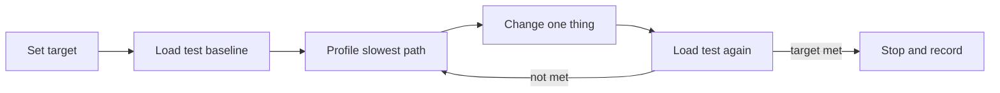
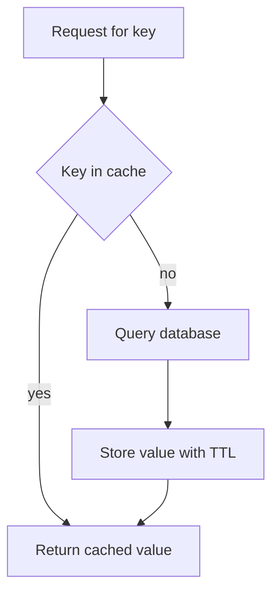

# Performance Optimisation

!!! note "In simple words"
    Measure first, then change one thing at a time and measure again. Most slow Java backends are slow because of how they use the database and the connection pool, not because of the JVM.

## Why it matters

Guessing at performance wastes time and often makes systems worse. A change that speeds up a micro-benchmark can slow a real service under load, because real traffic involves I/O, lock contention, and shared caches. Interviewers ask about performance to see whether you optimise from evidence. They want to hear a method: set a target, measure, find the largest cost, fix it, and confirm the fix.

## How it works

Performance work is a loop with five steps. Each pass should change one variable, so you can tell what made the difference.

1. Set a target, such as "p95 latency under a set value at a set throughput".
2. Run a load test with realistic data and record the metrics.
3. Profile the slowest path and confirm where the time goes.
4. Make a single change, such as a query, an index, a pool size, or a cache.
5. Repeat the load test and compare the result with the baseline.

The loop below shows the same method as a diagram.



### Measure before changing anything

Start with a baseline. Averages hide the slow requests that users notice, so record percentiles, such as p95 and p99, along with throughput, error rate, CPU, heap use, and GC pauses. Keep the test conditions the same from one run to the next, so the comparison means something.

### Profilers and diagnostic tools

| Tool | Use |
|---|---|
| JFR (Java Flight Recorder) | Low-overhead recording of CPU, allocation, lock, and GC events. Safe to run in production |
| VisualVM | Standalone monitor for heap, threads, and sampling |
| JProfiler and YourKit | Commercial profilers with rich interfaces and analysis |
| async-profiler | Low-overhead sampling profiler for CPU, allocation, and locks on Linux and macOS |
| JMH | Micro-benchmarks for isolated code. Read its guidance on common pitfalls first |

Thread dumps, taken with `jstack` or the actuator thread dump endpoint, show threads that are blocked or waiting. They help you find lock contention and pools that are stuck.

### Database query optimisation and the N+1 problem

The N+1 problem occurs when code loads a list with one query, and then loads a related collection for each item with one more query per item. Lazy loading hides it, because the extra queries happen only when a property is read. A list of 100 customers can therefore produce 101 queries.

*Spring Data JPA example (library code, not compiled here).*

```java
import jakarta.persistence.Entity;
import jakarta.persistence.FetchType;
import jakarta.persistence.GeneratedValue;
import jakarta.persistence.Id;
import jakarta.persistence.ManyToOne;
import jakarta.persistence.OneToMany;
import java.util.List;
import org.springframework.data.jpa.repository.JpaRepository;
import org.springframework.data.jpa.repository.Query;

@Entity
class Customer {

    @Id
    @GeneratedValue
    Long id;

    String name;

    @OneToMany(mappedBy = "customer", fetch = FetchType.LAZY)
    List<CustomerOrder> orders;

    protected Customer() {}
}

@Entity
class CustomerOrder {

    @Id
    @GeneratedValue
    Long id;

    String item;

    @ManyToOne(fetch = FetchType.LAZY)
    Customer customer;

    protected CustomerOrder() {}
}

interface CustomerRepository extends JpaRepository<Customer, Long> {

    // One query that fetches the customers and their orders together.
    @Query("select distinct c from Customer c left join fetch c.orders")
    List<Customer> findAllWithOrders();
}
```

Choose the fix that matches the access pattern, in this order of preference:

1. Read only the columns you need with a DTO projection.
2. Use a fetch join or `@EntityGraph` when the relation is always needed.
3. Use batch fetching when the relation cannot be avoided.

Make the query count visible in tests, for example with a statistics assertion. `spring.jpa.show-sql` is useful for debugging on a laptop, but it is not a test tool. Check that indexes cover the filters and sorts each query uses, and read execution plans with `EXPLAIN`.

Eager loading everywhere is not the fix. It loads data that nobody reads, and N+1 patterns still appear through other paths.

### Connection pool sizing

Each request that uses the database holds a connection while it works. Spring Boot uses HikariCP by default, with a maximum pool size of 10. A bigger pool does not make the database faster. Beyond what the database can serve, extra connections only add queuing and contention on the server. The HikariCP documentation suggests starting with a small pool sized from CPU cores and disk parallelism, and then measuring rather than guessing.

Watch for these symptoms: threads waiting for a connection, slow requests while database CPU stays low, and timeouts during traffic spikes. Keep transactions short, so connections return to the pool quickly.

### JVM tuning

Most applications do not need manual JVM tuning. Start with the defaults and measure.

- Heap size: set `-Xms` and `-Xmx`, or use the container-aware percentage flags, so the heap fits the memory the container has. An oversized heap can cause long pauses, and an undersized one causes frequent collections.
- Garbage collector: G1 is the default on server-class machines. CMS was removed in Java 14. ZGC aims at very low pause times, but measure its effect on your workload before adopting it.
- GC logs: enable them with `-Xlog:gc*` to see pause times and allocation rates before you tune anything.
- Allocation: cutting short-lived allocation often helps more than changing GC flags.

Virtual threads became final in Java 21 (JEP 444). They let I/O-bound code handle many concurrent requests with less thread overhead. They do not speed up CPU-bound work, and they do not remove the need to limit pools for shared resources such as database connections.

The example below starts many blocking tasks on virtual threads. It compiles with Java 21.

```java
import java.time.Duration;
import java.util.concurrent.Executors;
import java.util.stream.IntStream;

public class VirtualThreadDemo {

    public static void main(String[] args) {
        try (var executor = Executors.newVirtualThreadPerTaskExecutor()) {
            IntStream.range(0, 10_000).forEach(i -> executor.submit(() -> {
                Thread.sleep(Duration.ofSeconds(1));   // stands in for a blocking I/O call
                return i;
            }));
        }
    }
}
```

### Load testing

Common load tools include Apache JMeter, which supports many protocols, Gatling, which uses a Scala DSL and produces good reports, and k6, which uses JavaScript scripts. Use realistic data volumes and a realistic mix of requests. Ramp the load up gradually. Watch the database, the connection pool, and GC during the test, not only the response times.

### Where to look first

When one endpoint is slow, check the most likely causes in this order:

1. Is the database slow, or are there too many queries? Check query counts and durations.
2. Are the connections exhausted? Check pool metrics.
3. Is a downstream call slow? Check timeouts and traces.
4. Is the CPU busy? Profile with JFR or async-profiler.
5. Is memory or GC the problem? Check the GC logs.

The cache-aside pattern, covered in [Distributed Caching](distributed-caching.md), often removes repeated database work that this list uncovers. The flow below shows the lookup path that a cache-aside read follows.



## Where it is used

- Latency-sensitive APIs, such as checkout or search, that have a percentile target.
- Batch jobs that must finish inside a time window.
- Services whose database work dominates response time.
- Any system that must justify a hardware or cloud spend increase with measurements.

## Benefits

- Measurements show where the time goes, so effort goes to the biggest cost.
- Fixing query patterns often gives larger gains than tuning the JVM.
- A repeatable load test protects against regressions after each release.
- Percentile targets describe what users actually experience.

## Cons and limits

- Realistic load tests take time to build, and their data must resemble production.
- Profilers add overhead, so the numbers differ from those in production when a tool is running.
- Tuning one component can move the bottleneck to another.
- Caches and pools can hide a slow query until the cache is cold or the pool is saturated.
- Virtual threads help only with waiting work, not with computation.

### Common pitfalls

- Optimising code that is not on the critical path.
- Using averages, which hide the tail latency that users notice. Look at p95 and p99.
- Increasing pool sizes to fix timeouts that a slow query is actually causing.
- Turning on SQL logging in production, which slows the system and may write sensitive values to logs.
- Drawing conclusions from micro-benchmarks that were not written with JMH.
- Adding indexes without checking their write cost and the queries they serve.
- Assuming virtual threads remove the need for backpressure or pool limits.

## Best practices

- Write down a target and a baseline before you change anything.
- Count queries per request in tests, and fix N+1 patterns when they appear.
- Keep pools small, keep transactions short, and monitor pool wait time.
- Use JFR or async-profiler for CPU and allocation questions, and GC logs for pause questions.
- Run load tests against production-like data, and watch the whole system while they run.
- Record every change and its measured effect, so the next engineer can see why the code looks the way it does.

!!! tip "Interview tip"
    **Q: An endpoint is slow. What do you do?**
    Start by proving the slowness with metrics and a representative load test. Next, locate the time: how many queries run and how long they take, whether requests queue for connections, whether a dependency is slow, or whether CPU or GC is the limit. Attack the biggest slice first, which is most often the query pattern, then re-measure. N+1 access and pool starvation are the two findings that turn up most.

## Quick recap

- Look at percentiles, because averages conceal the slow tail.
- Loops that trigger lazy loads cause N+1 traffic; fetch joins, projections, and entity graphs remove it.
- Smaller pools and shorter transactions often beat bigger pools.
- Choose JFR or async-profiler for CPU and allocation, and GC logs for pauses.
- Run tests on realistic data, and observe every layer at once.

## Official documentation

- [Java 21 GC Tuning Guide](https://docs.oracle.com/en/java/javase/21/gctuning/)
- [JEP 444: Virtual Threads](https://openjdk.org/jeps/444)
- [Spring Data JPA Reference](https://docs.spring.io/spring-data/jpa/reference/index.html)
- [Spring Boot Reference](https://docs.spring.io/spring-boot/reference/index.html)

**See also:** [Spring Cache and Redis](spring-cache-and-redis.md) | [Distributed Caching](distributed-caching.md) | [Databases and SQL](../06-databases-sql/index.md) | [Local Caching with Caffeine and EhCache](local-caching-ehcache-caffeine.md)
