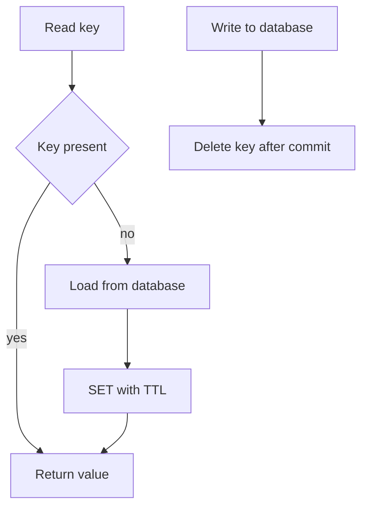

# Redis Advanced Patterns

!!! note "In simple words"
    Redis runs each single command as one indivisible step, but a string of commands from one client can be interrupted. When a decision depends on several steps, fold them into one command or a Lua script. Treat Redis as a fast copy of your data, and keep the original elsewhere.

## Why it matters

Redis backs caches, sessions, rate limits, rankings, and locks. Each of those uses has a quiet failure mode. A lock released with the wrong check can delete somebody else's lock. A counter without an expiry can slowly fill memory. A cluster with a poor key layout rejects multi-key commands. Interviewers probe these spots to learn whether you reason about concurrency and failure, not just about command names. Spring wiring basics live in [Spring Cache and Redis](spring-cache-and-redis.md).

## How it works

Choosing a Redis design follows a repeatable path. Classify the data first, then match a data type to the access pattern, bound every key with a TTL, make read-then-write steps atomic, and pick a topology that survives the failures you expect.

1. Classify the data: a cache, a derived store, or the system of record. Redis fits the first two.
2. Choose the data type that matches the reads and writes, for example a sorted set for ranks or a hash for a record.
3. Attach a TTL to every key, unless the key is an intentional persistent structure.
4. Wrap any read-then-write decision in one atomic command or a Lua script.
5. Pick a topology: a primary with replicas, Sentinel for automatic failover, or Cluster for more capacity.
6. Monitor memory, hit rate, slow commands, and oversized keys from day one.

The flowchart below shows the cache-aside read that most Redis caches follow. Every write that goes to the database also removes the affected key after the commit.



## Core concepts

### Data types at the command level

Each type fits a particular shape of data. These are the commands you will use most often:

| Type | Core commands | Typical use |
|---|---|---|
| String | `SET key value EX seconds NX`, `GET`, `INCR`, `MGET` | Cached values, counters, flags |
| List | `LPUSH`, `RPUSH`, `LPOP`, `LRANGE`, `LTRIM` | Simple queues and activity feeds |
| Set | `SADD`, `SISMEMBER`, `SINTER`, `SUNION` | Unique members, tags, deduplication |
| Sorted set | `ZADD`, `ZINCRBY`, `ZREVRANGE`, `ZREVRANK`, `ZREMRANGEBYSCORE` | Leaderboards, sliding windows, time-ordered indexes |
| Hash | `HSET`, `HGET`, `HINCRBY`, `HGETALL` | Record-like objects, such as a user profile |

Some details that come up in practice:

- `SET key value EX seconds NX` writes only when the key is missing, and it applies the expiry in that same step. This is the core of a lock.
- `LTRIM list 0 99` keeps only the newest 100 entries, which caps a feed.
- `INCR` is atomic, so concurrent counters need no client-side locking.
- `ZINCRBY` changes a score atomically, and `ZREVRANGE ... WITHSCORES` returns the ranked list.

### Atomicity: single commands versus sequences

A single command is atomic. A sequence of commands from one client is not. If the code sends `INCR` and then `EXPIRE` as two calls, a crash between them leaves a counter that never expires. Two ways to close that gap:

- Pick one command that performs both steps, such as `SET ... EX ... NX`.
- Use a Lua script. Redis executes a script as one unit, so no other client can slip in between its check and its write.

Reach for Lua when a choice depends on reading a value first, such as removing a lock only if it still carries your token.

## Distributed locks

A distributed lock stops parallel workers from repeating a job, such as two instances handling the same order. The lock is a key with a TTL, so a crashed holder cannot block others indefinitely.

Two rules make the lock sound:

1. Take the lock with `SET key token NX EX seconds`. The `token` value should be random and private to this holder.
2. Release only when the key still holds your token. A `GET` followed by `DEL` is unsafe, because the lock can expire and pass to someone else between the two calls. A Lua script performs the comparison and the deletion as one unit.

*Spring Data Redis example (library code, not compiled here).*

```java
import java.time.Duration;
import java.util.List;
import java.util.UUID;
import org.springframework.data.redis.core.StringRedisTemplate;
import org.springframework.data.redis.core.script.DefaultRedisScript;
import org.springframework.stereotype.Component;

@Component
public class OrderLock {

    private static final DefaultRedisScript<Long> RELEASE = new DefaultRedisScript<>(
        "if redis.call('get', KEYS[1]) == ARGV[1] then return redis.call('del', KEYS[1]) else return 0 end",
        Long.class);

    private final StringRedisTemplate redis;

    public OrderLock(StringRedisTemplate redis) {
        this.redis = redis;
    }

    public String tryAcquire(String key, Duration ttl) {
        String token = UUID.randomUUID().toString();
        Boolean acquired = redis.opsForValue().setIfAbsent(key, token, ttl);
        return Boolean.TRUE.equals(acquired) ? token : null;
    }

    public boolean release(String key, String token) {
        Long removed = redis.execute(RELEASE, List.of(key), token);
        return Long.valueOf(1L).equals(removed);
    }
}
```

A caller takes the lock, does its work in a `try` block, and releases in `finally`:

```java
import java.time.Duration;

class OrderProcessor {

    // Stand-in for the OrderLock class shown above.
    interface OrderLockApi {
        String tryAcquire(String key, Duration ttl);
        boolean release(String key, String token);
    }

    private final OrderLockApi orderLock;

    OrderProcessor(OrderLockApi orderLock) {
        this.orderLock = orderLock;
    }

    void processOrder(int orderId) {
        // Business logic goes here.
    }

    void handle(int orderId) {
        String key = "order:" + orderId + ":processing";
        String token = orderLock.tryAcquire(key, Duration.ofSeconds(30));
        if (token == null) {
            throw new IllegalStateException("Order " + orderId + " is already being processed");
        }
        try {
            processOrder(orderId);
        } finally {
            orderLock.release(key, token);
        }
    }
}
```

Limits to state out loud:

- The TTL expires even while the work continues. Keep the work well under the TTL, extend the lock on purpose, and make the protected step safe to retry.
- A lock held on one node disappears if that node fails before the write reaches a replica. Redlock spreads the lock over several independent nodes, but its safety is disputed. See [Spring Cache and Redis](spring-cache-and-redis.md).
- When a wrong result would be costly, enforce the rule with a database constraint or a fencing token. A lock alone cannot guarantee exclusivity.

## Rate limiting

A rate limiter caps the requests a client can make inside a time window. Two designs are common:

- **Fixed window.** Count requests under a key that includes the window number. It is cheap and easy. Requests near a window boundary can pass at up to twice the limit.
- **Sliding log.** Record each request as a sorted-set member scored by its timestamp, then count the members inside the last window. It is precise, but memory scales with request volume.

*Spring Data Redis example (library code, not compiled here).*

```java
import java.time.Duration;
import java.util.UUID;
import org.springframework.data.redis.core.StringRedisTemplate;
import org.springframework.stereotype.Component;

@Component
public class SlidingWindowLimiter {

    private final StringRedisTemplate redis;

    public SlidingWindowLimiter(StringRedisTemplate redis) {
        this.redis = redis;
    }

    public boolean allow(String clientId, int maxRequests, Duration window) {
        String key = "rate:" + clientId;
        long now = System.currentTimeMillis();

        redis.opsForZSet().removeRangeByScore(key, 0, now - window.toMillis());
        Long inWindow = redis.opsForZSet().zCard(key);
        if (inWindow != null && inWindow >= maxRequests) {
            return false;
        }

        redis.opsForZSet().add(key, UUID.randomUUID().toString(), now);
        redis.expire(key, window);
        return true;
    }
}
```

The random member is important. Two requests in the same millisecond with a fixed member would overwrite each other. The version above still has a race: two concurrent calls can both see free room and both insert, so a few extra requests can slip through under load. For a strict limit, put the trim, the count, and the insert into one Lua script.

When `allow` returns false, answer with HTTP 429 and a `Retry-After` header. The check usually sits in a `HandlerInterceptor` or a gateway filter rather than in business code.

## Leaderboards

A sorted set gives a leaderboard, and rank lookups take logarithmic time.

*Spring Data Redis example (library code, not compiled here).*

```java
import java.util.Set;
import org.springframework.data.redis.core.StringRedisTemplate;
import org.springframework.data.redis.core.ZSetOperations.TypedTuple;
import org.springframework.stereotype.Component;

@Component
public class Leaderboard {

    private static final String KEY = "leaderboard:weekly";
    private final StringRedisTemplate redis;

    public Leaderboard(StringRedisTemplate redis) {
        this.redis = redis;
    }

    public void addPoints(String userId, double points) {
        redis.opsForZSet().incrementScore(KEY, userId, points);
    }

    public Set<TypedTuple<String>> topTen() {
        return redis.opsForZSet().reverseRangeWithScores(KEY, 0, 9);
    }

    public Long rankOf(String userId) {
        return redis.opsForZSet().reverseRank(KEY, userId);   // 0 means first place
    }
}
```

Positions are zero-based, so the top score sits at rank 0. Equal scores fall back to lexicographic order, which means you should define your own tie-break if it matters. Many teams open a new key each week and let a TTL retire the old one, instead of running a cleanup job.

## Pub/Sub and when to use Streams

Pub/Sub pushes each message only to subscribers that are connected at that moment. It stores nothing, so anyone offline when a message goes out never sees it. That is acceptable for hints such as a cache invalidation signal, since the next read corrects things anyway.

Messages that must survive a restart call for Redis Streams with consumer groups, which hold entries until they are acknowledged. For events between services, a broker such as Kafka or RabbitMQ is usually the stronger choice. See [Messaging](../13-messaging/index.md).

## Configuration in Spring Boot

Spring Boot 3 reads Redis settings from `spring.data.redis`. The older `spring.redis` prefix is out of date.

```yaml
spring:
  data:
    redis:
      host: localhost
      port: 6379
      password: ${REDIS_PASSWORD}
      timeout: 2s
      lettuce:
        pool:
          max-active: 20
          max-idle: 10
          min-idle: 5
```

Lettuce pooling needs `commons-pool2` on the classpath. Pull the password from an environment variable or a secrets store, and keep it out of version control.

To keep HTTP sessions in Redis so that any instance can serve any request:

```yaml
spring:
  session:
    store-type: redis
    timeout: 30m
```

Keep session contents small and serialisable. The session is written back to Redis on each change, so a large session adds bandwidth to every request.

## High availability and scaling

### Replication

A primary takes writes and streams them to its replicas. Replicas serve reads, and an operator can promote one by hand. Replication is asynchronous, so a failover can drop the newest writes. Point a server at its primary with `replicaof <primary-host> <port>`. The older `slaveof` keyword is deprecated.

### Sentinel

Sentinel processes watch the primary and its replicas. When a quorum agrees the primary is gone, one replica is promoted. Run an odd number of sentinels, normally three or more, on separate hosts.

```
sentinel monitor mymaster 10.0.0.10 6379 2
sentinel down-after-milliseconds mymaster 5000
sentinel failover-timeout mymaster 10000
```

Clients ask Sentinel which node is the current primary. Spring Boot needs the master name and the sentinel addresses:

```yaml
spring:
  data:
    redis:
      sentinel:
        master: mymaster
        nodes: 10.0.0.11:26379,10.0.0.12:26379,10.0.0.13:26379
```

### Cluster

Redis Cluster splits the keyspace into 16,384 hash slots, and every key belongs to exactly one slot. Each primary owns a range of slots and may have replicas. When a primary fails, the cluster promotes one of its replicas.

```
redis-server --port 7000 --cluster-enabled yes
redis-cli --cluster create 127.0.0.1:7000 127.0.0.1:7001 127.0.0.1:7002 \
  127.0.0.1:7003 127.0.0.1:7004 127.0.0.1:7005 --cluster-replicas 1
```

Multi-key commands and transactions require every key to live in the same slot. A hash tag solves this: `user:{42}:cart` and `user:{42}:wishlist` share a slot, because only the text inside the braces is hashed. Without one, a multi-key command fails with a cross-slot error.

Choose Sentinel when one primary can hold the data and you only need failover. Choose Cluster when the data outgrows one machine, and accept the cross-slot restrictions that come with it.

## Persistence

Redis holds its data in memory. Persistence copies that data to disk, and two mechanisms exist. You can use both together.

| Mechanism | How it works | Data at risk on a crash | Cost |
|---|---|---|---|
| RDB snapshot | Writes a point-in-time file at set intervals | Everything since the last snapshot | Compact file and quick restart |
| AOF | Appends every write to a log that is replayed at startup | Up to one second with `appendfsync everysec` | Larger file and more write work |

```
save 900 1
save 300 10
appendonly yes
appendfsync everysec
```

Recent Redis releases write an RDB snapshot at the head of the AOF file by default, so restarts are fast and the log stays small. Persistence guards against restarts, but not against bad writes, and it cannot take the place of backups. Even with AOF, a failover to a replica can lose writes that were already acknowledged. Treat Redis as a cache or a fast store for derived data, and keep the authoritative copy in a database.

## Monitoring and debugging

### INFO and memory

`INFO` returns grouped statistics:

```bash
redis-cli INFO memory      # used memory and fragmentation ratio
redis-cli INFO stats       # commands processed, keyspace hits and misses
redis-cli INFO clients     # connected clients
```

`keyspace_hits` against `keyspace_misses` gives the server-wide hit rate. Compare `used_memory` with `maxmemory`. For a cache, set a policy such as `maxmemory-policy allkeys-lru`. With `noeviction`, writes fail once memory runs out, which is right for data that must never disappear.

### SLOWLOG

The slow log keeps commands that exceed a time threshold:

```bash
redis-cli CONFIG SET slowlog-log-slower-than 10000   # microseconds
redis-cli SLOWLOG GET 10
redis-cli SLOWLOG RESET
```

The usual culprits are `KEYS`, large `SMEMBERS` or `HGETALL` reads on big values, and Lua scripts that run too long. Replace `KEYS` with `SCAN`, which pages through the keyspace.

### MONITOR and key analysis

`MONITOR` prints every command the server receives. It is handy for a brief debugging session, yet it adds load, so never leave it running in production.

```bash
redis-cli --bigkeys               # largest key of each type
redis-cli MEMORY USAGE user:1     # bytes used by one key
redis-cli OBJECT ENCODING user:1  # internal encoding, such as listpack or hashtable
```

Oversized keys make reads and deletes slow enough to cause latency spikes. Break them up, or remove them with `UNLINK`, which frees memory in the background.

## Where it is used

- Locks that stop a scheduled job from running twice, and rate limits at a gateway.
- Rankings for games and campaigns, and sessions shared by a fleet of web servers.

## Benefits

- Single commands are atomic, and sorted sets and hashes fit common access patterns without extra services.
- Sentinel and Cluster are well-understood ways to add failover and capacity.
- Keeping data in memory gives very low latency.

## Cons and limits

- Everything lives in memory, so memory size and the eviction policy shape the design.
- Replication is asynchronous, so a failover can lose recent writes.
- Cluster mode restricts multi-key operations.
- A lock with a timeout cannot prove exclusive access by itself.
- A Lua script that runs too long blocks every other client.
- Write-behind caching over Redis loses unflushed writes when a node fails. [Distributed Caching](distributed-caching.md) compares the caching patterns.

### Common pitfalls

- Releasing a lock with `GET` then `DEL`, which can remove another holder's lock.
- Setting a key and its TTL in two calls, which can leave a key that never expires.
- Running `KEYS` in production, which stalls the server while it scans the keyspace.
- Looping over single round trips. Batch them with `MGET`, a pipeline, or a Lua script.
- Storing huge values, such as whole documents, with no size limit or compression.
- Assuming Redis is the only copy of important data, and losing it during a failover.
- Running without a password, or with the port open to the public network.
- Using a single node for everything, with no failover plan and no monitoring.

## Best practices

- Give every key a TTL unless it is a deliberate persistent structure.
- For locks, use a random token and a compare-and-delete Lua script.
- Use `SCAN` for maintenance work and `UNLINK` for deletion.
- Name keys with an application prefix, a version, and a clear identifier.
- Track memory, hit rate, the slow log, and large keys from the start.
- Keep the authoritative data in a database, and make lock-protected writes safe to repeat.

### Key naming

A consistent pattern makes keys readable in `redis-cli` and easy to inspect with patterns:

```java
final class CacheKeys {

    private static final String APP = "orders";
    private static final String VERSION = "v2";

    private CacheKeys() {
    }

    static String order(long orderId) {
        return APP + ":" + VERSION + ":order:" + orderId;
    }
}
```

When the cached shape changes, bump the version. Old entries are no longer read, and they expire without a mass delete. Keep keys short, since every key costs memory.

### Avoid KEYS in production

`KEYS pattern` walks the entire keyspace in one call and blocks every other client until it finishes. `SCAN` walks the keyspace in small pages, so the server stays responsive:

```bash
SCAN 0 MATCH orders:v2:order:* COUNT 500
```

A `SCAN` run can repeat a key, and a page can come back empty while the cursor still advances. Code using it must handle both cases. Keep `SCAN` for maintenance jobs, not the request path.

### Handle big keys

Oversized values and collections with millions of members both count as big keys. Touching one ties up the single Redis thread for longer. To locate and measure them:

```bash
redis-cli --bigkeys                    # sampled report of the largest keys per type
MEMORY USAGE orders:v2:order:42        # bytes used by one key
```

Remedies: break a large collection into several keys, for example one hash per time bucket. Keep large documents in a database or object storage, and cache only the fields a request needs. Delete with `UNLINK`, not `DEL`.

### Set sensible TTLs

Give each cache key a TTL, except for structures you keep on purpose, such as a leaderboard you manage by hand. Without TTLs, cache keys build up until memory runs out. Add jitter, so keys written together do not expire together:

```java
import java.time.Duration;
import java.util.concurrent.ThreadLocalRandom;

final class Ttls {

    private Ttls() {
    }

    // Ten minutes plus up to one minute of random jitter.
    static Duration cacheEntry() {
        long jitterSeconds = ThreadLocalRandom.current().nextLong(60);
        return Duration.ofMinutes(10).plusSeconds(jitterSeconds);
    }
}
```

Set the TTL in the same command as the value, using `SET key value EX seconds` or `setIfAbsent` with a duration. A crash then cannot leave a key without a TTL.

### Secure the instance and keep values small

Turn on authentication through `requirepass` or ACL users, limit network access, and use TLS when traffic crosses networks you do not control. Keep each value small, and combine reads into one `MGET` or a pipeline rather than one round trip per key. Let a database remain the authority, and treat Redis as a copy. Cluster handles sharding, but each shard stays available only through its replicas and a failover mechanism such as Sentinel or a managed service. Pick the topology by the failures you need to survive, not merely by the capacity you need.

!!! tip "Interview tip"
    **Q: Why is a naive Redis lock unsafe, and how do you fix it?**
    Take the lock with `SET key token NX EX` and a random token. Free it through a Lua script that deletes only when the token still matches. Finish the protected work before the TTL runs out, make the step safe to repeat, and add a database constraint where a mistake would be expensive. A timeout alone never proves that nobody else is inside.

## Quick recap

- Each command is indivisible, but a sequence of commands is not. Merge dependent steps into one command or script.
- Locks need random tokens, and a release that checks the token first.
- Sliding logs live in sorted sets, and exact limits need scripting.
- Sentinel covers failover, and Cluster covers sharding. Related keys must share a slot.
- Keep an eye on memory, hit rate, slow commands, and big keys, and let a database hold the truth.

## Official documentation

- [Redis Documentation](https://redis.io/docs/latest/)
- [Spring Data JPA Reference](https://docs.spring.io/spring-data/jpa/reference/index.html)
- [Spring Boot Reference](https://docs.spring.io/spring-boot/reference/index.html)
- [Spring Framework Reference](https://docs.spring.io/spring-framework/reference/)

**See also:** [Spring Cache and Redis](spring-cache-and-redis.md) | [Distributed Caching](distributed-caching.md) | [Local Caching with Caffeine and EhCache](local-caching-ehcache-caffeine.md) | [Resilience Patterns](../14-microservices/resilience-patterns.md) | [AWS](../18-cloud/aws.md)
