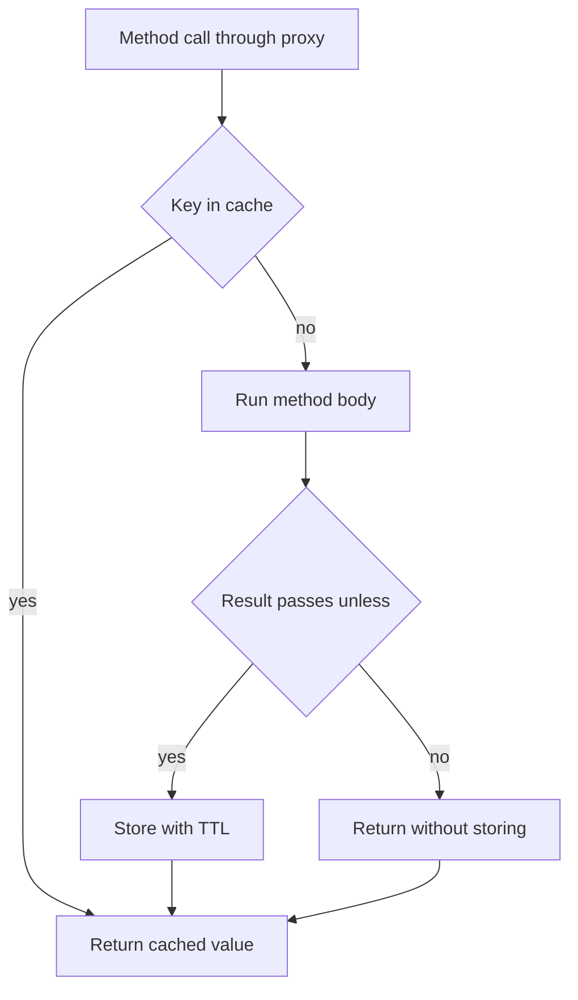

# Spring Cache Abstraction and Redis

!!! note "In simple words"
    Spring lets you add caching to a method with an annotation. The cache manager decides where the stored values live, and Redis is a common choice because many application instances can share it.

## Why it matters

Calling a database for the same data over and over costs time and capacity. A cache keeps the answer close to the caller, so the next request skips the slow work. The hard part is keeping the cache correct when the data changes. Interviewers ask about Spring caching to see whether you understand how caching works through proxies, how it interacts with transactions and invalidation, and what Redis can and cannot guarantee.

## How it works

Caching in Spring works through a proxy. The proxy sits in front of the bean, so the cache check happens before your method body runs.

1. A caller invokes a method annotated with `@Cacheable` through the Spring proxy.
2. The proxy builds a cache key from the method arguments, or from the expression you supply.
3. On a hit, the cached value is returned, and the method body does not run.
4. On a miss, the method runs. If the result passes the `unless` check, it is stored with its time-to-live.
5. `@CacheEvict` and `@CachePut` change entries when the underlying data changes.

The flow below follows a cache-aside read, which is the usual pattern with `@Cacheable`.



### Enabling caching

Add `@EnableCaching` to a configuration class, and add a cache starter or set `spring.cache.type` to pick a provider. With no provider, Spring falls back to a simple in-memory map that has no size limit and no expiry. That is rarely what production needs.

*Spring Boot example (library code, not compiled here).*

```java
import org.springframework.cache.annotation.EnableCaching;
import org.springframework.context.annotation.Configuration;

@Configuration
@EnableCaching
class CacheConfig {
}
```

### @Cacheable, @CachePut, and @CacheEvict

- `@Cacheable` returns the cached value when one exists. Otherwise it runs the method and stores the result.
- `@CachePut` always runs the method, and then writes the result into the cache.
- `@CacheEvict` removes entries. Setting `allEntries = true` clears the whole cache.
- `@Caching` combines several of these on one method.

*Spring Boot example (library code, not compiled here).*

```java
import java.util.Optional;
import org.springframework.cache.annotation.CacheEvict;
import org.springframework.cache.annotation.CachePut;
import org.springframework.cache.annotation.Cacheable;
import org.springframework.stereotype.Service;

record Product(long id, String name, long priceCents) {}

interface ProductRepository {
    Optional<Product> findById(long id);
    Product save(Product product);
    void deleteById(long id);
}

@Service
class ProductService {

    private final ProductRepository repository;

    ProductService(ProductRepository repository) {
        this.repository = repository;
    }

    @Cacheable(cacheNames = "products", key = "#id", unless = "#result == null")
    public Product findById(long id) {
        return repository.findById(id).orElse(null);
    }

    @CachePut(cacheNames = "products", key = "#result.id()")
    public Product update(Product product) {
        return repository.save(product);
    }

    @CacheEvict(cacheNames = "products", key = "#id")
    public void delete(long id) {
        repository.deleteById(id);
    }
}
```

`unless = "#result == null"` stops Spring from caching a "not found" answer. Otherwise a record created later would stay hidden behind a cached miss. Caching nulls is one of the most common causes of stale data.

Use `condition` to decide before the call, based on the arguments, and `unless` to decide after the call, based on the result:

```java
import org.springframework.cache.annotation.Cacheable;

@Cacheable(cacheNames = "products", key = "#id", condition = "#id > 0")
public Product findCached(long id) {
    return repository.findById(id).orElse(null);
}
```

### Cache keys

By default Spring builds a key from the method arguments with `SimpleKeyGenerator`. One argument is used as the key itself. Several arguments form a composite key. You can set `key` with SpEL when you need control, for example `key = "#customerId + ':' + #page"`. Write a custom `KeyGenerator` bean when many methods must follow one rule. Keys that rely on mutable objects, or on an inconsistent `toString()`, cause silent misses.

### Cache managers

A `CacheManager` provides the caches your methods use. The common implementations are:

- `ConcurrentMapCacheManager`, an in-memory map with no eviction, suited to tests and small demos.
- `SimpleCacheManager`, where you register each cache yourself.
- `CompositeCacheManager`, which tries several managers in order.

Production systems usually use a library such as Caffeine for local memory, or Redis when the cache must be shared. See [Local Caching with Caffeine and EhCache](local-caching-ehcache-caffeine.md).

### Redis as a cache

Set `spring.cache.type=redis` with the Redis starter, and configure time-to-live values for each cache through a `RedisCacheManager`.

*Spring Data Redis example (library code, not compiled here).*

```java
import java.time.Duration;
import org.springframework.cache.CacheManager;
import org.springframework.context.annotation.Bean;
import org.springframework.context.annotation.Configuration;
import org.springframework.data.redis.cache.RedisCacheConfiguration;
import org.springframework.data.redis.cache.RedisCacheManager;
import org.springframework.data.redis.connection.RedisConnectionFactory;

@Configuration
class RedisCacheConfig {

    @Bean
    CacheManager cacheManager(RedisConnectionFactory connections) {
        RedisCacheConfiguration defaults = RedisCacheConfiguration.defaultCacheConfig()
                .entryTtl(Duration.ofMinutes(10))
                .disableCachingNullValues();
        return RedisCacheManager.builder(connections)
                .cacheDefaults(defaults)
                .build();
    }
}
```

The time-to-live is your main protection against stale data when an update path forgets to evict. Choose it from how stale the data is allowed to be, not from how often the data changes.

### Redis data structures

| Structure | Typical use |
|---|---|
| Strings | Cached values, counters with `INCR`, flags |
| Lists | Queues and recent-activity feeds |
| Sets | Unique membership and tags |
| Hashes | Objects with several fields, such as a user profile |
| Sorted sets | Leaderboards and time-ordered indexes |
| Streams | Append-only logs with consumer groups |
| Bitmaps | Compact flags, such as daily active users |

Spring Data Redis offers these through `StringRedisTemplate`, which uses string keys and values, and `RedisTemplate`, which uses typed serialisation. For plain string values, `StringRedisTemplate` is clearer.

*Spring Data Redis example (library code, not compiled here).*

```java
import java.time.Duration;
import org.springframework.data.redis.core.StringRedisTemplate;
import org.springframework.stereotype.Service;

@Service
class SessionFlags {

    private final StringRedisTemplate redis;

    SessionFlags(StringRedisTemplate redis) {
        this.redis = redis;
    }

    void markSeen(String userId) {
        redis.opsForValue().set("seen:" + userId, "1", Duration.ofHours(1));
    }

    boolean wasSeen(String userId) {
        return Boolean.TRUE.equals(redis.hasKey("seen:" + userId));
    }
}
```

### Sessions, pub/sub, streams, and locks

- Spring Session with Redis stores HTTP sessions in Redis, so any instance can serve any user. Add `spring-session-data-redis`.
- Pub/sub delivers each message only to the subscribers connected at that moment. Nothing is stored, so an offline subscriber misses the message.
- Redis Streams keep entries until consumers acknowledge them, which makes them closer to a durable queue.
- A distributed lock coordinates work across instances. A single-node lock built with `SET key value NX PX` is common. Redlock extends the idea across several Redis nodes, but its safety is debated, and it does not replace fencing tokens when correctness is critical. Use a Lua script when several commands must run as one step.

### Persistence and clustering

Redis keeps its data in memory. Persistence writes that data to disk in one of two forms: RDB snapshots, which are point-in-time copies taken at intervals, and AOF, which is an append-only log of writes that is replayed on restart. Replication copies data to replicas, and Redis Cluster splits keys across nodes. Treat a cache as something you can afford to lose. Treat Redis as a durable store only when you have designed persistence and failover deliberately.

## Where it is used

- Caching the results of expensive reads, such as product details or reference data.
- Sharing sessions across several web instances.
- Holding short-lived flags, such as "already processed" markers.
- Coordinating work across instances with locks or counters.

## Benefits

- Annotations add caching to existing methods without rewriting them.
- Redis gives every instance the same view of the cache.
- TTLs bound how long a stale value can survive.
- Redis data structures fit many access patterns without extra services.

## Cons and limits

- Proxy-based caching does not apply to calls made inside the same class.
- Cache invalidation is hard to get right when many code paths change the data.
- Redis is in memory, so memory size and eviction policy matter.
- Serialised values must stay compatible across deployments.
- Redis persistence and failover do not give the guarantees of a transactional database.

### Common pitfalls

- Self-invocation: calling a cached method from another method in the same class skips the proxy, so nothing is cached.
- Forgetting to evict on every write path, including batch jobs and direct repository writes.
- Caching mutable objects and then changing them, which changes the cached copy too.
- Changing serialisation after a deployment, which makes old entries unreadable. Version cache names or keys.
- Caching data that depends on the current user without putting the user in the key.
- Assuming pub/sub is durable. Use Streams or a broker when messages must not be lost.
- Running `INCR` and `EXPIRE` as two separate calls, which can leave a key with no expiry if the process dies between them.

## Best practices

- Use `unless` to keep misses out of the cache, and `condition` to skip caching for unsuitable inputs.
- Give every Redis cache a TTL, and choose it from the staleness the business accepts.
- Evict or update entries on every write path, and test those paths.
- Put the current user or tenant in the key when the value depends on them.
- Use `StringRedisTemplate` for simple values, and keep payloads small.
- Read the Redis password from the environment or a secrets store, never from source control.

!!! tip "Interview tip"
    **Q: Why might `@Cacheable` not seem to work?**
    Usually the method is invoked from inside its own class, which skips the proxy entirely. Other suspects are a missing `@EnableCaching`, a visibility rule the proxy cannot honour, or a key expression that never produces a match. Fix it by moving the cached method into a separate bean, or by reaching it through the injected proxy.

## Quick recap

- The annotations act through a proxy, so an internal call bypasses them.
- `condition` filters what may enter the cache; `unless` filters results after the call.
- A TTL on each Redis cache limits the harm from a missed eviction.
- The Redis data type should follow the access pattern.
- Pub/sub forgets messages that nobody was listening for; Streams and brokers keep them.

## Official documentation

- [Redis Documentation](https://redis.io/docs/latest/)
- [Spring Framework Reference](https://docs.spring.io/spring-framework/reference/)
- [Spring Boot Reference](https://docs.spring.io/spring-boot/reference/index.html)
- [Spring Data JPA Reference](https://docs.spring.io/spring-data/jpa/reference/index.html)

**See also:** [Distributed Caching](distributed-caching.md) | [Performance Optimisation](performance-optimisation.md) | [Redis Advanced Patterns](redis-advanced-patterns.md) | [Spring Core](../08-spring-core/index.md)
