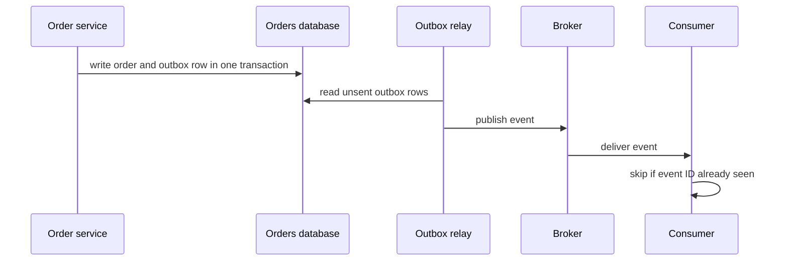

# Event-Driven Architecture

!!! note "In simple words"
    Instead of calling every other service to tell it what to do, a service announces what just happened, such as "an order was placed". Services that care about that fact react on their own. Nobody has to wait for everyone else.

## Why it matters

In an event-driven system, services react to facts that have already happened. This loosens the coupling between services and lets each one scale and deploy on its own. The price is eventual consistency, plus failure modes such as duplicate deliveries and events arriving out of order.

Interviewers ask about these patterns to see whether you can reason about those trade-offs, not just name the patterns. The strong answers cover reliable publishing, idempotent handling, and how sagas recover from failure.

## How it works

### Why put a broker in between

A messaging system moves data between services without the sender and receiver calling each other directly. The sender produces a message, and the receiver consumes it when it is ready. Neither side needs to know the other's address, speed, or availability at that moment. The component that stores messages and hands them over is the **broker**.

Two delivery shapes are common:

- **Queue**: each message goes to one consumer. Competing consumers share the work, which suits background jobs.
- **Publish and subscribe**: a publisher sends to a topic, and every subscriber gets its own copy. Adding a subscriber does not change the publisher.

Teams add a broker for these reasons:

- **Buffering**: the broker absorbs bursts that the consumer cannot keep up with.
- **Durable hand-off**: after the broker accepts a message, the producer can continue even if the consumer is down.
- **Decoupling**: producers and consumers can change, scale, and deploy independently, as long as the message contract holds.
- **Asynchronous work**: the caller returns quickly, and the consumer finishes the job later.
- **Load spreading**: several consumers share a queue or a set of partitions.
- **Replay and new consumers**: some brokers keep messages for a while, so a new consumer can start from earlier data.

A broker is not free. It is one more component to run, it forces you to choose delivery guarantees, it brings duplicates and out-of-order delivery, and failures inside it are hard to see. Use it where those costs buy something concrete, such as surviving a consumer outage or letting teams work independently. Do not use it for every call between two services.

### Events versus commands

An event describes something that already happened and is named in the past tense, such as `OrderPlaced`. A command asks for an action that might fail, such as `ChargePayment`. Events are broadcast, and the publisher does not expect a particular reply. A command is addressed to one handler.

Mixing the two blurs ownership. If a service publishes events that other services must obey, those services now depend on it in a hidden way.

### Message patterns

| Pattern | Shape | Example |
|---|---|---|
| Publish and subscribe | One publisher, many independent subscribers | An order is placed, and billing, shipping, and analytics each read it |
| Request and reply | A request on one queue, and a reply on another | RPC-style calls routed through a broker |
| Routing and filtering | Messages are routed by key or header | Region-specific handling |
| Work queue | One message, one consumer | Background jobs |

### The transactional outbox

A service often has to update its database and publish an event. Done as two separate steps, this is a dual write. If the service writes the database and then publishes, a crash in between loses the event. If it publishes first, a failed commit announces something that never happened.

The transactional outbox removes the gap. The service writes the event into an `outbox` table in the same local transaction as the state change. A separate relay reads unsent rows and publishes them to the broker. Because the relay can publish a row more than once, consumers must stay idempotent.



### Idempotent consumers

Most messaging systems deliver at least once, so the same event can arrive twice. An idempotent consumer gives the same result no matter how many times it sees an event. The usual technique is to record processed event IDs in the same transaction as the state change, and skip any ID that is already recorded.

The following example is a Spring-style handler. It was not compiled here.

```java
import java.util.UUID;
import org.springframework.stereotype.Service;
import org.springframework.transaction.annotation.Transactional;

interface ProcessedEventStore {
    boolean markIfNew(UUID eventId);   // inserts the ID; returns false if it already exists
}

@Service
class PaymentEventHandler {

    private final ProcessedEventStore processed;

    PaymentEventHandler(ProcessedEventStore processed) {
        this.processed = processed;
    }

    @Transactional
    public void handle(UUID eventId, long amountCents) {
        if (!processed.markIfNew(eventId)) {
            return; // duplicate delivery, already applied
        }
        applyPayment(amountCents);
    }

    private void applyPayment(long amountCents) {
        // update the ledger here, inside the same transaction
    }
}
```

The check and the state change must share one transaction. Otherwise a crash between them can still apply an event twice or drop it.

### Event sourcing

In event sourcing, the source of truth is the sequence of events for an entity, not its current row. The current state is derived by replaying the events in order. The event store is append-only, and snapshots can speed up replay for long streams.

The following Java 21 example compiles as a single file. It replays a small event list into a status.

```java
import java.util.List;

sealed interface OrderEvent permits OrderPlaced, OrderShipped {}

record OrderPlaced(String orderId, int amount) implements OrderEvent {}

record OrderShipped(String orderId) implements OrderEvent {}

class OrderReplay {

    static String statusAfter(List<OrderEvent> events) {
        String status = "NONE";
        for (OrderEvent event : events) {
            status = switch (event) {
                case OrderPlaced placed -> "PLACED";
                case OrderShipped shipped -> "SHIPPED";
            };
        }
        return status;
    }
}
```

The `sealed` interface lists every event type, so the compiler knows the full set. The exhaustive `switch` with type patterns (Java 21) reads each event without casts. A missing case is a compile error, which catches new event types early.

Event sourcing gives a full audit trail and lets you rebuild read models at any time. It is harder to query directly, and changing event shapes needs versioning.

### CQRS

Command Query Responsibility Segregation separates the write model, which changes state, from the read model, which serves queries. The write side publishes events, and the read side builds views shaped for the screen. Reads become fast and simple, and the cost is eventual consistency between the two sides.

Use CQRS where reads and writes have very different shapes or loads. Do not use it as a default, because it adds moving parts.

### Sagas: choreography and orchestration

A saga coordinates a business process across services. It uses local transactions and compensating actions, because one distributed transaction across services is not practical. Every step has a compensation that undoes it if a later step fails. The full treatment is in [Distributed Transactions](../14-microservices/distributed-transactions.md).

- **Choreography**: each service listens for events and publishes the next one. There is no central coordinator. This is simple for short flows, but the whole process is spread across several services.
- **Orchestration**: a coordinator tells each participant what to do and tracks progress. The flow is explicit and easier to change, but the coordinator is another component to design and operate.

### Eventual consistency and ordering

After an event is published, consumers update their state later. In that window, reads can be stale. Design the user experience and the APIs for it, such as showing "pending" and not assuming another service has already reacted.

Ordering matters per entity, not across the whole system. Use the entity ID as the partition key (see [Kafka](kafka.md)), so events for one order arrive in order. Consumers must still cope with events from different entities or topics arriving out of order. One common approach is to store a version number and ignore any update older than the one already applied.

### Event versioning and upcasting

Events are stored or delivered long after they were written, so their shape must change carefully.

- Add optional fields rather than changing or removing existing ones.
- Use a schema registry or an explicit version field.
- An **upcaster** converts an old event shape into the current one when the event is read. Keep upcasters as pure functions, and test them against recorded old events.

```java
record OrderPlacedV1(String orderId, int amount) {}

record OrderPlacedV2(String orderId, long amountCents, String currency) {}

class OrderPlacedUpcaster {

    // Assumes every V1 amount was a whole number of US dollars. Confirm this before relying on it.
    static OrderPlacedV2 upcast(OrderPlacedV1 old) {
        return new OrderPlacedV2(old.orderId(), old.amount() * 100L, "USD");
    }
}
```

## Where it is used

- **Cross-team integration**: a payments team publishes events that shipping, billing, and analytics consume.
- **Workflow automation**: a new customer triggers welcome emails, fraud checks, and account setup in parallel.
- **Read models**: dashboards and search indexes are updated from events.
- **Audit and history**: event sourcing keeps every change for compliance or debugging.
- **Long-running business processes**: sagas coordinate order, payment, and stock changes.

## Benefits

- **Loose coupling**: publishers do not know who consumes their events.
- **Independent scaling**: each consumer scales to its own load.
- **Resilience to outages**: a stopped consumer catches up later instead of failing the caller.
- **Extensibility**: new consumers can be added without changing the publisher.
- **Auditability**: an event log records what happened and when.

## Cons and limits

- **Eventual consistency**: users and other services can see stale data for a while.
- **Duplicates and reordering**: every consumer needs idempotency and version checks.
- **Hard debugging**: a single user action may touch many services asynchronously.
- **Schema evolution is ongoing work**: old events stay in the log, so upcasting and compatibility rules never end.
- **Hidden coupling**: events that carry commands in disguise recreate direct dependencies.
- **Complexity for simple CRUD**: event sourcing and CQRS add cost with little gain for basic data.

## Best practices

- **Publish through an outbox** so the database change and the event cannot diverge.
- **Make every consumer idempotent**, and record processed event IDs in the same transaction as the change.
- **Name events as facts** in the past tense, and keep them coarse enough to be meaningful.
- **Version events** and only add optional fields when you can.
- **Give every saga step a compensation**, and make compensations idempotent.
- **Monitor lag and dead letters**, not just whether messages were sent.
- **Choose choreography or orchestration deliberately**, and document the flow in one place.

### Step by step

1. A service changes its state and writes the event in the same transaction, through an outbox.
2. A relay publishes the event to the broker.
3. Consumers receive it, check whether they have already processed the event ID, and apply the change.
4. If a later step fails, a saga runs the compensations for the steps that completed.
5. Read models update asynchronously, and the user interface shows pending states until they catch up.

!!! tip "Interview tip"
    **Q: How do you publish an event reliably when you also update a database?**
    Use a transactional outbox. Write the event to an outbox table in the same local transaction as the state change, and have a relay publish it afterwards. That removes the dual-write problem. Consumers stay idempotent, because the relay can publish the same event more than once.

## Common pitfalls

- Publishing an event before the database commit, or assuming two separate writes are atomic.
- Treating delivery as exactly once and skipping idempotency.
- Making events too fine-grained, which produces chatty choreography that is hard to follow.
- Using events as remote procedure calls in disguise, which hides coupling.
- Changing event schemas without versioning, so old consumers break.
- Designing a saga without a compensation for every step, or with compensations that are not idempotent.
- Adopting event sourcing or CQRS for simple CRUD, where they add cost and no benefit.

## Quick recap

- Events describe facts; commands ask for actions. Keep ownership clear.
- Event sourcing stores events as the source of truth, and CQRS separates the read and write models.
- Sagas coordinate multi-service work with compensations, using choreography or orchestration.
- Plan for eventual consistency, out-of-order arrival, and duplicates.
- The transactional outbox and idempotent consumers keep the system reliable.

## Official documentation

- [Martin Fowler: Microservices](https://martinfowler.com/articles/microservices.html)
- [Apache Kafka documentation](https://kafka.apache.org/documentation/)
- [Spring for Apache Kafka reference](https://docs.spring.io/spring-kafka/reference/index.html)

**See also:** [Distributed Transactions](../14-microservices/distributed-transactions.md) | [Apache Kafka](kafka.md) | [Distributed Caching](../12-caching-performance/distributed-caching.md)
