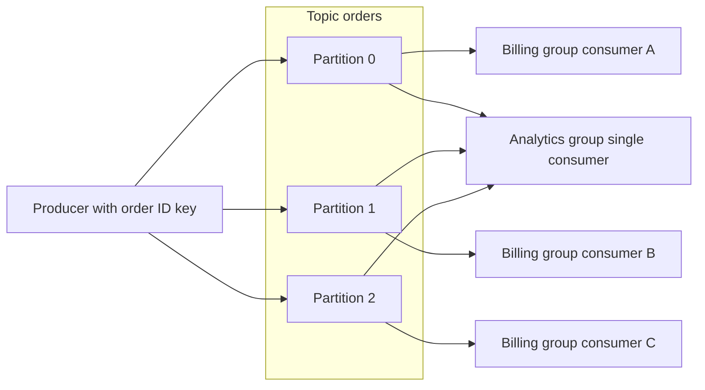

# Apache Kafka

!!! note "In simple words"
    Kafka keeps events in a long, ordered list. New events are added at the end, they stay for a set time, and every reader keeps its own bookmark. Readers never take events away from each other.

## Why it matters

Many systems need to pass along a stream of facts: an order was placed, a payment was captured, a page was viewed. Kafka stores those facts as an append-only log that is split into partitions. Reading a record does not delete it, so several teams can consume the same stream, replay older events, and work at their own speed.

Interviewers ask about Kafka to see whether you understand four things: partitions and the ordering they give, consumer groups and offsets, how delivery guarantees are built, and what "exactly once" really covers.

## How it works

### Core building blocks

- **Broker**: a Kafka server. It stores partitions and serves producers and consumers. A cluster is several brokers working together.
- **Topic**: a named stream of records, such as `orders`.
- **Partition**: an ordered, append-only log. It is the unit of storage, ordering, and parallelism. A topic has one or more partitions, spread across brokers.
- **Replica**: a copy of a partition on another broker. One replica is the leader that serves reads and writes. The others follow the leader.
- **Record**: a key, a value, headers, and a timestamp. The key normally decides which partition the record goes to.

Order is guaranteed only inside a single partition. Records with the same key go to the same partition, so they keep their relative order. Across partitions there is no global order.

Cluster metadata, meaning which brokers exist, which partitions exist, and which replica leads each partition, used to be stored in Apache ZooKeeper. Current releases run in KRaft mode, where a group of controllers keeps that metadata in a Raft-based log. Kafka 4.0 removed ZooKeeper support. Clients never read the metadata store directly, so this change mostly matters to operators. If a tutorial says to start ZooKeeper first, check which version it targets.

### Producers and keys

A producer chooses a partition by hashing the record key. A record with no key is spread across partitions in turn. Using an order ID as the key keeps all events for one order in one partition, in the order they were written.

The `acks` setting controls how much durability a send needs:

| `acks` | Meaning | Trade-off |
|---|---|---|
| `0` | Do not wait for the broker | Fastest, but data can be lost without any error |
| `1` | Wait for the leader to write | Data is lost if the leader fails before the copies catch up |
| `all` | Wait for all in-sync replicas | Strongest durability, with higher latency |

Turn on the idempotent producer (`enable.idempotence=true`). It stops retries from writing the same record twice into a partition. Transactions extend that protection to several writes at once, as covered in the delivery section.

### Consumer groups, partitions, and offsets

A consumer group is a set of consumers that share the partitions of a topic. Each partition is read by at most one consumer in a group at a time. Adding consumers raises parallelism up to the partition count, and any consumer beyond that count sits idle. Each group receives every record, so separate services can each read the full stream.



The diagram shows three rules. The key picks the partition. Inside one group, each partition belongs to one consumer. Different groups each read the whole topic, and each group keeps its own position.

An **offset** is a record's position inside a partition. Each group stores the offset of the next record it expects, for each partition. After a restart or a rebalance, the consumer resumes from the stored offset.

- **Auto-commit** saves offsets on a timer, whether or not processing worked. A crash can skip work or repeat it.
- **Manual commit** saves the offset only after processing succeeds. Paired with idempotent handling, this gives at-least-once behaviour.

A rebalance happens when a consumer joins, leaves, or stops responding. Partitions move to the remaining members. Work that is still in flight for a partition being taken away must finish or be abandoned safely.

### Delivery semantics

| Semantic | How it is achieved | Risk |
|---|---|---|
| At-most-once | Commit the offset before processing | Records are lost if processing fails |
| At-least-once | Process first, then commit | Duplicates after a crash, so consumers must be idempotent |
| Exactly-once | Idempotent producer, transactions, and read-process-write inside Kafka | Covers Kafka-to-Kafka work only; external effects such as a database write or an email are not included |

The honest answer in an interview is that most systems run with at-least-once delivery and idempotent consumers. Kafka's exactly-once support is real, but it applies to Kafka's own reads and writes. It does not make a database insert or an email happen only once.

### Replication, ISR, and retention

Each partition has a **replication factor**, which is the number of copies kept on different brokers. The leader replica takes writes. Replicas that have caught up with the leader form the **in-sync replica (ISR)** set. A replica that falls behind leaves the set and rejoins after it catches up.

`min.insync.replicas` sets how many replicas must hold a write before `acks=all` succeeds. With a replication factor of three and `min.insync.replicas=2`, one broker can fail without losing acknowledged writes. If too few replicas are in sync, the write fails instead of being accepted by a lone leader. A common production pairing is `acks=all` with `min.insync.replicas=2`.

Retention decides how long records are kept, whether or not they were read. Limits can be set by time (for example, seven days), by size per partition, or by both, and whichever limit is hit first applies. Retention is what makes replay possible. A consumer that starts later, or a brand-new group, can read from the start of the retained window.

### Compaction and tombstones

A topic with `cleanup.policy=compact` keeps the most recent record for each key and removes older ones. A record with a key and a null value is a **tombstone**: it tells compaction to delete that key. Compacted topics suit "current state" streams, such as the latest shipping address for each customer.

### Schema management

Producers and consumers change on their own schedules, so the message format needs a contract. Avro, Protobuf, and JSON Schema are common choices. A schema registry stores versions and checks compatibility rules, so a producer cannot publish a change that breaks existing consumers. Add optional fields instead of renaming or removing them, and keep consumers tolerant of unknown fields.

### Kafka Streams and Kafka Connect

Kafka Streams is a Java library for stateful stream processing, such as counts, joins, and time windows. It runs inside your application and keeps its state locally, backed up to changelog topics so it can recover. Kafka Connect moves data between Kafka and outside systems, such as databases and object storage, using configured connectors. You do not need to write custom consumer code for that.

### Spring for Apache Kafka

The following examples use Spring for Apache Kafka. They show the shape of the code and were not compiled here.

`KafkaTemplate` sends records, and `@KafkaListener` consumes them.

```java
import org.springframework.kafka.core.KafkaTemplate;
import org.springframework.stereotype.Service;

@Service
class OrderEventPublisher {

    private final KafkaTemplate<String, String> kafka;

    OrderEventPublisher(KafkaTemplate<String, String> kafka) {
        this.kafka = kafka;
    }

    void orderPlaced(String orderId, String payloadJson) {
        // The order ID is the key, so all events for one order share a partition and stay in order.
        kafka.send("orders", orderId, payloadJson);
    }
}
```

```java
import org.springframework.kafka.annotation.KafkaListener;
import org.springframework.kafka.support.Acknowledgment;
import org.springframework.stereotype.Component;

@Component
class BillingOrderListener {

    // Requires spring.kafka.listener.ack-mode=manual
    @KafkaListener(topics = "orders", groupId = "billing")
    void onOrder(String payloadJson, Acknowledgment ack) {
        process(payloadJson);   // must be idempotent
        ack.acknowledge();      // commit only after success
    }

    private void process(String payloadJson) {
        // record the event ID in a table first, and skip IDs that were already seen
    }
}
```

The `Acknowledgment` parameter works only when the listener runs in a manual acknowledgement mode. Set `spring.kafka.listener.ack-mode=manual` explicitly. Check the configured mode before relying on any default, because the container's default commit behaviour is not the same as manual acknowledgement.

### Error handling and dead-letter topics

If processing keeps failing, retrying forever blocks the whole partition. Spring Kafka's `DefaultErrorHandler` retries with a back-off. Once retries run out, a `DeadLetterPublishingRecoverer` publishes the failed record to a dead-letter topic (DLT). Spring Boot picks up a `CommonErrorHandler` bean automatically.

```java
import org.springframework.context.annotation.Bean;
import org.springframework.context.annotation.Configuration;
import org.springframework.kafka.core.KafkaOperations;
import org.springframework.kafka.listener.DeadLetterPublishingRecoverer;
import org.springframework.kafka.listener.DefaultErrorHandler;
import org.springframework.util.backoff.FixedBackOff;

@Configuration
class KafkaErrorConfig {

    @Bean
    DefaultErrorHandler errorHandler(KafkaOperations<?, ?> template) {
        DeadLetterPublishingRecoverer recoverer = new DeadLetterPublishingRecoverer(template);
        // Retry 3 times, one second apart, then publish to the DLT.
        return new DefaultErrorHandler(recoverer, new FixedBackOff(1_000L, 3L));
    }
}
```

Watch the DLT. Each record there needs a decision: fix the cause and replay it, or discard it and keep a note of why.

### Step by step

1. A producer serialises the record and picks a partition from its key.
2. The partition leader appends the record to its log. With `acks=all`, the write waits until the in-sync replicas have it.
3. Consumers in a group are assigned partitions. Each one reads from its committed offset.
4. After processing succeeds, the consumer commits its offset.
5. If processing fails, the error handler retries. If the record still cannot be processed, it goes to a DLT.

## Where it is used

- **Log and metrics aggregation**: many services write events, and analytics or monitoring systems read them.
- **Stream processing**: consumers compute counts, joins, and windows over a continuous feed.
- **Service integration**: services publish domain events that other teams subscribe to, with no direct call.
- **Event sourcing and CQRS**: the log is the record of every change, and read models are rebuilt from it.
- **Ingestion**: devices or partners send high volumes that are buffered and processed later.
- **Fraud and anomaly detection**: transactions are scored as they arrive.

In each case the requirements that matter most are throughput, retention, and replay, not just delivery.

## Benefits

- **High throughput**: appends are sequential writes, and many partitions can be written in parallel.
- **Replay**: a new consumer or a fixed bug can re-read history within the retention window.
- **Independent readers**: each consumer group keeps its own offsets, so teams do not interfere with each other.
- **Durability options**: replication and `acks=all` let you trade latency for safety.
- **Ordering where you need it**: a key gives per-entity order without a global lock.

## Cons and limits

- **No global order**: ordering holds only within one partition.
- **Partition count is hard to change**: adding partitions changes how keys map to partitions for new records, which can break per-key order for in-flight data.
- **Parallelism has a ceiling**: a group cannot usefully have more consumers than partitions.
- **Duplicates are normal**: at-least-once delivery means handlers must be idempotent.
- **Exactly-once has a boundary**: it covers Kafka's own reads and writes, not external side effects.
- **Operations are real work**: replication, disk sizing, retention tuning, and upgrades need an owner.
- **Poor fit for simple task queues**: a plain job queue with per-message acknowledgement and routing is simpler with a traditional broker.

### Kafka compared with RabbitMQ

| Aspect | Kafka | RabbitMQ |
|---|---|---|
| Model | Partitioned, append-only log | Queues fed by exchanges |
| Removal | Records stay for the retention window | Messages are removed once acknowledged |
| Several independent readers | Yes, each group keeps its own offset | Each message goes to one consumer; fan-out needs separate queues |
| Replay | Yes, within the retention window | No, once acknowledged |
| Scaling readers | More partitions and consumers in a group | More competing consumers on a queue |
| Ordering | Within a partition | In queue order, but competing consumers work concurrently |
| Routing | By topic and key | Flexible routing through exchange types and bindings |
| Protocol | Kafka binary protocol over TCP | AMQP 0-9-1 natively, with plugins for other protocols |

Choose Kafka for high-volume event streams that several consumers read or replay in their own way. Choose RabbitMQ for task queues, request-style messaging, and flexible routing rules. Some architectures use both for different kinds of traffic.

## Best practices

- **Pick keys with many distinct values.** A key with few values, such as a country code, sends most traffic to one partition.
- **Size partitions for the consumers you expect.** Leave headroom, because adding partitions later changes key mapping.
- **Use `acks=all` with `min.insync.replicas=2`** on a replication factor of three for important data.
- **Enable the idempotent producer** and make every consumer idempotent.
- **Commit offsets after processing**, not before, and never auto-commit slow work.
- **Send poison messages to a DLT** rather than retrying them forever.
- **Put schemas under a registry** and only allow compatible changes.
- **Alert on consumer lag**, not just on broker health.

### Troubleshooting common problems

| Symptom | Likely cause | What to do |
|---|---|---|
| A new consumer sees no messages | Its offset is at the end, or the reset policy is wrong | Check the group's committed offsets, and reset them on purpose if you need to replay |
| Consumers are busy but partitions are idle | Too few partitions for the consumer count | Add partitions (this changes key mapping for new records), then scale consumers |
| Messages lost after a broker failure | `acks=1`, or `acks=all` without enough in-sync replicas | Use `acks=all` with `min.insync.replicas=2` on a replication factor of three |
| Duplicates appear | Retries after a timeout, or a restart before the commit | Enable the idempotent producer and make the consumer idempotent |
| Consumer lag keeps growing | Processing is slower than arrival | Profile the handler, batch database writes, and add consumers up to the partition count |
| Consumer memory pressure | Very large batches or fetch sizes | Lower `max.poll.records` or the fetch limits, and process smaller batches |

!!! tip "Interview tip"
    **Q: How does Kafka guarantee order?**
    Only within a partition. Records with the same key go to the same partition, so events for one entity stay in order. Order across different keys needs a single partition, which limits throughput. Most designs avoid that by making sure the consumer does not depend on cross-entity order.

## Common pitfalls

- Using a key with few distinct values, so one partition gets most of the traffic.
- Expecting global ordering across partitions.
- Running more consumers than partitions and wondering why some sit idle.
- Auto-committing offsets while processing is slow, so a crash loses work.
- Retrying a poison message forever, which stalls the whole partition.
- Assuming "exactly once" means an external database write happens once.
- Changing a record schema in a way that old consumers cannot read.

## Quick recap

- Topics are split into partitions, and order holds only within a partition.
- A consumer group shares partitions; parallelism is capped by the partition count.
- Offsets and the commit strategy decide between at-most-once and at-least-once delivery.
- Use `acks=all`, `min.insync.replicas`, and the idempotent producer for durable writes without duplicates.
- Route poison messages to a dead-letter topic instead of retrying forever.

## Official documentation

- [Apache Kafka documentation](https://kafka.apache.org/documentation/)
- [Spring for Apache Kafka reference](https://docs.spring.io/spring-kafka/reference/index.html)

**See also:** [RabbitMQ](rabbitmq.md) | [Event-Driven Architecture](event-driven-architecture.md) | [Integration Testing](../11-testing/integration-testing.md)
