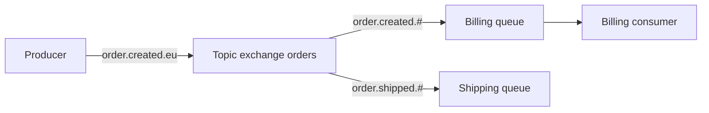

# RabbitMQ

!!! note "In simple words"
    RabbitMQ is a post office for messages. A sender drops a letter at a sorting desk (an exchange), the desk puts copies into mailboxes (queues) based on rules, and a worker takes a letter out and confirms it was handled. Once confirmed, the letter is gone.

## Why it matters

Services often need to hand off work without waiting for the other side to finish. RabbitMQ holds those messages until a consumer is ready, and it can route them by rules, retry failed ones, and send hopeless ones to a side queue. It implements AMQP 0-9-1 and supports other protocols through plugins.

Interviewers ask about RabbitMQ to check whether you can design routing, handle failures with acknowledgements and dead-letter exchanges, and know when a log-based system such as Kafka is the better fit.

## How it works

### The AMQP model

- **Producer**: publishes a message to an exchange, with a routing key.
- **Exchange**: receives messages and routes them to queues. It does not store messages.
- **Binding**: a rule that links an exchange to a queue, with an optional binding key or pattern.
- **Queue**: stores messages until a consumer takes them and acknowledges them.
- **Consumer**: reads messages from a queue.



A message leaves the queue when it is acknowledged. That is the main difference from Kafka, where a record stays in the log for the retention period.

### Exchange types

| Type | Routing rule |
|---|---|
| Direct | The routing key must equal the binding key exactly |
| Topic | The routing key matches a pattern, where `*` is one word and `#` is zero or more words |
| Fanout | Copies go to every bound queue, and the routing key is ignored |
| Headers | Matching uses header values instead of the routing key |

With a topic exchange and the binding `order.created.#`, the messages `order.created.eu` and `order.created.eu.priority` reach the queue, but `order.shipped.eu` does not.

### Acknowledgements, nack, and prefetch

- **Auto-ack**: the broker treats a message as delivered as soon as it is sent. If the consumer crashes, the message is lost.
- **Manual ack**: the consumer acknowledges after processing. If the consumer dies first, the broker redelivers the message.
- **Nack or reject**: the consumer refuses the message. With `requeue=true` it returns to the queue, which can loop forever on a poison message. With `requeue=false` it is dropped, or sent to a dead-letter exchange if one is set.

Limit the prefetch count (QoS) so that one slow consumer does not hold a large batch of unacknowledged messages.

### Message TTL and queue limits

A per-queue TTL (`x-message-ttl`) expires messages that wait too long. `x-max-length` caps the queue depth. When a queue is full, the broker either drops messages from the head or rejects new ones, depending on configuration. Set these limits on purpose. An unbounded queue hides a consumer that has stopped, until memory runs out.

### Dead-letter exchanges

A dead-letter exchange (DLX) receives messages that are rejected without requeue, expire because of their TTL, or overflow a queue. Set it on a queue with the `x-dead-letter-exchange` argument. A dead-letter queue bound to that exchange holds the failed messages for inspection or replay. A topic DLX with no bindings would discard them, so always bind a queue to it.

### Publisher confirms and returns

Publisher confirms tell the producer that the broker has accepted a message. Without them, a publish can be lost if the broker fails before saving it. Spring AMQP supports correlated confirms through `spring.rabbitmq.publisher-confirm-type=correlated`.

### RPC over RabbitMQ

RPC uses a request queue and a reply queue. The client sets `reply-to` and a `correlation-id`. The server answers on the reply queue, and the client matches each answer by its correlation ID. This works, but a synchronous call over a broker adds latency and coupling. For request-response, prefer HTTP or gRPC unless you need the broker's routing or buffering.

### Spring AMQP

The following examples use Spring AMQP. They show the shape of the code and were not compiled here.

Declare exchanges, queues, and bindings as beans, and `RabbitAdmin` creates them at startup. This topology includes a dead-letter queue, so failed messages are kept.

```java
import org.springframework.amqp.core.Binding;
import org.springframework.amqp.core.BindingBuilder;
import org.springframework.amqp.core.Queue;
import org.springframework.amqp.core.QueueBuilder;
import org.springframework.amqp.core.TopicExchange;
import org.springframework.context.annotation.Bean;
import org.springframework.context.annotation.Configuration;

@Configuration
class RabbitTopology {

    static final String EXCHANGE = "orders.exchange";
    static final String DLX = "orders.dlx";
    static final String QUEUE = "billing.orders";
    static final String DLQ = "billing.orders.dlq";

    @Bean
    TopicExchange ordersExchange() {
        return new TopicExchange(EXCHANGE);
    }

    @Bean
    TopicExchange deadLetterExchange() {
        return new TopicExchange(DLX);
    }

    @Bean
    Queue billingQueue() {
        return QueueBuilder.durable(QUEUE)
                .withArgument("x-dead-letter-exchange", DLX)
                .build();
    }

    @Bean
    Queue deadLetterQueue() {
        return QueueBuilder.durable(DLQ).build();
    }

    @Bean
    Binding billingBinding(Queue billingQueue, TopicExchange ordersExchange) {
        return BindingBuilder.bind(billingQueue).to(ordersExchange).with("order.created.#");
    }

    @Bean
    Binding deadLetterBinding(Queue deadLetterQueue, TopicExchange deadLetterExchange) {
        // "#" matches every routing key, so every dead-lettered message reaches the DLQ.
        return BindingBuilder.bind(deadLetterQueue).to(deadLetterExchange).with("#");
    }
}
```

`RabbitTemplate` publishes, and `@RabbitListener` consumes.

```java
import org.springframework.amqp.rabbit.core.RabbitTemplate;
import org.springframework.stereotype.Service;

@Service
class OrderPublisher {

    private final RabbitTemplate rabbit;

    OrderPublisher(RabbitTemplate rabbit) {
        this.rabbit = rabbit;
    }

    void created(String region, String payloadJson) {
        rabbit.convertAndSend(RabbitTopology.EXCHANGE, "order.created." + region, payloadJson);
    }
}
```

```java
import org.springframework.amqp.AmqpRejectAndDontRequeueException;
import org.springframework.amqp.rabbit.annotation.RabbitListener;
import org.springframework.stereotype.Component;

@Component
class BillingListener {

    @RabbitListener(queues = RabbitTopology.QUEUE)
    void handle(String payloadJson) {
        try {
            process(payloadJson);
        } catch (IllegalArgumentException invalid) {
            // A message that can never succeed must not be requeued. Send it to the DLX.
            throw new AmqpRejectAndDontRequeueException("invalid payload", invalid);
        }
    }

    private void process(String payloadJson) {
        if (payloadJson == null || payloadJson.isBlank()) {
            throw new IllegalArgumentException("empty payload");
        }
    }
}
```

For explicit acknowledgements, set `spring.rabbitmq.listener.simple.acknowledge-mode=manual` and acknowledge in the listener. In the default auto mode, Spring acknowledges when the listener method returns normally, and it rejects when the method throws.

### Step by step

1. The producer publishes to an exchange with a routing key.
2. The exchange checks its bindings and copies the message to each matching queue.
3. A consumer receives the message, with a delivery tag, and processes it.
4. On success, the consumer acknowledges, and the broker removes the message.
5. If the message is rejected or expires, the broker moves it to the DLX, when one is configured.

## Where it is used

- **Background jobs**: a web request queues an email or a report, and a worker pool handles it.
- **Work distribution**: several workers compete for tasks from one queue, and each task runs once.
- **Routing by rule**: messages are sent to regional or priority queues based on their routing key or headers.
- **Request-reply over messaging**: a caller sends a request and waits on a reply queue.
- **Buffering between systems**: a slow external system is shielded by a queue in front of it.

## Benefits

- **Flexible routing**: exchange types and bindings express rules that a plain queue cannot.
- **Per-message acknowledgement**: a crashed consumer's messages are redelivered.
- **Built-in failure handling**: dead-letter exchanges, TTLs, and requeue choices cover many failure paths.
- **Simple mental model**: messages are removed once handled, so queue depth reflects pending work.
- **Mature tooling**: management UI, metrics, and client libraries for many languages.

## Cons and limits

- **No replay**: once acknowledged, a message is gone. Keep an archive or use a log-based system when you need replay.
- **Queues can grow**: without TTLs or length limits, a stopped consumer hides the problem until the broker runs out of resources.
- **Redelivery can loop**: a poison message requeued forever wastes capacity.
- **Competing consumers lose order**: with several consumers on one queue, processing order is not guaranteed.
- **Publisher confirms add latency**: they make publishing safer but slower.
- **Not built for huge event streams**: very high throughput with long retention fits a log better.

## Best practices

- **Acknowledge after processing** and reject without requeue when a message can never succeed.
- **Set a dead-letter exchange and bind a queue to it**, so failures are kept for review.
- **Bound every queue** with a TTL or a length limit, and alert on queue depth.
- **Limit prefetch** so one consumer does not hoard messages.
- **Use publisher confirms** when losing a message is not acceptable.
- **Keep patterns narrow.** A broad topic pattern delivers messages to queues that should not receive them.
- **Make consumers idempotent**, because redelivery is normal.

!!! tip "Interview tip"
    **Q: When would you choose RabbitMQ over Kafka?**
    When you need flexible routing (topic, header, or fanout rules), per-message acknowledgement and retry, and work queues where each message is handled by one consumer and then removed. Kafka suits high-throughput event logs that many consumers read or replay in their own way.

## Common pitfalls

- Auto-acknowledging work that can fail, so a crash silently drops messages.
- Requeuing a poison message, which causes a tight redelivery loop.
- Unbounded queues with no TTL or length limit, which hide an offline consumer.
- Publishing without confirms, then assuming the broker accepted the message.
- Using a topic exchange with overly broad patterns.
- Using RabbitMQ for replay needs. Acknowledged messages cannot be read again.

## Quick recap

- Producers publish to exchanges, and bindings route messages to queues.
- Exchange types (direct, topic, fanout, headers) define the routing rules.
- Acknowledge after processing, and reject without requeue to avoid poison loops.
- Dead-letter exchanges capture failed, expired, and overflowing messages.
- Publisher confirms tell the producer that the broker accepted the message.

## Official documentation

- [RabbitMQ AMQP concepts tutorial](https://www.rabbitmq.com/tutorials/amqp-concepts.html)
- [Spring AMQP reference](https://docs.spring.io/spring-amqp/reference/index.html)

**See also:** [Apache Kafka](kafka.md) | [Event-Driven Architecture](event-driven-architecture.md) | [Integration Testing](../11-testing/integration-testing.md)
