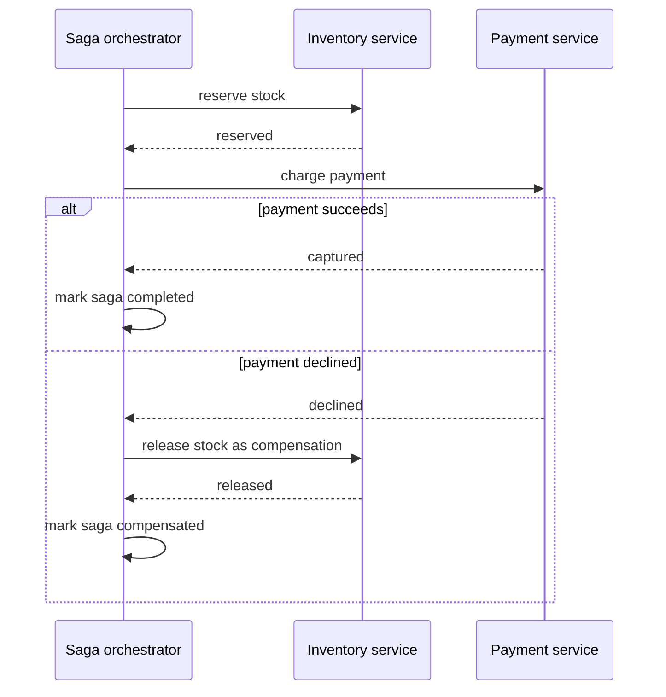

# Distributed Transactions

!!! note "In simple words"
    When one business action changes data in several services, a single database transaction cannot cover all of it. Instead, each service makes its own change, and if a later step fails, the earlier steps are undone by new actions. This undo-by-action approach is called a saga.

## Why it matters

Placing an order might reserve stock, charge a card, and create a shipment, each in a different service with its own database. If the charge fails after the stock was reserved, the system must not be left half done. Distributed transactions are the approaches for keeping that data consistent. The two main ones are the classic two-phase commit (2PC) and the saga pattern.

Interviewers ask about this because it is one of the hardest parts of microservices. The answer is always a trade-off between consistency, availability, and complexity.

## How it works

### CAP theorem and eventual consistency

The CAP theorem says that during a network partition, a distributed system must choose between consistency (every read sees the latest write) and availability (every request gets a response). Partitions happen, so the real question is what the system does when one occurs. PACELC extends the idea. Even with no partition, there is a trade-off between latency and consistency.

Most microservice systems accept **eventual consistency**: after a change, the other services converge on the new state within an acceptable time. This is a business decision. Ask how stale each piece of data may be.

### Two-phase commit

2PC coordinates one transaction across several resources in two phases:

1. **Prepare**: the coordinator asks each participant whether it can commit. Participants lock their resources and vote yes or no.
2. **Commit or abort**: if every participant voted yes, the coordinator tells all of them to commit. Otherwise it tells all of them to abort.

Its limits explain why microservices avoid it:

- Participants hold locks while the protocol runs, so throughput drops and contention rises.
- The coordinator is a single point of failure. If it fails after the prepare phase, participants can wait with their locks held.
- Many modern systems, including NoSQL stores, message brokers, and many cloud services, do not offer the XA interface that 2PC needs.
- Latency grows with every participant and every network round trip.

JTA (Jakarta Transactions) and XA support exist for legacy cases. They are rarely the right answer for new services.

### The saga pattern

A saga breaks a business transaction into local transactions, one per service. Each step commits locally and then publishes an event or returns a result. If a later step fails, the saga runs **compensating transactions** for the steps already completed. A compensation is a new business action that undoes an effect, such as refunding a payment. It cannot always restore the exact earlier state. An email that was already sent cannot be unsent.



The diagram shows an orchestrated saga. The orchestrator moves the process forward one step at a time. When the charge is declined, it calls the compensation for the completed stock reservation, and then records the saga as compensated.

There are two ways to coordinate a saga:

- **Choreography**: services react to each other's events. The order service publishes `OrderCreated`. Inventory reserves stock and publishes `StockReserved`. Payment charges the card and publishes `PaymentCaptured`. If the payment fails, inventory listens for the failure event and releases the stock. This is simple for short flows, but the whole process is spread across services and harder to follow.
- **Orchestration**: a saga orchestrator sends commands to each participant and tracks the state. The flow is explicit and easier to change and observe. The orchestrator itself must be designed, stored durably, and kept available.

The following Java 21 sketch shows the shape of an orchestrated saga. It compiles as written, but the step methods are stubs.

```java
import java.util.UUID;

class CheckoutSaga {

    void execute(UUID orderId, long amountCents) {
        reserveStock(orderId);
        try {
            charge(orderId, amountCents);
        } catch (RuntimeException failure) {
            releaseStock(orderId);   // compensation for the step that already completed
            throw failure;
        }
    }

    private void reserveStock(UUID orderId) {
        // call the inventory service; the call must be idempotent
    }

    private void charge(UUID orderId, long amountCents) {
        // call the payment provider; the call must be idempotent
    }

    private void releaseStock(UUID orderId) {
        // compensation; it must be idempotent and safe to retry
    }
}
```

The orchestrator must store its progress. If it crashes in the middle, it resumes or compensates from where it stopped. It must not start over and repeat the steps that already ran.

### Compensations and their limits

A compensation can run more than once, so it must be idempotent. It should also be retried until it succeeds. That usually means a durable state machine or message retries drive it. Some steps cannot be undone. A shipment that has already left the warehouse is one example. The design should mark such a step as a **pivot**. After the pivot, the saga only moves forward, with retries, and never rolls back.

### Idempotency and deduplication

Any step or compensation in a saga can run more than once, because messages are redelivered and requests are retried. Use an idempotency key, such as the saga ID plus the step name, and store it with the result. Repeated calls then return the same outcome. Payment providers offer the same idea through an idempotency key header, which prevents double charges. For the processed-events table and the transactional outbox, see [Event-Driven Architecture](../13-messaging/event-driven-architecture.md).

### Choosing an approach

| Option | Consistency | Availability | Complexity | Typical use |
|---|---|---|---|---|
| Single local transaction | Strong | Depends on one database | Low | Everything in one service |
| Two-phase commit | Strong across resources | Reduced during failures | High operational risk | Legacy systems, few resources, XA-capable stores |
| Saga (choreography) | Eventual | High | Medium, spread out | Short flows across few services |
| Saga (orchestration) | Eventual | High | Medium, centralised | Longer flows, complex rules |

### Saga state and timeouts

The orchestrator needs durable state. A minimal table records each saga instance and the step where it stopped. The table below is standard SQL.

```sql
CREATE TABLE saga_instance (
    saga_id      UUID PRIMARY KEY,
    saga_type    VARCHAR(64)  NOT NULL,
    current_step VARCHAR(64)  NOT NULL,
    status       VARCHAR(16)  NOT NULL,  -- RUNNING, COMPLETED, COMPENSATING, FAILED
    deadline_at  TIMESTAMP    NOT NULL,
    updated_at   TIMESTAMP    NOT NULL
);
```

Each step updates this row in the same local transaction as its business change, so the recorded state and the real effect cannot disagree. A scheduled job, often called a sweeper, looks for sagas that are `RUNNING` or `COMPENSATING` past their `deadline_at`. It retries the current step if that is safe, or starts compensation if it is not. Without a sweeper, a lost message leaves a saga stuck forever, and nobody notices.

Each step should also have its own timeout. A step that does not answer within its budget counts as a failure, so the saga retries or compensates instead of holding resources open.

Saga status is also a product feature. Show it to support staff and, where it makes sense, to users, for example as "payment pending". That way people can see what is happening while the system converges.

## Where it is used

- **Checkout flows** that reserve stock, take payment, and create a shipment in separate services.
- **Travel bookings** that hold a seat, a room, and a car, and release them together if one fails.
- **Account onboarding** that creates a user, a wallet, and a welcome record across services.
- **Money movement between ledgers**, where each side is a separate service and compensations post reversing entries.

## Benefits

- **No cross-service locks**: each step commits locally, so nothing waits on a remote lock.
- **High availability**: services keep working when one participant is down.
- **Explicit failure handling**: every step has a planned undo, so failures are designed for rather than hoped away.
- **Visibility**: with an orchestrator, the state of each business process is stored in one place.

## Cons and limits

- **Eventual consistency**: other services can see intermediate states.
- **Compensations are not perfect undo**: a sent email or a shipped parcel cannot be fully reversed.
- **More code**: every step needs a compensation, idempotency, and a timeout.
- **Orchestrator is critical**: it must be designed, stored durably, and kept available.
- **Debugging is harder**: a failure may appear in one service while its cause is in another.
- **Choreography gets tangled** as the number of steps and services grows.

## Best practices

- **Model the process as steps**, each with a compensation, or with a marker that it is a pivot.
- **Give each step an idempotency key** and make it safe to repeat.
- **Run each step as a local transaction**, and publish the outcome through an outbox.
- **Run compensations in reverse order**, and retry them until they succeed.
- **Persist saga state**, and run a sweeper for stuck sagas.
- **Expose saga status** to support teams and, where useful, to users.
- **Avoid sagas when one service can own the data and the transaction.**

!!! tip "Interview tip"
    **Q: How do you keep order and payment consistent across services?**
    Use a saga. The order is created as pending, a payment step runs in its own local transaction, and each step has a compensation. If the payment is declined, the order is cancelled. The steps are idempotent, the saga state is persisted, and events go out through an outbox. Say that the system is eventually consistent, and say what the user sees while the order is pending.

## Common pitfalls

- Using 2PC across microservices because it looks like a normal transaction.
- Running sagas without persisted state, so a crash loses track of which steps ran.
- Writing compensations that are not idempotent, or that assume the original step's exact result.
- Ignoring the window in which other services see intermediate states.
- Dual writes, where the database is updated and then an event is published, without an outbox.
- Saga steps with no timeout, so one stuck participant holds the whole process open.
- Using sagas where a single service could own the data and the transaction.

## Quick recap

- CAP is about what happens during partitions. Most microservice systems choose eventual consistency.
- 2PC gives strong consistency, but it blocks resources and adds a coordinator failure mode.
- Sagas use local transactions and compensations, with choreography or orchestration.
- Make every step and compensation idempotent, and persist the saga state.
- Avoid distributed transactions unless the data truly has to live in one place.

## Official documentation

- [microservices.io: Saga pattern](https://microservices.io/patterns/data/saga.html)
- [Martin Fowler: Microservices](https://martinfowler.com/articles/microservices.html)

**See also:** [Event-Driven Architecture](../13-messaging/event-driven-architecture.md) | [Microservices Fundamentals](microservices-fundamentals.md) | [Databases and SQL](../06-databases-sql/index.md)
