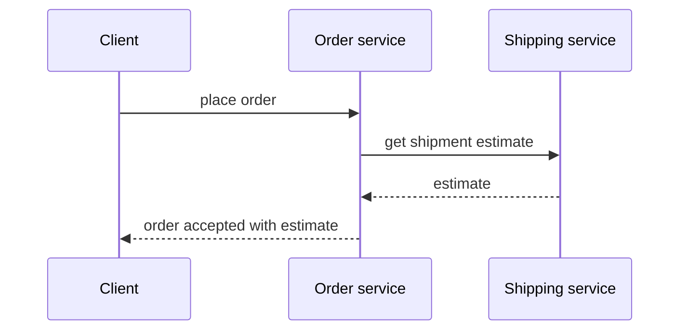
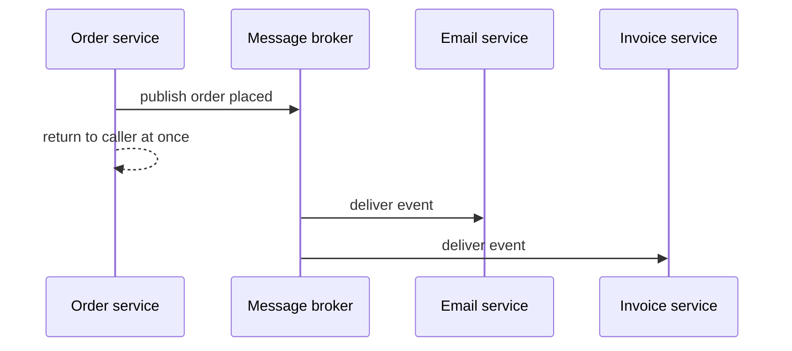

# Inter-Service Communication

!!! note "In simple words"
    Services talk in one of two ways. Either a caller asks and waits for an answer, or it leaves a message and goes on with its work. Pick the waiting style only when the caller truly needs the answer right away.

## Why it matters

Each call between services is a network call, and any of them can be slow, fail, or change shape. The style you pick decides how much one service's problems spread to the others. You also need a way to secure the calls and to change an API without breaking its callers.

Interviewers ask about this to see whether you choose a style for a reason, and whether you can keep callers working when the provider changes.

## How it works

### Synchronous styles

| Style | Strengths | Trade-offs |
|---|---|---|
| REST over HTTP | Universal, easy to debug, cache-friendly for reads | Text payloads, and loose contracts unless they are documented |
| gRPC | Binary Protocol Buffers, typed contracts, streaming, deadlines | Less convenient from browsers, and needs generated code |
| GraphQL | Clients ask for exactly the fields they need, through one endpoint | Caching and authorisation are harder, and query cost must be controlled |

A synchronous call ties the availability of two services together. If the callee is down, the caller fails unless it has a fallback. Keep the number of synchronous hops in one user request small.

REST is the default for most services. Choose gRPC for internal, high-volume, or streaming traffic where typed contracts matter. Choose GraphQL when a client combines many resources and the team can manage the cost of queries.



### Asynchronous styles

Messaging, through Kafka, RabbitMQ, or a cloud queue such as AWS SQS, decouples the producer from the consumer in time. The producer does not wait for the consumer, and the consumer works at its own pace. This absorbs traffic spikes and survives short outages. The costs are eventual consistency and the need for idempotent consumers (see [Event-Driven Architecture](../13-messaging/event-driven-architecture.md)).



Use asynchronous messages for notifications and workflows that do not need an immediate answer. Use synchronous calls when the caller needs the result to continue.

### Service-to-service security

Traffic between services must be authenticated and encrypted, even inside a private network.

- **Mutual TLS (mTLS)**: both sides present certificates, so each one knows the other's identity. Service meshes and internal certificate authorities often manage this.
- **Token propagation**: the caller forwards the end user's JWT, so the downstream service can check what the user may do. When no user is involved, the caller uses its own identity through the OAuth 2.0 client credentials grant.
- **Least privilege**: each service accepts calls only from the services that actually need them.

Do not trust a request just because it comes from inside the network. Forwarding a token without checks can also let a downstream service accept requests the user should not make, so check the audience and scopes at each hop.

The following example uses Spring WebFlux. It was not compiled here.

```java
import org.springframework.stereotype.Service;
import org.springframework.web.reactive.function.client.WebClient;
import reactor.core.publisher.Mono;

@Service
class ShipmentClient {

    private final WebClient web;

    ShipmentClient(WebClient.Builder builder) {
        // The host name is resolved by service discovery or Kubernetes DNS.
        this.web = builder.baseUrl("http://shipping-service").build();
    }

    // Forward the caller's bearer token, so shipping can authorise the same user.
    Mono<String> status(String shipmentId, String bearerToken) {
        return web.get()
                .uri("/shipments/{id}", shipmentId)
                .headers(h -> h.setBearerAuth(bearerToken))
                .retrieve()
                .bodyToMono(String.class);
    }
}
```

### API versioning and backward compatibility

Consumers deploy on their own schedules, so a provider change must not break them. These changes are backward compatible:

- Adding optional fields
- Adding endpoints
- Adding optional request parameters

These changes break callers:

- Removing or renaming fields
- Changing a type or the meaning of a field
- Making an optional input required

When a break is unavoidable:

- **Version the API.** Put the version in the path, such as `/v2/`, or in a header or media type. Path versioning is the easiest to see and to route.
- **Run old and new versions side by side** for a stated deprecation period.
- **Use expand and contract.** Add the new field, move callers to it, then remove the old one.
- **Use consumer-driven contract tests**, so the provider learns what its consumers depend on (see [API Testing and Code Coverage](../11-testing/api-testing-and-coverage.md)).

Tolerant readers ignore fields they do not know. Consumers that fail on new fields force providers to coordinate every single change.

### Versioned endpoints in practice

Suppose a shipment response needs a `carrier` field. Adding a field is backward compatible for tolerant readers, so version 1 can keep its shape and simply gain the field. Splitting `status` into two fields is a breaking change, so it needs a new version:

```java
import org.springframework.web.bind.annotation.GetMapping;
import org.springframework.web.bind.annotation.PathVariable;
import org.springframework.web.bind.annotation.RestController;

record ShipmentV1(String id, String status) {}

record ShipmentV2(String id, String state, String substate, String carrier) {}

@RestController
class ShipmentApi {

    @GetMapping("/v1/shipments/{id}")
    ShipmentV1 getV1(@PathVariable String id) {
        return new ShipmentV1(id, "IN_TRANSIT");
    }

    @GetMapping("/v2/shipments/{id}")
    ShipmentV2 getV2(@PathVariable String id) {
        return new ShipmentV2(id, "IN_TRANSIT", "WITH_CARRIER", "carrier-x");
    }
}
```

This Spring example was not compiled here. Both versions can share the same service logic and differ only in how they map to their response types. Keep the version 1 mapping stable until the deprecation date you announced. Make the deprecation visible in responses, for example with a `Deprecation` header, and in the documentation. Removing a version is itself a breaking change, so it needs the same coordination as a release.

### Choosing a style for a call

Ask four questions:

1. Does the caller need the answer to continue? If yes, use a synchronous call.
2. Can the callee be unavailable for a while? If yes, use messaging.
3. Is the traffic high or latency-sensitive? Consider gRPC.
4. Does a user-facing client need flexible queries? Consider GraphQL at the edge.

### Step by step

1. The caller chooses a style, using the questions above.
2. For a synchronous call, the request carries credentials (a token or an mTLS identity), a timeout, and a trace ID.
3. The callee authorises the request, does the work, and responds. The caller handles errors and fallbacks.
4. For an asynchronous call, the producer publishes an event, and consumers process it later, idempotently.
5. When an API changes, the team checks compatibility, adds a version if needed, and removes old behaviour only after callers have moved.

## Where it is used

- **Checkout flows** that need a price or stock answer before the order can be accepted.
- **Notifications** such as emails or push messages sent after an order, which do not need to block the order.
- **Internal high-volume calls** where gRPC's typed, binary protocol saves bandwidth and time.
- **Mobile and web backends** that combine several services into one response, often through GraphQL or a gateway.

## Benefits

- **Right tool per call**: synchronous calls give immediate answers, and messaging gives resilience and decoupling.
- **Clear contracts**: typed or documented APIs make changes visible.
- **Fault containment**: asynchronous work keeps a slow consumer from stalling its producer.
- **Safer evolution**: versioning and expand-and-contract let providers change without an outage.

## Cons and limits

- **Synchronous chains are fragile**: each extra hop adds latency and another point of failure.
- **Messaging adds eventual consistency**: callers must handle answers that arrive later, if at all.
- **Security adds work**: mTLS, token checks, and audience rules all need management.
- **Versioning costs maintenance**: every supported version must be tested and kept running.
- **GraphQL and gRPC bring their own limits**: caching, tooling, and browser support need extra effort.

## Best practices

- **Set a timeout on every remote call**, and keep the total of the hops in a user request small.
- **Make writes idempotent**, so a retry after a timeout does not repeat the effect.
- **Pass the trace ID and credentials on every call.**
- **Check the audience and scopes of forwarded tokens** at every hop.
- **Make changes backward compatible by default**, and version only when you must break a contract.
- **Write consumer-driven contract tests** for APIs that many teams depend on.
- **Be tolerant when reading responses**, so new fields do not break you.

!!! tip "Interview tip"
    **Q: REST or messaging between two services?**
    Use REST when the caller needs an immediate answer to continue, such as a price lookup during checkout. Use messaging when the caller only needs to announce a fact or start work, such as sending a confirmation email after an order. Many systems use both, and the choice should follow the business need, not the tool.

## Common pitfalls

- Long chains of synchronous calls, where one user request waits on five services.
- Calling services without timeouts, or retrying calls that are not safe to repeat.
- Forwarding user tokens to services that should not receive them, or without checking the audience.
- Trusting internal traffic only because of its network location.
- Breaking consumers by renaming a field, with no deprecation period.
- Choosing gRPC or GraphQL because they are fashionable, when REST already meets the need.
- Versioning every small change, which multiplies maintenance work.

## Quick recap

- Synchronous styles (REST, gRPC, GraphQL) fit immediate answers. Messaging fits decoupled work.
- Secure service-to-service traffic with mTLS or forwarded, audience-checked tokens.
- Make backward-compatible changes by default. Use versioning and expand-and-contract for breaking ones.
- Keep synchronous hops per request small, and always set timeouts.
- Choose the style for each call based on whether the caller needs the answer now.

## Official documentation

- [RFC 9110: HTTP Semantics](https://www.rfc-editor.org/rfc/rfc9110)
- [OpenAPI Specification](https://spec.openapis.org/oas/latest.html)
- [Spring Framework reference](https://docs.spring.io/spring-framework/reference/)

**See also:** [Resilience Patterns](resilience-patterns.md) | [Authentication: JWT, OAuth 2.0, and OpenID Connect](../10-security/authentication-jwt-oauth.md) | [Apache Kafka](../13-messaging/kafka.md)
