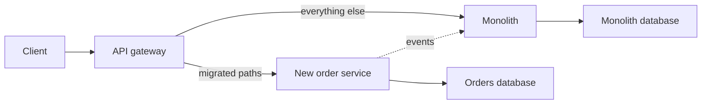

# Microservices Fundamentals

!!! note "In simple words"
    A microservice is a small program that does one business job, such as taking payments, and owns its own data. Each one is deployed by itself, and a team looks after it from start to finish.

## Why it matters

Microservices are as much about teams as about code. When each team owns a service end to end, it can release without waiting for others. The architecture also brings real costs: network calls can fail, data is spread across stores, and one user action may cross many processes.

Interviewers ask about microservices to test whether you know where to draw service boundaries, why each service should own its database, when a monolith is the better answer, and how to observe a system spread across many processes.

## How it works

### Decomposition and bounded contexts

Domain-Driven Design gives a practical way to find boundaries. A **bounded context** is an area of the business where a model and its words have one consistent meaning. "Order" in sales means a cart with prices. "Order" in shipping means a parcel with dimensions. Those are two different models, so each belongs in its own context, with its own service.

Common ways to decompose a system:

- By business capability, such as billing, inventory, or shipping
- By subdomain, separating the core differentiators from supporting and generic areas
- By data ownership, where one service is the authority for a piece of data
- By change frequency, where parts that change together stay together

A good boundary keeps related changes inside one service. If a single feature needs edits in four services at the same time, the boundary is probably wrong.

### Database per service

Each service owns its data store and exposes that data only through its API or its events. Other services never read its tables. This keeps services deployable on their own and lets each team pick a suitable store. The cost is that queries across services need API calls, events, or a read model, and transactions cannot easily span services (see [Distributed Transactions](distributed-transactions.md)).

Sharing one database between services is the most common way a "microservice" system turns into a distributed monolith. The services look separate but cannot change independently.

### Monolith versus microservices

| Factor | Monolith | Microservices |
|---|---|---|
| Deployment | One unit | Many units, each deployed on its own |
| Consistency | Local transactions | Eventual consistency across services |
| Operations | Simpler | Needs discovery, tracing, and more automation |
| Team scaling | Coordination cost grows with team size | Teams can own services |
| Latency | In-process calls | Network calls that can fail |

A well-structured **modular monolith** is often the right starting point. Split a module into a service when there is a clear reason, such as independent scaling, a separate release cadence, a separate team, or a different technology need. Splitting too early pays the costs without the benefits.

### Observability

A request in a microservice system crosses several processes, so three kinds of signal are needed to follow it:

- **Logs**: centralised, structured, and tagged with a trace ID. The ELK stack (Elasticsearch, Logstash, Kibana) is a common choice, and other log platforms work too.
- **Metrics**: counters, gauges, and histograms for each service. Prometheus collects them and Grafana draws them. Spring Boot uses Micrometer to record them (see [Actuator and API Documentation](../09-spring-boot/actuator-and-api-docs.md)).
- **Traces**: the path of one request across services, with timing for each hop. Zipkin and Jaeger store and display traces. OpenTelemetry is the vendor-neutral standard for producing them.

Health checks tell an orchestrator whether an instance is alive and ready for traffic. Commercial application performance monitoring (APM) products combine these signals into one view.

Good observability needs consistent identifiers. Pass a trace ID and a correlation ID through every call and every log line, so one request can be followed from the edge to the database. For a deeper look, see [Observability](../20-observability/index.md).

### Context relationships and anti-corruption layers

Bounded contexts rarely stand alone. A **context map** shows how they relate. An upstream context publishes a model that a downstream context depends on. When the downstream model should not take its shape from someone else's model, place an **anti-corruption layer (ACL)** between them. The ACL is a small translator that converts the external model into your own.

```java
// The shipping context's own model. Partner terms do not leak into it.
record Shipment(String shipmentId, String destinationCountry) {}

// The partner's response shape. It belongs to someone else and may change.
record PartnerShipmentDto(String ref, String countryIsoCode) {}

// The anti-corruption layer: the only class that knows both shapes.
class PartnerShipmentTranslator {

    Shipment toDomain(PartnerShipmentDto dto) {
        return new Shipment(dto.ref(), dto.countryIsoCode());
    }
}
```

Other relationships you may be asked about:

- **Customer and supplier**: the upstream team plans its work around the downstream team's needs.
- **Conformist**: the downstream team adopts the upstream model as it is.
- **Shared kernel**: two teams share a small, jointly owned model, which needs close coordination.

### Migrating from a monolith

Rewriting a whole system at once is risky. The **strangler fig** approach moves one capability at a time:

1. Put a routing layer, such as an API gateway, in front of the monolith.
2. Pick one capability with clear boundaries and build it as a service.
3. Send only that capability's traffic to the new service. The rest stays on the monolith.
4. Keep data in step while both exist, through events or a temporary read model. Decide which side owns the data.
5. When the new service is trusted, remove the old code path, then repeat for the next capability.



The hardest step is data ownership. Moving code is usually easier than moving the tables it depends on.

### Twelve-factor practices

The twelve-factor method is a set of habits for building portable, cloud-friendly services. It came from engineers at Heroku. You should know the ideas even if you do not recite the numbering.

| Factor | Practice | What it looks like in Java |
|---|---|---|
| Codebase | One repository per service, many deploys | The same build artefact runs in dev, test, and production |
| Dependencies | Declare every dependency explicitly | Maven or Gradle lists all libraries; nothing relies on the server |
| Config | Keep config out of the code, read it from the environment | Spring properties overridden by environment variables; no secrets in Git |
| Backing services | Treat databases, queues, and caches as attached resources | Connection details come from configuration, so providers can be swapped |
| Build, release, run | Keep the stages separate | CI builds the artefact once; deployment combines it with config |
| Processes | Stay stateless and keep state in backing services | Sessions in Redis; uploads in object storage |
| Port binding | Export the service by binding to a port | An embedded Tomcat or Netty serves HTTP directly |
| Concurrency | Scale out with more processes | More pods or instances, rather than bigger machines |
| Disposability | Start fast and stop gracefully | Spring Boot's graceful shutdown lets in-flight requests finish |
| Dev and prod parity | Keep environments as alike as possible | Local containers that run the same database version as production |
| Logs | Write logs as a stream to standard output | The platform or a log agent collects and ships them |
| Admin processes | Run one-off tasks as separate processes | Database migrations run as a job, not at application startup |

Config deserves the most attention. Prefer configuration over code branches for environment differences, so the same binary behaves correctly everywhere. For secrets, see [Secrets Management](../10-security/secrets-management.md).

### Cloud service models and where data lives

Cloud offerings are grouped by how much of the stack the provider runs:

- **IaaS** (infrastructure as a service): virtual machines, storage, and networks on demand. You manage the operating system and everything above it.
- **PaaS** (platform as a service): a ready runtime for your code. You manage the application and its data.
- **SaaS** (software as a service): finished applications that you use rather than build.
- **BPaaS** (business process as a service): outsourced business processes delivered from the cloud, usually automated and shared among customers.

For storage, the AWS pair of managed relational databases and object storage shows the trade-off. A relational database suits transactional data with relationships, consistency rules, and joins. Object storage suits files, backups, logs, and static assets, where capacity and durability matter more than complex queries.

| Need | Typical choice | Reason |
|---|---|---|
| Orders, accounts, inventory | Relational database | Transactions, constraints, and joins |
| User-uploaded images or documents | Object storage | Cheap, large, and retrieved by key |
| High-volume application logs | Object storage or a log platform | Unstructured and kept for a set period |
| Database backups | Object storage | Durable and inexpensive over long retention |
| Real-time analytics | A store built for analytics | Scans and aggregations across large data |

In microservices, each service usually gets its own relational database. Object storage can be a shared resource for files, backups, and audit exports. The details of specific services are in [AWS](../18-cloud/aws.md).

### Deployment strategies

A deployment strategy describes how a new version replaces an old one. Each one trades downtime, risk, cost, and rollback speed.

- **Big bang**: stop the old version and deploy the new one. Simple and cheap, but the downtime is visible and rollback is slow.
- **Blue-green**: run two identical environments. Deploy to the idle one, check it, then switch traffic. Rolling back means switching back. The cost is about double while both run.
- **Canary**: send a small share of traffic, for example 5 percent, to the new version. Watch error rates and latency, then raise the share or roll back. This limits the damage from a bad release.
- **Rolling**: replace instances in batches, so the service stays up throughout. Kubernetes uses this as the default for Deployments, controlled by `maxSurge` and `maxUnavailable`.
- **Shadow** (dark launch): copy live requests to the new version and throw away its responses. This tests behaviour under real load at double cost. Shadow traffic must not trigger side effects such as charges or emails, so the new version needs a read-only path or a sandboxed dependency.

```yaml
# Rolling update settings on a Kubernetes Deployment (fragment)
spec:
  replicas: 4
  strategy:
    type: RollingUpdate
    rollingUpdate:
      maxSurge: 1          # at most one extra pod during the rollout
      maxUnavailable: 0    # never drop below the desired count
```

| Strategy | Downtime | Risk | Cost | Rollback | Typical use |
|---|---|---|---|---|---|
| Big bang | High | High | Low | Slow | Low-stakes systems in a quiet window |
| Blue-green | None | Medium | About 2x while both run | Instant | Critical systems that need a fast switch |
| Canary | None | Low | Near normal | Quick | High-traffic production services |
| Rolling | None, with health checks | Low | Near normal | Quick | Stateless services on Kubernetes |
| Shadow | None | Very low | About 2x during testing | Not needed | Checking a new version before users see it |

Database changes complicate every strategy. Make schema changes backward compatible, deploy code that works with both shapes, and only then remove the old shape. The pipeline side is covered in [CI/CD](../17-cicd/index.md).

## Where it is used

- **Large product platforms** where many teams ship features in parallel.
- **Systems with uneven load**, where checkout must scale far more than the admin screens.
- **Organisations with separate domains**, such as payments, catalogue, and shipping, each run by its own team.
- **Companies moving off a monolith** in stages, using the strangler approach.

## Benefits

- **Independent deployment**: a team ships its service without a full-system release.
- **Independent scaling**: heavy services get more instances without scaling everything.
- **Fault isolation**: a bug in one service does not always take down the others.
- **Technology choice per service**: a team can pick a suitable store or runtime, within agreed limits.
- **Clear ownership**: each service has one team responsible for it.

## Cons and limits

- **Network failures everywhere**: every remote call needs a timeout and a failure plan.
- **Distributed data is hard**: queries, transactions, and reporting cross service boundaries.
- **Operational load**: discovery, tracing, deployment pipelines, and on-call duties multiply.
- **Wrong boundaries are costly**: redrawing service lines later means moving code and data together.
- **Hidden coupling**: shared databases or shared domain classes create a distributed monolith.
- **Overhead for small systems**: a small team may move slower with services than with a clean monolith.

## Best practices

- **Draw boundaries around business capabilities and data ownership**, not technical layers.
- **Give each service its own database** and expose its data only through APIs or events.
- **Start with a modular monolith** when the domain is still changing.
- **Trace every request** with a shared trace ID, and log that ID everywhere.
- **Keep health checks honest.** Liveness should detect a broken process. Readiness can include dependencies, so traffic stops reaching an instance that cannot serve it.
- **Share technical libraries and API contracts**, not domain entities.
- **Make deployments and rollbacks independent**, with a pipeline per service.

### Monorepo or multi-repo

A monorepo keeps all services, shared libraries, contracts, and deployment files in one repository. A multi-repo layout gives each service its own repository and pipeline. Neither choice defines the architecture. The service boundary and the API contract do.

| Concern | Monorepo | Multi-repo |
|---|---|---|
| Cross-service change | One commit can update a library and all its callers | Releases must be coordinated across repositories |
| Shared code | Used directly from the same tree | Published as versioned artefacts |
| Ownership | Coarser access control | Clear per-service ownership |
| Build and CI | Needs path filters or a build graph to stay fast | Simple per service, but CI configuration is repeated |
| Version drift | Less likely, since versions are pinned in one place | Likely unless dependencies are updated regularly |

A typical monorepo has a parent build file that pins framework versions, a `libs/` folder for technical code such as error handling and logging, a `contracts/` folder for API descriptions, and one folder per service. CI builds only the services that a change affects.

```text
platform/
  pom.xml
  libs/common-web/
  contracts/orders-api.yaml
  services/order-service/
  services/payment-service/
  deploy/
```

Share technical libraries and contracts, not domain entities. If services share domain classes, a change to one forces a release of the others, and the system becomes a distributed monolith.

### Ownership and operability checklist

A service is ready for production when the team can answer these questions:

- Who owns it, and who is on call?
- Does it own its data, with no other service writing to its tables?
- Do its health and readiness endpoints reflect its real dependencies?
- Are its logs, metrics, and traces linked by a shared trace ID?
- Does every remote call have a timeout, a limited retry, and a fallback?
- Is there a runbook for its most likely failures?
- Can it be deployed and rolled back by its own pipeline?

## Step by step

1. Identify the business capabilities and bounded contexts from the domain.
2. Draw boundaries around data ownership and change patterns.
3. Give each service its own store, its own API, and its own deployment pipeline.
4. Add discovery, configuration, routing, and tracing (see [Spring Cloud](spring-cloud.md)).
5. Add resilience and monitoring before the first production incident, not after it.

!!! tip "Interview tip"
    **Q: When would you stay with a monolith?**
    When the team is small, the domain is still changing, the parts do not need independent scaling or deployment, and operational maturity is low. A modular monolith keeps clean boundaries without distributed costs. Splitting later is much easier when the boundaries are already clear in the code.

## Common pitfalls

- Creating services by technical layer, such as a "database service" or a "validation service", instead of by business capability.
- Sharing a database across services.
- Chatty services that need five calls to answer one question.
- Splitting services before the domain is understood, then redrawing the boundaries again and again.
- Deploying many services without tracing, so incidents take hours to diagnose.
- Assuming the network is reliable. Every remote call needs a timeout and a failure plan.

## Quick recap

- Draw service boundaries around bounded contexts and data ownership.
- Each service owns its database; a shared database creates a distributed monolith.
- A monolith is often the right answer for a young or small system.
- Observability needs logs, metrics, and traces tied together by trace IDs.
- Plan for network failure from the start.

## Official documentation

- [Martin Fowler: Microservices](https://martinfowler.com/articles/microservices.html)
- [The Twelve-Factor App](https://12factor.net/)
- [Kubernetes Deployments](https://kubernetes.io/docs/concepts/workloads/controllers/deployment/)

**See also:** [Spring Cloud](spring-cloud.md) | [Distributed Transactions](distributed-transactions.md) | [Observability](../20-observability/index.md)
