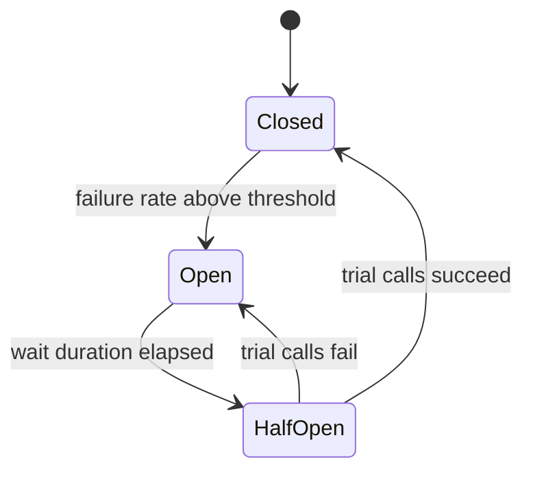

# Resilience Patterns

In a distributed system, some dependency is always slow or failing. Resilience patterns keep one failing call from exhausting threads, connections, and memory across the whole system. The main patterns are timeouts, retries with backoff, circuit breakers, bulkheads, and rate limiting. Interviewers ask about them to check that you know what each pattern protects against, and that you know retries can make an outage worse.

## Core concepts

### Timeouts

A timeout bounds how long a caller waits. Without one, a stuck dependency holds threads until the process runs out of them. Set timeouts on every remote call, separately for connection and response, and keep them shorter than the caller's own deadline so the caller can respond.

Deadline propagation passes the remaining time budget along the call chain, so a downstream service does not work on a request whose caller has already given up. gRPC supports deadlines natively; for HTTP, you usually pass a deadline header by convention.

### Retries and backoff

A retry repeats a failed call, which helps with transient errors such as a dropped connection. Retries need three rules:

1. Retry only idempotent operations, or operations protected by an idempotency key.
2. Retry only errors that may succeed later (timeouts, `503`), not validation errors or `404`.
3. Use exponential backoff with jitter and a maximum number of attempts.

Retries multiply load. If every caller retries three times against a struggling service, it receives four times the traffic at the moment it is least able to handle it. This is a retry storm, and it is why retries pair with circuit breakers.

Spring Retry provides `@Retryable` (requires `@EnableRetry`). Resilience4j provides its own `Retry` with similar concepts.

### Circuit breaker

A circuit breaker wraps a call and tracks failures. When failures pass a threshold, the breaker opens and fails calls immediately, without contacting the dependency. After a wait, it lets a few trial calls through (half-open). If they succeed, the breaker closes; if they fail, it opens again.



Hystrix, the original Netflix library, is retired. Resilience4j is the current choice for Spring Boot 3, and it integrates through annotations and configuration:

```java
import io.github.resilience4j.circuitbreaker.annotation.CircuitBreaker;
import io.github.resilience4j.retry.annotation.Retry;
import org.springframework.stereotype.Service;

@Service
class PaymentClient {

    @CircuitBreaker(name = "payments", fallbackMethod = "pending")
    @Retry(name = "payments")
    public String charge(String orderId) {
        // call the payment provider here, with a timeout configured on the HTTP client
        throw new IllegalStateException("provider unavailable");
    }

    // Fallback: same parameters, plus the exception as the last parameter.
    String pending(String orderId, Throwable cause) {
        return "PENDING";
    }
}
```

Settings live in configuration:

```yaml
resilience4j:
  circuitbreaker:
    instances:
      payments:
        sliding-window-size: 20
        failure-rate-threshold: 50
        wait-duration-in-open-state: 30s
        permitted-number-of-calls-in-half-open-state: 5
```

Annotations need the Resilience4j Spring Boot integration and Spring AOP on the classpath. Check the Resilience4j documentation for the exact artefacts for your Boot version.

A fallback is a degraded answer, not a hidden success. Return "pending" or cached data when that is acceptable, and fail clearly when it is not.

### Bulkhead

A bulkhead isolates resources so one dependency cannot consume all of them. Two common forms:

- Thread-pool bulkhead: each dependency gets its own bounded pool. A slow call fills only its pool.
- Semaphore bulkhead: a counter limits concurrent calls on the calling thread, which is cheaper but cannot time out a blocked call by itself.

The name comes from ship compartments: a flooded section is sealed off, and the rest stays afloat.

### Rate limiting and throttling

Rate limiting caps how many requests a client or service may make in a period. It protects the service from overload and from noisy clients.

- Token bucket: tokens refill at a steady rate; each request takes one. It allows short bursts up to the bucket size.
- Sliding window: counts requests in a moving window, which is smoother than fixed windows.

A single instance can count in memory. Multiple instances need a shared store (usually Redis), or each instance enforces only its share. Be explicit about what happens when the limiter's store is unavailable: fail open (allow) or fail closed (deny).

### Combining the patterns

A typical order for an outbound call: rate limiter, then bulkhead, then circuit breaker, then retry, with a timeout inside each attempt. The exact order depends on the library, so check the documented decorator order before relying on it.

## How it works / Step by step

1. A call is made with a timeout.
2. If it fails with a retryable error, the retry waits with backoff and tries again, up to the limit.
3. Failures are counted by the circuit breaker; above the threshold, it opens.
4. While open, calls fail fast and use the fallback.
5. After the wait, trial calls test recovery; the breaker closes or opens again.

## Common pitfalls

- Missing timeouts, which turn a slow dependency into a full outage.
- Retrying non-idempotent calls, such as charging a card twice.
- Retry storms: retries without backoff, jitter, or a circuit breaker.
- Timeouts longer than the caller's own deadline, so work is wasted.
- Fallbacks that silently return fake success.
- Using Hystrix or Ribbon in new code on Spring Boot 3.
- One shared thread pool for all dependencies, so one slow dependency blocks everything.

!!! tip "Interview tip"
    **Q: What happens when a downstream service is slow?**
    Without protection, callers wait, their threads fill up, and the failure spreads upstream. Timeouts stop the waiting. Retries with backoff handle brief blips, and a circuit breaker stops calls to a service that is clearly down. Bulkheads keep one slow dependency from consuming every thread. Together they contain the failure.

## Quick recap

- Set timeouts on every remote call; propagate deadlines.
- Retry only idempotent, transient failures, with exponential backoff and jitter.
- Circuit breakers move through closed, open, and half-open states; Resilience4j replaces Hystrix.
- Bulkheads isolate resource pools per dependency.
- Rate limiting needs a shared store across instances and a clear fail-open or fail-closed choice.

**See also:** [HTTP Clients and Testing](../09-spring-boot/http-clients-and-testing.md) | [Inter-Service Communication](inter-service-communication.md) | [Spring Cloud](spring-cloud.md)
