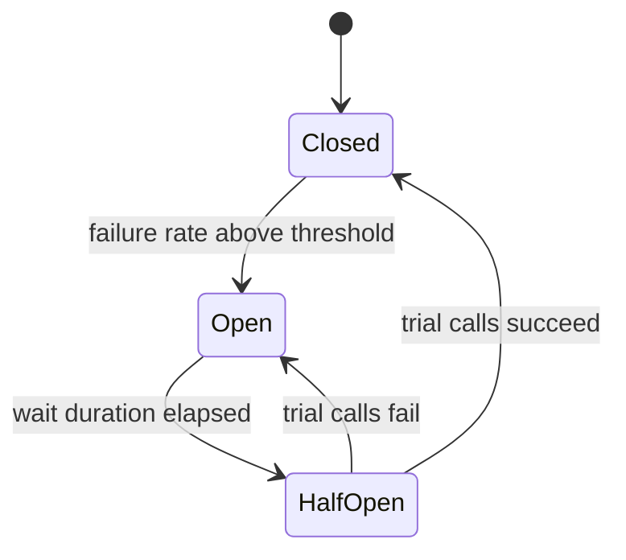
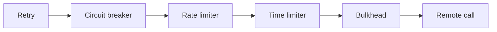

# Resilience Patterns

!!! note "In simple words"
    Remote services will sometimes be slow or broken. Resilience patterns are the guards that stop one slow service from freezing every caller. They give up early, try again carefully, and step back when a service is clearly down.

## Why it matters

In a distributed system, some dependency is always slow or failing. A single stuck call can hold threads, connections, and memory, and that pressure spreads to every caller upstream. Resilience patterns keep a local failure local.

The main patterns are timeouts, retries with backoff, circuit breakers, bulkheads, and rate limiting. Interviewers ask about them to check that you know what each pattern protects against, and that you know retries can make an outage worse.

## How it works

### Timeouts

A timeout limits how long a caller waits. Without one, a stuck dependency holds threads until the process runs out of them. Set timeouts on every remote call, separately for connecting and for reading the response. Keep each timeout shorter than the caller's own deadline, so the caller still has time to answer.

Deadline propagation passes the remaining time budget down the call chain. A downstream service then does not work on a request whose caller has already given up. gRPC supports deadlines natively. For plain HTTP, teams usually pass a deadline header by agreement.

### Retries and backoff

A retry repeats a failed call. It helps with transient errors such as a dropped connection. Three rules apply:

1. Retry only operations that are idempotent, or that carry an idempotency key.
2. Retry only errors that may succeed later, such as timeouts and `503`. Do not retry validation errors or `404`.
3. Use exponential backoff with jitter, and a maximum number of attempts.

Retries multiply load. If every caller retries three times against a struggling service, the service receives four times its normal traffic at the moment it can least handle it. This is a **retry storm**, and it is the reason retries are paired with circuit breakers.

Spring Retry offers `@Retryable`, which needs `@EnableRetry`. Resilience4j has its own `Retry` with similar ideas.

### Circuit breaker

A circuit breaker wraps a call and counts failures. When the failures pass a threshold, the breaker opens and fails calls at once, without touching the dependency. After a wait, it lets a few trial calls through (half-open). If the trials succeed, the breaker closes. If they fail, it opens again.



Hystrix, the original Netflix library, is in maintenance mode, and Spring Cloud recommends Resilience4j. For Spring Boot 3, Resilience4j works through annotations and configuration:

```java
import io.github.resilience4j.circuitbreaker.annotation.CircuitBreaker;
import io.github.resilience4j.retry.annotation.Retry;
import org.springframework.stereotype.Service;

@Service
class PaymentClient {

    @CircuitBreaker(name = "payments", fallbackMethod = "pending")
    @Retry(name = "payments")
    public String charge(String orderId) {
        // call the payment provider here, with a timeout set on the HTTP client
        throw new IllegalStateException("provider unavailable");
    }

    // The fallback takes the same parameters, plus the exception as the last one.
    String pending(String orderId, Throwable cause) {
        return "PENDING";
    }
}
```

These annotations come from the Resilience4j Spring Boot integration, and they need Spring AOP on the classpath. The settings live in configuration:

```yaml
resilience4j:
  circuitbreaker:
    instances:
      payments:
        sliding-window-size: 20
        failure-rate-threshold: 50
        wait-duration-in-open-state: 30s
        permitted-number-of-calls-in-half-open-state: 5
```

A fallback is a degraded answer, not a hidden success. Return "pending" or cached data when that is acceptable. Fail clearly when it is not. For full detail on breaker behaviour, see [Circuit Breakers in Spring Boot with Resilience4j](spring-circuit-breaker.md).

### Bulkhead

A bulkhead isolates resources, so one dependency cannot use all of them. There are two common forms:

- **Thread-pool bulkhead**: each dependency gets its own bounded pool. A slow call fills only its own pool.
- **Semaphore bulkhead**: a counter limits concurrent calls on the calling thread. It is cheaper, but it cannot time out a blocked call by itself.

The name comes from the watertight compartments of a ship. A flooded compartment is sealed, and the rest of the ship stays afloat.

### Rate limiting and throttling

Rate limiting caps how many requests a client or service may make in a period. It protects a service from overload and from noisy clients.

- **Token bucket**: tokens refill at a steady rate, and each request takes one. This allows short bursts up to the bucket size.
- **Sliding window**: requests are counted over a moving window, which is smoother than a fixed window.

A single instance can count in memory. Several instances need a shared store, usually Redis. Otherwise each instance enforces only its own share. Decide what happens when the limiter's store is unavailable: fail open (allow the traffic) or fail closed (deny it).

### Combining the patterns

Resilience4j's default decorator order, from outermost to innermost, is shown below. Each attempt of a retry passes through the breaker, so the breaker counts every attempt. The order can be configured, so check the documentation for your version.



A practical rule set:

- Put a timeout on every remote call, so nothing waits forever.
- Retry only idempotent operations, with backoff so retries do not pile up.
- Let the breaker open when retries keep failing, so callers stop waiting on a dependency that is down.
- Use a bulkhead for a dependency that is slow but usually healthy, so it cannot starve other calls.
- Make every fallback honest about what it returned.

### Step by step

1. A call is made with a timeout.
2. If it fails with a retryable error, the retry waits with backoff and tries again, up to the limit.
3. The circuit breaker counts failures. Above the threshold, it opens.
4. While it is open, calls fail fast and the fallback runs.
5. After the wait, trial calls test recovery. The breaker then closes, or opens again.

## Where it is used

- **Calls to payment, shipping, or pricing providers**, where a slow answer must not stall checkout.
- **Internal calls between services**, where one overloaded service can drag down its callers.
- **Public APIs with quotas**, where rate limiting protects the provider and the users.
- **Gateways and edge services**, where limits and breakers keep bad traffic away from the core.

## Benefits

- **Contained failures**: one dependency's trouble stays within its own boundary.
- **Faster failure**: callers get an answer quickly instead of waiting on a dead service.
- **Recovery room**: an open breaker stops traffic, so the dependency can recover.
- **Predictable behaviour**: explicit limits make load and failure easier to test.

## Cons and limits

- **Tuning is hard**: thresholds, windows, and timeouts need real traffic data.
- **Fallbacks can hide problems**: a silent fallback can make an outage look like normal operation.
- **Retries add load**: even with backoff, retries use more capacity during trouble.
- **Shared state is needed** for rate limits across many instances.
- **Patterns can fight each other**: a retry inside a breaker, or a timeout shorter than a retry delay, gives surprising results.
- **A breaker does not make a slow service fast**: it limits the damage, and capacity work is still needed.

## Best practices

- **Set timeouts on every remote call**, and keep them shorter than the caller's own deadline.
- **Retry only safe, transient failures**, with exponential backoff and jitter.
- **Make writes idempotent** before adding retries to them.
- **Use one resilience library** for each dependency, so counters and thresholds are not duplicated.
- **Separate thread pools for separate dependencies**, so one slow service cannot block the rest.
- **Monitor breaker state and rejection counts**, and alert on open breakers.

!!! tip "Interview tip"
    **Q: What happens when a downstream service is slow?**
    Without protection, callers wait, their threads fill up, and the failure spreads upstream. Timeouts stop the waiting. Retries with backoff cover brief blips, and a circuit breaker stops calls to a service that is clearly down. Bulkheads keep one slow dependency from consuming every thread. Together they keep the failure contained.

## Common pitfalls

- Missing timeouts, which turn a slow dependency into a full outage.
- Retrying non-idempotent calls, such as charging a card twice.
- Retry storms, from retries without backoff, jitter, or a breaker.
- Timeouts longer than the caller's own deadline, which wastes work.
- Fallbacks that silently return a fake success.
- Using Hystrix or Ribbon in new code on Spring Boot 3.
- One shared thread pool for all dependencies, so one slow dependency blocks everything.

## Quick recap

- Set timeouts on every remote call, and propagate deadlines.
- Retry only idempotent, transient failures, with exponential backoff and jitter.
- Circuit breakers move between closed, open, and half-open states. Resilience4j replaces Hystrix.
- Bulkheads isolate resource pools for each dependency.
- Rate limiting needs a shared store across instances, and a clear fail-open or fail-closed choice.

## Official documentation

- [Resilience4j documentation](https://resilience4j.readme.io/)
- [Spring Cloud CircuitBreaker reference](https://docs.spring.io/spring-cloud-circuitbreaker/reference/index.html)
- [Martin Fowler: Microservices](https://martinfowler.com/articles/microservices.html)

**See also:** [HTTP Clients and Testing](../09-spring-boot/http-clients-and-testing.md) | [Inter-Service Communication](inter-service-communication.md) | [Spring Cloud](spring-cloud.md) | [Circuit Breakers with Resilience4j](spring-circuit-breaker.md)
