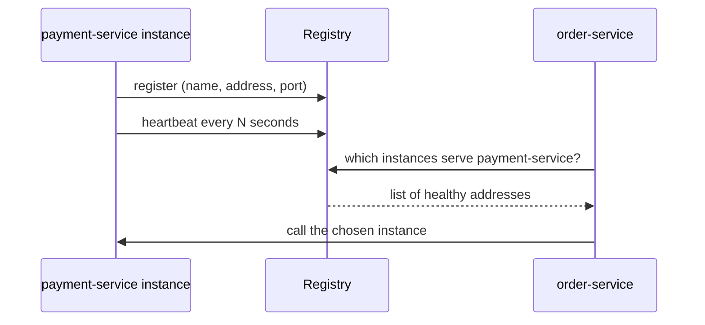

# Service Discovery

Service discovery lets a caller find the current network addresses of a service by its logical name, instead of a fixed host and port. Instances register themselves when they start, and a registry tracks which ones are healthy. Interviewers ask about discovery to check that you understand why static addresses fail in dynamic environments, how client-side and server-side lookup differ, and what a registry does when it is wrong.

## Core concepts

### Why fixed addresses fail

A client that hard-codes `http://payment-service-1:8080` breaks as soon as that instance moves, scales out, or is replaced during a deployment. Operators then edit configuration by hand, and the client keeps sending traffic to instances that no longer exist or never receive traffic from new ones. Discovery replaces the address with a name and moves the knowledge of "which instances exist right now" into a registry.

### The registry model

Three roles take part:

1. **Registry**: stores the list of service names and their live instances, with health information.
2. **Provider**: an instance of a service. It registers on startup, sends heartbeats or passes health checks, and deregisters on shutdown.
3. **Consumer**: a caller that asks the registry for instances of a name, then chooses one.



### Client-side and server-side discovery

**Client-side discovery**: the consumer queries the registry, receives the list, and picks an instance itself, usually with a load-balancing rule such as round-robin. Netflix Eureka with Spring Cloud LoadBalancer works this way.

- Advantage: the client can make smart choices, such as preferring a zone or avoiding instances with recent errors.
- Cost: every client needs discovery and balancing logic, in every language it uses.

**Server-side discovery**: the consumer calls a stable load-balancer address. The balancer queries the registry and forwards the request. Kubernetes Services and cloud load balancers follow this model.

- Advantage: callers stay simple, and the routing rules live in one place.
- Cost: the balancer is a shared component that must itself be highly available and scaled.

Neither model is always better. Polyglot systems with many languages often favour server-side lookup, while a Java-only estate with Spring can use client-side lookup comfortably.

### Registries compared

| Registry | Type | Notes |
|---|---|---|
| Eureka | Library and server, Netflix origin | Spring Cloud integration is simple. Netflix has placed Eureka in maintenance mode, so check its current status before you choose it for a new system. |
| Consul | Standalone server and agent | Health checks, a key-value store, DNS and HTTP interfaces, multi-datacenter support. Language-neutral. |
| etcd | Distributed key-value store | Strongly consistent (Raft-based). Used by Kubernetes for its own state. Discovery is built on top by convention. |
| ZooKeeper | Coordination service | Mature and used by older systems. Discovery is possible, but it is more of a coordination tool than a discovery product. |
| Kubernetes DNS | Built into the platform | Each Service gets a DNS name. Zero extra components, but tied to Kubernetes. |

### Registration with Spring Cloud Netflix Eureka

The registry server is a small Spring Boot application:

```java
import org.springframework.boot.SpringApplication;
import org.springframework.boot.autoconfigure.SpringBootApplication;
import org.springframework.cloud.netflix.eureka.server.EnableEurekaServer;

@SpringBootApplication
@EnableEurekaServer
public class DiscoveryServerApplication {
    public static void main(String[] args) {
        SpringApplication.run(DiscoveryServerApplication.class, args);
    }
}
```

```yaml
server:
  port: 8761
spring:
  application:
    name: discovery-server
eureka:
  client:
    register-with-eureka: false   # the server does not register itself
    fetch-registry: false
```

A provider registers by naming itself and pointing at the server. Recent Spring Cloud versions register Eureka clients automatically when the client starts, so older tutorials that add `@EnableEurekaClient` do not need that annotation.

```yaml
spring:
  application:
    name: payment-service
eureka:
  client:
    service-url:
      defaultZone: ${EUREKA_URL:http://localhost:8761/eureka/}   # set EUREKA_URL per environment
  instance:
    prefer-ip-address: true
    lease-renewal-interval-in-seconds: 30     # heartbeat interval (the default)
    lease-expiration-duration-in-seconds: 90  # removal time without heartbeats (the default)
```

### Calling a service by name

A consumer can call the logical name through a load-balanced client, so no host appears in the code:

```java
import org.springframework.cloud.client.loadbalancer.LoadBalanced;
import org.springframework.context.annotation.Bean;
import org.springframework.context.annotation.Configuration;
import org.springframework.web.reactive.function.client.WebClient;

@Configuration
class PaymentClientConfig {

    @Bean
    @LoadBalanced
    WebClient.Builder loadBalancedBuilder() {
        return WebClient.builder();
    }
}
```

```java
import org.springframework.stereotype.Service;
import org.springframework.web.reactive.function.client.WebClient;
import reactor.core.publisher.Mono;

@Service
class PaymentGateway {

    private final WebClient web;

    PaymentGateway(WebClient.Builder builder) {
        this.web = builder.baseUrl("http://payment-service").build();
    }

    Mono<String> charge(String orderId) {
        return web.post().uri("/payments/{id}", orderId).retrieve().bodyToMono(String.class);
    }
}
```

When you need to look up instances yourself, for example to apply custom selection, use the `DiscoveryClient` abstraction:

```java
import java.net.URI;
import java.util.Optional;
import org.springframework.cloud.client.ServiceInstance;
import org.springframework.cloud.client.discovery.DiscoveryClient;
import org.springframework.stereotype.Component;

@Component
class InstanceLookup {

    private final DiscoveryClient discovery;

    InstanceLookup(DiscoveryClient discovery) {
        this.discovery = discovery;
    }

    Optional<URI> anyInstanceOf(String serviceId) {
        return discovery.getInstances(serviceId).stream()
                .map(ServiceInstance::getUri)
                .findAny();
    }
}
```

Manual lookup gives you control, but it also means you own the balancing, retry, and failure handling. Prefer the load-balanced client unless you have a specific reason not to.

### Discovery in Kubernetes

Kubernetes creates a Service object for each set of pods and a DNS record for it. A caller in the same namespace can use the short name:

```text
http://payment-service:8080
```

From another namespace, use the qualified form, `http://payment-service.payments.svc.cluster.local:8080`, where `payments` is the namespace. In a Kubernetes deployment you usually do not need a separate registry such as Eureka for discovery. Spring Cloud components can still handle configuration and routing.

### Health, heartbeats, and self-preservation

A registry is only as good as its view of health. Two mechanisms do most of the work:

- **Heartbeats and leases** (Eureka): each instance renews its lease every 30 seconds by default. If no renewal arrives within 90 seconds, the registry removes the instance.
- **Health checks** (Consul, Kubernetes probes): the registry or platform calls a health endpoint and removes instances that fail. In Spring Boot, a readiness probe should reflect whether the instance can serve traffic, not just whether the process is alive.

Eureka also has **self-preservation**. When many renewals stop at once, the registry assumes a network problem rather than a mass crash, and it keeps the old entries instead of evicting them. This protects against a network partition wiping out the whole registry, but it means clients can be sent to dead instances for a while. Turning self-preservation off is only sensible in development.

### Failure scenarios

| Scenario | What the caller sees | Mitigation |
|---|---|---|
| Instance crashes | Registry still lists it until the lease expires | Short lease or health-check interval, plus retries against another instance |
| Registry is unavailable | New instances cannot register, and lookups may fail | Clients cache the last good list; run the registry as a cluster |
| Network partition | Some instances cannot reach the registry | Quorum-based removal (Consul), self-preservation (Eureka) |
| Stale client cache | Calls go to an instance that just left | Retries, a circuit breaker, and a timeout on every call |

Discovery is not a substitute for resilience. A healthy-looking entry can still fail, so every remote call needs a timeout, a bounded retry, and a fallback. See [Resilience Patterns](resilience-patterns.md).

## Resilient discovery pattern
A lookup and a call are two separate failures. The registry can return an instance that is already gone, and the call itself can time out or fail. The resilient discovery pattern treats the whole sequence, lookup plus call, as one protected operation:

1. Resolve the service name to the current instances on every attempt, not once at startup.
2. Pick one instance at random, so a retry can land on a different instance.
3. Call it with a timeout set on the client.
4. Retry only the failures that are safe to retry, with a bounded number of attempts.
5. Keep a circuit breaker per service name. When it is open, stop calling and use a fallback.
6. Return a clear result when no instance is available, instead of an unrelated error.

```java
import java.math.BigDecimal;
import java.net.URI;
import java.util.List;
import java.util.concurrent.ThreadLocalRandom;
import io.github.resilience4j.circuitbreaker.annotation.CircuitBreaker;
import io.github.resilience4j.retry.annotation.Retry;
import org.springframework.cloud.client.ServiceInstance;
import org.springframework.cloud.client.discovery.DiscoveryClient;
import org.springframework.stereotype.Service;
import org.springframework.web.client.RestTemplate;

record Order(String id, BigDecimal amount) {}
record PaymentResponse(String orderId, String status) {}

@Service
public class PaymentClient {

    private static final String SERVICE = "payment-service";

    private final DiscoveryClient discoveryClient;
    private final RestTemplate restTemplate; // configured with connect and read timeouts

    public PaymentClient(DiscoveryClient discoveryClient, RestTemplate restTemplate) {
        this.discoveryClient = discoveryClient;
        this.restTemplate = restTemplate;
    }

    @CircuitBreaker(name = SERVICE, fallbackMethod = "chargeFallback")
    @Retry(name = SERVICE)
    public PaymentResponse charge(Order order) {
        URI base = pickInstance();
        // A production version also sends an idempotency key with the request, so the
        // server can ignore a repeated charge when a retry follows a timeout that hid a success.
        return restTemplate.postForObject(base.resolve("/api/charge"), order, PaymentResponse.class);
    }

    // Fallback: same parameters plus the cause. Do not report success here.
    PaymentResponse chargeFallback(Order order, Throwable cause) {
        return new PaymentResponse(order.id(), "PENDING");
    }

    private URI pickInstance() {
        List<ServiceInstance> instances = discoveryClient.getInstances(SERVICE);
        if (instances.isEmpty()) {
            throw new IllegalStateException("No instances of " + SERVICE + " are registered");
        }
        ServiceInstance chosen = instances.get(ThreadLocalRandom.current().nextInt(instances.size()));
        return chosen.getUri();
    }
}
```

Points that make this safe:

- **Retry only idempotent work, or make the work idempotent.** A charge is not idempotent. A timeout does not tell you whether the server charged the card, so a retry without an idempotency key can charge twice. Send a key the server uses to detect repeats.
- **Retry the lookup too.** Because `pickInstance()` runs inside the retried method, each attempt looks up the registry again. A stale entry therefore fails once, not for every retry.
- **Make the fallback honest.** A fallback that returns "success" hides a failure. Returning `PENDING` lets the caller queue the work and reconcile it later.
- **Set the timeout on the client.** A retry without a timeout only multiplies a slow wait.
- **Check the aspect order.** Resilience4j applies retry and circuit-breaker aspects in a fixed order, and that order decides whether each retry attempt counts toward the breaker. Confirm it in the library documentation for your version.

Spring Cloud load balancing does the same selection for you when a client is annotated for load balancing. Write the explicit version only when you need control over the choice.

## How it works / Step by step

1. An instance starts, reads its logical name, and registers its address with the registry.
2. The instance sends heartbeats, or the registry runs health checks against it.
3. A consumer asks the registry for the healthy instances of a name, or calls a load-balanced name directly.
4. The consumer chooses an instance, sends the request, and handles failures with retries and a circuit breaker.
5. On shutdown, the instance deregisters, or its lease expires after it stops responding.

## Common pitfalls

- Hard-coding one instance's address "temporarily" in a client, which then survives for years.
- Setting very long lease durations, so dead instances stay in the list for minutes.
- Turning off self-preservation in production without understanding the partition behaviour.
- Running a single registry node with no cluster or cached fallback.
- Mixing two discovery mechanisms in one environment, such as Eureka inside Kubernetes, without a clear reason.
- Treating a registry entry as proof that the instance works.

!!! tip "Interview tip"
    **Q: Client-side or server-side discovery?**
    Client-side gives the caller more control over choosing an instance, at the cost of discovery logic in every client. Server-side keeps clients simple and centralises routing in a balancer, which then becomes a component to scale and protect. In Kubernetes, the platform's Service objects already provide server-side discovery, so you rarely need a separate client-side registry.

## Quick recap

- Discovery maps a logical service name to the instances that are alive now.
- Providers register and send heartbeats; consumers query the registry.
- Client-side lookup puts balancing in the caller; server-side lookup puts it in a balancer.
- Eureka uses leases and self-preservation; Consul and Kubernetes use health checks.
- Discovery data can be stale, so pair it with timeouts, retries, and circuit breakers.

**See also:** [Spring Cloud](spring-cloud.md) | [Resilience Patterns](resilience-patterns.md) | [Microservices Fundamentals](microservices-fundamentals.md) | [Kubernetes](../16-kubernetes/index.md)
