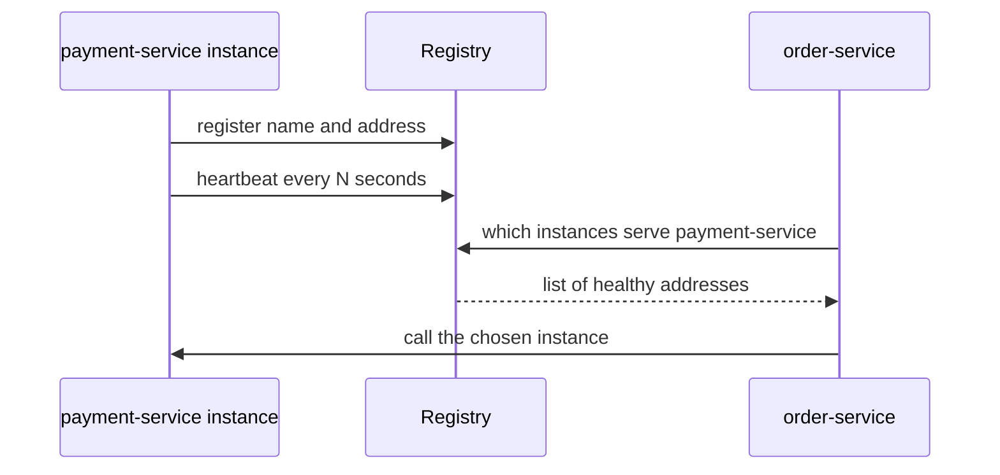

# Service Discovery

!!! note "In simple words"
    Services move around. Discovery lets a caller ask for "the payment service" by name, and get back the addresses of the copies that are alive right now, instead of a fixed address that may be wrong by tomorrow.

## Why it matters

In a dynamic environment, instances start, stop, and move all the time. A client that hard-codes an address breaks as soon as its target changes. Operators then edit configuration by hand, and traffic goes to instances that no longer exist while new instances receive none.

Discovery replaces the address with a name, and it moves the knowledge of which instances exist right now into a registry. Interviewers ask about it to check that you understand why fixed addresses fail, how client-side and server-side lookup differ, and what happens when the registry itself is wrong.

## How it works

### Why fixed addresses fail

A client that hard-codes `http://payment-service-1:8080` breaks when that instance moves, scales out, or is replaced during a deployment. Scaling adds instances that the client never sees, and removing one leaves the client calling a dead address. Discovery solves both problems by looking up the current instances on each use.

### The registry model

Three roles take part:

1. **Registry**: stores the service names, their live instances, and their health information.
2. **Provider**: an instance of a service. It registers when it starts, sends heartbeats or passes health checks, and deregisters when it shuts down.
3. **Consumer**: a caller that asks the registry for the instances of a name, then picks one.



### Client-side and server-side discovery

**Client-side discovery**: the consumer asks the registry for the list and chooses an instance itself, usually with a rule such as round-robin. Netflix Eureka with Spring Cloud LoadBalancer works this way.

- Advantage: the client can choose smartly, for example by preferring its own zone or avoiding instances with recent errors.
- Cost: every client needs discovery and balancing logic, in every language it is written in.

**Server-side discovery**: the consumer calls one stable address, and a load balancer looks up the registry and forwards the request. Kubernetes Services and cloud load balancers follow this model.

- Advantage: callers stay simple, and routing rules live in one place.
- Cost: the balancer is a shared component that must itself be highly available and scaled.

Neither model is always better. Systems with many languages often prefer server-side lookup. A Java-only estate built on Spring can use client-side lookup comfortably.

### Registries compared

| Registry | Type | Notes |
|---|---|---|
| Eureka | Library and server, from Netflix | Simple Spring Cloud integration. Check its current maintenance status before choosing it for a new system. |
| Consul | Standalone server and agent | Health checks, a key-value store, DNS and HTTP interfaces, and multi-datacenter support. Language neutral. |
| etcd | Distributed key-value store | Strongly consistent (Raft-based). Kubernetes uses it for its own state. Discovery is built on top by convention. |
| ZooKeeper | Coordination service | Mature, and found in older systems. Discovery is possible, but it is a coordination tool more than a discovery product. |
| Kubernetes DNS | Built into the platform | Each Service gets a DNS name. No extra components, but tied to Kubernetes. |

### Registration with Spring Cloud Netflix Eureka

The following examples use Spring Cloud. They show the shape of the configuration and were not compiled here.

The registry itself is a small Spring Boot application:

```java
import org.springframework.boot.SpringApplication;
import org.springframework.boot.autoconfigure.SpringBootApplication;
import org.springframework.cloud.netflix.eureka.server.EnableEurekaServer;

@SpringBootApplication
@EnableEurekaServer
public class DiscoveryServerApplication {
    public static void main(String[] args) {
        SpringApplication.run(DiscoveryServerApplication.class, args);
    }
}
```

```yaml
server:
  port: 8761
spring:
  application:
    name: discovery-server
eureka:
  client:
    register-with-eureka: false   # the server does not register itself
    fetch-registry: false
```

A provider registers by giving its name and the server's address. Recent Spring Cloud versions register Eureka clients automatically at startup, so the `@EnableEurekaClient` annotation in older tutorials is no longer needed.

```yaml
spring:
  application:
    name: payment-service
eureka:
  client:
    service-url:
      defaultZone: ${EUREKA_URL:http://localhost:8761/eureka/}   # set EUREKA_URL per environment
  instance:
    prefer-ip-address: true
    lease-renewal-interval-in-seconds: 30     # heartbeat interval (the default)
    lease-expiration-duration-in-seconds: 90  # removal time without heartbeats (the default)
```

### Calling a service by name

A caller can use the logical name through a load-balanced client, so no host name appears in the code:

```java
import org.springframework.cloud.client.loadbalancer.LoadBalanced;
import org.springframework.context.annotation.Bean;
import org.springframework.context.annotation.Configuration;
import org.springframework.web.reactive.function.client.WebClient;

@Configuration
class PaymentClientConfig {

    @Bean
    @LoadBalanced
    WebClient.Builder loadBalancedBuilder() {
        return WebClient.builder();
    }
}
```

```java
import org.springframework.stereotype.Service;
import org.springframework.web.reactive.function.client.WebClient;
import reactor.core.publisher.Mono;

@Service
class PaymentGateway {

    private final WebClient web;

    PaymentGateway(WebClient.Builder builder) {
        this.web = builder.baseUrl("http://payment-service").build();
    }

    Mono<String> charge(String orderId) {
        return web.post().uri("/payments/{id}", orderId).retrieve().bodyToMono(String.class);
    }
}
```

To choose an instance yourself, for example with custom rules, use the `DiscoveryClient` abstraction:

```java
import java.net.URI;
import java.util.Optional;
import org.springframework.cloud.client.ServiceInstance;
import org.springframework.cloud.client.discovery.DiscoveryClient;
import org.springframework.stereotype.Component;

@Component
class InstanceLookup {

    private final DiscoveryClient discovery;

    InstanceLookup(DiscoveryClient discovery) {
        this.discovery = discovery;
    }

    Optional<URI> anyInstanceOf(String serviceId) {
        return discovery.getInstances(serviceId).stream()
                .map(ServiceInstance::getUri)
                .findAny();
    }
}
```

Manual lookup gives you control, but it also means you own the balancing, retry, and failure handling. Prefer the load-balanced client unless you have a specific reason not to use it.

### Discovery in Kubernetes

Kubernetes creates a Service object for each set of pods, and a DNS record for that Service. A caller in the same namespace can use the short name:

```text
http://payment-service:8080
```

From another namespace, use the qualified form, `http://payment-service.payments.svc.cluster.local:8080`, where `payments` is the namespace. On Kubernetes you usually do not need a separate registry such as Eureka. Spring Cloud components can still handle configuration and routing.

### Health, heartbeats, and self-preservation

A registry is only as good as its view of health. Two mechanisms do most of the work:

- **Heartbeats and leases** (Eureka): each instance renews its lease every 30 seconds by default. If no renewal arrives within 90 seconds, the registry removes the instance.
- **Health checks** (Consul, Kubernetes probes): the registry or platform calls a health endpoint and removes instances that fail. In Spring Boot, a readiness probe should show whether the instance can serve traffic, not just whether the process is running.

Eureka also has **self-preservation**. When a large share of renewals stop at once, the registry assumes a network problem rather than a mass crash, and it keeps the old entries instead of removing them. This protects the registry from a partition that would otherwise erase everything. The cost is that clients may be sent to dead instances for a while. Turning self-preservation off is only sensible in development.

### Failure scenarios

| Scenario | What the caller sees | Mitigation |
|---|---|---|
| Instance crashes | The registry still lists it until its lease expires | A short lease or health-check interval, plus retries against another instance |
| Registry is unavailable | New instances cannot register, and lookups may fail | Clients cache the last good list; run the registry as a cluster |
| Network partition | Some instances cannot reach the registry | Quorum-based removal (Consul), or self-preservation (Eureka) |
| Stale client cache | Calls go to an instance that has just left | Retries, a circuit breaker, and a timeout on every call |

Discovery is not a substitute for resilience. A healthy-looking entry can still fail, so every remote call needs a timeout, a bounded retry, and a fallback. See [Resilience Patterns](resilience-patterns.md).

### Resilient discovery pattern

A lookup and a call are two separate failures. The registry can return an instance that is already gone, and the call itself can time out or fail. The resilient pattern treats the whole sequence, lookup plus call, as one protected operation:

1. Resolve the service name to current instances on every attempt, not once at startup.
2. Pick one instance at random, so a retry can land on a different instance.
3. Call it with a timeout set on the client.
4. Retry only the failures that are safe to retry, with a bounded number of attempts.
5. Keep a circuit breaker for each service name. When it is open, stop calling and use a fallback.
6. Return a clear result when no instance is available, instead of an unrelated error.

The following example uses Spring Cloud, Resilience4j, and RestTemplate. It was not compiled here.

```java
import java.math.BigDecimal;
import java.net.URI;
import java.util.List;
import java.util.concurrent.ThreadLocalRandom;
import io.github.resilience4j.circuitbreaker.annotation.CircuitBreaker;
import io.github.resilience4j.retry.annotation.Retry;
import org.springframework.cloud.client.ServiceInstance;
import org.springframework.cloud.client.discovery.DiscoveryClient;
import org.springframework.stereotype.Service;
import org.springframework.web.client.RestTemplate;

record Order(String id, BigDecimal amount) {}

record PaymentResponse(String orderId, String status) {}

@Service
public class PaymentClient {

    private static final String SERVICE = "payment-service";

    private final DiscoveryClient discoveryClient;
    private final RestTemplate restTemplate; // configured with connect and read timeouts

    public PaymentClient(DiscoveryClient discoveryClient, RestTemplate restTemplate) {
        this.discoveryClient = discoveryClient;
        this.restTemplate = restTemplate;
    }

    @CircuitBreaker(name = SERVICE, fallbackMethod = "chargeFallback")
    @Retry(name = SERVICE)
    public PaymentResponse charge(Order order) {
        URI base = pickInstance();
        // A production version also sends an idempotency key, so the server can
        // ignore a repeated charge when a retry follows a timeout that hid a success.
        return restTemplate.postForObject(base.resolve("/api/charge"), order, PaymentResponse.class);
    }

    // The fallback has the same parameters plus the cause. It does not report success.
    PaymentResponse chargeFallback(Order order, Throwable cause) {
        return new PaymentResponse(order.id(), "PENDING");
    }

    private URI pickInstance() {
        List<ServiceInstance> instances = discoveryClient.getInstances(SERVICE);
        if (instances.isEmpty()) {
            throw new IllegalStateException("No instances of " + SERVICE + " are registered");
        }
        ServiceInstance chosen = instances.get(ThreadLocalRandom.current().nextInt(instances.size()));
        return chosen.getUri();
    }
}
```

Points that make this safe:

- **Retry only idempotent work, or make the work idempotent.** A charge is not idempotent. A timeout does not tell you whether the server charged the card, so a retry without an idempotency key can charge twice. Send a key that the server uses to detect repeats.
- **Retry the lookup too.** `pickInstance()` runs inside the retried method, so each attempt looks the registry up again. A stale entry fails once, not on every retry.
- **Make the fallback honest.** A fallback that returns success hides a failure. Returning `PENDING` lets the caller queue the work and reconcile it later.
- **Set the timeout on the client.** A retry without a timeout only multiplies a slow wait.
- **Know the aspect order.** Resilience4j applies its retry and circuit-breaker aspects in a defined order, and that order decides whether each retry attempt counts toward the breaker. Check the default in the library documentation for your version, and see [Spring Circuit Breakers](spring-circuit-breaker.md).

Spring Cloud load balancing makes the same choice for you when a client is marked for load balancing. Write the explicit version only when you need control over the selection.

## Where it is used

- **Microservice platforms** where instances scale up and down with load.
- **Blue-green and canary deployments**, where new instances must appear in the list and old ones must leave it.
- **Hybrid estates**, where some services run on virtual machines and others on Kubernetes.
- **Multi-datacenter setups**, where Consul or a similar registry tracks services across sites.

## Benefits

- **No hard-coded addresses**: moving or scaling an instance needs no configuration change.
- **Automatic removal of dead instances**, once leases or health checks expire.
- **Simple callers**: with load-balanced clients, the call looks like a call to a name.
- **Faster deployments**: new versions can come up and join without manual steps.

## Cons and limits

- **Eventual accuracy**: the list is a snapshot that can be seconds old.
- **The registry is critical**: if it fails badly and clients have no cache, new calls fail.
- **Self-preservation can keep dead entries**: during a partition, clients may call instances that are gone.
- **Client-side logic is spread out**: each language needs its own discovery library.
- **Two mechanisms cause confusion**: running Eureka inside Kubernetes, for example, adds a second source of truth.

## Best practices

- **Use a logical name in every call**, and keep host names out of code and configuration.
- **Choose lease or health-check timings** that match how fast a dead instance must disappear.
- **Run the registry as a cluster**, and let clients cache the last good list.
- **Pair discovery with timeouts, retries, and circuit breakers.**
- **Make readiness probes reflect real dependencies**, so unready instances stop receiving traffic.
- **Use one discovery mechanism per environment**, and document which one applies.
- **Never treat a registry entry as proof that an instance works.**

!!! tip "Interview tip"
    **Q: Client-side or server-side discovery?**
    Client-side gives the caller more control over choosing an instance, at the cost of discovery logic in every client. Server-side keeps clients simple and moves routing into a balancer, which then becomes a component to scale and protect. On Kubernetes, the Service objects already provide server-side discovery, so a separate client-side registry is rarely needed.

## Common pitfalls

- Hard-coding one instance's address "temporarily", which then lasts for years.
- Setting very long lease durations, so dead instances stay listed for minutes.
- Turning off self-preservation in production without understanding partition behaviour.
- Running a single registry node with no cluster and no cached fallback.
- Mixing two discovery mechanisms in one environment without a clear reason.
- Treating a registry entry as proof that the instance works.

## Quick recap

- Discovery maps a logical service name to the instances that are alive now.
- Providers register and send heartbeats; consumers query the registry.
- Client-side lookup puts balancing in the caller; server-side lookup puts it in a balancer.
- Eureka uses leases and self-preservation; Consul and Kubernetes rely on health checks.
- Discovery data can be stale, so pair it with timeouts, retries, and circuit breakers.

## Official documentation

- [Spring Cloud Netflix reference](https://docs.spring.io/spring-cloud-netflix/reference/index.html)
- [Spring Cloud project overview](https://spring.io/projects/spring-cloud)
- [Kubernetes Service](https://kubernetes.io/docs/concepts/services-networking/service/)

**See also:** [Spring Cloud](spring-cloud.md) | [Resilience Patterns](resilience-patterns.md) | [Microservices Fundamentals](microservices-fundamentals.md) | [Kubernetes](../16-kubernetes/index.md)
