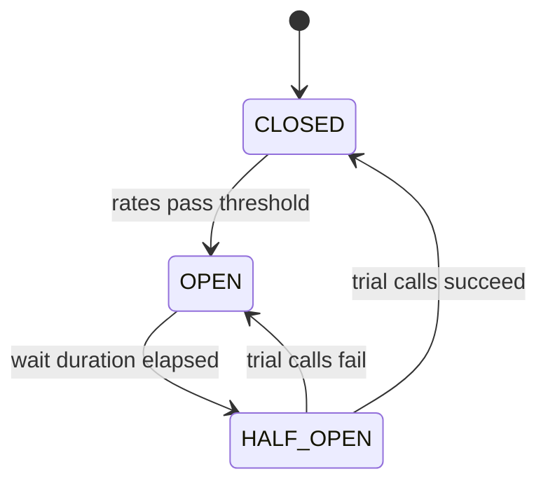

# Circuit Breakers in Spring Boot with Resilience4j

!!! note "In simple words"
    A circuit breaker is like the fuse in a fuse box. When a dependency keeps failing, the breaker trips and calls fail immediately, so your service stops wasting time on a broken neighbour. After a short wait, it tests the water again and resets if the dependency has recovered.

## Why it matters

A slow or failing dependency can freeze every caller that waits for it. A circuit breaker stops repeated calls to a failing dependency. Once enough calls fail, the breaker opens and calls fail fast. That protects the caller's threads and gives the dependency room to recover. In Spring Boot the standard library is Resilience4j.

Interviewers ask about this to check that you can reason about the three states, what the fallback must do, and how retries and timeouts interact with the breaker.

## How it works

### The three states

A circuit breaker is a state machine with three states:

| State | Behaviour | Moves to |
|---|---|---|
| `CLOSED` | Calls pass through, and failures are counted in a sliding window | `OPEN` when the failure rate or the slow-call rate passes its threshold |
| `OPEN` | Calls are rejected at once with `CallNotPermittedException` | `HALF_OPEN` after `waitDurationInOpenState` |
| `HALF_OPEN` | A limited number of trial calls are allowed through | `CLOSED` if the trials succeed, `OPEN` if they fail |



The breaker decides only once its sliding window holds enough data. Set `minimumNumberOfCalls`, so that one early failure cannot open the circuit.

### Dependencies

For Spring Boot 3 with annotations, add the Resilience4j Boot starter. It provides the annotations, the metrics, and the auto-configuration, and it needs Spring AOP on the classpath.

```xml
<dependency>
    <groupId>io.github.resilience4j</groupId>
    <artifactId>resilience4j-spring-boot3</artifactId>
</dependency>
<dependency>
    <groupId>org.springframework.boot</groupId>
    <artifactId>spring-boot-starter-aop</artifactId>
</dependency>
```

If you prefer the Spring Cloud abstraction, add `spring-cloud-starter-circuitbreaker-resilience4j` and use `CircuitBreakerFactory`, shown later. Both options use Resilience4j underneath. Do not choose Hystrix for new code.

### Configuration

Each named instance has its own settings, and the `name` attribute on an annotation refers to it.

```yaml
resilience4j:
  circuitbreaker:
    instances:
      payments:
        slidingWindowType: COUNT_BASED
        slidingWindowSize: 20
        minimumNumberOfCalls: 10
        failureRateThreshold: 50          # percent of failed calls that opens the circuit
        slowCallDurationThreshold: 2s
        slowCallRateThreshold: 80         # percent of slow calls that opens the circuit
        waitDurationInOpenState: 30s
        permittedNumberOfCallsInHalfOpenState: 3
  retry:
    instances:
      payments:
        maxAttempts: 3
        waitDuration: 500ms
        retryExceptions:
          - org.springframework.web.client.ResourceAccessException
  timelimiter:
    instances:
      payments:
        timeoutDuration: 3s
```

The time-limiter key is `timelimiter`, not `timelimit`. Any setting you leave out falls back to a library default. Check those defaults before quoting a number in an interview.

### The sliding window: how failures are counted

A breaker does not judge the whole history of a dependency. It keeps a sliding window of recent call outcomes and decides from that window alone. The window type sets what "recent" means:

- `COUNT_BASED` keeps the last N calls. With `slidingWindowSize: 20`, the window always holds the 20 most recent outcomes.
- `TIME_BASED` keeps the calls from the last N seconds. With `slidingWindowSize: 60`, a call from two minutes ago has no effect. Outcomes are grouped into per-second buckets, so the window moves in steps rather than call by call.

Two thresholds read the window. The `failureRateThreshold` is the percentage of failed calls in the window. The `slowCallRateThreshold` is the percentage of calls slower than `slowCallDurationThreshold`. When either rate reaches its threshold, the breaker opens. Neither rate is checked until the window holds at least `minimumNumberOfCalls` outcomes. The first few calls therefore never open the circuit on their own.

A worked example, with `COUNT_BASED`, `slidingWindowSize: 10`, `minimumNumberOfCalls: 5`, and `failureRateThreshold: 50`:

1. Calls 1 and 2 succeed, and calls 3, 4, and 5 fail. The window now holds 5 outcomes, so the rate is checked. Three of five failed is 60 percent, which reaches 50, so the breaker opens.
2. Had the window held only 4 outcomes, the rate would not be checked at all, however many of them failed.
3. If the breaker had stayed closed, later successes would push the old failures out of the window. After 10 successes, the window holds none of the failures, and the failure rate is 0 percent.

The window size and the traffic must fit together. A `TIME_BASED` window of 60 seconds with `minimumNumberOfCalls: 10` never opens on a route that gets 2 calls a minute, because the minimum is never reached. Choose the window from the real request rate of the dependency, and check it with load tests.

```yaml
resilience4j:
  circuitbreaker:
    instances:
      inventory:
        slidingWindowType: TIME_BASED
        slidingWindowSize: 60          # seconds
        minimumNumberOfCalls: 10
        failureRateThreshold: 50
```

### Annotating a call

The circuit breaker wraps a method that calls the dependency. The fallback method must have the same return type and the same parameters, plus an extra trailing `Throwable` (or subclass) parameter. The example below uses Spring's `RestClient` and was not compiled here.

```java
import io.github.resilience4j.circuitbreaker.annotation.CircuitBreaker;
import io.github.resilience4j.retry.annotation.Retry;
import org.springframework.stereotype.Service;
import org.springframework.web.client.RestClient;

record ChargeRequest(String orderId, long cents) { }
record PaymentReceipt(String orderId, String status) { }

@Service
class PaymentClient {

    private final RestClient http;

    PaymentClient(RestClient.Builder builder) {
        this.http = builder.baseUrl("https://payments.example.com").build();
    }

    @CircuitBreaker(name = "payments", fallbackMethod = "unavailable")
    @Retry(name = "payments")
    public PaymentReceipt charge(ChargeRequest request) {
        return http.post()
                .uri("/charges")
                .body(request)
                .retrieve()
                .body(PaymentReceipt.class);
    }

    // Called when the call fails, or when the circuit is open.
    PaymentReceipt unavailable(ChargeRequest request, Throwable cause) {
        return new PaymentReceipt(request.orderId(), "PENDING");   // record it for later processing
    }
}
```

The fallback is a decision, not just a default value. Returning `PENDING` tells the caller that the charge is not confirmed, so the order flow must handle that state. Never return "success" to hide a failure.

### Combining with a timeout

The `@TimeLimiter` annotation cancels a call that runs too long. It applies only to methods that return a `CompletableFuture` or a reactive type, because the time limit has to be enforced from outside the thread that runs the call.

```java
import java.util.concurrent.CompletableFuture;
import io.github.resilience4j.circuitbreaker.annotation.CircuitBreaker;
import io.github.resilience4j.timelimiter.annotation.TimeLimiter;
import org.springframework.stereotype.Service;

record Quote(String symbol, long priceCents) { }

@Service
class QuoteClient {

    @TimeLimiter(name = "quotes")
    @CircuitBreaker(name = "quotes", fallbackMethod = "staleQuote")
    public CompletableFuture<Quote> fetch(String symbol) {
        return CompletableFuture.supplyAsync(() -> new Quote(symbol, 10_000));   // stands in for a remote call
    }

    CompletableFuture<Quote> staleQuote(String symbol, Throwable cause) {
        return CompletableFuture.completedFuture(new Quote(symbol, -1));         // -1 marks an unknown price
    }
}
```

### Order of retry and circuit breaker

When both annotations sit on one method, Resilience4j applies `Retry` outside the `CircuitBreaker` by default. Each retry attempt therefore passes through the breaker, and the breaker records it. The order can be changed in configuration. If you are asked, state the default and say that it is configurable.

Retry only makes sense for failures that are safe to repeat. Retrying a charge that has no idempotency key can charge a customer twice. Pair the retry with an idempotency key, or limit it to connection failures.

### Programmatic use

Inject the registry to read a breaker's state and metrics, or to wrap code that is not on a bean method:

```java
import io.github.resilience4j.circuitbreaker.CallNotPermittedException;
import io.github.resilience4j.circuitbreaker.CircuitBreaker;
import io.github.resilience4j.circuitbreaker.CircuitBreakerRegistry;
import java.util.function.Supplier;
import org.springframework.stereotype.Service;

@Service
class StatusProbe {

    private final CircuitBreaker payments;

    StatusProbe(CircuitBreakerRegistry registry) {
        this.payments = registry.circuitBreaker("payments");
        payments.getEventPublisher()
                .onStateTransition(e -> System.out.println("payments: " + e.getStateTransition()));
    }

    String describe() {
        return payments.getState() + " failure rate " + payments.getMetrics().getFailureRate() + "%";
    }

    String guarded(Supplier<String> remoteCall) {
        Supplier<String> decorated = CircuitBreaker.decorateSupplier(payments, remoteCall);
        try {
            return decorated.get();
        } catch (CallNotPermittedException open) {
            return "circuit open";
        }
    }
}
```

`getMetrics().getFailureRate()` returns a `float` percentage. It returns `-1` until the breaker has recorded `minimumNumberOfCalls`. For dashboards, expose the state through Actuator metrics rather than through hand-written endpoints (see [Actuator and API Documentation](../09-spring-boot/actuator-and-api-docs.md)).

### Spring Cloud CircuitBreaker abstraction

The `CircuitBreakerFactory` API hides the library behind one interface. It suits code that might move between implementations, but it gives you less fine-grained Resilience4j configuration.

```java
import org.springframework.cloud.client.circuitbreaker.CircuitBreakerFactory;
import org.springframework.stereotype.Service;

record Stock(String sku, int available) {
    static Stock unknown(String sku) { return new Stock(sku, 0); }
}

@Service
class InventoryClient {

    private final CircuitBreakerFactory<?, ?> breakers;

    InventoryClient(CircuitBreakerFactory<?, ?> breakers) {
        this.breakers = breakers;
    }

    Stock stock(String sku) {
        return breakers.create("inventory")
                .run(() -> new Stock(sku, 42),          // stands in for the remote call
                     throwable -> Stock.unknown(sku));
    }
}
```

### Bulkhead and rate limiting

Two related Resilience4j annotations isolate or limit calls:

- `@Bulkhead` caps concurrent calls, either with a semaphore or with a dedicated thread pool. It stops one slow dependency from using every thread.
- `@RateLimiter` caps calls per time period. It protects a provider that enforces quotas.

Use them alongside the breaker when one dependency could otherwise drain shared resources.

### Migrating from Hystrix

Hystrix is in maintenance mode, and Spring Cloud recommends Resilience4j. The concepts map across directly, but the names and configuration differ.

| Hystrix | Resilience4j |
|---|---|
| `@HystrixCommand(fallbackMethod = ...)` | `@CircuitBreaker(name = ..., fallbackMethod = ...)` |
| `execution.isolation.thread.timeoutInMilliseconds` | `@TimeLimiter` with `timeoutDuration` |
| Thread-pool isolation by default | Semaphore isolation by default; thread pools through `@Bulkhead` |
| Properties per command key | YAML per named instance |

Thread-pool isolation costs threads and context switches. Resilience4j's default is lighter, so choose thread-pool isolation on purpose, only for a dependency that needs the stronger separation.

## Circuit breaker frameworks compared

Resilience4j is the library to learn for Spring Boot. It is lightweight, built from separate modules (circuit breaker, retry, rate limiter, bulkhead, time limiter), and it integrates with annotations and Spring Cloud. You may still meet other frameworks in older code or in other teams, so it helps to know them by name and to know why you would not start with them today.

| Framework | Style | When it was used |
|---|---|---|
| Netflix Hystrix | Annotation-based, with thread-pool or semaphore isolation | Netflix-style microservices and older Spring Cloud services. It is in maintenance mode, and Spring Cloud recommends Resilience4j. |
| Vavr | Functional library. `Try` wraps a call, and `recover` supplies the fallback | Teams that wanted fallbacks composed as values, without a breaker library |
| Failsafe | Plain Java policies that you compose yourself, with no Spring dependency | Standalone services and libraries that have no Spring container |
| Sentinel | Flow control and circuit breaking, with live rules and a dashboard | High-traffic systems that already run its control plane and need live tuning |

Hystrix's isolation model is the main difference from Resilience4j. Hystrix ran each dependency on its own thread pool by default. That gave strong isolation at the cost of threads and context switches. Resilience4j uses semaphores by default and adds a bulkhead when you want a pool. Mention this trade-off if an interviewer asks why the defaults changed.

### Choosing a framework

| Situation | Recommendation | Reason |
|---|---|---|
| A new Spring Boot service | Resilience4j | Spring integration, active maintenance, and modules you pick one at a time |
| Existing Hystrix code | Migrate to Resilience4j | Hystrix is in maintenance mode, and the concepts map across |
| A standalone Java service without Spring | Resilience4j core, or Failsafe | Both work without a container. Choose the one your team knows |
| A team that writes functional code | Resilience4j decorators on a `Supplier`, or Vavr for composition | Decorators fit a functional style without a second resilience library |
| An organisation already running Sentinel | Keep Sentinel for the gateway or the flows it governs | Its dashboard and rules are the reason to keep it, so do not add a second breaker to the same call |

Pick one library for each dependency. Two breakers on the same call path, each with its own counters and thresholds, make the behaviour hard to predict and hard to test.

### Combining patterns

Resilience patterns work together, and the order in which they wrap a call matters. Resilience4j's default decorator order, from outermost to innermost, is:

| Order | Pattern | What it does |
|---|---|---|
| 1 (outermost) | Retry | Repeats the whole inner chain for safe failures |
| 2 | Circuit breaker | Rejects calls fast when the breaker is open |
| 3 | Rate limiter | Caps calls per period for quota-limited providers |
| 4 | Time limiter | Cancels a future that runs too long |
| 5 | Bulkhead | Limits concurrent calls so one dependency cannot take every thread |
| 6 (innermost) | Your function | The actual remote call |

With this order, each retry attempt passes through the breaker, so the breaker counts every attempt. The order is configurable, so state the default and say that it can change if an interviewer asks.

A practical rule set:

- Put a timeout on every remote call, so no call waits forever.
- Retry only idempotent operations, with backoff, so retries do not pile up on a struggling service.
- Let the breaker open when retries keep failing, so callers stop waiting on a dependency that is down.
- Use a bulkhead for a dependency that is slow but usually healthy, so it cannot starve other calls.
- Make every fallback honest about what it returned, so a failed payment never looks like a success.

## Where it is used

- **Payment and card providers**, where a broken provider must not stall checkout.
- **Pricing and quote services**, where a stale answer is better than none, and the fallback says so.
- **Inventory lookups** on product pages, where a degraded response keeps the page usable.
- **Third-party APIs with quotas**, where rate limiters and breakers keep the integration within limits.

## Benefits

- **Fast failure**: callers get an answer at once instead of waiting on a dead dependency.
- **Recovery room**: while open, the breaker sends no traffic, so the dependency can recover.
- **Clear metrics**: state transitions and failure rates are visible through Actuator.
- **Composable**: retry, time limiter, rate limiter, and bulkhead can be combined on one method.

## Cons and limits

- **Thresholds need tuning**: wrong window sizes or minimums cause false opens or missed trips.
- **Fallbacks can hide failures** when they return success-looking values.
- **Low-traffic routes behave oddly**: the breaker may never reach its minimum call count.
- **Annotations depend on proxies**: calls from inside the same class skip the aspect.
- **Multiple breakers on one path** make behaviour hard to predict.
- **A breaker does not make a slow service fast.** It limits damage. Timeouts and capacity planning are still needed.

## Best practices

- **Set `minimumNumberOfCalls`** so one early error cannot open the circuit.
- **Return honest fallbacks**, such as `PENDING`, and make the caller handle them.
- **Give each dependency its own instance name**, so one failing service does not open the breaker for others.
- **Pair the breaker with a timeout** on the HTTP client, and with `@TimeLimiter` for futures.
- **Retry only idempotent calls**, and count the retry attempts in your design.
- **Watch the state metrics** and alert when a breaker stays open.
- **Test the states**, including open, half-open, and recovery, with a stubbed dependency.

!!! tip "Interview tip"
    **Q: Why would you combine retry, timeout, and circuit breaker?**
    A timeout stops a single call from hanging. A retry recovers from a brief blip, but only for safe operations. The circuit breaker stops retries from piling onto a dependency that is clearly down, and the fallback keeps the caller responsive. Mention that under the default ordering the breaker counts retry attempts, and that a fallback must be honest about what it returns.

## Common pitfalls

- Setting thresholds without `minimumNumberOfCalls`, so one early error opens the circuit.
- Writing a fallback that returns a success-looking value and hides a failed payment or write.
- Putting `@TimeLimiter` on a method that returns a plain value. It cannot be enforced that way.
- Retrying non-idempotent operations, which can duplicate side effects.
- Sharing one instance name across unrelated dependencies, so one failure opens the breaker for all of them.
- Expecting a breaker to fix a slow dependency. It limits damage, but the caller still needs timeouts and capacity planning.
- Forgetting that `CallNotPermittedException` is thrown in the open state, so a broad `RuntimeException` catch can hide the difference.

## Quick recap

- The breaker moves through `CLOSED`, `OPEN`, and `HALF_OPEN`. Set `minimumNumberOfCalls` so the decision has enough data.
- Use `resilience4j-spring-boot3` for annotations, and configure each named instance in YAML.
- A fallback has the same signature plus a `Throwable`, and it must not hide a failure.
- Pair `@CircuitBreaker` with `@TimeLimiter` for futures, and with `@Retry` for idempotent calls.
- Hystrix is in maintenance mode. Resilience4j is the supported choice for Spring Boot.

## Official documentation

- [Resilience4j documentation](https://resilience4j.readme.io/)
- [Spring Cloud CircuitBreaker reference](https://docs.spring.io/spring-cloud-circuitbreaker/reference/index.html)
- [Spring Boot reference documentation](https://docs.spring.io/spring-boot/reference/index.html)

**See also:** [Resilience Patterns](resilience-patterns.md) | [Spring Cloud](spring-cloud.md) | [Inter-Service Communication](inter-service-communication.md) | [Async and Threading](../09-spring-boot/spring-async-and-threading.md) | [HTTP Clients and Testing](../09-spring-boot/http-clients-and-testing.md)
