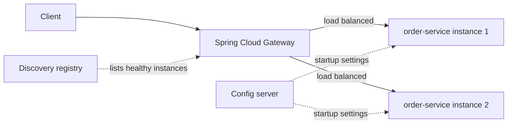

# Spring Cloud

!!! note "In simple words"
    A microservice system needs helpers around the services: something to find them, something to spread calls across copies, something to hold shared settings, a front door for outside traffic, and a way to follow a request. Spring Cloud is a set of Spring projects that provide those helpers.

## Why it matters

Each Spring Cloud component solves one specific problem. Interviewers ask about them because it shows whether you can match a component to a need. They also check whether you know that older tutorials use parts that have since changed or been retired. Always check the Spring Cloud release train that matches your Spring Boot version before choosing components.

## How it works

### Service discovery with Eureka

Instances register their network location with a registry, and clients look up the current instances of a service by name. Netflix Eureka is one registry, and Spring Cloud connects to it through the Eureka client and server. Consul and etcd are other common registries. Kubernetes has its own discovery through DNS and Service objects, so on Kubernetes you often do not need Eureka at all. For more on this, see [Service Discovery](service-discovery.md).

Instances register at startup and deregister at shutdown. Registries also rely on heartbeats, so a crashed instance disappears once its lease expires. Clients cache the list they receive, which means discovery is eventually consistent.

```yaml
eureka:
  client:
    service-url:
      defaultZone: http://discovery.example.com:8761/eureka/
```

### Client-side load balancing

Spring Cloud LoadBalancer picks an instance for each call from the list that discovery returns. Round-robin is the default. Random selection is also built in. Other strategies, such as least-connections, need a custom implementation, and the `ReactorLoadBalancer` interface is the extension point for that.

A load-balanced `WebClient` builder accepts a logical service name in the URI. The following examples use Spring WebFlux and were not compiled here.

```java
import org.springframework.cloud.client.loadbalancer.LoadBalanced;
import org.springframework.context.annotation.Bean;
import org.springframework.context.annotation.Configuration;
import org.springframework.web.reactive.function.client.WebClient;

@Configuration
class ClientConfig {

    @Bean
    @LoadBalanced
    WebClient.Builder loadBalancedWebClientBuilder() {
        return WebClient.builder();
    }
}
```

```java
import org.springframework.stereotype.Service;
import org.springframework.web.reactive.function.client.WebClient;
import reactor.core.publisher.Mono;

@Service
class InventoryClient {

    private final WebClient web;

    InventoryClient(WebClient.Builder builder) {
        this.web = builder.baseUrl("http://inventory-service").build();
    }

    Mono<String> stockFor(String sku) {
        return web.get().uri("/stock/{sku}", sku).retrieve().bodyToMono(String.class);
    }
}
```

Here `inventory-service` is a logical name that discovery resolves. It is not a host name.

### Centralised configuration

The Spring Cloud Config Server serves configuration over HTTP, usually from a Git repository. Clients fetch their settings at startup, by application name and profile. Git gives history, review, and rollback for configuration changes.

```java
import org.springframework.boot.SpringApplication;
import org.springframework.boot.autoconfigure.SpringBootApplication;
import org.springframework.cloud.config.server.EnableConfigServer;

@SpringBootApplication
@EnableConfigServer
public class ConfigServerApplication {
    public static void main(String[] args) {
        SpringApplication.run(ConfigServerApplication.class, args);
    }
}
```

Beans that must pick up new values without a restart are annotated with `@RefreshScope`. A refresh endpoint, or a bus message, then triggers the reload. Secrets should not sit in plain configuration files. Combine the config server with a secrets store, as described in [Secrets Management](../10-security/secrets-management.md).

### API gateway with Spring Cloud Gateway

Spring Cloud Gateway is the edge router for outside traffic. It matches requests with predicates, applies filters, and forwards each request to a target URI. A `lb://` target uses load balancing through discovery.

```yaml
spring:
  cloud:
    gateway:
      routes:
        - id: orders
          uri: lb://order-service
          predicates:
            - Path=/orders/**
          filters:
            - StripPrefix=1
```

Gateways commonly handle authentication, rate limiting, request size limits, and routing. Keep business logic out of the gateway. It should route traffic and enforce policy, but it should not decide what an order is. Gateway rate limiting usually uses a Redis-backed limiter, so the limit is shared by all gateway instances.

### Distributed tracing with Micrometer Tracing

Spring Cloud Sleuth is not available in Spring Boot 3. Its replacement is Micrometer Tracing. It creates trace and span IDs and passes them along across HTTP and messaging calls. You add a bridge to a tracing library (Brave or OpenTelemetry), and an exporter for Zipkin, Jaeger, or an OTLP-compatible backend.

```yaml
management:
  tracing:
    sampling:
      probability: 0.1
```

Sampling decides what fraction of requests get recorded. A low rate cuts cost and overhead. Always-on sampling is useful in development, and for specific routes that matter. Put trace and span IDs in the log lines too, so one request can be found in every service.

### How the pieces fit together



The gateway asks the registry for healthy instances and spreads requests across them. The config server supplies settings when each instance starts.

### Step by step

1. A service instance starts and registers with discovery.
2. A client or gateway resolves the logical name to the healthy instances.
3. The load balancer picks one instance for each call.
4. Configuration loads from the config server at startup. `@RefreshScope` beans reload when asked.
5. Tracing headers travel with each call, and spans are exported to the tracing backend.

## Where it is used

- **Microservice platforms** on virtual machines, where Eureka and Spring Cloud LoadBalancer handle discovery.
- **Public API fronts**, where Spring Cloud Gateway handles routing, authentication, and rate limits.
- **Teams with many services** that need one place for shared settings.
- **Spring Boot 3 systems** that need tracing across services, through Micrometer Tracing.

## Benefits

- **Consistent building blocks**: each component follows the same Spring programming model.
- **Less glue code**: discovery, balancing, and routing come from configuration.
- **Central configuration with history**: Git-backed settings can be reviewed and rolled back.
- **Tracing across services**: requests can be followed from edge to database.

## Cons and limits

- **Platform overlap**: on Kubernetes, the discovery role duplicates what the platform already gives.
- **Version alignment is strict**: Spring Boot and Spring Cloud must match on the release train.
- **Central components are critical**: a broken config server or gateway affects many services.
- **Refresh is not universal**: a bean that holds an old reference keeps the old value.
- **Tutorials go stale quickly**: many examples still use Sleuth, Ribbon, or Hystrix.

## Best practices

- **Use logical names** in every client, never fixed host names.
- **Keep secrets out of the config repository** and load them from a secrets store.
- **Keep the gateway thin.** Let it route and enforce policy, not run business rules.
- **Set sampling deliberately**, rather than leaving it at 100 percent in production.
- **Pair discovery with health checks**, so dead instances stop receiving traffic.
- **Use one discovery mechanism per environment**, and document which one applies.

!!! tip "Interview tip"
    **Q: Do you need Eureka on Kubernetes?**
    Usually not. Kubernetes Services already provide name-based discovery and load balancing. Spring Cloud components remain useful for configuration and routing, but the discovery role overlaps with the platform. Pick one discovery mechanism per environment, and be clear about which one applies.

## Common pitfalls

- Hard-coding host names in clients, which defeats discovery.
- Storing secrets in the configuration repository.
- Putting business rules into the gateway, which turns it into a bottleneck and a hidden service.
- Assuming a `@RefreshScope` bean updates everywhere. Anything holding the old reference keeps the old value.
- Following outdated tutorials that rely on Sleuth, Ribbon, or Hystrix on Spring Boot 3.
- Sampling at 100 percent in production without considering overhead and cost.
- Relying on discovery without health checks, so dead instances keep receiving traffic.

## Quick recap

- Eureka, Consul, or Kubernetes DNS maps logical service names to instances.
- Spring Cloud LoadBalancer picks an instance for each call, round-robin by default.
- The Config Server serves Git-backed settings, and `@RefreshScope` reloads selected beans.
- Spring Cloud Gateway routes outside traffic with predicates and filters.
- Micrometer Tracing replaces Sleuth on Spring Boot 3, with a bridge and an exporter.

## Official documentation

- [Spring Cloud project overview](https://spring.io/projects/spring-cloud)
- [Spring Cloud Gateway reference](https://docs.spring.io/spring-cloud-gateway/reference/index.html)
- [Spring Cloud Config reference](https://docs.spring.io/spring-cloud-config/reference/index.html)
- [Spring Cloud Commons reference](https://docs.spring.io/spring-cloud-commons/reference/index.html)

**See also:** [Resilience Patterns](resilience-patterns.md) | [Inter-Service Communication](inter-service-communication.md) | [Service Discovery](service-discovery.md) | [Kubernetes](../16-kubernetes/index.md)
